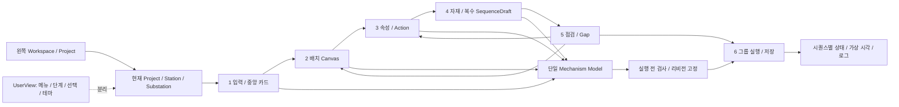

# Aurora Concept Designer — 텍스트 와이어프레임

문서 버전: v0.3 / 2026-11-08 KST.

[설계 제안] 이 문서는 화면 구조·정보 우선순위·상태/이동을 설명하는 텍스트/Mermaid 모형이다. 실제 앱 화면·생성 시안·실행 검증·최종 픽셀 디자인이 아니다. 앱 소스/외부 디자인 canvas를 생성하지 않았다. 확정 요구와 아래 레이아웃 세부안을 구별한다. 비공개 외부 노트 URL/UUID는 없다.

## 1. 확정 제약과 유지할 기준

- [확정] Equipment(Station)>Unit(Substation)>Device. Station은 장비 전체이며 Substation은 복수 시퀀스 동시 Play/Pause/Resume 단위다.
- [확정] 모든 단계의 왼쪽에서 Workspace/Project를 조작한다. 중앙은 항상 Canvas가 아니라 현재 작업에 맞는 뷰다. 라이브러리는 중앙 카드 목록이다.
- [확정] 도식과 AI 생성 실사풍 토글은 방향·anchor·전체 문맥과 설계/연결/상태를 유지하고 실제 촬영 아님을 표시한다.
- [확정] A 밝은 엔지니어링, B 어두운 관제, C 따뜻하고 차분한 테마를 선택한다. 동일한 조작/구조를 유지한다.
- [설계 제안] 기존 6단계 기준을 유지한다. 정확한 폭·grid 열수·패널 수·문구·수치·아이콘은 설계 제안이며 승인 범위 내 가역적 시제품 정책으로 적용 시 제안·변경 가능성을 기록한다. 모델 편집과 UserView 전환은 다르다.

## 2. WF-00 공통 IDE shell

연결: N01/N03/N05, C01/C03/C10, UX-01/09/12.

```text
┌ 제품명 · 현재 Project/미저장 · 현재 Station/Substation · 테마 A/B/C ┐
├ 왼쪽 Workspace/Project ┬ 중앙 상단 6단계/현재 목표/준비·미정 표시 ┤
│ 생성 / 열기 / 최근     │ 입력 → 배치 → Action → 자재/시퀀스 → 점검 → 실행 │
│ Workspace             ├ 현재 단계의 중앙 workspace ──────────────┤
│ ├ Project A *         │ 카드 OR Canvas OR 편집기 OR Gap OR 실행     │
│ │ └ Station           │ 관련 상세·근거·경고 (위치/접기 방식은 제안)    │
│ │   ├ Substation A    │                                          │
│ │   │ ├ Devices       │                                          │
│ │   │ └ Sequences     ├ 하단 이전 / 남은 항목 / 다음 / 관련 편집 이동 ┤
│ │   └ Substation B    │ 저장 상태 · 실행 문맥 · 오류/가정 요약        │
│ └ Project B           │                                          │
└───────────────────────┴──────────────────────────────────────────┘
```

[설계 제안] 왼쪽은 어느 중앙 뷰에서도 같은 역할을 유지한다. Project 탭과 트리의 선택·미저장 표시를 일치시킨다. 현재 단계/메뉴의 활성 표시와 실제 중앙 화면이 맞아야 한다. 실행중에는 조회 경로를 남기되 모델 편집 명령은 사유와 함께 차단한다. 오른쪽 상세는 별도 패널/중앙 분할/접이식 중 미정이며 상시 고정 요구가 아니다.

상태: 초기 빈 Workspace, 열기/저장중, 경로 누락, 미저장, 실행중 편집 잠금, Project 전환 취소. 현재 대상이 없는 실행 버튼은 비활성 사유를 설명한다.

## 3. WF-01 입력·중앙 에셋 라이브러리

연결: C02/C03, F1, N04, UX-02/08.

```text
[공통 왼쪽 IDE 유지] | [현재 단계: 1 입력·에셋]
[직접/라이브러리] [설계자료] [VC/USD]  (지원 범위/미구현 표시)
[AML 읽기] [검색] [장치/센서/복합유닛 분류] [도식 | AI 실사풍]
┌ 에셋 카드 ──────────┐ ┌ 에셋 카드 ──────────┐  열수는 제안
│ 도식 / AI 미리보기   │ │ 도식 / AI 미리보기   │
│ 이름 · 분류          │ │ 이름 · 분류          │
│ AI 생성/촬영 아님    │ │ AI 미준비→도식 대체  │
│ subset/CAEX/XSD상태 │ │ 검토/지원한계 표시    │
│ [상세] [프로젝트추가]│ │ [상세] [프로젝트추가]│
└─────────────────────┘ └─────────────────────┘
[선택 상세: 정의·속성·ports·Actions·출처/사용조건·대표범위]
[추출 후보표: 후보/출처위치/신뢰근거/사람확인/반영대상]
```

[설계 제안] 카드 미리보기 토글은 프로젝트 인스턴스 의미를 바꾸지 않는다. 실제 AML 파일 로드 결과와 지원 상태를 상세에서 확인한다. XML 구문/XSD/앱 의미 검사를 분리한다. ‘상세’는 읽기이며 ‘프로젝트 추가’가 명시적 변경이다. 저신뢰 추출 후보는 사람 배정 전에 확정 반영하지 않는다. 사진 수집이 아닌 생성 자료 경로를 기본으로 쓰되 출처/사용조건 확인은 계속 필요하다.

빈 상태는 읽기/직접 입력 안내, 실패는 위치/지원 한계와 기존 데이터 보존, 로딩은 실제 상태 표시다. 카드만 있고 파서가 없으면 실제 AML 읽기 완료라고 표시하지 않는다.

## 4. WF-02 배치·연결 Canvas

연결: F2, N01/N03/N04, UX-03/08.

```text
[공통 왼쪽 IDE] | [단계 2 배치·연결] [현재 Station/Substation]
[선택/이동/정렬] [Undo/Redo] [레이어] [도식 | AI 실사풍]
┌ Equipment(Station) ─────────────────────────────────┐
│ ┌ Unit(Substation) A ┐   물류/신호를 구별하는 연결    │
│ │ Device · ports    │───────────────────────────     │
│ │ 자식/Action 표시  │    ┌ Unit(Substation) B ┐      │
│ └───────────────────┘    │ Device · ports    │      │
│ 선택적 도면/탑뷰 배경    └───────────────────┘      │
└─────────────────────────────────────────────────────┘
[선택 속성/Signal/Position/Action/미정/Interlock 후보]
```

[확정] 배경 없이도 동작한다. Background/Units/Axis/I/O/Positions/Flow 레이어를 유지한다. [설계 제안] 레이어 숨김은 삭제가 아니다. 포트 anchor는 이미지 크기에 종속되지 않는 모델 문맥으로 유지한다. AI 이미지에 그려진 가짜 부품이 실제 Device가 되지 않는다. 실행중 편집 차단, 잘못된 포트/소속/누락 참조의 진단과 영향을 명확히 표시한다.

## 5. WF-03 속성·Action 편집/제공 능력표

연결: F3, N01, UX-04.

```text
[공통 왼쪽 IDE] | [단계 3 속성·Action] [현재 Substation]
[Devices] [Signals] [Positions] [Actions] (탭 구성은 제안)
[선택 대상: 종류/속성/수치·단위/출처/가정/확인]
[Action 목록] | [매개변수] [pre] [명령/자원] [post/완료] [금지조건]
[정의 검사] → [제공 능력표: 동작/Position/I/O/자재변화/제약/근거]
[문제/미정 → 관련 객체로 이동] [Interlock 후보: 사람 확인 필요]
```

단순 필드 입력 완료가 확정 사양은 아니다. 값과 가정/미정/null을 구별한다. 실제 I/O 주소가 없는 개념 Signal도 설계에 사용할 수 있다. 조건 언어/axis 상세는 미정이다. 삭제/수정 영향 단계와 후속 gate 재평가를 보여 준다. 자유 메모를 실행 조건으로 자동 취급하지 않는다.

## 6. WF-04 자재·시퀀스 편집

연결: F4/F5, N02, UX-05.

```text
[공통 왼쪽 IDE] | [단계 4 자재·시퀀스] [현재 Substation]
[자재: 개별/캐리어·크기/무게/상태·초기조건·투입간격]
[Unit 경로/Action-post 상태전이 연결]
[Substation 시퀀스 목록: Sequence A / Sequence B / 추가]
[Action 팔레트] → [선택 SequenceDraft 단계/전이/SFC]
[자연어 입력] → [등급/모호함/후보 확인] → [같은 Draft]
[요구/미정/Interlock 후보/Gap 연결]
```

[설계 제안] 목록은 Substation의 여러 시퀀스를 뜻한다. 선택 시퀀스 내부 병렬 구간과 다른 시퀀스를 시각적으로 구별한다. 그룹 실행은 WF-06에서 대상 목록을 확인한다. 자재 이동과 가공 상태 변화도 구별한다. AI가 필요 없는 구조 변환은 결정적으로 수행하며 미정 전이를 임의 true로 채우지 않는다.

## 7. WF-05 점검·Gap·근거

연결: F6/F7/F8, C08, UX-06/10.

```text
[공통 왼쪽 IDE] | [단계 5 점검] [분석 기준 리비전/재분석]
[필수 차단] [미정/가정] [사람확인] [일반 경고] [해결 접힘]
[Gap종류 | 관련 단계/객체 | 근거 | 수정제안 | 상태 | 이동]
[선택 근거/출처 위치/요구 vs 제공]
[Canvas로] [Configurator로] [Lab으로]  (가용/미구현 상태 구별)
[실행 준비: 가능/차단/미정] [Core 준비: 별도 계약/미확인]
```

부족 I/O/부족 Unit/미정 축 사양/간섭 후보/타이밍 병목을 유지한다. 복수 시퀀스 Device/공유 자재 충돌 진단은 실행 전 검사와 연결하되 정밀 물리 간섭 검증으로 부르지 않는다. 안전/간섭 자동 확정 닫힘 금지. 수정 후 일반 해결 행은 접고 근거는 남긴다. Lab 원본 적용·Export는 별도 사람 확인 경계를 유지한다.

## 8. WF-06 실행·저장·Substation 시퀀스 상태

연결: C04/C06, N02, UX-07/09.

```text
[공통 왼쪽 IDE] | [단계 6 실행·저장]
[대상 Station > Substation] [포함 시퀀스 수/목록] [실행규칙/리비전]
[실행 전 검사] [Play] [Pause] [Resume] [Reset: 제안] [저장]
[그룹 상태 / 가상 시각 / 편집 잠금 / 미정·차단 요약]
┌ Sequence A: 상태 · 현재 단계 · 완료/대기/오류 ┐
├ Sequence B: 상태 · 현재 단계 · 완료/대기/오류 ┤
└────────────────────────────────────────────┘
[시뮬레이션 문맥/자재·Signal 상태] [시간순 로그·관련 객체]
[저장 성공/실패·미저장] [실행 결과 ≠ 안전/Core/상용 전체 완료]
```

[설계 제안] 그룹의 Ready/Running/Paused/Completed/Blocked/Error와 시퀀스별 상태를 따로 표시한다. 그룹 집계/오류 전파는 미정이며 다수 시퀀스 중 하나만 완료했다고 그룹 전체를 완료로 표시하지 않는다. 공통 가상 시계·Pause 동결·초기조건 Reset은 제안 계약을 합의해 검수한다. 충돌 후보는 자원/시퀀스/단계와 이동 경로를 보여 준다. 실행 중 메뉴 탐색은 실행을 초기화하거나 편집 잠금을 풀지 않는다.

## 9. WF-07 공통 상세·미정·실행 차단·복구

```text
[작업 제목/현재 Project·대상]
[문제 유형: 필수누락 / 미정 / 가정 / 사람확인 / 미구현 / AI미준비]
[관련 객체/시퀀스/단계] [원인/출처/기준 리비전]
[가능한 행동: 관련 편집 / 재검사 / 도식 대체 / 재시도 / 취소]
[취소/닫기 → 원래 포커스·선택 복원]
```

연결: C05/C06/C08/C10, N03/N04/N05. 이 정보는 팝업/인라인/패널 중 제안 배치다. 사진/AI 미준비와 필수 실행 누락은 같은 차단 등급이 아니다. 저장 실패에서 완료 버튼을 저장 성공처럼 보이게 하지 않는다. 단순 경고 닫기가 사람 안전 확인이 되지 않는다. 외부 Export 파일/AI 요청은 Undo로 회수되지 않을 수 있음을 구별한다.

## 10. 이동/데이터 구조 모형 [설계 제안]



이 화살표는 화면/데이터 관계이며 실행 전이 알고리즘이 아니다. 실행중의 화면 조회와 모델 변경은 분리한다. 문서 모형으로 검사 통과·실제 화면 동작을 증명하지 않는다.

## 11. 크기·스크롤·키보드·테마 검수안

[설계 제안] 1280×800 및 1920×1080 기본 배율에서 QLT-01~08을 검수한다. 정확 패널 폭/카드 열수는 고정하지 않는다. 작은 화면에서는 중앙 보조 상세를 접고 왼쪽 Workspace/Project의 접근/복원 경로와 현재 단계·주요 행동을 유지한다. 의도하지 않은 전체 가로 스크롤과 버튼 겹침은 결함 후보로 기록한다.

트리·카드·표·로그의 스크롤 소유를 명시하고 Canvas pan은 별도다. 긴 한글/이름은 줄바꿈/상세 경로를 제공한다. Tab 순서, 포커스 가시성, 팝업 복귀, 색 외 상태 표시를 A/B/C 모두 검수한다. 대비 수치는 실제 값으로 측정하며 인증/상용 완성으로 과장하지 않는다.

## 12. 변경 운영과 미정

WF ID·연결 UX/요구/AC, 변경일, 구조 제안/확정 차이, 실제 앱 대조 결과를 함께 관리한다. 실제 이미지/앱 검증 결과는 이 문서에 아직 기록하지 않았다. 미정: 패널 폭/접기, grid 열수, 입력 폼/조건 언어, 그룹 오류/Reset, 앵커 정량 오차, 최소 지원 배율, 최종 디자인 토큰과 사용자 시험. 초기 관리자는 요구/UX/개발 인계를 통합하고 작업이 커질 때 별도 UX 역할을 분리하는 안을 권고한다.
