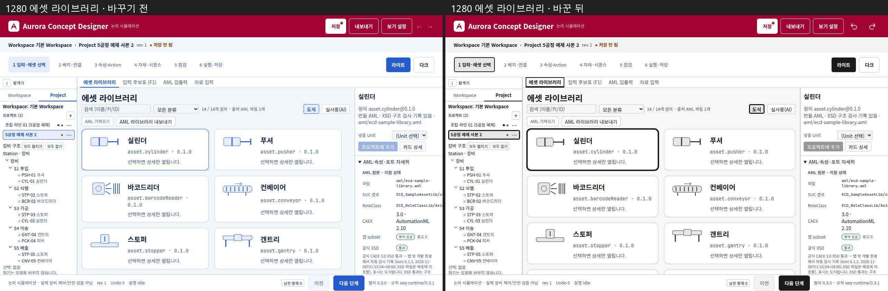
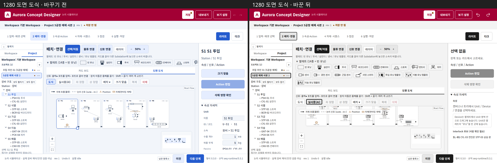
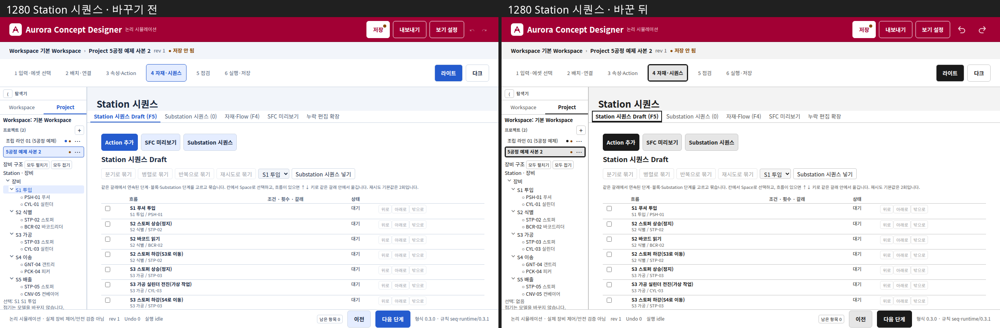
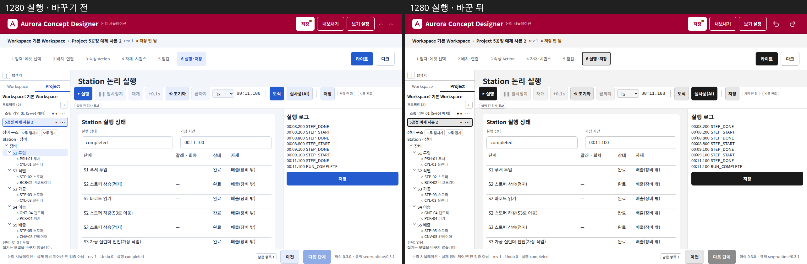
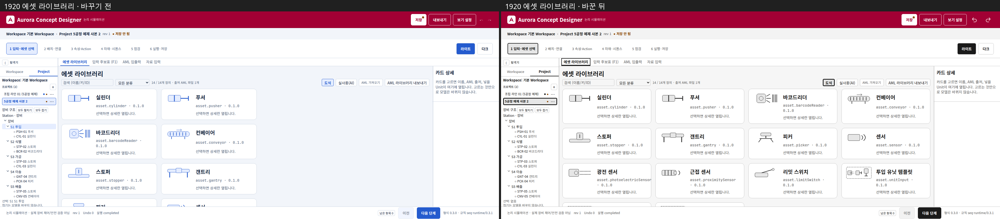
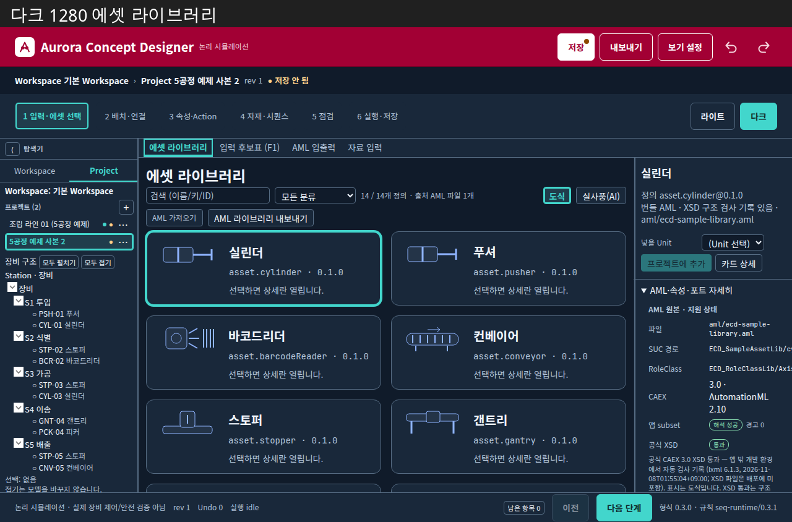
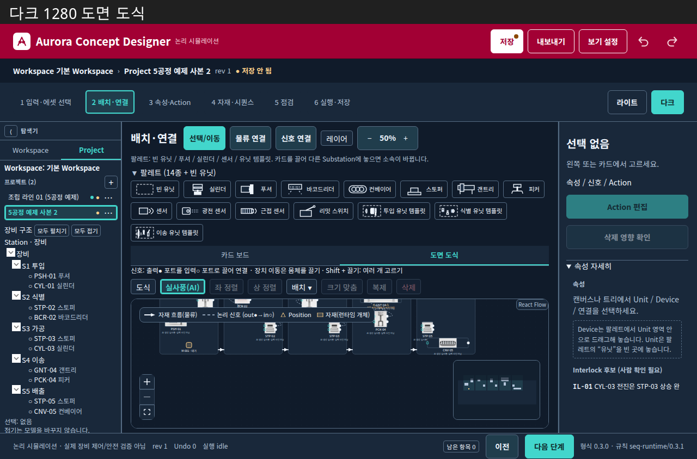
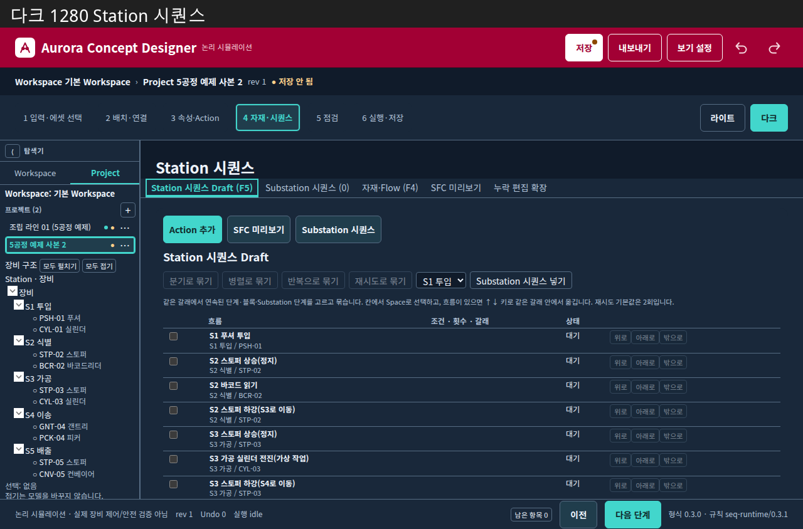
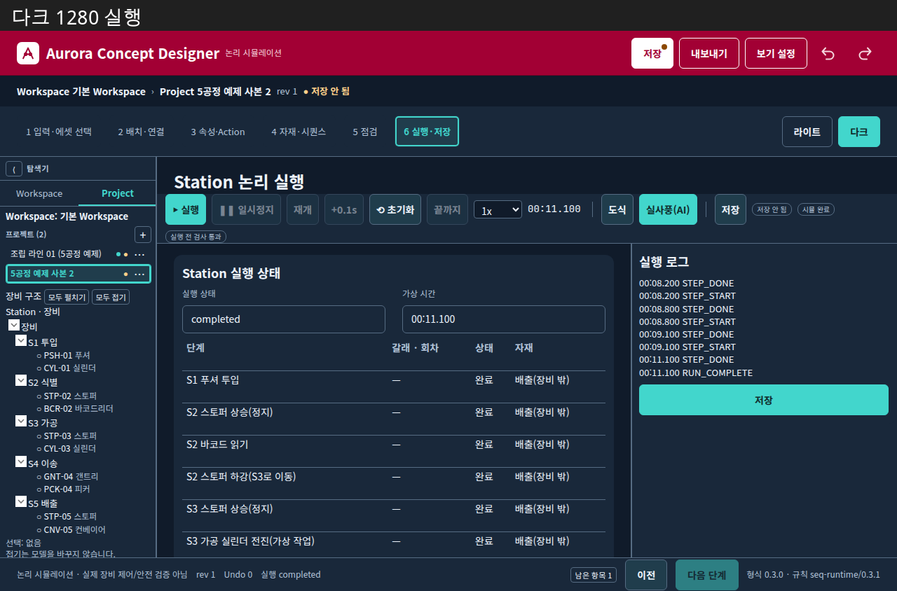
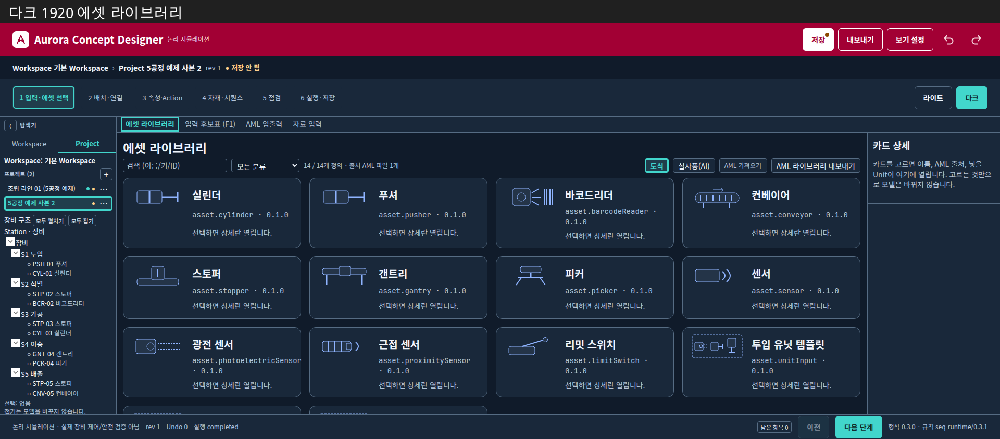

# TURN-026 라이트 테마를 Black / Gray 로 · 카드와 팔레트를 폭에 맞게 · Undo / Redo 아이콘 키우기

상태: 검토 후보. 사람 검수 전. 정식 릴리스가 아니다. 앱 버전은 `0.3.0-prototype` 그대로다. 파일 형식은 `0.3.0`. 실행 규칙은 `seq-runtime/0.3.1`. `release/` 와 `README.md` 는 바꾸지 않았다. CI 확인 대기 — 루카가 Actions로 확인.

## 한 일

- 라이트 테마(`THEMES.A`)의 배경 · 패널 · 캔버스 · 테두리 · 글자 · 흐린 글자 · 강조 · 선택 · 격자 · 테마 단추를 흰색 · 회색 · 검정으로 바꿨다. 강조는 `#1a1a1a`, 그 위 글자는 `#ffffff` 다. 헤더 빨강과 성공 · 경고 · 위험 색은 그대로다. 다크 테마와 보관 테마 C 도 그대로다.
- 라이트 단추에 직접 적혀 있던 푸른 색은 `--accent` · `--on-accent` · `--selected` · `--text` · `--theme-light-*` · `--theme-dark-*` 토큰을 쓰게 했다.
- 카드 도식의 라이트 선 · 채움은 `#2C2C2C` · `#E6E6E6` 이다. 다크는 `slot-theme.css` 의 `#8FB4FF` · `#243448` 그대로다. 트리 꺾쇠 선은 `#747474` 다.
- 에셋 라이브러리 카드는 `repeat(auto-fill, minmax(280px, 1fr))` 다. 1280 폭은 2열, 1600 폭은 3열, 1920 폭은 4열이다.
- 2단계 팔레트는 단계 폭을 가득 쓰고 다음 줄로 이어진다. 1280 폭에서 15개(14종 + 빈 유닛)가 3줄이고, 가로 스크롤은 없다. 도면 칸은 그 아래 남은 높이를 쓴다.
- 헤더 실행 취소 · 다시 실행은 44×44px 단추 안의 24×24 인라인 SVG 다. 선 굵기는 2px 이고, 화살표 전체가 상자 안에 들어온다. 글자를 확대해서 그리던 방식은 상자에 잘려 빼었다. 비활성 색은 헤더의 흐린 글자 `#F5D6DE` 이고 불투명도는 1이다. `aria-label` · 단축키 · 비활성 조건은 그대로다.
- 선택된 단계 · 카드 · 트리 · 단추는 채움만으로 구분하지 않는다. 안쪽 2px 강조 테두리, 또는 카드의 2px 테두리와 바깥 고리, 또는 트리의 왼쪽 3px 막대다.

## 화면

Chrome 1280×800, 1920×800. 예제는 5공정. 라이트는 바꾸기 전과 후를 나란히 붙였다. 다크는 바꾼 뒤다. 헤더의 실행 취소 아이콘이 보인다.

1280 도면에서 팔레트 15개의 오른쪽 끝은 1000px 이고, 뷰포트 가로 스크롤은 없다.

## 하지 않은 것

- 다크 테마 색, 헤더 색, 로고
- `src/ui/Canvas.tsx` 의 포인터 · 키 처리, `src/model/`
- 화면 문구, 의존성
- `release/`, `README.md`
- 도면 유닛 그림자의 `rgba(16, 24, 40, .06)`. TURN-005 검사가 그 값을 고정해 두었다.

## 확인 필요

- 색이 보기 좋은지, 선택 테두리가 충분한지는 Matthew 검수다.
- 도면 최소 높이를 360px 에서 0 으로 바꿔, 팔레트가 줄을 바꿔도 도면이 단계 안에 남게 했다. 1280 에서 도면 높이는 약 239px 이다. `tests/ui-turn009.test.tsx` 의 그 한 줄만 고쳤다.
- 로컬 `npm run typecheck`, `npm test` (38파일 509개), `npm run build` 는 통과했다. 빌드가 만든 `release/` 변경은 되돌렸다. CI 판정은 이 기록이 아니다.
