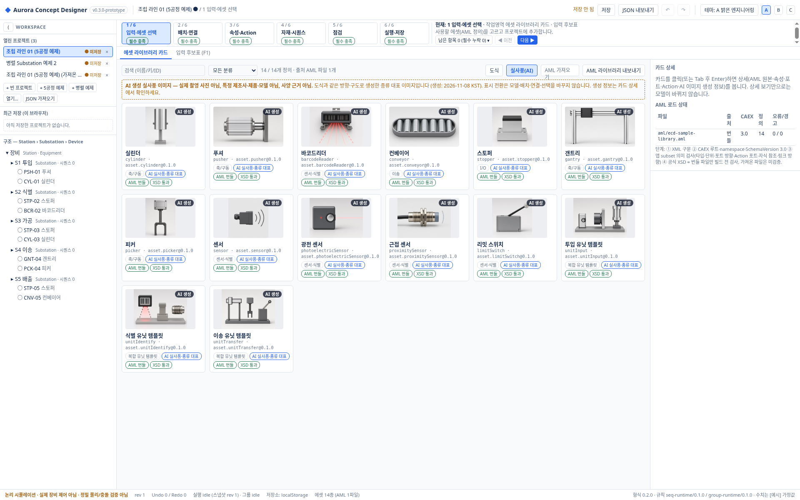
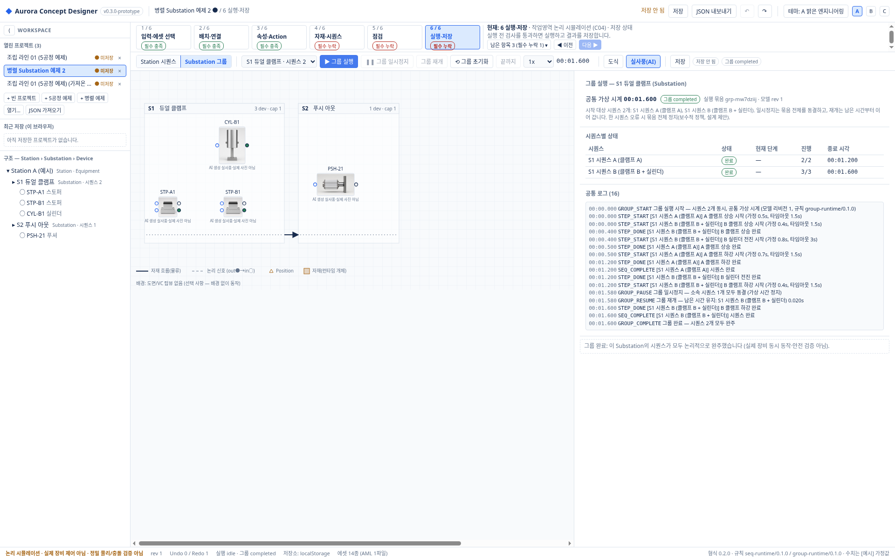
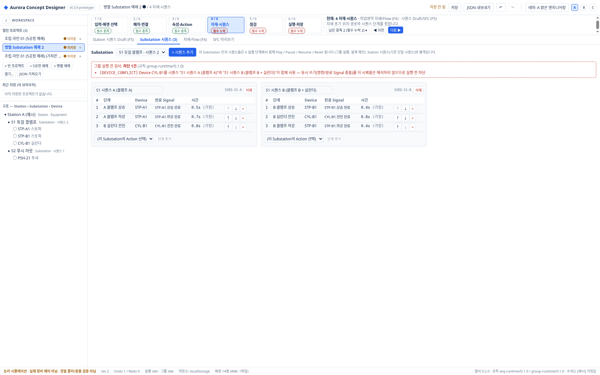

# Aurora Concept Designer v0.3 사용자 매뉴얼 (초보자용 단계별 실무 안내)

| 항목 | 내용 |
|---|---|
| 대상 앱 | Aurora Concept Designer 웹 시제품 **v0.3.0-prototype** (이전 이름: 장비 컨셉 디자이너) |
| 기준 소스 | 공개 저장소 `kotaeji/EquipCD_G`의 앱 commit `28c962f` (전체 `28c962fbc24a1c7827dcdce6840a2836d8956457`). 매뉴얼 작성 시점(2026-11-08)에 이 commit은 PR #1로 `main`에 병합되어 있었음(병합 commit `7351018`, 앱 파일 내용 동일) |
| 매뉴얼 버전 | UM-0.3.0-r1 · 작성 2026-11-08 (KST) |
| 대상 독자 | 앱을 처음 쓰는 설비 개념 설계 담당자 (프로그래밍 지식 불필요, 2.4절 개발 실행만 Node.js 필요) |
| 권장 위치 | 저장소 `docs/user-manual/USER-MANUAL.ko.md` (같은 원고의 PDF: `docs/user-manual/USER-MANUAL.ko.pdf`) |

> **먼저 꼭 읽기 — 이 앱이 하지 않는 것**
>
> - 이 앱은 설비의 **초기 컨셉을 그려 보고 동작 순서를 논리적으로 시뮬레이션**하는 시제품입니다.
> - **실제 장비 제어, PLC 연결, 정밀 물리·충돌 검증, 안전 판정, AI 최적화, Aurora Core 실제 연동은 하지 않습니다.**
> - 화면의 모든 시간·크기·무게·타임아웃은 **[예시] 가정값**이며 실제 장비 사양이 아닙니다.
> - "실사풍(AI)" 이미지는 **AI로 생성한 일반형 예시이며 실제 촬영 사진이 아닙니다.**

## 목차

- [0. 이 매뉴얼 읽는 법](#0-이-매뉴얼-읽는-법)
- [1. v0.3 범위와 성격](#1-v03-범위와-성격)
- [2. 시작하기](#2-시작하기)
- [3. 화면 구성](#3-화면-구성)
- [4. 6단계 작업 흐름 한눈에 보기](#4-6단계-작업-흐름-한눈에-보기)
- [5. 프로젝트 만들기와 전환](#5-프로젝트-만들기와-전환)
- [6. 1단계 입력·에셋 선택 — 라이브러리 검색과 카드](#6-1단계-입력에셋-선택--라이브러리-검색과-카드)
- [7. 2단계 배치·연결](#7-2단계-배치연결)
- [8. 3단계 속성·Action과 계층 Station › Substation › Device](#8-3단계-속성action과-계층-station--substation--device)
- [9. 4단계 자재·시퀀스 — 개략 시퀀스 만들기](#9-4단계-자재시퀀스--개략-시퀀스-만들기)
- [10. 5단계 점검](#10-5단계-점검)
- [11. 6단계 실행·저장 — Station 실행과 Substation 그룹 실행](#11-6단계-실행저장--station-실행과-substation-그룹-실행)
- [12. 따라 하기 실습 — 샘플 3가지](#12-따라-하기-실습--샘플-3가지)
- [13. 보기 설정 — 도식/실사풍(AI) 토글과 테마 A/B/C](#13-보기-설정--도식실사풍ai-토글과-테마-abc)
- [14. 저장·열기와 JSON 내보내기/가져오기](#14-저장열기와-json-내보내기가져오기)
- [15. Mac과 Windows 사이에서 쓰기](#15-mac과-windows-사이에서-쓰기)
- [16. AML 지원 범위와 표준 관련 제한](#16-aml-지원-범위와-표준-관련-제한)
- [17. 문제 해결](#17-문제-해결)
- [18. 미구현·미검증 목록](#18-미구현미검증-목록)
- [19. 검증 기록 요약](#19-검증-기록-요약)
- [부록 A. 기능 ID와 절 번호 — 향후 요구 추가 규칙](#부록-a-기능-id와-절-번호--향후-요구-추가-규칙)
- [부록 B. 용어](#부록-b-용어)
- [부록 C. PDF 생성 재현법과 버전 갱신 체크리스트](#부록-c-pdf-생성-재현법과-버전-갱신-체크리스트)
- [부록 D. 참조 파일](#부록-d-참조-파일)

## 0. 이 매뉴얼 읽는 법

- 화면에 보이는 버튼·탭 이름은 **「」** 로 표시합니다. 예: 「▶ 그룹 실행」. 라벨은 기준 commit의 소스(`src/ui/*.tsx`)와 실제 GUI 스크린샷에서 그대로 옮겼습니다.
- 각 기능에는 기능 ID(`MF-xx`)를 붙였습니다. 요구가 추가되면 부록 A 규칙에 따라 번호를 이어 붙입니다.
- 상태 표기:

| 표기 | 뜻 |
|---|---|
| **[구현]** | v0.3 앱에 실제로 있는 기능. 이 매뉴얼은 [구현] 기능에만 조작 절차를 적습니다. |
| **[미구현·예정]** | 앱에 없는 기능. 조작 방법을 적지 않습니다. "예정"은 요구 문서에 있거나 앞으로 다룰 후보라는 뜻이며 일정 약속이 아닙니다. |
| **[미검증]** | 앱에는 있지만 해당 환경·경로에서 실제 화면으로 확인한 기록이 없는 것. |
| **[설계 제안]** | 요구 문서상 사용자 확정 전인 규칙을 시제품이 임시로 구현한 것. 바뀔 수 있습니다. |

- 이 매뉴얼의 검증 관련 내용은 저장소에 이미 있는 기록(README, `BROWSER-VERIFICATION.md`, `REQUIREMENTS-VERIFICATION.md`)을 옮긴 것입니다. 매뉴얼 작성 때 테스트나 브라우저 검수를 새로 실행하지 않았습니다.

## 1. v0.3 범위와 성격

### 1.1 이 앱은 무엇인가 (MF-01)

설비를 **Station(장비) › Substation(구간 유닛) › Device(실린더·센서 등)** 계층으로 그리고, Device의 명령/완료 Signal과 동작 시간을 정한 뒤, 정해진 순서대로 **가상 시간 논리 시뮬레이션**을 돌려 보는 **초기 컨셉 설계용 웹 시제품**입니다.

- 실행 결과는 "정해 둔 가정값으로 순서가 논리적으로 끝까지 진행되는가"만 보여 줍니다.
- 실행 완료 화면에도 "논리 시뮬레이션 완료 (실제 장비 안전·정밀 물리 검증·Core Export 준비 완료 아님)"이라고 표시됩니다.
- 화면 아래 상태 표시줄에는 항상 "논리 시뮬레이션 · 실제 장비 제어 아님 · 정밀 물리/충돌 검증 아님"이 보입니다.

### 1.2 v0.3에서 새로 생긴 것

| 요구 ID | 내용 | 매뉴얼 절 |
|---|---|---|
| N01 | Station › Substation › Device 표기 (내부 Equipment/Unit ID·파일 키는 그대로) | 8.1 |
| N02 | Substation마다 시퀀스 여러 개 + 그룹 실행/일시정지/재개/초기화, 충돌 사전 차단 | 9.3, 11.3 |
| N03 | 6단계 모두에서 보이는 왼쪽 Workspace/Project 탐색기 | 3.2, 5 |
| N04 | 14종 AI 생성 실사풍 이미지와 「도식 / 실사풍(AI)」 토글 | 6.4, 13.1 |
| N05 | 룩앤필 정리(테마 A/B/C 유지). 상용 완성·접근성 인증 주장 아님 | 13.2 |
| — | 프로젝트 파일 형식 0.2.0 (0.1.x 파일은 열 때 자동 변환) | 14.4 |

### 1.3 v0.3에서 하지 않는 것 (요약)

WPF 버전, 실제 장비 제어, 정밀 물리, 개별 시퀀스만 일시정지, 여러 Substation 동시 실행, 시퀀스 사이 대기/동기화, 동적 자원 예약, Aurora Core 매핑(실제 Export)은 **[미구현]** 입니다. 전체 목록은 18절을 보세요.

## 2. 시작하기

### 2.1 README 먼저 확인하기

1. GitHub에서 저장소 [`kotaeji/EquipCD_G`](https://github.com/kotaeji/EquipCD_G)를 엽니다.
2. 첫 화면의 README에서 **현재 버전 표기**와 「빠른 시작」 안내를 확인합니다. 이 매뉴얼은 v0.3.0-prototype 기준이므로, README의 버전이 다르면 매뉴얼이 오래되었을 수 있습니다.
3. 저장소의 브랜치·PR 상태(병합 여부 등)는 시간이 지나면 바뀝니다. 이 매뉴얼은 그 상태를 단정하지 않으므로 GitHub 화면에서 직접 확인하세요.

### 2.2 권장: 로컬 HTTP로 열기 (실제 검증된 방법)

앱은 `release/equipment-concept-designer.html` **파일 하나**(약 2.26 MB, React 번들·AML 라이브러리·도식·AI 이미지 모두 포함, 외부 CDN 없음)로 배포됩니다.

1. GitHub에서 `release/equipment-concept-designer.html` 파일을 열고 「Download raw file」로 내려받습니다. (또는 저장소 전체를 받습니다. 15.1절)
2. 내려받은 HTML을 새 폴더 `release` 안에 넣고(저장소 전체를 받았다면 이미 `release` 폴더에 있음), `release`의 **상위 폴더**에서 터미널을 열어 다음 중 하나를 실행합니다.

```bash
python3 -m http.server 8766 --directory release
# 또는 (Node.js가 있으면) README 안내:
npx serve release
```

3. Chrome 주소창에 `http://localhost:8766/equipment-concept-designer.html`을 입력합니다(`npx serve`를 썼다면 터미널에 표시된 주소).
4. 화면 왼쪽 위에 "Aurora Concept Designer v0.3.0-prototype"이 보이면 성공입니다.

> **검증 범위**: v0.3 화면은 Linux Chrome에서 로컬 정적 HTTP 서버(`http://127.0.0.1:8767/…`)로 연 상태로 작업 에이전트가 실제 브라우저 화면을 조작해 GUI 검수했습니다(1920×1200, 사람 검수 아님). Mac/Windows Chrome에서의 검수 기록은 없습니다. Windows에서 `python3` 명령이 없으면 Python 설치 상태에 따라 `py` 등 다른 이름일 수 있습니다 **[미검증]**.

### 2.3 파일 직접 열기(file://, 더블클릭) — 미검증

- 내려받은 HTML을 더블클릭해 Chrome으로 여는 방법도 README에 안내되어 있습니다.
- 그러나 **v0.3에서는 file:// 직접 열기를 GUI로 검수하지 않았고, Mac/Windows에서도 검수하지 않았습니다.** (v0.2 빌드에서 Linux headless Chrome 자동 조작으로 열기·저장·새로고침이 동작한 기록만 있습니다.)
- Chrome의 file:// localStorage는 로컬 HTML 파일끼리 저장 영역을 공유할 수 있습니다. 중요한 작업은 반드시 「JSON 내보내기」로 백업하세요(14.3절).
- 문제가 생기면 2.2절 HTTP 방식으로 바꿔 여세요.

### 2.4 (선택) 개발 서버로 실행

소스에서 직접 실행하려면 Node.js 20 이상이 필요합니다(Python 불필요).

```bash
git clone https://github.com/kotaeji/EquipCD_G.git
cd EquipCD_G
npm ci
npm run dev        # http://localhost:5173
```

### 2.5 처음 열었을 때 보이는 것

- 브라우저에 저장된 프로젝트가 없으면 **「조립 라인 01 (5공정 예제)」** 가 열리고, 1단계 「입력·에셋 선택」 화면이 나옵니다.
- 저장된 프로젝트가 있으면 가장 최근 저장 프로젝트가 열리고, 마지막으로 보던 단계가 복원됩니다(실행 상태는 복원하지 않음).

## 3. 화면 구성



*그림 1. 1단계 「입력·에셋 선택」 화면 (`docs/screenshots/v0.3-library-ai.png`, 실제 GUI 캡처)*

### 3.1 상단 헤더

| 위치 | 라벨 | 하는 일 |
|---|---|---|
| 왼쪽 | Aurora Concept Designer · v0.3.0-prototype | 제품명·버전 |
| 가운데 | `프로젝트 이름 ● / 단계 번호 단계 이름` | 현재 프로젝트와 단계. ●는 저장 안 된 변경이 있다는 뜻 |
| 오른쪽 | 「저장 안 됨」/「저장됨 시각」 | 저장 상태 |
| 오른쪽 | 「저장」 | 브라우저 저장소(localStorage)에 저장 (14.1) |
| 오른쪽 | 「JSON 내보내기」 | 프로젝트를 `.ecd.json` 파일로 내려받기 (14.3) |
| 오른쪽 | 「↶」「↷」 | 실행 취소/다시 실행 (Ctrl/Cmd+Z, Ctrl/Cmd+Shift+Z 또는 Ctrl+Y) |
| 오른쪽 | 「테마: A 밝은 엔지니어링」, 「A」「B」「C」 | 테마 전환 (13.2) |

### 3.2 왼쪽 탐색기 「WORKSPACE」 (MF-02)

모든 단계(1~6)에서 항상 보입니다. 「⟨」 버튼으로 접고 「⟩」로 펼칩니다.

- **열린 프로젝트 (N)**: 열려 있는 프로젝트 목록. 「● 미저장」은 저장 안 된 변경, 「×」는 닫기.
- 버튼: 「+ 빈 프로젝트」, 「+ 5공정 예제」, 「+ 병렬 예제」, 「열기…」, 「JSON 가져오기」
- **최근 저장 (이 브라우저)**: 최근 저장한 프로젝트 최대 6개.
- **구조 — Station › Substation › Device**: 현재 프로젝트의 트리. 항목을 클릭(또는 Tab 후 Enter)하면 선택됩니다.

### 3.3 단계 바

- 「1 / 6 입력·에셋 선택」 … 「6 / 6 실행·저장」 버튼 6개. 각 버튼 아래 배지: 「필수 충족」, 「필수 누락」, 「재확인 필요」, 「확인됨 ✓」.
- 오른쪽 안내: 「현재: 번호 단계명」, 작업영역, 목표.
- 「남은 항목 N (필수 누락 M) ▾」: 누르면 남은 항목 목록이 열립니다. 각 항목은 「필수 데이터 누락」, 「가정값 존재」, 「미정」, 「선택 사항 미확보」, 「사람 확인 필요」로 구분되고, 「편집으로 이동」 버튼으로 해당 위치로 갑니다.
- 「◀ 이전」, 「다음 ▶」: 단계 이동. 필수 데이터가 빠진 상태로 「다음 ▶」을 누르면 원인 목록 창이 뜨고 「머무르며 수정」 또는 「확인 없이 다음 화면 보기」를 고를 수 있습니다. 확인 없이 넘어가도 실행은 6단계의 실행 전 검사에서 따로 차단됩니다.
- 실행 중에는 「실행 중 — 모델 편집 잠금 (조회만)」 배지가 보이고 모델 편집과 Undo가 막힙니다.

### 3.4 중앙 작업영역과 상태 표시줄

- 중앙은 현재 단계의 작업 화면입니다(4절 표).
- 아래 상태 표시줄: 경고 문구, `rev`(모델 리비전), `Undo n / Redo n`, 실행 상태, `저장소: localStorage`(쓸 수 없으면 `메모리 전용`), `에셋 14종 (AML 1파일)`, `형식 0.2.0 · 규칙 seq-runtime/0.1.0 / group-runtime/0.1.0`.

## 4. 6단계 작업 흐름 한눈에 보기

| 단계 (실제 라벨) | 작업영역 | 목표 (화면 문구) | 하위 탭 | 매뉴얼 절 |
|---|---|---|---|---|
| 1 입력·에셋 선택 | 에셋 라이브러리 카드 · 입력 후보표 | 사용할 에셋(AML 정의)을 고르고 프로젝트에 추가합니다. | 「에셋 라이브러리 카드」, 「입력 후보표 (F1)」 | 6 |
| 2 배치·연결 | Canvas (F2) | Unit 안에 Device를 배치하고 물류/신호를 연결합니다. | (툴바·팔레트·Canvas·속성 패널) | 7 |
| 3 속성·Action | 속성/Action 편집기 (F3) | 필요 사양, 명령·완료 Signal, 동작/타임아웃을 채웁니다. | 「속성」「신호」「포지션」「Action」「정의 체크」 | 8 |
| 4 자재·시퀀스 | 자재/Flow (F4) · 시퀀스 Draft/SFC (F5) | 자재 초기 위치·경로와 시퀀스 단계를 정합니다. | 「Station 시퀀스 Draft (F5)」「Substation 시퀀스 (N)」「자재·Flow (F4)」「SFC 미리보기」 | 9 |
| 5 점검 | Gap 목록 (F6) · 진단 · Export 미리보기 | 차단 사유·미정·사람 확인 항목을 확인합니다. | 「Gap (F6) N」「진단·저장·AML」「Export 미리보기 (F8)」「Evolution Lab (F7)」 | 10 |
| 6 실행·저장 | 논리 시뮬레이션 (C04) · 저장 상태 | 실행 전 검사를 통과하면 실행하고 결과를 저장합니다. | 「Station 시퀀스」/「Substation 그룹」 | 11 |

> 6단계 구성과 단계 판정 규칙은 요구 문서상 **[설계 제안]** 입니다. 단계 이동·도식/실사풍 토글·테마는 브라우저의 보기 설정(UserView)에만 저장되고 프로젝트 파일에는 들어가지 않습니다.

## 5. 프로젝트 만들기와 전환

### 5.1 새 프로젝트 만들기 (MF-03) [구현]

왼쪽 탐색기에서 하나를 누릅니다.

| 버튼 | 결과 |
|---|---|
| 「+ 빈 프로젝트」 | 「새 프로젝트 N」 (Station 이름 「장비」, Substation 없음) |
| 「+ 5공정 예제」 | 「5공정 예제 사본 N」 — 기본 5공정 Station 예제 사본 (12.1 실습) |
| 「+ 병렬 예제」 | 「병렬 Substation 예제 N」 — Substation 하나에 병렬 시퀀스 2개 (12.2 실습) |

- 새 프로젝트는 **아직 저장되지 않은 상태**(「● 미저장」)로 열립니다. 남기려면 「저장」 또는 「JSON 내보내기」를 하세요.
- 프로젝트 이름과 Station 이름을 바꾸는 화면 기능은 v0.3에 없습니다 **[미구현]**. Substation·Device·Action 등의 이름은 3단계 「속성」에서 바꿀 수 있습니다(8.2).

### 5.2 프로젝트 전환 (MF-04) [구현]

1. 「열린 프로젝트」 목록에서 원하는 프로젝트 이름을 클릭합니다(또는 Tab으로 이동 후 Enter).
2. 실행 중인 프로젝트에서 다른 프로젝트로 바꾸면, 원래 프로젝트의 실행은 **자동 일시정지**되고 "실행을 일시정지하고 전환했습니다 (돌아와서 재개 가능, 자동 재개 없음)" 안내가 뜹니다.
3. 원래 프로젝트로 돌아와 「재개」(그룹은 「그룹 재개」)를 눌러 이어 갑니다. (GUI 검수: 그룹 실행 중 전환 → 자동 일시정지 → 복귀 후 재개 통과)

### 5.3 프로젝트 닫기

- 이름 옆 「×」를 누릅니다. 저장 안 된 변경이 있으면 「저장하지 않고 닫기」 / 「취소 (변경 유지)」 중에서 고릅니다.

## 6. 1단계 입력·에셋 선택 — 라이브러리 검색과 카드

### 6.1 라이브러리 검색 (MF-05) [구현]

1. 단계 바에서 「1 / 6 입력·에셋 선택」을 누릅니다. 하위 탭은 「에셋 라이브러리 카드」.
2. 검색창(「검색 (이름/키/ID)」)에 이름 일부를 입력합니다. 예: `바코드`.
3. 분류 목록에서 「모든 분류」, 「축/구동」, 「I/O」, 「센서·식별」, 「이송」, 「복합 유닛 템플릿」 중 하나를 고르면 좁혀집니다.
4. 「14 / 14개 정의 · 출처 AML 파일 1개」처럼 현재 표시 개수가 보입니다.

번들 라이브러리 14종: 실린더, 푸셔, 바코드리더, 컨베이어, 스토퍼, 갠트리, 피커, 센서, 광전 센서, 근접 센서, 리밋 스위치, 투입 유닛 템플릿, 식별 유닛 템플릿, 이송 유닛 템플릿.

### 6.2 카드 보기와 상세 (MF-06) [구현]

- 카드에는 이미지, 이름, `키 · ID@버전`, 배지(분류, 「AI 실사풍·종류 대표」, 「AML 번들」/「AML 가져옴」, 「XSD 통과」/「XSD 미검증」)가 있습니다.
- 카드를 클릭(또는 Tab 후 Enter)하면 오른쪽 「카드 상세」에 AML 원본(파일·SUC 경로·RoleClass·CAEX), 속성, 포트, Action, (템플릿이면) 자식·링크·규칙, 시각 자료 정보가 나옵니다.
- **상세 보기만으로는 모델이 바뀌지 않습니다.** 모델을 바꾸는 것은 「프로젝트에 추가」뿐입니다.

### 6.3 프로젝트에 추가 (MF-07) [구현]

- **유닛 템플릿**(투입/식별/이송): 상세에서 「프로젝트에 추가」를 누르면 새 Substation(Unit)과 자식 Device 3개가 생깁니다. 위치는 2단계 Canvas에서 확인합니다.
- **단일 Device**(실린더 등): 상세의 「넣을 Unit」에서 Substation을 고른 뒤 「프로젝트에 추가」를 누릅니다. Device는 Unit 안에만 놓을 수 있으므로, Substation이 없으면 먼저 유닛 템플릿을 추가하거나 2단계에서 「빈 유닛」을 배치하세요.
- 실행 중에는 추가가 막힙니다(「실행 중 — 조회만 가능, 추가·수정 차단」).
- 잘못 추가했으면 「↶」(Ctrl/Cmd+Z)로 되돌립니다.

> 주의: 유닛 템플릿의 규칙으로 생긴 사전조건(예: 광전 센서 감지=true)은 시제품에서 센서 신호를 켜는 주체가 없어, **템플릿 유닛의 Action을 시퀀스에 넣고 실행하면 PRE_UNMET으로 멈춥니다**(알려진 제약). 실행 확인은 기본 5공정 모델과 병렬 예제로만 되어 있습니다.

### 6.4 AI 생성 실사풍 이미지 14종 (MF-08) [구현]

- 「실사풍(AI)」을 누르면 14종 모두 AI로 생성한 실사풍 이미지가 보이고, 카드마다 「AI 생성」 배지가 붙습니다.
- 위쪽 안내: "AI 생성 실사풍 이미지 — 실제 촬영 사진 아님, 특정 제조사·제품·모델 아님, 사양 근거 아님".
- 카드 상세 「시각 자료」에서 생성 도구, 생성일(2026-11-08 KST), 방향·구도, 구도 참고, 생성 지시(brief), 사용 조건([미정]) 등을 볼 수 있습니다. 배지: 「실제 촬영 사진 아님」, 「정확 모델 일치: 아니오」, 「대표 범위: 종류(class)」, 「검토: 에이전트 대조 · 사람 검수 전」.
- v0.2 실제 사진은 출처 이력으로만 남아 있으며, 상세의 접힌 영역 「이전 참고 사진 (v0.2 출처 이력 — 기본 표시 안 함)」을 펼쳐야 보입니다.
- **이 이미지를 제품 선정·사양 근거로 쓰지 마세요.**

### 6.5 AML 가져오기/내보내기 (MF-09) [구현]

- 「AML 가져오기」: `.aml`/`.xml` 파일을 골라 정의를 추가합니다. 결과 창에 XML 구문, CAEX SchemaVersion, 앱 subset 오류/경고, "공식 XSD: 미검증 (브라우저 내 미실행)"이 따로 표시됩니다. 오류 없는 정의만 추가되고 기존 정의·열린 프로젝트는 바뀌지 않습니다.
- 가져온 AML은 **이 브라우저에만** 보관됩니다. 다른 PC·브라우저에서는 그 정의를 쓴 프로젝트가 열리지 않을 수 있습니다(16절).
- 「AML 라이브러리 내보내기」: 현재 로드된 정의 전체를 `ecd-library-export.aml`로 내려받습니다.

### 6.6 입력 후보표 (F1) [구현, GUI 미검증]

하위 탭 「입력 후보표 (F1)」에서 대상·종류·소속·신뢰도·출처를 직접 입력한 후보를 사람이 확인/거절하고 「반영 미리보기」 후 반영합니다. 문서(PDF/DWG/XLSX)·USD 자동 추출은 **[미구현]** 입니다.

## 7. 2단계 배치·연결

> 이 절의 조작(연결·레이어·정렬·삭제 등)은 자동 테스트로 규칙이 확인되어 있고, v0.1 빌드에서 일부(이동·Undo·팔레트 배치)만 실제 화면으로 확인했습니다. v0.3 GUI 검수 항목에는 포함되지 않았습니다.

### 7.1 팔레트로 배치 (MF-10) [구현]

1. 「2 / 6 배치·연결」을 누릅니다. 왼쪽 「팔레트 (14종 AML 정의 + 빈 유닛) — 드래그」가 보입니다.
2. 「빈 유닛」을 Canvas 빈 곳으로 끌어 놓으면 새 Substation(Unit)이 생깁니다.
3. Device(예: 실린더)는 **Substation 상자 안으로** 끌어 놓습니다. Unit 밖에 놓으면 거부됩니다.
4. 유닛 템플릿을 끌어 놓으면 Unit + 자식 Device가 함께 생깁니다.

### 7.2 이동과 소속 변경 [구현]

- 「선택/이동」 모드에서 상자를 끌어 옮깁니다. Shift(또는 Cmd/Ctrl)를 누른 채 클릭해 여러 개 선택 후 「좌 정렬」·「상 정렬」이 가능합니다.
- Device를 다른 Substation 위로 옮기면 「…의 소속 Unit 변경?」 창이 뜹니다: 「소속 변경 + 이동」, 「좌표만 이동 (소속 유지)」, 「취소」.

### 7.3 연결 [구현]

- **물류 연결**: 「물류 연결」 → 출발 Substation 클릭 → 도착 Substation 클릭.
- **신호 연결**: 「신호 연결」 → 출력(out) 포트 클릭 → 입력(in) 포트 클릭. 방향이 맞지 않으면 거부됩니다.
- 연결 중 「Esc」로 취소합니다.

### 7.4 보기·삭제 [구현]

- 「레이어 ▾」: Background / Units / Axis / I/O / Positions / Flow 표시 끄기·켜기 (숨김은 삭제가 아니고 시뮬레이션 제외도 아님).
- 「−」「+」: 줌 50~200%.
- 「삭제」 또는 Delete/Backspace 키: 「… 삭제 — 참조 영향 확인」 창에서 영향(Action·시퀀스 단계·연결·자재 경로)을 보고 「참조 해제 후 삭제」. 다른 Action이 참조하던 조건은 "미정" 조건으로 바뀌어 실행이 차단됩니다. Undo로 되돌릴 수 있습니다.

> 알려진 표시 문제: 1920 폭에서도 Canvas는 내부 가로 스크롤이 생기며, 스크롤 전에는 오른쪽 끝 Substation이 오른쪽 속성 패널 뒤에 가려질 수 있습니다. 가로 스크롤하면 보입니다.

## 8. 3단계 속성·Action과 계층 Station › Substation › Device

### 8.1 계층 이해하기 (MF-11) [구현]

| 화면 이름 | 내부 이름 (파일 키) | 개수 | 예 (병렬 예제) |
|---|---|---|---|
| Station | Equipment | 프로젝트당 1개 | 「Station A (예시)」 |
| Substation | Unit | 여러 개 | 「S1 듀얼 클램프」, 「S2 푸시 아웃」 |
| Device | Device | Substation 안에 여러 개 | `STP-A1`, `STP-B1`, `CYL-B1`, `PSH-21` |

- 화면 표기만 Station/Substation으로 바뀌었고, 기존 ID·파일 키·AML은 그대로입니다. Canvas 위 라벨은 기존 Unit 이름을 씁니다.
- 탐색기 트리에서 Substation 옆에 「Substation · 시퀀스 N」이 표시됩니다. 유닛 템플릿으로 만든 Substation은 이름 뒤에 템플릿 표시 기호(겹친 두 사각형 모양)가 붙습니다.

### 8.2 속성 편집하기 (MF-12) [구현, 일부 GUI 확인]

1. 「3 / 6 속성·Action」을 누릅니다.
2. 왼쪽 탐색기 트리에서 Substation 또는 Device를 클릭합니다.
3. 편집기 탭에서 값을 채웁니다.

| 탭 | 하는 일 | 주요 버튼 |
|---|---|---|
| 「속성」 | 이름, 사양 값·단위·가정 여부 (빈 값 = 미정) | 「Device 삭제(영향 확인)」/「Unit 삭제(영향 확인)」 |
| 「신호 N」 | 개념 Signal(방향·역할·주소 미정 유지) | 「+ 입력(명령)」「+ 출력(완료)」「+ 센서」 |
| 「포지션 N」 | 위치(가정값) | 「+ Position」 |
| 「Action N」 | 동작 시간, 타임아웃, 명령 Signal, 완료 Signal, 목표 Position, 전제(pre) 조건, 완료 후(post) 검증 조건, 자재 변화 | 「+ Action」「+ 조건」「시퀀스 끝에 추가」「Action 삭제」 |
| 「정의 체크」 | 정의 누락 확인 | — |

- 오른쪽에 「제공 능력표 — Substation 이름 (F3-03)」이 자동으로 만들어집니다.
- 「이 단계 남은 항목」에서 완료 Signal·타임아웃 미정 등을 확인하고 「선택」으로 이동합니다.
- **시퀀스에서 쓰는 Action의 완료 Signal이나 타임아웃이 비어 있으면 실행이 차단됩니다**(임의로 true 처리하지 않음).
- Interlock 후보는 「확인」/「거절」/「미확인」을 사람이 직접 고릅니다(자동 확정 없음).

## 9. 4단계 자재·시퀀스 — 개략 시퀀스 만들기

### 9.1 Station 시퀀스 Draft — 개략 시퀀스 (MF-13) [구현, 편집 GUI 미검증]

Station 전체의 **순차 단계 목록**입니다. 기본 5공정 예제는 이 시퀀스(12단계)를 씁니다.

1. 「4 / 6 자재·시퀀스」 → 하위 탭 「Station 시퀀스 Draft (F5)」.
2. 왼쪽 「제공 Action」 목록(「모든 Unit」으로 필터 가능)에서 Action을 오른쪽 표로 끌어 놓습니다. 3단계 「Action」 탭의 「시퀀스 끝에 추가」로도 넣을 수 있습니다.
3. 순서는 행을 끌거나 「↑」「↓」로 바꾸고, 「×」로 삭제합니다.
4. 표의 「타임아웃」 칸에서 그 단계만의 타임아웃을 덮어쓸 수 있습니다.
5. (선택) 오른쪽 「구조화 문장 입력 (결정적 변환 · AI 미사용)」에 한 줄에 한 단계씩 적고 「변환 미리보기」 → 모호한 줄은 사람이 선택 → 「확정된 줄만 시퀀스에 추가」.

- **순차 실행만** 지원합니다. 한 시퀀스 안의 분기·병렬·루프, 자연어 Dictation·AI 해석은 **[미구현]** 입니다.
- 하위 탭 「SFC 미리보기」는 표시 전용입니다.

### 9.2 자재·Flow (MF-14) [구현, GUI 미검증]

「자재·Flow (F4)」에서 「+ 자재 정의」로 자재를 만들고 초기 위치·초기 상태·경로·투입 간격 등을 정합니다. **실행에는 자재 정의가 정확히 1개**여야 합니다(다중 자재 [미구현]).

### 9.3 Substation 시퀀스 — 병렬 시퀀스 만들기 (MF-15) [구현, 설계 제안]

한 Substation 안에서 **여러 시퀀스를 만들어 6단계에서 함께 실행**합니다. Station 시퀀스와는 별개입니다.

1. 「4 / 6 자재·시퀀스」 → 하위 탭 「Substation 시퀀스 (N)」.
2. 「Substation」 목록에서 대상(예: 「S1 듀얼 클램프 · 시퀀스 2」)을 고릅니다.
3. 「+ 시퀀스 추가」를 누르면 시퀀스 카드가 생깁니다. 카드 위 이름 칸에서 이름을 바꿀 수 있고, 「삭제」로 시퀀스를 지웁니다.
4. 카드 아래 「(이 Substation의 Action 선택)」에서 Action을 고르고 「단계 추가」를 누릅니다. **이 Substation 소속 Device의 Action만** 고를 수 있습니다.
5. 「↑」「↓」로 순서를 바꾸고 「×」로 단계를 지웁니다.
6. 위쪽 「그룹 실행 전 검사」가 「통과」인지 확인합니다. 「차단 N건」이면 목록의 코드를 보고 고칩니다(17절).

실행 전에 차단되는 경우(규칙 `group-runtime/0.1.0`, 설계 제안):

| 코드 | 원인 | 고치는 법 |
|---|---|---|
| `NO_SUB_SEQUENCES` / `NO_STEPS` | 시퀀스 또는 단계가 없음 | 시퀀스·단계를 추가 |
| `DEVICE_OUTSIDE_SUBSTATION` | 다른 Substation의 Device 사용 | 해당 단계 삭제 |
| `NO_COMPLETE_SIGNAL`, `DURATION_UNDEFINED`, `TIMEOUT_UNDEFINED`, `CAPACITY_UNDEFINED` | 완료 Signal·시간·타임아웃·수용 개수 미정 | 3단계에서 값 채우기 |
| `CONDITION_UNDEFINED` | 미정 조건 | 조건을 구체화하거나 제거 |
| `DEVICE_CONFLICT` | **같은 Device를 두 시퀀스가 사용** | 한쪽 단계 삭제 또는 Undo (12.3 실습) |
| `SHARED_MATERIAL_CONFLICT` | 자재를 다루는 시퀀스가 2개 이상 | 자재를 다루는 시퀀스를 1개로 |

- 다른 시퀀스의 진행을 **기다리는 조건은 지원하지 않습니다**. 조건이 맞지 않으면 기다리지 않고 즉시 `PRE_UNMET` 오류가 납니다.

## 10. 5단계 점검

### 10.1 하위 탭 (MF-16) [구현, GUI 일부만 확인]

| 하위 탭 | 내용 |
|---|---|
| 「Gap (F6) N」 | 규칙 기반 Gap 목록(부족/미정/사람 확인 후보), 근거·수정 제안. 「재분석」, 「이동」, 「숨김」, 「사람 확인」, 「복원」. 안전 관련 행은 자동으로 닫히지 않습니다. |
| 「진단·저장·AML」 | 참조 진단, 가져오기에 실패한 원본 파일의 「격리 보관함 (거부된 가져오기 원본)」(「원본 그대로 다운로드」), AML 상태 |
| 「Export 미리보기 (F8)」 | **읽기 전용 미리보기**. 실제 Aurora Core Export·SignalMap·역매핑은 [미구현] |
| 「Evolution Lab (F7)」 | "이번 시제품에서 미구현" 안내만 [미구현] |

- Gap 판정 규칙·임계값은 승인 전 시제품 가정입니다. 간섭 후보는 2D 도식 상자 겹침 기준이며 **물리·안전 검증이 아닙니다.**

## 11. 6단계 실행·저장 — Station 실행과 Substation 그룹 실행

### 11.1 실행 대상 고르기

「6 / 6 실행·저장」 화면 맨 왼쪽의 「Station 시퀀스」 / 「Substation 그룹」 중 하나를 고릅니다. 둘은 **동시에 돌릴 수 없습니다**(한쪽이 실행·일시정지 중이면 먼저 초기화).

### 11.2 Station 시퀀스 실행 (MF-17) [구현]

| 버튼 | 동작 |
|---|---|
| 「▶ 실행」 | 실행 전 검사 후 시작. 통과하지 못하면 "실행 준비 실패: …" 안내 |
| 「❚❚ 일시정지」 | 가상 시간 동결 |
| 「재개」 | 남은 시간부터 이어서 진행 |
| 「+0.1s」 | 일시정지 중 가상 0.1초만 진행 |
| 「⟲ 초기화」 | 실행 시작 시점의 초기 조건으로 복원 (Undo와 별개) |
| 「끝까지」 | 실행 중에만 활성. 남은 단계를 즉시 계산 |
| 속도 `0.25x`~`4x` | 화면 재생 속도만 바꿈. 결과에는 영향 없음 |

- 오른쪽 패널에 실행 상태·로그가 나오고, 「검증용 오류 주입 (시뮬 설정)」으로 "결과 실패"·"완료 신호 미발생"을 일부러 넣어 오류 처리(TIMEOUT 등)를 확인할 수 있습니다.
- 툴바의 배지: 「저장됨/저장 안 됨」, 「시뮬 완료」 등, 「실행 전 검사 통과/미통과」.

### 11.3 Substation 그룹 실행·일시정지·재개·초기화 (MF-18) [구현, 설계 제안]



*그림 2. 「Substation 그룹」 실행 완료 화면 (`docs/screenshots/v0.3-group-complete.png`, 실제 GUI 캡처)*

1. 「Substation 그룹」을 누릅니다.
2. 옆 목록에서 Substation을 고릅니다(예: 「S1 듀얼 클램프 · 시퀀스 2」).
3. 「▶ 그룹 실행」: 그 Substation의 모든 시퀀스가 **같은 가상 시계로 동시에** 시작합니다. 차단되면 "그룹 실행 전 검사 차단: …" 안내와 함께 오른쪽에 「실행 전 검사 — 차단 N건」 목록이 보입니다.
4. 「❚❚ 그룹 일시정지」: **묶음 전체**가 동결됩니다(개별 시퀀스만 멈추는 기능은 없음).
5. 「그룹 재개」: 남은 시간부터 이어 갑니다. 로그에 `GROUP_RESUME 그룹 재개 — 남은 시간 유지: …`가 남습니다.
6. 「끝까지」: 실행 중에만 활성. 남은 부분을 즉시 계산합니다.
7. 「⟲ 그룹 초기화」: 그룹 시작 시점의 초기 조건으로 되돌립니다.

- 오른쪽 「그룹 실행 — 이름 (Substation)」: 공통 가상 시계, 「그룹 상태」 배지, 실행 묶음 ID·모델 rev.
- 「시퀀스별 상태」 표: 시퀀스 / 상태(「대기」「진행 중」「완료」「오류」「그룹 정지」) / 현재 단계 / 진행 / 종료 시각.
- 「공통 로그 (N)」: `GROUP_START`, `STEP_START`, `STEP_DONE`, `SEQ_COMPLETE`, `GROUP_PAUSE`, `GROUP_RESUME`, `GROUP_COMPLETE` 등.
- 한 시퀀스에서 오류(`PRE_UNMET`/`TIMEOUT`/`POST_UNMET`/`READ_FAILED`/`CAPACITY_FULL`)가 나면 **묶음 전체가 정지**하고 나머지는 「그룹 정지」가 됩니다(보수적 정책, 설계 제안).
- 그룹 실행 상태는 저장되지 않으며 다시 열어도 자동 재개하지 않습니다.
- 그룹 실행 중에도 모델 편집·Undo는 막힙니다.

### 11.4 결과 저장

실행 결과(로그·순간 상태)는 프로젝트 파일에 저장되지 않습니다. 툴바의 「저장」은 **모델**을 저장합니다(14절).

## 12. 따라 하기 실습 — 샘플 3가지

### 12.1 실습 A: 기본 5공정 Station 예제 — 11.100 s (MF-19)

1. 탐색기에서 「+ 5공정 예제」를 누릅니다(또는 처음 열린 「조립 라인 01 (5공정 예제)」 사용).
2. 「6 / 6 실행·저장」 → 「Station 시퀀스」.
3. 「▶ 실행」 → (기다리거나) 「끝까지」.
4. 확인: 가상 시간 **`00:11.100`**, 로그 `RUN_COMPLETE`, 자재가 장비 밖(배출)으로 나감, 오류 0.
5. 「⟲ 초기화」로 `00:00.000`으로 되돌립니다.

> 기본 예제: Substation 5개(S1 투입·S2 식별·S3 가공·S4 이송·S5 배출), Device 10개, 자재 1개, 12단계 순차. 시간은 모두 [예시] 가정값입니다. (GUI 검수: v0.3에서 RUN_COMPLETE 11.100 s 통과)

### 12.2 실습 B: 병렬 Substation 예제 — A 1.2 s / B 1.6 s (MF-20)

1. 탐색기에서 「+ 병렬 예제」를 누릅니다. Station 「Station A (예시)」, Substation 「S1 듀얼 클램프」(Device STP-A1·STP-B1·CYL-B1)와 「S2 푸시 아웃」(PSH-21).
2. (확인용) 「4 / 6 자재·시퀀스」 → 「Substation 시퀀스 (3)」에서 S1의 시퀀스 2개를 봅니다.
   - 「S1 시퀀스 A (클램프 A)」: A 클램프 상승 0.5 s → A 클램프 하강 0.7 s
   - 「S1 시퀀스 B (클램프 B + 실린더)」: B 클램프 상승 0.4 s → B 실린더 전진 0.8 s → B 클램프 하강 0.4 s
3. 「6 / 6 실행·저장」 → 「Substation 그룹」 → 「S1 듀얼 클램프 · 시퀀스 2」 선택.
4. 「▶ 그룹 실행」. 중간에 「❚❚ 그룹 일시정지」 → 시계가 멈추는지 확인 → 「그룹 재개」.
5. 확인: 「시퀀스별 상태」에서 시퀀스 A 종료 **`00:01.200`**, 시퀀스 B 종료 **`00:01.600`**, 로그 `GROUP_COMPLETE 그룹 완료 — 시퀀스 2개 모두 완주` (그림 2).
6. 「⟲ 그룹 초기화」로 되돌립니다.

### 12.3 실습 C: DEVICE_CONFLICT 충돌 대처와 Undo (MF-21)



*그림 3. 「그룹 실행 전 검사: 차단 1건」 화면 (`docs/screenshots/v0.3-device-conflict.png`, 실제 GUI 캡처)*

1. 실습 B의 병렬 예제에서 「4 / 6 자재·시퀀스」 → 「Substation 시퀀스 (3)」 → Substation 「S1 듀얼 클램프 · 시퀀스 2」.
2. 「S1 시퀀스 A (클램프 A)」 카드 아래 「(이 Substation의 Action 선택)」에서 **`CYL-B1 · B 실린더 전진`** 을 고르고 「단계 추가」.
3. 위쪽에 빨간 상자 「그룹 실행 전 검사: 차단 1건」과 `[DEVICE_CONFLICT] Device CYL-B1를 시퀀스 "S1 시퀀스 A (클램프 A)"와 "S1 시퀀스 B (클램프 B + 실린더)"가 함께 사용 — …실행 전 차단`이 표시됩니다(상태 표시줄 rev 2).
4. 이 상태로 6단계에서 「▶ 그룹 실행」을 눌러도 시작되지 않습니다. 앱은 임의 우선순위로 진행하지 않습니다.
5. 대처 방법 둘 중 하나:
   - **Undo**: 헤더 「↶」 또는 Ctrl/Cmd+Z → rev 1로 복원, 차단 해소.
   - **직접 수정**: 시퀀스 A 카드에서 추가한 「B 실린더 전진」 행의 「×」(단계 삭제).
6. 「그룹 실행 전 검사: 통과」를 확인합니다. (GUI 검수: DEVICE_CONFLICT 차단, Undo rev 2→1 통과)

> 6단계 차단 목록 아래 안내문은 "3 시퀀스 단계 → “Substation 시퀀스”에서 수정하세요"라고 표시되지만, 실제 위치는 **4 자재·시퀀스** 단계의 「Substation 시퀀스」 탭입니다(v0.3 화면 문구 불일치, 기능 영향 없음).

## 13. 보기 설정 — 도식/실사풍(AI) 토글과 테마 A/B/C

### 13.1 도식 / 실사풍(AI) 토글 (MF-22) [구현]

- 1단계 라이브러리, 2단계 툴바, 6단계 툴바에 「도식」 / 「실사풍(AI)」 버튼이 있습니다.
- 전환은 **표시 이미지만** 바꿉니다. Device 상자 크기·위치·연결 앵커·ID·선택·모델 리비전은 바뀌지 않습니다(GUI 검수: 전환 전후 rev 1 유지).
- 실사풍 모드에서는 Device 동작 애니메이션이 이미지에 반영되지 않고 활성 테두리만 표시됩니다. 포트 위치 등 세부 형상은 도식과 다를 수 있으며, 연결 앵커는 항상 모델 좌표를 씁니다.

### 13.2 테마 A/B/C (MF-23) [구현]

| 테마 | 라벨 |
|---|---|
| A | 「A 밝은 엔지니어링」(기본) |
| B | 「B 어두운 관제」 |
| C | 「C 따뜻하고 차분함」 |

- 헤더 「테마: …」 버튼은 A→B→C 순서로 돌아가고, 「A」「B」「C」 버튼은 바로 선택합니다.
- 테마·토글·현재 단계는 브라우저의 보기 설정에만 저장되며 프로젝트 파일에는 들어가지 않습니다.

## 14. 저장·열기와 JSON 내보내기/가져오기

### 14.1 저장 (MF-24) [구현]

- 헤더 또는 6단계 툴바의 「저장」 → "브라우저 저장소에 저장됨 (저장 후 읽기 확인 완료)".
- 저장 위치는 **이 브라우저의 localStorage**입니다. 다른 브라우저·다른 PC와 자동 동기화되지 않습니다. 자동 저장은 없습니다.
- 저장소를 쓸 수 없으면 상태 표시줄이 `저장소: 메모리 전용`이 되고, 이때는 「JSON 내보내기」로 보관해야 합니다.

### 14.2 열기 [구현]

- 탐색기 「최근 저장 (이 브라우저)」에서 이름을 클릭하거나, 「열기…」 → 「저장된 프로젝트 열기 (최근 작업)」 창에서 「열기」.
- 이미 열려 있는 프로젝트면 새로 열지 않고 기존 탭으로 이동합니다.

### 14.3 JSON 내보내기 / 가져오기 — 형식 0.2.0 (MF-25) [구현]

**내보내기**
1. 헤더 「JSON 내보내기」를 누릅니다.
2. `프로젝트이름.ecd.json` 파일이 내려받아집니다. 파일 안 `formatVersion`은 `0.2.0`, `appVersion`은 `0.3.0-prototype`입니다.

**가져오기**
1. 탐색기 「JSON 가져오기」를 누르고 `.json` 파일을 고릅니다.
2. 성공하면 새 탭으로 열리고 "가져오기 완료 … — 아직 브라우저 저장소에는 저장되지 않음"이 표시됩니다. 필요하면 「저장」을 누르세요.
3. 같은 ID의 프로젝트가 이미 열려 있으면 덮어쓰지 않고 「새 ID 사본으로 열기」 / 「기존 탭으로 이동」 중에서 고릅니다.
4. 형식이 틀리거나 손상된 파일은 「가져오기 거부 — 현재 모델 불변」 창과 함께 거부되고, 원본은 5단계 「진단·저장·AML」의 격리 보관함에 그대로 보존됩니다.

(GUI 검수: v0.3에서 JSON 내보내기 formatVersion 0.2.0 → 가져오기 UI 통과)

### 14.4 v0.1 형식 파일 (0.1.x) [구현, GUI 미검증]

- 0.1.x 파일은 열 때 0.2.0으로 자동 변환되고 `MIGRATED_FORMAT` 경고가 표시됩니다. 기존 단일 시퀀스는 Station 시퀀스로 유지되고 Substation 시퀀스는 비어 있습니다. 원본 파일은 바뀌지 않습니다.
- 이 변환은 **자동 테스트로만** 확인되었고, v0.1 파일 가져오기 화면 조작은 검수하지 않았습니다.
- 지원하지 않는 버전(0.1.x·0.2.x 외)은 `VERSION_UNSUPPORTED`로 거부됩니다.

## 15. Mac과 Windows 사이에서 쓰기

> 이 앱은 Mac·Windows Chrome에서 **GUI로 검수한 기록이 없습니다**. 아래는 저장소 문서(`docs/DEVELOPMENT-WORKFLOW.md`)에 정해진 작업 방법입니다.

### 15.1 앱·소스 받기

| 방법 | 동작 | 비고 |
|---|---|---|
| 앱만 보기 | GitHub에서 `release/equipment-concept-designer.html` → Download raw file | 2.2절로 열기 |
| ZIP | 저장소 화면 Code → Download ZIP | git 이력 없음 |
| git | `git clone https://github.com/kotaeji/EquipCD_G.git` | push하려면 GitHub 인증 필요 |

### 15.2 프로젝트 데이터 옮기기 (가장 중요)

1. 원래 PC의 앱에서 「JSON 내보내기」.
2. 파일을 다른 PC로 옮깁니다(USB, 메일, 저장소 `samples/` 등에 커밋 등).
3. 다른 PC의 앱에서 「JSON 가져오기」 → 「저장」.

- git은 **코드·문서·에셋 파일만** 동기화합니다. 브라우저 localStorage의 프로젝트는 옮겨지지 않습니다.
- 가져온 AML 정의도 그 브라우저에만 남습니다. 그런 정의를 쓴 프로젝트를 옮기려면 AML 파일도 함께 옮겨 먼저 「AML 가져오기」를 하세요.
- 단축키는 Mac은 Cmd, Windows는 Ctrl입니다(Undo: Cmd/Ctrl+Z).

### 15.3 개발자가 두 PC를 오갈 때

- 시작 전 `git pull --ff-only`, 옮기기 전 commit·push. 두 PC에서 같은 파일(특히 `release/*.html`, `assets/aml/*.aml`, `package-lock.json`)을 동시에 고치지 않습니다.
- Windows PowerShell에서 `npm run typecheck && npm test`가 안 되면 한 줄씩 실행합니다.

## 16. AML 지원 범위와 표준 관련 제한

### 16.1 지원하는 것 (MF-26) [구현]

- 앱의 에셋 라이브러리는 `assets/aml/ecd-sample-library.aml`(CAEX 3.0, `SuperiorStandardVersion` AutomationML 2.10 표기) **한 파일을 읽어** 만듭니다.
- 이 앱이 정한 **부분집합(subset)** 만 해석합니다: `SystemUnitClass`(정의), `SupportedRoleClass`, 숫자 `Attribute`(xs:double + Unit), 신호 `ExternalInterface`, 도식/사진 참조, 유닛 템플릿 `InternalElement`/`InternalLink`. Action·시간·템플릿 규칙은 **앱 확장**(`ECD.AppExtension`)이며 AutomationML 표준 의미가 아닙니다.
- 불러올 때 판정 단계를 따로 표시합니다: ① XML 구문 ② CAEX 루트·namespace·SchemaVersion 3.0 ③ 앱 subset 의미 검사 ④ 공식 XSD.

### 16.2 표준 관련 제한

- **공식 CAEX XSD 검사는 브라우저 안에서 하지 않습니다.** 번들 AML은 개발 환경에서 미리 검사한 기록이 있을 때만 「XSD 통과」로 표시되고, 가져온 파일은 항상 「XSD 미검증」입니다.
- 공식 XSD 파일은 재배포 조건 미확인으로 **저장소에 없습니다.** XSD 검사(`npm run validate:aml`, Python+lxml, XSD 직접 다운로드 필요)는 선택이며, 이 매뉴얼 작성 범위에서는 다루지 않았습니다.
- **XSD 통과 = 구조 적합성만** 뜻합니다. AutomationML 의미 규칙 전체 적합성, AutomationML Editor 등 다른 도구와의 상호 운용은 검증하지 않았습니다. "AutomationML 준수"를 주장하지 않습니다.
- `InstanceHierarchy`, 외부 참조(`ExternalReference`), 상속(중첩 SUC) 등은 경고 후 무시되고, CAEX 2.15 파일은 거부됩니다.
- 가져온 AML의 사진 참조는 파일을 함께 받을 수 없어 도식으로 표시됩니다.

자세한 표는 [`AML-SUPPORT.md`](../../AML-SUPPORT.md)를 보세요.

## 17. 문제 해결

| 증상 | 원인 | 해결 |
|---|---|---|
| 「▶ 실행」을 눌러도 시작 안 함, "실행 준비 실패" | 완료 Signal·동작 시간·타임아웃·수용 개수 미정, 미정 조건, 자재 정의 0개 또는 2개 이상 | 「남은 항목」→「편집으로 이동」, 5단계 Gap 확인 후 3·4단계에서 값 채우기 |
| 「▶ 그룹 실행」이 시작 안 함, "그룹 실행 전 검사 차단" | 9.3절 표의 차단 코드 | 표의 해결 방법 적용. `DEVICE_CONFLICT`는 12.3 실습 참고 |
| 「Station 시퀀스 실행 중에는 그룹 실행을 시작할 수 없습니다」(또는 그 반대) | 두 실행은 동시 불가 | 실행 중인 쪽에서 「⟲ 초기화」/「⟲ 그룹 초기화」 |
| 편집·Undo가 안 됨, 「실행 중 — 모델 편집 잠금」 | 실행·일시정지 중 편집 차단 | 「⟲ 초기화」 후 편집 |
| 실행 중 `PRE_UNMET` 오류 | 전제 조건 불충족(대기 기능 없음). 유닛 템플릿 Action은 센서 신호 미구현으로 항상 해당 | 조건 수정. 템플릿 Action은 현재 실행 시나리오에 쓰지 않기 |
| `TIMEOUT` 오류 | 완료 Signal이 타임아웃 안에 안 켜짐(오류 주입 포함) | 오류 주입 해제, 시간/타임아웃 확인 |
| 「끝까지」가 회색 | 실행 중에만 활성 | 먼저 「▶ 실행」/「▶ 그룹 실행」 |
| 프로젝트를 다른 PC에서 찾을 수 없음 | localStorage는 PC·브라우저별 | 15.2절 JSON 내보내기→가져오기 |
| 가져온 프로젝트가 `ASSET_UNKNOWN`으로 거부 | 가져온 AML 정의가 이 브라우저에 없음 | 해당 AML을 먼저 「AML 가져오기」 |
| 「가져오기 거부 — 현재 모델 불변」 | 형식·버전·참조 오류, 손상 파일 | 오류 코드 확인. 원본은 5단계 격리 보관함에 보존 |
| `저장소: 메모리 전용` | 브라우저 저장소 사용 불가 | 「JSON 내보내기」로 보관, 2.2절 HTTP 방식으로 열어 보기 |
| 오른쪽 끝 Substation이 안 보임 | Canvas 내부 가로 스크롤 | Canvas를 가로 스크롤 |
| 같은 이름 Device가 여러 개라 헷갈림 | 새 Device 기본 이름 = 에셋 이름 | 3단계 「속성」에서 이름 변경 (ID는 항상 고유) |
| 파일 더블클릭으로 열었더니 이상함 | file:// 직접 열기는 v0.3·Mac/Windows 미검증 | 2.2절 HTTP 방식으로 열기 |
| 6단계 안내문이 "3 시퀀스 단계"라고 함 | 화면 문구 불일치 | 실제로는 4 자재·시퀀스 → 「Substation 시퀀스」 |

## 18. 미구현·미검증 목록

### 18.1 미구현 [미구현·예정] — 조작 방법 없음

- WPF(데스크톱) 버전, 웹/WPF 동등성
- 실제 장비 제어, PLC·실주소 연결, 정밀 물리·충돌·안전 검증
- 개별 시퀀스만 일시정지, 여러 Substation 동시 실행, 시퀀스 사이 대기/동기화, 동적 충돌 판정·동적 자원 예약
- Aurora Core 매핑: 실제 Export·SignalMap·역매핑, Core 용어 대응표(N01-AC4) — 5단계는 읽기 전용 미리보기만
- 한 시퀀스 안의 분기·병렬·루프, 다중 자재·버퍼, 캐리어 적재 관계 편집
- 유닛 템플릿 센서 신호 생성(템플릿 Action 실행 시 PRE_UNMET)
- F7 Evolution Lab 전체, F1 문서/USD 자동 추출, 자연어·AI 시퀀스 해석, AI/평가기 어댑터
- 일반 AutomationML 파일 전체 해석, 브라우저 내 XSD 검사
- 프로젝트·Station 이름 변경 UI, Workspace 파일, 자동 저장, 패널 폭 조절, Canvas 키보드 배치·이동

### 18.2 미검증 [미검증]

- Mac / Windows Chrome에서의 GUI 동작
- 1280×800 등 작은 화면(검수 환경에서 창 크기 변경 불가), 문서 전체(body) 가로 넘침 측정
- file:// 직접 열기의 GUI 검수 (v0.2 Linux headless 자동 확인만)
- v0.1 형식 파일 가져오기 화면 조작 (자동 변환 테스트만)
- 2단계 연결·레이어·정렬·삭제, 3단계 신호/Action 편집, 자재·Flow, 시퀀스 편집, 키보드 포커스 순회, 탐색기 접기 일부, 실행 중 편집 차단 화면 확인
- **14종 에셋 모두가 실행 시나리오에서 동작한다는 보장 없음** (실행 확인은 기본 5공정·병렬 예제만)
- AI 이미지의 방향·정렬은 에이전트 대조만, 사람 검수 전
- 사람(최종 사용자) 검수

## 19. 검증 기록 요약

아래는 기준 commit에 **이미 기록된** 결과입니다. 이 매뉴얼을 쓰면서 다시 실행하지 않았습니다.

출처 약칭: 요구검증표 = `REQUIREMENTS-VERIFICATION.md`, 브라우저검증 = `BROWSER-VERIFICATION.md`, AML지원 = `AML-SUPPORT.md`.

| 구분 | 기록된 결과 | 출처 |
|---|---|---|
| 자동 테스트 | `npm test` 7개 파일 **72개 통과**(실패 0) = 기존 57 + 신규 15(group 12, visuals 3) | README, 요구검증표 0절 |
| 타입 검사·빌드 | `npm run typecheck` 성공, `npm run build` 성공(단일 HTML, 외부 script/link 0) | 요구검증표 0절 |
| XSD 검사 | v0.3 기록에서는 저장소 XSD 검사를 생략(공식 XSD 미포함, 선택 사항). v0.2 때 작업 폴더의 로컬 XSD 사본으로 번들 AML 통과 기록이 있음 | AML지원 5절, README |
| v0.3 GUI 검수 | 작업 에이전트의 실제 브라우저 조작, 사람 검수 아님, Linux Chrome, `http://127.0.0.1:8767/…`, CSS 뷰포트 1920×1200. AI 카드 14·배지·메타데이터·토글 rev 불변, 테마 A/B/C, 1~6단계 상시 탐색기, 병렬 예제 1.200/1.600 s, DEVICE_CONFLICT 차단·Undo, 그룹 실행/일시정지/재개/끝까지·GROUP_COMPLETE, 프로젝트 전환 자동 일시정지·복귀 재개, 기본 Station 11.100 s, JSON 0.2 내보내기/가져오기 통과 | 브라우저검증 7절 |
| 콘솔 | 현재 페이지 콘솔 오류 0건 (세션 전체의 외부 `collector.github.com` 503 기록 6건은 원인 불명으로 앱 오류로 단정하지 않음) | 브라우저검증 7.2 |
| 화면 관찰 | 1920 폭에서 6단계 Canvas 내부 가로 스크롤 (헤더·탐색기·실행 조작은 보임) | 브라우저검증 7절 |
| 미검증 | 1280×800, Mac/Windows, file://, v0.1 가져오기 GUI | 브라우저검증 7.2 |

## 부록 A. 기능 ID와 절 번호 — 향후 요구 추가 규칙

### A.1 기능 ID 표

| 기능 ID | 기능 | 절 | 관련 요구 | 상태 | 검증 근거 |
|---|---|---|---|---|---|
| MF-01 | 제품 성격·범위 | 1 | C04, C09 | 구현 | — |
| MF-02 | 왼쪽 탐색기 | 3.2 | N03 | 구현 | v0.3 GUI |
| MF-03 | 새 프로젝트·예제 | 5.1 | C01, N02, N03 | 구현 | v0.3 GUI(예제) |
| MF-04 | 프로젝트 전환·자동 일시정지 | 5.2 | N03 | 구현 | v0.3 GUI |
| MF-05 | 라이브러리 검색·분류 | 6.1 | C03-07/08 | 구현 | v0.2 GUI |
| MF-06 | 카드 상세 | 6.2 | C03-08, C02-05 | 구현 | v0.3 GUI |
| MF-07 | 프로젝트에 추가 | 6.3 | C03-AC5, C02-09 | 구현 | v0.2 GUI |
| MF-08 | AI 실사풍 이미지 14종 | 6.4 | N04 | 구현 | v0.3 GUI |
| MF-09 | AML 가져오기/내보내기 | 6.5 | C02-04~10 | 구현 | v0.2 GUI, 자동 |
| MF-10 | 배치·연결 | 7 | F2 | 구현 | 자동, v0.1 일부 |
| MF-11 | 계층 Station › Substation › Device | 8.1 | N01 | 구현(부분) | 자동 |
| MF-12 | 속성·Signal·Action 편집 | 8.2 | F3 | 구현 | 자동, v0.1 일부 |
| MF-13 | Station 시퀀스 Draft | 9.1 | F5 | 구현 | 자동 |
| MF-14 | 자재·Flow | 9.2 | F4 | 구현 | 자동 |
| MF-15 | Substation 시퀀스 편집·충돌 검사 | 9.3 | N02 | 구현(설계 제안) | 자동, v0.3 GUI(충돌) |
| MF-16 | 점검(Gap·진단·Export 미리보기) | 10 | F6, F8, C08 | 구현(부분) | 자동 |
| MF-17 | Station 실행 | 11.2 | C04 | 구현 | v0.3 GUI(11.100 s) |
| MF-18 | Substation 그룹 실행 | 11.3 | N02 | 구현(설계 제안) | v0.3 GUI |
| MF-19 | 실습 A 5공정 | 12.1 | SC-AC1 | 구현 | v0.3 GUI |
| MF-20 | 실습 B 병렬 | 12.2 | N02 | 구현 | v0.3 GUI |
| MF-21 | 실습 C DEVICE_CONFLICT·Undo | 12.3 | N02, C06 | 구현 | v0.3 GUI |
| MF-22 | 도식/실사풍(AI) 토글 | 13.1 | N04, C03 | 구현 | v0.3 GUI |
| MF-23 | 테마 A/B/C | 13.2 | C03, N05 | 구현 | v0.3 GUI |
| MF-24 | 저장·열기 | 14.1–14.2 | C01, D02 | 구현 | v0.1 일부 |
| MF-25 | JSON 0.2 내보내기/가져오기 | 14.3–14.4 | C05 | 구현 | v0.3 GUI, 자동(0.1 변환) |
| MF-26 | AML subset 지원 | 16 | C02 | 구현(subset) | 자동 |
| MF-27~ | (예약) 다음 요구용 | 20~ | — | — | — |

### A.2 요구를 추가할 때의 규칙

1. **기존 번호는 바꾸지 않습니다.** 절 번호 0~19와 MF-01~MF-26은 고정합니다.
2. 새 기능은 다음 빈 번호(MF-27, MF-28 …)를 받고, A.1 표에 한 줄을 추가합니다.
3. 기존 단계의 세부 기능이면 해당 절에 하위 번호를 붙입니다(예: 9.4). 새로운 영역이면 **20절부터** 새 절을 만듭니다(부록은 항상 맨 뒤).
4. 아직 구현되지 않은 요구는 18.1절에 **[미구현·예정]** 으로만 적고 조작 절차를 쓰지 않습니다. 구현·검증되면 본문 절차를 쓰고 18절에서 지웁니다.
5. 사라진 기능은 번호를 재사용하지 않고 A.1 표에서 상태를 "삭제(버전)"로 남깁니다.
6. 매뉴얼 버전(UM-앱버전-rN)을 올리고 부록 C 체크리스트를 따릅니다.

## 부록 B. 용어

| 용어 | 뜻 |
|---|---|
| Station | 장비 전체 (내부 이름 Equipment). 프로젝트당 1개 |
| Substation | 장비 안의 구간 유닛 (내부 이름 Unit) |
| Device | Substation 안의 실린더·스토퍼·센서 등 |
| Action | Device가 하는 동작(명령 Signal → 완료 Signal, 동작 시간, 타임아웃) |
| Station 시퀀스 | Station 전체의 순차 단계 목록(기존 단일 시퀀스) |
| Substation 시퀀스 | 한 Substation 안의 여러 시퀀스. 그룹 실행 단위 |
| 그룹 실행 | 한 Substation의 시퀀스들을 공통 가상 시계로 함께 실행 |
| 가상 시간 | 실제 시계가 아닌 정수 ms 단위 계산 시간. 재생 속도와 무관하게 결과가 같음 |
| rev | 모델 리비전. 모델을 바꿀 때마다 1 증가 |
| UserView | 테마·토글·현재 단계 등 보기 설정. 브라우저에만 저장, 프로젝트 파일에 없음 |
| AML / CAEX | AutomationML 파일 / 그 기반 XML 형식. 이 앱은 CAEX 3.0 subset만 해석 |
| XSD | XML 구조 규칙 파일. 이 앱은 브라우저 안에서 XSD 검사를 하지 않음 |
| [예시] 가정값 | 실제 사양이 아닌 임시 값 |

## 부록 C. PDF 생성 재현법과 버전 갱신 체크리스트

### C.1 PDF 생성 재현법

이 PDF는 같은 Markdown 원고(`docs/user-manual/USER-MANUAL.ko.md`)를 **브라우저 없이 파일 변환만으로** 만든 것입니다. 생성 스크립트와 의존성 목록은 매뉴얼과 같은 폴더에 있습니다.

| 파일 | 내용 |
|---|---|
| [`build_user_manual_pdf.py`](build_user_manual_pdf.py) | Markdown → HTML(인쇄용 CSS, A4, 쪽 번호) → PDF. Python `markdown` + `WeasyPrint`만 사용. 웹 브라우저·네트워크 사용 안 함 |
| [`requirements-pdf.txt`](requirements-pdf.txt) | 고정 버전: `markdown==3.11.3`, `weasyprint==70.0` |

- 필요: Python 3.9 이상, 위 패키지, WeasyPrint가 쓰는 시스템 라이브러리(Pango 등 — 운영체제별 설치법은 WeasyPrint 문서 참고), 한글 글꼴(Noto Sans CJK KR 또는 나눔고딕 등). 이번 PDF는 Linux에서 Noto Sans CJK KR로 만들었으며, Mac/Windows에서의 생성은 확인하지 않았습니다 **[미검증]**.
- 그림은 `../screenshots/`의 파일을 읽어 PDF 안에 넣습니다. 저장소 상대 링크는 `--ref`로 지정한 commit에 고정된 GitHub 주소로 바꿔, PDF에 로컬 파일 경로가 남지 않게 합니다. 목차 링크는 PDF 안의 절로 이동합니다.

```bash
# 저장소 루트에서
python3 -m venv .venv-manual
.venv-manual/bin/pip install -r docs/user-manual/requirements-pdf.txt
.venv-manual/bin/python docs/user-manual/build_user_manual_pdf.py \
  --md docs/user-manual/USER-MANUAL.ko.md \
  --out docs/user-manual/USER-MANUAL.ko.pdf \
  --ref <링크를 고정할 commit SHA>
# 확인(poppler-utils): pdffonts / pdfinfo / pdftotext / pdftoppm
```

### C.2 버전 갱신 체크리스트

1. 기준 commit·앱 버전(`src/model/types.ts`의 `APP_VERSION`, `FILE_FORMAT_VERSION`)을 확인하고 표지 표를 고칩니다.
2. 바뀐 화면 라벨을 소스(`src/ui/*.tsx`, `src/ui/wizard.ts`)에서 다시 확인합니다.
3. 새 기능은 부록 A 규칙으로 번호를 붙이고, 미구현은 18절에만 적습니다.
4. 검증 수치(테스트 개수, GUI 검수 항목)는 `REQUIREMENTS-VERIFICATION.md`·`BROWSER-VERIFICATION.md`의 기록만 옮기고, 직접 다시 실행하지 않았으면 "재실행"이라고 쓰지 않습니다.
5. 스크린샷을 바꾸면 `docs/screenshots/`의 실제 GUI 캡처만 쓰고 주소창·개인 정보가 없는지 확인합니다.
6. C.1 방법으로 PDF를 다시 만들고 확인합니다: 한글 글꼴 내장(`pdffonts`의 emb=yes), 표·코드 넘침 없음(`pdftoppm` 페이지 이미지 확인), 쪽 번호, 목차·외부 링크, `pdftotext`로 핵심 절·문구 존재.
7. 공개 안전 확인: 개인 로컬 절대 경로, 개인 노트 URL, 계정 메일, 토큰이 MD/PDF(메타데이터 포함)에 없어야 합니다.
8. Markdown과 PDF를 **같은 commit**에 함께 올립니다. 이전 버전은 git 이력(릴리스별 commit)으로 보존하고 별도 사본 파일을 만들지 않습니다. 기능 ID MF-01~MF-26은 유지하고, 바뀐 기능·미검증 항목만 갱신합니다.

## 부록 D. 참조 파일

앱 기준 commit `28c962f`(= `main` 병합 commit `7351018`과 같은 앱 내용)의 저장소 파일입니다. (아래 링크는 저장소 안 상대 경로이며, PDF에서는 commit 고정 GitHub 주소로 열립니다.)

| 파일 | 내용 |
|---|---|
| [`README.md`](../../README.md) | 빠른 시작, v0.3 요약, 런타임 규칙, 알려진 한계 |
| [`BROWSER-VERIFICATION.md`](../../BROWSER-VERIFICATION.md) | 실제 브라우저 관찰 기록 (v0.3 = 7절) |
| [`REQUIREMENTS-VERIFICATION.md`](../../REQUIREMENTS-VERIFICATION.md) | 요구별 구현·검증표, 자동 테스트 72개 |
| [`AMBIGUITIES.md`](../../AMBIGUITIES.md) | 임시 가정과 결정 필요 항목 (v0.3 = A41~A50) |
| [`AML-SUPPORT.md`](../../AML-SUPPORT.md) | AML/CAEX 지원 범위 |
| [`docs/DEVELOPMENT-WORKFLOW.md`](../DEVELOPMENT-WORKFLOW.md) | Mac/Windows 작업 방법 |
| [`docs/requirements-v0.3.md`](../requirements-v0.3.md) | v0.3 요구 공개 통합본 (N01~N08) |
| [`docs/UX-SCENARIOS.md`](../UX-SCENARIOS.md), [`docs/WIREFRAMES.md`](../WIREFRAMES.md) | UX 시나리오, 화면안 |
| `src/ui/App.tsx`, `src/ui/wizard.ts`, `src/ui/Library.tsx`, `src/ui/SubstationPanels.tsx`, `src/ui/Inspector.tsx`, `src/ui/Panels.tsx`, `src/ui/viewSettings.ts` | 화면 라벨 원본 |
| `src/runtime/group.ts`, `src/storage/fileFormat.ts`, `src/model/sample.ts`, `src/model/types.ts` | 그룹 실행 규칙·차단 코드, 파일 형식, 예제, 버전 상수 |
| `docs/screenshots/v0.3-library-ai.png`, `v0.3-group-complete.png`, `v0.3-device-conflict.png` | 실제 GUI 캡처(Linux Chrome, 1920×1200) |
