# Aurora Concept Designer v0.3 사용자 매뉴얼 (초보자용 단계별 실무 안내)

| 항목 | 내용 |
|---|---|
| 대상 앱 | Aurora Concept Designer 웹 시제품 **v0.3.0-prototype** (이전 이름: 장비 컨셉 디자이너) |
| 기준 소스 | 공개 저장소 `kotaeji/EquipCD_G`의 앱 commit `28c962f` (전체 `28c962fbc24a1c7827dcdce6840a2836d8956457`). 매뉴얼 작성 시점(2026-11-08)에 이 commit은 PR #1로 `main`에 병합되어 있었음(병합 commit `7351018`, 앱 파일 내용 동일) |
| 매뉴얼 버전 | **UM-0.3.0-r5 (검토용 — 정식 릴리스 아님)** · 개정 2026-11-08 (KST). 직전 판 UM-0.3.0-r4. 개정 이력은 부록 C.3, TURN 이력은 부록 C.4 |
| r5 대상 | **기준 `main` `179ac28`(PR #5 병합 후) 위의 웹 화면 검토본.** 앱 버전 표기는 v0.3.0-prototype 그대로입니다. 31개 설계 화면의 연결 상태와 캡처는 21절과 `docs/turns/TURN-003.md`입니다. 사람 검수 전입니다 |
| 대상 독자 | 앱을 처음 쓰는 설비 개념 설계 담당자 (프로그래밍 지식 불필요, 2.4절 개발 실행만 Node.js 필요) |
| 권장 위치 | 저장소 `docs/user-manual/USER-MANUAL.ko.md` (같은 원고의 PDF: `docs/user-manual/USER-MANUAL.ko.pdf`) |

> **먼저 꼭 읽기 — 이 앱이 하지 않는 것**
>
> - 이 앱은 설비의 **초기 컨셉을 그려 보고 동작 순서를 논리적으로 시뮬레이션**하는 시제품입니다.
> - **실제 장비 제어, PLC 연결, 정밀 물리·충돌 검증, 안전 판정, AI 최적화, Aurora Core 실제 연동은 하지 않습니다.**
> - 화면의 모든 시간·크기·무게·타임아웃은 **[예시] 가정값**이며 실제 장비 사양이 아닙니다.
> - "실사풍(AI)" 이미지는 **AI로 생성한 일반형 예시이며 실제 촬영 사진이 아닙니다.**

## 목차

- [0. 이 매뉴얼 읽는 법](#0-이-매뉴얼-읽는-법)
- [1. v0.3 범위와 성격](#1-v03-범위와-성격)
- [2. 시작하기](#2-시작하기)
- [3. 화면 구성](#3-화면-구성)
- [4. 6단계 작업 흐름 한눈에 보기](#4-6단계-작업-흐름-한눈에-보기)
- [5. 프로젝트 만들기와 전환](#5-프로젝트-만들기와-전환)
- [6. 1단계 입력·에셋 선택 — 라이브러리 검색과 카드](#6-1단계-입력에셋-선택--라이브러리-검색과-카드)
- [7. 2단계 배치·연결](#7-2단계-배치연결)
- [8. 3단계 속성·Action과 계층 Station › Substation › Device](#8-3단계-속성action과-계층-station--substation--device)
- [9. 4단계 자재·시퀀스 — 개략 시퀀스 만들기](#9-4단계-자재시퀀스--개략-시퀀스-만들기)
- [10. 5단계 점검](#10-5단계-점검)
- [11. 6단계 실행·저장 — Station 실행과 Substation 그룹 실행](#11-6단계-실행저장--station-실행과-substation-그룹-실행)
- [12. 따라 하기 실습 — 샘플 3가지](#12-따라-하기-실습--샘플-3가지)
- [13. 보기 설정 — 도식/실사풍(AI) 토글과 테마 A/B/C](#13-보기-설정--도식실사풍ai-토글과-테마-abc)
- [14. 저장·열기와 JSON 내보내기/가져오기](#14-저장열기와-json-내보내기가져오기)
- [15. Mac과 Windows 사이에서 쓰기](#15-mac과-windows-사이에서-쓰기)
- [16. AML 지원 범위와 표준 관련 제한](#16-aml-지원-범위와-표준-관련-제한)
- [17. 문제 해결](#17-문제-해결)
- [18. 미구현·미검증 목록](#18-미구현미검증-목록)
- [19. 검증 기록 요약](#19-검증-기록-요약)
- [20. Workspace와 프로젝트 관리, 구조 트리 접기/펼치기 (r4)](#20-workspace와-프로젝트-관리-구조-트리-접기펼치기-r4)
- [21. 웹 화면 (r5, 검토용)](#21-웹-화면-r5-검토용)
- [부록 A. 기능 ID와 절 번호 — 향후 요구 추가 규칙](#부록-a-기능-id와-절-번호--향후-요구-추가-규칙)
- [부록 B. 용어](#부록-b-용어)
- [부록 C. PDF 생성 재현법과 버전 갱신 체크리스트](#부록-c-pdf-생성-재현법과-버전-갱신-체크리스트)
- [부록 D. 참조 파일](#부록-d-참조-파일)

## 0. 이 매뉴얼 읽는 법

- 화면에 보이는 버튼·탭 이름은 **「」** 로 표시합니다. 예: 「▶ 그룹 실행」. 라벨은 기준 commit의 소스(`src/ui/*.tsx`)와 실제 GUI 스크린샷에서 그대로 옮겼습니다.
- 각 기능에는 기능 ID(`MF-xx`)를 붙였습니다. 요구가 추가되면 부록 A 규칙에 따라 번호를 이어 붙입니다.
- 상태 표기:

| 표기 | 뜻 |
|---|---|
| **[구현]** | v0.3 앱에 실제로 있는 기능. 이 매뉴얼은 [구현] 기능에만 조작 절차를 적습니다. |
| **[미구현·예정]** | 앱에 없는 기능. 조작 방법을 적지 않습니다. "예정"은 요구 문서에 있거나 앞으로 다룰 후보라는 뜻이며 일정 약속이 아닙니다. |
| **[미검증]** | 앱에는 있지만 해당 환경·경로에서 실제 화면으로 확인한 기록이 없는 것. |
| **[설계 제안]** | 요구 문서상 사용자 확정 전인 규칙을 시제품이 임시로 구현한 것. 바뀔 수 있습니다. |

- 이 매뉴얼의 검증 관련 내용은 저장소에 이미 있는 기록(README, `BROWSER-VERIFICATION.md`, `REQUIREMENTS-VERIFICATION.md`)을 옮긴 것입니다. 매뉴얼 작성 때 테스트나 브라우저 검수를 새로 실행하지 않았습니다.
- **그림(스크린샷)**: 그림 1·18은 이전 v0.3 GUI 검수(1920×1200) 때 저장한 캡처(`docs/screenshots/`)입니다. 그림 19~23은 개정 r3에서 TURN-001 검토용 빌드를 작업 에이전트가 1280×800 화면에서 조작하며 캡처한 실제 화면입니다(내용 편집·합성 없음). 나머지 그림은 개정 r2에서 작업 에이전트가 **1280×800 화면**의 웹 UI를 단계별로 열어 캡처한 실제 화면(`docs/user-manual/images/`, 내용 편집·합성 없음, 사람 캡처 아님)입니다. 1280×800 캡처는 **화면이 보이는 것만 확인**한 것이며, 1280×800에서의 전체 사용성·넘침 검수는 하지 않았습니다. 이름에 "부분 확대"가 붙은 그림은 같은 캡처의 일부를 원본 픽셀 그대로 잘라 크게 보여 준 것입니다.
- 개정 r2는 그림과 설명만 추가했습니다. **앱 기능은 바뀌지 않았습니다(기능 추가 없음, 앱 버전 v0.3.0-prototype 그대로).**
- 개정 r4(**검토용, 정식 릴리스 아님**)은 TURN-002(부록 C.4)를 반영합니다: Workspace 만들기·이름 변경·삭제·전환, 프로젝트 이름 변경·삭제, 닫기와 삭제의 구분, 저장소 실패 때의 안전 정책, 구조 트리 접기/펼치기와 키보드, 대화상자 키보드 규칙(20절, MF-27~MF-32). 기존 절 번호·기능 ID·그림 번호 1~24는 바꾸지 않았습니다. 새 그림 25~32는 TURN-002 검토용 빌드(rev 2·rev 3·rev 4)를 작업 에이전트가 실제 화면(1280×800)에서 조작하며 캡처한 것에서, 브라우저 주소창·탭·작업 표시줄을 빼고 원본 픽셀 그대로 잘라 낸 **부분 확대**입니다(합성·편집 없음, 사람 캡처 아님). 각 캡션에 빌드 판(rev)을 적었습니다. r4의 검증 상태는 20.9절과 19절에 개발 자동 / 독립 재검수 / 실제 GUI로 나눠 적었습니다.
- 개정 r3(**검토용, 정식 릴리스 아님**)은 TURN-001(Substation 그룹 실행 차단 안내 개선, 부록 C.4)을 반영합니다. 새 기능이 아니라 기존 「실행 전 검사」 차단 목록의 안내 문구와 이동 버튼만 바뀝니다(9.3·11.3·12.3·17절). 이 변경은 검토용 Draft PR 단계이며 아직 `main`에 반영되지 않았고, 앱 버전 표기는 v0.3.0-prototype 그대로입니다. 검증은 세 가지를 구분해 적습니다: ① 개발 자동 테스트, ② 별도 독립 에이전트의 코드·자동 재검증, ③ 작업 에이전트의 실제 GUI 확인(사람 검수 아님).

## 1. v0.3 범위와 성격

### 1.1 이 앱은 무엇인가 (MF-01)

설비를 **Station(장비) › Substation(구간 유닛) › Device(실린더·센서 등)** 계층으로 그리고, Device의 명령/완료 Signal과 동작 시간을 정한 뒤, 정해진 순서대로 **가상 시간 논리 시뮬레이션**을 돌려 보는 **초기 컨셉 설계용 웹 시제품**입니다.

- 실행 결과는 "정해 둔 가정값으로 순서가 논리적으로 끝까지 진행되는가"만 보여 줍니다.
- 실행 완료 화면에도 "논리 시뮬레이션 완료 (실제 장비 안전·정밀 물리 검증·Core Export 준비 완료 아님)"이라고 표시됩니다.
- 화면 아래 상태 표시줄에는 항상 "논리 시뮬레이션 · 실제 장비 제어 아님 · 정밀 물리/충돌 검증 아님"이 보입니다.

### 1.2 v0.3에서 새로 생긴 것

| 요구 ID | 내용 | 매뉴얼 절 |
|---|---|---|
| N01 | Station › Substation › Device 표기 (내부 Equipment/Unit ID·파일 키는 그대로) | 8.1 |
| N02 | Substation마다 시퀀스 여러 개 + 그룹 실행/일시정지/재개/초기화, 충돌 사전 차단 | 9.3, 11.3 |
| N03 | 6단계 모두에서 보이는 왼쪽 Workspace/Project 탐색기 | 3.2, 5 |
| N04 | 14종 AI 생성 실사풍 이미지와 「도식 / 실사풍(AI)」 토글 | 6.4, 13.1 |
| N05 | 룩앤필 정리(테마 A/B/C 유지). 상용 완성·접근성 인증 주장 아님 | 13.2 |
| — | 프로젝트 파일 형식 0.2.0 (0.1.x 파일은 열 때 자동 변환) | 14.4 |
| (r4, TURN-002) | 기존 C01·N03의 Workspace/Project 조작을 브라우저 안 관리 단위로 구체화. 새 요구 아님 | 20 |

### 1.3 v0.3에서 하지 않는 것 (요약)

WPF 버전, 실제 장비 제어, 정밀 물리, (r4) Workspace 파일·폴더, 공유 에셋, 협업, 개별 시퀀스만 일시정지, 여러 Substation 동시 실행, 시퀀스 사이 대기/동기화, 동적 자원 예약, Aurora Core 매핑(실제 Export)은 **[미구현]** 입니다. 전체 목록은 18절을 보세요.

## 2. 시작하기

### 2.1 README 먼저 확인하기

1. GitHub에서 저장소 [`kotaeji/EquipCD_G`](https://github.com/kotaeji/EquipCD_G)를 엽니다.
2. 첫 화면의 README에서 **현재 버전 표기**와 「빠른 시작」 안내를 확인합니다. 이 매뉴얼은 v0.3.0-prototype 기준이므로, README의 버전이 다르면 매뉴얼이 오래되었을 수 있습니다.
3. 저장소의 브랜치·PR 상태(병합 여부 등)는 시간이 지나면 바뀝니다. 이 매뉴얼은 그 상태를 단정하지 않으므로 GitHub 화면에서 직접 확인하세요.

### 2.2 권장: 로컬 HTTP로 열기 (실제 검증된 방법)

앱은 `release/equipment-concept-designer.html` **파일 하나**(약 2.26 MB, React 번들·AML 라이브러리·도식·AI 이미지 모두 포함, 외부 CDN 없음)로 배포됩니다.

1. GitHub에서 `release/equipment-concept-designer.html` 파일을 열고 「Download raw file」로 내려받습니다. (또는 저장소 전체를 받습니다. 15.1절)
2. 내려받은 HTML을 새 폴더 `release` 안에 넣고(저장소 전체를 받았다면 이미 `release` 폴더에 있음), `release`의 **상위 폴더**에서 터미널을 열어 다음 중 하나를 실행합니다.

```bash
python3 -m http.server 8766 --directory release
# 또는 (Node.js가 있으면) README 안내:
npx serve release
```

3. Chrome 주소창에 `http://localhost:8766/equipment-concept-designer.html`을 입력합니다(`npx serve`를 썼다면 터미널에 표시된 주소).
4. 화면 왼쪽 위에 "Aurora Concept Designer v0.3.0-prototype"이 보이면 성공입니다.

> **검증 범위**: v0.3 화면은 Linux Chrome에서 로컬 정적 HTTP 서버(`http://127.0.0.1:8767/…`)로 연 상태로 작업 에이전트가 실제 브라우저 화면을 조작해 GUI 검수했습니다(1920×1200, 사람 검수 아님). Mac/Windows Chrome에서의 검수 기록은 없습니다. Windows에서 `python3` 명령이 없으면 Python 설치 상태에 따라 `py` 등 다른 이름일 수 있습니다 **[미검증]**.

### 2.3 파일 직접 열기(file://, 더블클릭) — 미검증

- 내려받은 HTML을 더블클릭해 Chrome으로 여는 방법도 README에 안내되어 있습니다.
- 그러나 **v0.3에서는 file:// 직접 열기를 GUI로 검수하지 않았고, Mac/Windows에서도 검수하지 않았습니다.** (v0.2 빌드에서 Linux headless Chrome 자동 조작으로 열기·저장·새로고침이 동작한 기록만 있습니다.)
- Chrome의 file:// localStorage는 로컬 HTML 파일끼리 저장 영역을 공유할 수 있습니다. 중요한 작업은 반드시 「JSON 내보내기」로 백업하세요(14.3절).
- 문제가 생기면 2.2절 HTTP 방식으로 바꿔 여세요.

### 2.4 (선택) 개발 서버로 실행

소스에서 직접 실행하려면 Node.js 20 이상이 필요합니다(Python 불필요).

```bash
git clone https://github.com/kotaeji/EquipCD_G.git
cd EquipCD_G
npm ci
npm run dev        # http://localhost:5173
```

### 2.5 처음 열었을 때 보이는 것

- 브라우저에 저장된 프로젝트가 없으면 **「조립 라인 01 (5공정 예제)」** 가 열리고, 1단계 「입력·에셋 선택」 화면이 나옵니다.
- 저장된 프로젝트가 있으면 가장 최근 저장 프로젝트가 열리고, 마지막으로 보던 단계가 복원됩니다(실행 상태는 복원하지 않음).

## 3. 화면 구성


*그림 1. 1단계 「입력·에셋 선택」 화면, 「실사풍(AI)」 보기 (`docs/screenshots/v0.3-library-ai.png`, 이전 1920×1200 GUI 검수 캡처)*

### 3.1 상단 헤더

| 위치 | 라벨 | 하는 일 |
|---|---|---|
| 왼쪽 | Aurora Concept Designer · v0.3.0-prototype | 제품명·버전 |
| 가운데 | `프로젝트 이름 ● / 단계 번호 단계 이름` | 현재 프로젝트와 단계. ●는 저장 안 된 변경이 있다는 뜻 |
| 오른쪽 | 「저장 안 됨」/「저장됨 시각」 | 저장 상태 |
| 오른쪽 | 「저장」 | 브라우저 저장소(localStorage)에 저장 (14.1) |
| 오른쪽 | 「JSON 내보내기」 | 프로젝트를 `.ecd.json` 파일로 내려받기 (14.3) |
| 오른쪽 | 「↶」「↷」 | 실행 취소/다시 실행 (Ctrl/Cmd+Z, Ctrl/Cmd+Shift+Z 또는 Ctrl+Y) |
| 오른쪽 | 「테마: A 밝은 엔지니어링」, 「A」「B」「C」 | 테마 전환 (13.2) |

### 3.2 왼쪽 탐색기 「WORKSPACE」 (MF-02)

모든 단계(1~6)에서 항상 보입니다. 「⟨」 버튼으로 접고 「⟩」로 펼칩니다.

- (r4) **Workspace (이 브라우저)**: 「Workspace 선택」 목록과 「관리…」 버튼. Workspace는 이 브라우저 안의 프로젝트 묶음입니다(20절).
- **열린 프로젝트 (N)**: 열려 있는 프로젝트 목록. 「● 미저장」은 저장 안 된 변경, 「✎」은 이름 변경(r4, 20.4), 「×」는 탭 닫기(저장 데이터를 지우지 않음, 20.5).
- 버튼: 「+ 빈 프로젝트」, 「+ 5공정 예제」, 「+ 병렬 예제」, 「프로젝트…」(r4: 이전 「열기…」, 현재 Workspace의 저장 프로젝트 열기·이름 변경·삭제), 「JSON 가져오기」
- **최근 저장 (Workspace 이름)**: 현재 Workspace에서 최근 저장한 프로젝트 최대 6개(r4부터 Workspace별).
- **구조 — Station › Substation › Device**: 현재 프로젝트의 트리. 항목을 클릭(또는 Tab 후 Enter)하면 선택됩니다. (r4) 「▸/▾」로 접기/펼치기, 「⊞」 모두 펼치기, 「⊟」 모두 접기(20.7).

### 3.3 단계 바

- 「1 / 6 입력·에셋 선택」 … 「6 / 6 실행·저장」 버튼 6개. 각 버튼 아래 배지: 「필수 충족」, 「필수 누락」, 「재확인 필요」, 「확인됨 ✓」.
- 오른쪽 안내: 「현재: 번호 단계명」, 작업영역, 목표.
- 「남은 항목 N (필수 누락 M) ▾」: 누르면 남은 항목 목록이 열립니다. 각 항목은 「필수 데이터 누락」, 「가정값 존재」, 「미정」, 「선택 사항 미확보」, 「사람 확인 필요」로 구분되고, 「편집으로 이동」 버튼으로 해당 위치로 갑니다.
- 「◀ 이전」, 「다음 ▶」: 단계 이동. 필수 데이터가 빠진 상태로 「다음 ▶」을 누르면 원인 목록 창이 뜨고 「머무르며 수정」 또는 「확인 없이 다음 화면 보기」를 고를 수 있습니다. 확인 없이 넘어가도 실행은 6단계의 실행 전 검사에서 따로 차단됩니다.
- 실행 중에는 「실행 중 — 모델 편집 잠금 (조회만)」 배지가 보이고 모델 편집과 Undo가 막힙니다.

### 3.4 중앙 작업영역과 상태 표시줄

- 중앙은 현재 단계의 작업 화면입니다(4절 표).
- 아래 상태 표시줄: 경고 문구, `rev`(모델 리비전), `Undo n / Redo n`, 실행 상태, `저장소: localStorage`(쓸 수 없으면 `메모리 전용`), `에셋 14종 (AML 1파일)`, `형식 0.2.0 · 규칙 seq-runtime/0.1.0 / group-runtime/0.1.0`.

## 4. 6단계 작업 흐름 한눈에 보기

| 단계 (실제 라벨) | 작업영역 | 목표 (화면 문구) | 하위 탭 | 매뉴얼 절 |
|---|---|---|---|---|
| 1 입력·에셋 선택 | 에셋 라이브러리 카드 · 입력 후보표 | 사용할 에셋(AML 정의)을 고르고 프로젝트에 추가합니다. | 「에셋 라이브러리 카드」, 「입력 후보표 (F1)」 | 6 |
| 2 배치·연결 | Canvas (F2) | Unit 안에 Device를 배치하고 물류/신호를 연결합니다. | (툴바·팔레트·Canvas·속성 패널) | 7 |
| 3 속성·Action | 속성/Action 편집기 (F3) | 필요 사양, 명령·완료 Signal, 동작/타임아웃을 채웁니다. | 「속성」「신호」「포지션」「Action」「정의 체크」 | 8 |
| 4 자재·시퀀스 | 자재/Flow (F4) · 시퀀스 Draft/SFC (F5) | 자재 초기 위치·경로와 시퀀스 단계를 정합니다. | 「Station 시퀀스 Draft (F5)」「Substation 시퀀스 (N)」「자재·Flow (F4)」「SFC 미리보기」 | 9 |
| 5 점검 | Gap 목록 (F6) · 진단 · Export 미리보기 | 차단 사유·미정·사람 확인 항목을 확인합니다. | 「Gap (F6) N」「진단·저장·AML」「Export 미리보기 (F8)」「Evolution Lab (F7)」 | 10 |
| 6 실행·저장 | 논리 시뮬레이션 (C04) · 저장 상태 | 실행 전 검사를 통과하면 실행하고 결과를 저장합니다. | 「Station 시퀀스」/「Substation 그룹」 | 11 |

> 6단계 구성과 단계 판정 규칙은 요구 문서상 **[설계 제안]** 입니다. 단계 이동·도식/실사풍 토글·테마는 브라우저의 보기 설정(UserView)에만 저장되고 프로젝트 파일에는 들어가지 않습니다.

## 5. 프로젝트 만들기와 전환

### 5.1 새 프로젝트 만들기 (MF-03) [구현]

왼쪽 탐색기에서 하나를 누릅니다.

| 버튼 | 결과 |
|---|---|
| 「+ 빈 프로젝트」 | 「새 프로젝트 N」 (Station 이름 「장비」, Substation 없음) |
| 「+ 5공정 예제」 | 「5공정 예제 사본 N」 — 기본 5공정 Station 예제 사본 (12.1 실습) |
| 「+ 병렬 예제」 | 「병렬 Substation 예제 N」 — Substation 하나에 병렬 시퀀스 2개 (12.2 실습) |

- 새 프로젝트는 **아직 저장되지 않은 상태**(「● 미저장」)로 열립니다. 남기려면 「저장」 또는 「JSON 내보내기」를 하세요.
- (r4) 프로젝트 이름은 탭의 「✎」 또는 「프로젝트…」 목록에서 바꿀 수 있습니다(20.4). **Station 이름을 바꾸는 화면 기능은 없습니다 [미구현]**. Substation·Device·Action 등의 이름은 3단계 「속성」에서 바꿀 수 있습니다(8.2).
- (r4) 새 이름은 같은 Workspace 안에서 겹치지 않게 번호가 붙습니다. 새 프로젝트는 「저장」하는 순간 현재 Workspace에 들어갑니다.

### 5.2 프로젝트 전환 (MF-04) [구현]

1. 「열린 프로젝트」 목록에서 원하는 프로젝트 이름을 클릭합니다(또는 Tab으로 이동 후 Enter).
2. 실행 중인 프로젝트에서 다른 프로젝트로 바꾸면, 원래 프로젝트의 실행은 **자동 일시정지**되고 "실행을 일시정지하고 전환했습니다 (돌아와서 재개 가능, 자동 재개 없음)" 안내가 뜹니다.
3. 원래 프로젝트로 돌아와 「재개」(그룹은 「그룹 재개」)를 눌러 이어 갑니다. (GUI 검수: 그룹 실행 중 전환 → 자동 일시정지 → 복귀 후 재개 통과)

### 5.3 프로젝트 닫기

- 이름 옆 「×」를 누릅니다. 저장 안 된 변경이 있으면 「저장하지 않고 닫기」 / 「취소 (변경 유지)」 중에서 고릅니다. (r4) 이 확인 창에서 Esc를 누르거나 창 바깥을 누르면 「취소」와 같습니다.
- **닫기는 저장 데이터를 지우지 않습니다.** 저장한 프로젝트를 이 브라우저에서 지우려면 20.4절의 「삭제」를 씁니다(r4).

## 6. 1단계 입력·에셋 선택 — 라이브러리 검색과 카드

### 6.1 라이브러리 검색 (MF-05) [구현]

1. 단계 바에서 「1 / 6 입력·에셋 선택」을 누릅니다. 하위 탭은 「에셋 라이브러리 카드」.
2. 검색창(「검색 (이름/키/ID)」)에 이름 일부를 입력합니다. 예: `바코드`.
3. 분류 목록에서 「모든 분류」, 「축/구동」, 「I/O」, 「센서·식별」, 「이송」, 「복합 유닛 템플릿」 중 하나를 고르면 좁혀집니다.
4. 「14 / 14개 정의 · 출처 AML 파일 1개」처럼 현재 표시 개수가 보입니다.

번들 라이브러리 14종: 실린더, 푸셔, 바코드리더, 컨베이어, 스토퍼, 갠트리, 피커, 센서, 광전 센서, 근접 센서, 리밋 스위치, 투입 유닛 템플릿, 식별 유닛 템플릿, 이송 유닛 템플릿.

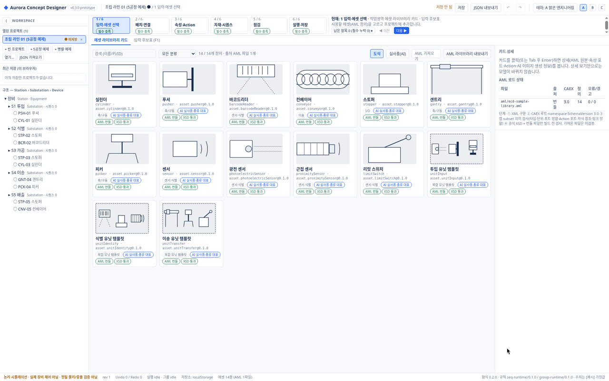

*그림 2. 1단계 「입력·에셋 선택」 — 「도식」 보기의 카드 14장. 위쪽 검색창·「모든 분류」 목록·「14 / 14개 정의 · 출처 AML 파일 1개」, 오른쪽은 카드를 고르기 전의 「카드 상세」 안내 (1280×800 화면 캡처, 2026-11-08)*

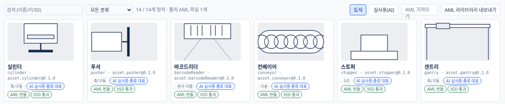

*그림 3. 그림 2의 부분 확대 — 검색창 「검색 (이름/키/ID)」, 분류 목록, 「도식」/「실사풍(AI)」 버튼, 카드 배지(분류, 「AI 실사풍·종류 대표」, 「AML 번들」, 「XSD 통과」)*

### 6.2 카드 보기와 상세 (MF-06) [구현]

- 카드에는 이미지, 이름, `키 · ID@버전`, 배지(분류, 「AI 실사풍·종류 대표」, 「AML 번들」/「AML 가져옴」, 「XSD 통과」/「XSD 미검증」)가 있습니다.
- 카드를 클릭(또는 Tab 후 Enter)하면 오른쪽 「카드 상세」에 AML 원본(파일·SUC 경로·RoleClass·CAEX), 속성, 포트, Action, (템플릿이면) 자식·링크·규칙, 시각 자료 정보가 나옵니다.
- **상세 보기만으로는 모델이 바뀌지 않습니다.** 모델을 바꾸는 것은 「프로젝트에 추가」뿐입니다.

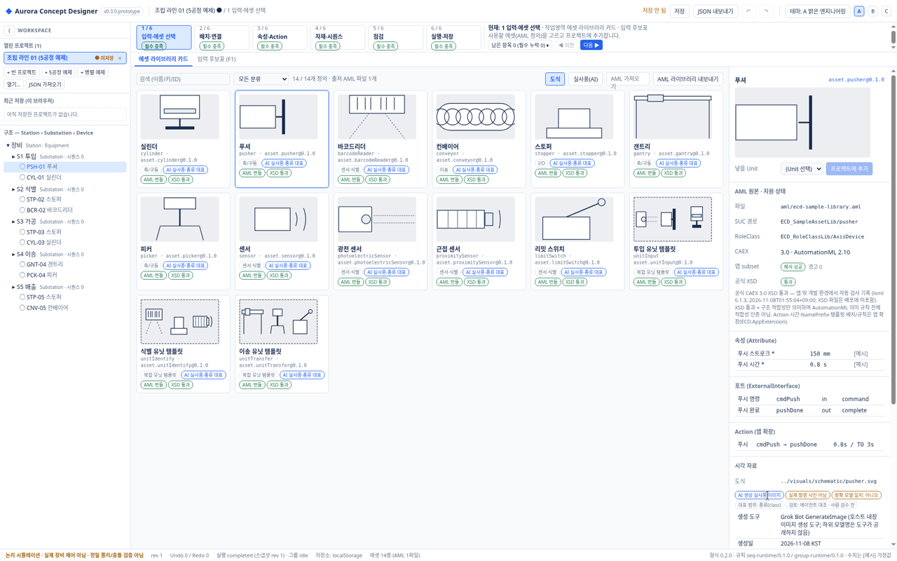

*그림 4. 「푸셔」 카드를 고른 상태 — 카드에 선택 테두리가 생기고 오른쪽 「카드 상세」 패널에 상세가 나옵니다. 별도 창(모달)이 아니라 화면 오른쪽 패널입니다 (1280×800 화면 캡처, 2026-11-08)*

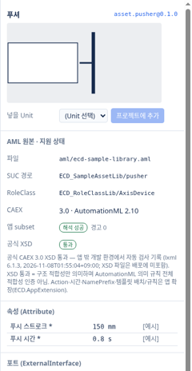

*그림 5. 그림 4의 부분 확대 — 「넣을 Unit」·「프로젝트에 추가」, 「AML 원본 · 지원 상태」(파일·SUC 경로·RoleClass·CAEX·앱 subset·공식 XSD), 「속성 (Attribute)」, 「포트 (ExternalInterface)」, 「Action (앱 확장)」*

### 6.3 프로젝트에 추가 (MF-07) [구현]

- **유닛 템플릿**(투입/식별/이송): 상세에서 「프로젝트에 추가」를 누르면 새 Substation(Unit)과 자식 Device 3개가 생깁니다. 위치는 2단계 Canvas에서 확인합니다.
- **단일 Device**(실린더 등): 상세의 「넣을 Unit」에서 Substation을 고른 뒤 「프로젝트에 추가」를 누릅니다. Device는 Unit 안에만 놓을 수 있으므로, Substation이 없으면 먼저 유닛 템플릿을 추가하거나 2단계에서 「빈 유닛」을 배치하세요.
- 실행 중에는 추가가 막힙니다(「실행 중 — 조회만 가능, 추가·수정 차단」).
- 잘못 추가했으면 「↶」(Ctrl/Cmd+Z)로 되돌립니다.

> 주의: 유닛 템플릿의 규칙으로 생긴 사전조건(예: 광전 센서 감지=true)은 시제품에서 센서 신호를 켜는 주체가 없어, **템플릿 유닛의 Action을 시퀀스에 넣고 실행하면 PRE_UNMET으로 멈춥니다**(알려진 제약). 실행 확인은 기본 5공정 모델과 병렬 예제로만 되어 있습니다.

### 6.4 AI 생성 실사풍 이미지 14종 (MF-08) [구현]

- 「실사풍(AI)」을 누르면 14종 모두 AI로 생성한 실사풍 이미지가 보이고, 카드마다 「AI 생성」 배지가 붙습니다.
- 위쪽 안내: "AI 생성 실사풍 이미지 — 실제 촬영 사진 아님, 특정 제조사·제품·모델 아님, 사양 근거 아님".
- 카드 상세 「시각 자료」에서 생성 도구, 생성일(2026-11-08 KST), 방향·구도, 구도 참고, 생성 지시(brief), 사용 조건([미정]) 등을 볼 수 있습니다. 배지: 「실제 촬영 사진 아님」, 「정확 모델 일치: 아니오」, 「대표 범위: 종류(class)」, 「검토: 에이전트 대조 · 사람 검수 전」.
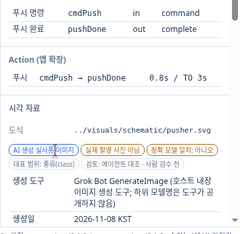

*그림 6. 그림 4의 부분 확대 — 「시각 자료」 영역. 「도식」 보기 상태에서도 「AI 생성 실사풍 이미지」, 「실제 촬영 사진 아님」, 「정확 모델 일치: 아니오」, 「대표 범위: 종류(class)」, 「검토: 에이전트 대조 · 사람 검수 전」 표시와 생성 도구·생성일이 보입니다(배지 위 세로 막대는 마우스 커서)*

- v0.2 실제 사진은 출처 이력으로만 남아 있으며, 상세의 접힌 영역 「이전 참고 사진 (v0.2 출처 이력 — 기본 표시 안 함)」을 펼쳐야 보입니다.
- **이 이미지를 제품 선정·사양 근거로 쓰지 마세요.**

### 6.5 AML 가져오기/내보내기 (MF-09) [구현]

- 「AML 가져오기」: `.aml`/`.xml` 파일을 골라 정의를 추가합니다. 결과 창에 XML 구문, CAEX SchemaVersion, 앱 subset 오류/경고, "공식 XSD: 미검증 (브라우저 내 미실행)"이 따로 표시됩니다. 오류 없는 정의만 추가되고 기존 정의·열린 프로젝트는 바뀌지 않습니다.
- 가져온 AML은 **이 브라우저에만** 보관됩니다. 다른 PC·브라우저에서는 그 정의를 쓴 프로젝트가 열리지 않을 수 있습니다(16절).
- 「AML 라이브러리 내보내기」: 현재 로드된 정의 전체를 `ecd-library-export.aml`로 내려받습니다.

### 6.6 입력 후보표 (F1) [구현, GUI 미검증]

하위 탭 「입력 후보표 (F1)」에서 대상·종류·소속·신뢰도·출처를 직접 입력한 후보를 사람이 확인/거절하고 「반영 미리보기」 후 반영합니다. 문서(PDF/DWG/XLSX)·USD 자동 추출은 **[미구현]** 입니다.

## 7. 2단계 배치·연결

> 이 절의 조작(연결·레이어·정렬·삭제 등)은 자동 테스트로 규칙이 확인되어 있고, v0.1 빌드에서 일부(이동·Undo·팔레트 배치)만 실제 화면으로 확인했습니다. v0.3 GUI 검수 항목에는 포함되지 않았습니다.

### 7.1 팔레트로 배치 (MF-10) [구현]

1. 「2 / 6 배치·연결」을 누릅니다. 왼쪽 「팔레트 (14종 AML 정의 + 빈 유닛) — 드래그」가 보입니다.
2. 「빈 유닛」을 Canvas 빈 곳으로 끌어 놓으면 새 Substation(Unit)이 생깁니다.
3. Device(예: 실린더)는 **Substation 상자 안으로** 끌어 놓습니다. Unit 밖에 놓으면 거부됩니다.
4. 유닛 템플릿을 끌어 놓으면 Unit + 자식 Device가 함께 생깁니다.

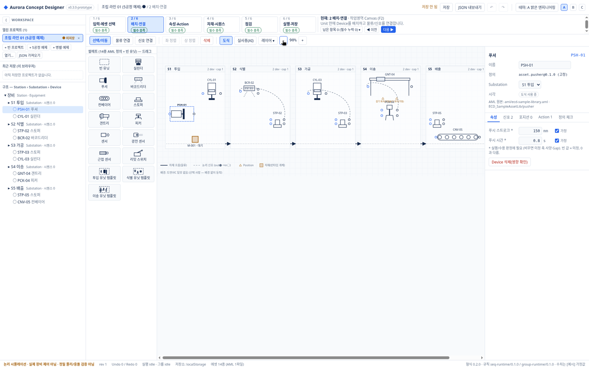

*그림 7. 2단계 「배치·연결」 — 왼쪽 팔레트, 가운데 Canvas(S1 투입 ~ S5 배출, 「도식」, 줌 90%), 오른쪽 속성 패널. Device `PSH-01`(푸셔)이 선택되어 점선 테두리로 보입니다. 모델 내용은 편집하지 않았습니다 (1280×800 화면 캡처, 2026-11-08)*

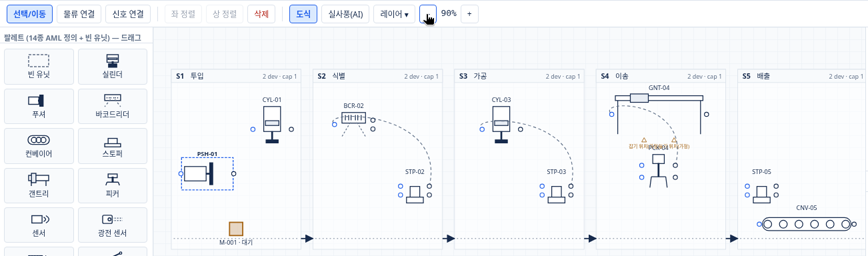

*그림 8. 그림 7의 부분 확대 — 툴바(「선택/이동」「물류 연결」「신호 연결」「좌 정렬」「상 정렬」「삭제」「도식」「실사풍(AI)」「레이어 ▾」「−」 90% 「+」)와 Substation 상자 안의 Device, 자재 `M-001 · 대기`, 물류 흐름 화살표*

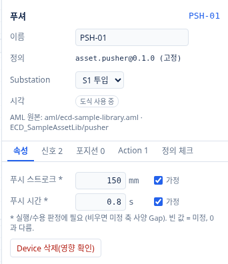

*그림 9. 그림 7의 부분 확대 — 선택한 `PSH-01`의 속성 패널: 이름, 정의 `asset.pusher@0.1.0 (고정)`, 소속 「Substation」 목록(「S1 투입」), 탭 「속성」「신호 2」「포지션 0」「Action 1」「정의 체크」, 「Device 삭제(영향 확인)」*

### 7.2 이동과 소속 변경 [구현]

- 「선택/이동」 모드에서 상자를 끌어 옮깁니다. Shift(또는 Cmd/Ctrl)를 누른 채 클릭해 여러 개 선택 후 「좌 정렬」·「상 정렬」이 가능합니다.
- Device를 다른 Substation 위로 옮기면 「…의 소속 Unit 변경?」 창이 뜹니다: 「소속 변경 + 이동」, 「좌표만 이동 (소속 유지)」, 「취소」.

### 7.3 연결 [구현]

- **물류 연결**: 「물류 연결」 → 출발 Substation 클릭 → 도착 Substation 클릭.
- **신호 연결**: 「신호 연결」 → 출력(out) 포트 클릭 → 입력(in) 포트 클릭. 방향이 맞지 않으면 거부됩니다.
- 연결 중 「Esc」로 취소합니다.

### 7.4 보기·삭제 [구현]

- 「레이어 ▾」: Background / Units / Axis / I/O / Positions / Flow 표시 끄기·켜기 (숨김은 삭제가 아니고 시뮬레이션 제외도 아님).
- 「−」「+」: 줌 50~200%.
- 「삭제」 또는 Delete/Backspace 키: 「… 삭제 — 참조 영향 확인」 창에서 영향(Action·시퀀스 단계·연결·자재 경로)을 보고 「참조 해제 후 삭제」. 다른 Action이 참조하던 조건은 "미정" 조건으로 바뀌어 실행이 차단됩니다. Undo로 되돌릴 수 있습니다.

> 알려진 표시 문제: 1920 폭에서도 Canvas는 내부 가로 스크롤이 생기며, 스크롤 전에는 오른쪽 끝 Substation이 오른쪽 속성 패널 뒤에 가려질 수 있습니다. 가로 스크롤하면 보입니다.

## 8. 3단계 속성·Action과 계층 Station › Substation › Device

### 8.1 계층 이해하기 (MF-11) [구현]

| 화면 이름 | 내부 이름 (파일 키) | 개수 | 예 (병렬 예제) |
|---|---|---|---|
| Station | Equipment | 프로젝트당 1개 | 「Station A (예시)」 |
| Substation | Unit | 여러 개 | 「S1 듀얼 클램프」, 「S2 푸시 아웃」 |
| Device | Device | Substation 안에 여러 개 | `STP-A1`, `STP-B1`, `CYL-B1`, `PSH-21` |

- Device의 소속 Substation은 속성 패널의 「Substation」 목록에서 볼 수 있습니다(그림 9).
- 화면 표기만 Station/Substation으로 바뀌었고, 기존 ID·파일 키·AML은 그대로입니다. Canvas 위 라벨은 기존 Unit 이름을 씁니다.
- 탐색기 트리에서 Substation 옆에 「Substation · 시퀀스 N」이 표시됩니다. 유닛 템플릿으로 만든 Substation은 이름 뒤에 템플릿 표시 기호(겹친 두 사각형 모양)가 붙습니다.

### 8.2 속성 편집하기 (MF-12) [구현, 일부 GUI 확인]

1. 「3 / 6 속성·Action」을 누릅니다.
2. 왼쪽 탐색기 트리에서 Substation 또는 Device를 클릭합니다.
3. 편집기 탭에서 값을 채웁니다.

| 탭 | 하는 일 | 주요 버튼 |
|---|---|---|
| 「속성」 | 이름, 사양 값·단위·가정 여부 (빈 값 = 미정) | 「Device 삭제(영향 확인)」/「Unit 삭제(영향 확인)」 |
| 「신호 N」 | 개념 Signal(방향·역할·주소 미정 유지) | 「+ 입력(명령)」「+ 출력(완료)」「+ 센서」 |
| 「포지션 N」 | 위치(가정값) | 「+ Position」 |
| 「Action N」 | 동작 시간, 타임아웃, 명령 Signal, 완료 Signal, 목표 Position, 전제(pre) 조건, 완료 후(post) 검증 조건, 자재 변화 | 「+ Action」「+ 조건」「시퀀스 끝에 추가」「Action 삭제」 |
| 「정의 체크」 | 정의 누락 확인 | — |

- 오른쪽에 「제공 능력표 — Substation 이름 (F3-03)」이 자동으로 만들어집니다.
- 「이 단계 남은 항목」에서 완료 Signal·타임아웃 미정 등을 확인하고 「선택」으로 이동합니다.
- **시퀀스에서 쓰는 Action의 완료 Signal이나 타임아웃이 비어 있으면 실행이 차단됩니다**(임의로 true 처리하지 않음).
- Interlock 후보는 「확인」/「거절」/「미확인」을 사람이 직접 고릅니다(자동 확정 없음).

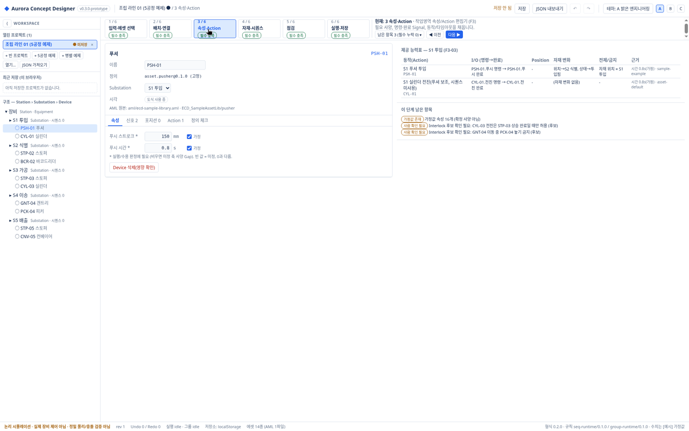

*그림 10. 3단계 「속성·Action」 — 탐색기에서 `PSH-01`을 고른 상태. 가운데 편집기(「속성」 탭: 푸시 스트로크 150 mm, 푸시 시간 0.8 s, 「가정」 체크), 오른쪽 「제공 능력표 — S1 투입 (F3-03)」과 「이 단계 남은 항목」 (1280×800 화면 캡처, 2026-11-08)*

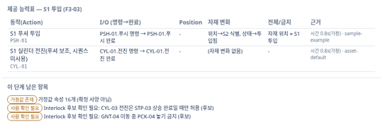

*그림 11. 그림 10의 부분 확대 — 공정 Action 목록(「S1 푸셔 투입」, 「S1 실린더 전진(푸셔 보조, 시퀀스 미사용)」)의 I/O·자재 변화·전제·근거와, 남은 항목(「가정값 존재」, 「사람 확인 필요」 Interlock 후보 2건)*

## 9. 4단계 자재·시퀀스 — 개략 시퀀스 만들기

### 9.1 Station 시퀀스 Draft — 개략 시퀀스 (MF-13) [구현, 편집 GUI 미검증]

Station 전체의 **순차 단계 목록**입니다. 기본 5공정 예제는 이 시퀀스(12단계)를 씁니다.

1. 「4 / 6 자재·시퀀스」 → 하위 탭 「Station 시퀀스 Draft (F5)」.
2. 왼쪽 「제공 Action」 목록(「모든 Unit」으로 필터 가능)에서 Action을 오른쪽 표로 끌어 놓습니다. 3단계 「Action」 탭의 「시퀀스 끝에 추가」로도 넣을 수 있습니다.
3. 순서는 행을 끌거나 「↑」「↓」로 바꾸고, 「×」로 삭제합니다.
4. 표의 「타임아웃」 칸에서 그 단계만의 타임아웃을 덮어쓸 수 있습니다.
5. (선택) 오른쪽 「구조화 문장 입력 (결정적 변환 · AI 미사용)」에 한 줄에 한 단계씩 적고 「변환 미리보기」 → 모호한 줄은 사람이 선택 → 「확정된 줄만 시퀀스에 추가」.

- **순차 실행만** 지원합니다. 한 시퀀스 안의 분기·병렬·루프, 자연어 Dictation·AI 해석은 **[미구현]** 입니다.
- 하위 탭 「SFC 미리보기」는 표시 전용입니다.

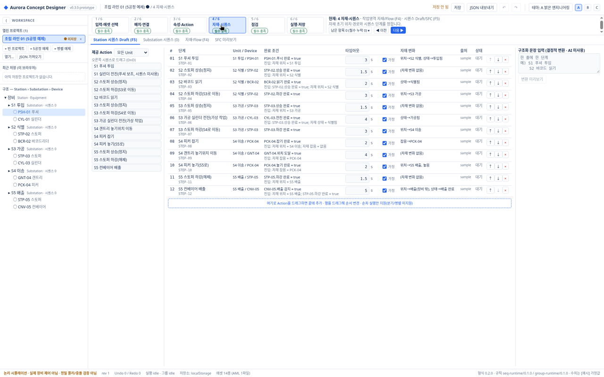

*그림 12. 4단계 「자재·시퀀스」 → 「Station 시퀀스 Draft (F5)」 — 기본 예제의 12단계. 왼쪽 「제공 Action」, 가운데 단계 표(단계·Unit / Device·완료 조건·타임아웃·자재 변화·상태), 오른쪽 「구조화 문장 입력 (결정적 변환 · AI 미사용)」. 보기만 한 화면이며 편집 조작은 이번에도 GUI로 확인하지 않았습니다 (1280×800 화면 캡처, 2026-11-08)*

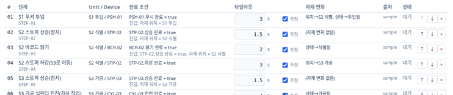

*그림 13. 그림 12의 부분 확대 — 01~05단계. 각 행의 Unit/Device, 완료 조건과 진입 조건, 「타임아웃」 칸과 「가정」 체크, 「↑」「↓」「×」 버튼*

### 9.2 자재·Flow (MF-14) [구현, GUI 미검증]

「자재·Flow (F4)」에서 「+ 자재 정의」로 자재를 만들고 초기 위치·초기 상태·경로·투입 간격 등을 정합니다. **실행에는 자재 정의가 정확히 1개**여야 합니다(다중 자재 [미구현]).

### 9.3 Substation 시퀀스 — 병렬 시퀀스 만들기 (MF-15) [구현, 설계 제안]

한 Substation 안에서 **여러 시퀀스를 만들어 6단계에서 함께 실행**합니다. Station 시퀀스와는 별개입니다.

1. 「4 / 6 자재·시퀀스」 → 하위 탭 「Substation 시퀀스 (N)」.
2. 「Substation」 목록에서 대상(예: 「S1 듀얼 클램프 · 시퀀스 2」)을 고릅니다.
3. 「+ 시퀀스 추가」를 누르면 시퀀스 카드가 생깁니다. 카드 위 이름 칸에서 이름을 바꿀 수 있고, 「삭제」로 시퀀스를 지웁니다.
4. 카드 아래 「(이 Substation의 Action 선택)」에서 Action을 고르고 「단계 추가」를 누릅니다. **이 Substation 소속 Device의 Action만** 고를 수 있습니다.
5. 「↑」「↓」로 순서를 바꾸고 「×」로 단계를 지웁니다.
6. 위쪽 「그룹 실행 전 검사」가 「통과」인지 확인합니다. 「차단 N건」이면 목록의 코드를 보고 고칩니다(17절).

실행 전에 차단되는 경우(규칙 `group-runtime/0.1.0`, 설계 제안):

| 코드 | 원인 | 고치는 법 |
|---|---|---|
| `NO_SUB_SEQUENCES` / `NO_STEPS` | 시퀀스 또는 단계가 없음 | 시퀀스·단계를 추가 |
| `DEVICE_OUTSIDE_SUBSTATION` | 다른 Substation의 Device 사용 | 해당 단계 삭제 |
| `NO_COMPLETE_SIGNAL`, `DURATION_UNDEFINED` | Action의 완료 Signal·동작 시간 미정 | 3단계 「Action」에서 값 채우기 |
| `TIMEOUT_UNDEFINED` | 타임아웃 미정 | Action 타임아웃이 미정이면 3단계 「Action」에서 채우기. **단계 자체의 타임아웃(덮어쓰기)** 이 미정이면 현재 화면에서 고칠 수 없음(11.3절 「직접 편집 불가」) |
| `CAPACITY_UNDEFINED` | 이동 대상 Unit의 수용 개수 미정 | 3단계에서 그 Unit을 선택하고 「수용 개수」 채우기 |
| `CONDITION_UNDEFINED` | 미정 조건 | Action의 사전/사후 조건이면 3단계 「Action」에서 구체화하거나 제거. **단계 진입 조건**이면 현재 화면에서 고칠 수 없음 |
| `MATERIAL_COUNT` | 자재 정의가 0개 또는 2개 이상 | 0개면 4단계 「자재·Flow」에서 「+ 자재 정의」. 2개 이상이면 현재 화면에서 줄일 수 없음(첫 자재만 편집, 삭제 기능 없음) |
| `DEVICE_CONFLICT` | **같은 Device를 두 시퀀스가 사용** | 한쪽 단계 삭제 또는 Undo (12.3 실습) |
| `SHARED_MATERIAL_CONFLICT` | 자재를 다루는 시퀀스가 2개 이상 | 자재를 다루는 시퀀스를 1개로 |

- 다른 시퀀스의 진행을 **기다리는 조건은 지원하지 않습니다**. 조건이 맞지 않으면 기다리지 않고 즉시 `PRE_UNMET` 오류가 납니다.

## 10. 5단계 점검

### 10.1 하위 탭 (MF-16) [구현, GUI 일부만 확인]

| 하위 탭 | 내용 |
|---|---|
| 「Gap (F6) N」 | 규칙 기반 Gap 목록(부족/미정/사람 확인 후보), 근거·수정 제안. 「재분석」, 「이동」, 「숨김」, 「사람 확인」, 「복원」. 안전 관련 행은 자동으로 닫히지 않습니다. |
| 「진단·저장·AML」 | 참조 진단, 가져오기에 실패한 원본 파일의 「격리 보관함 (거부된 가져오기 원본)」(「원본 그대로 다운로드」), AML 상태 |
| 「Export 미리보기 (F8)」 | **읽기 전용 미리보기**. 실제 Aurora Core Export·SignalMap·역매핑은 [미구현] |
| 「Evolution Lab (F7)」 | "이번 시제품에서 미구현" 안내만 [미구현] |

- Gap 판정 규칙·임계값은 승인 전 시제품 가정입니다. 간섭 후보는 2D 도식 상자 겹침 기준이며 **물리·안전 검증이 아닙니다.**

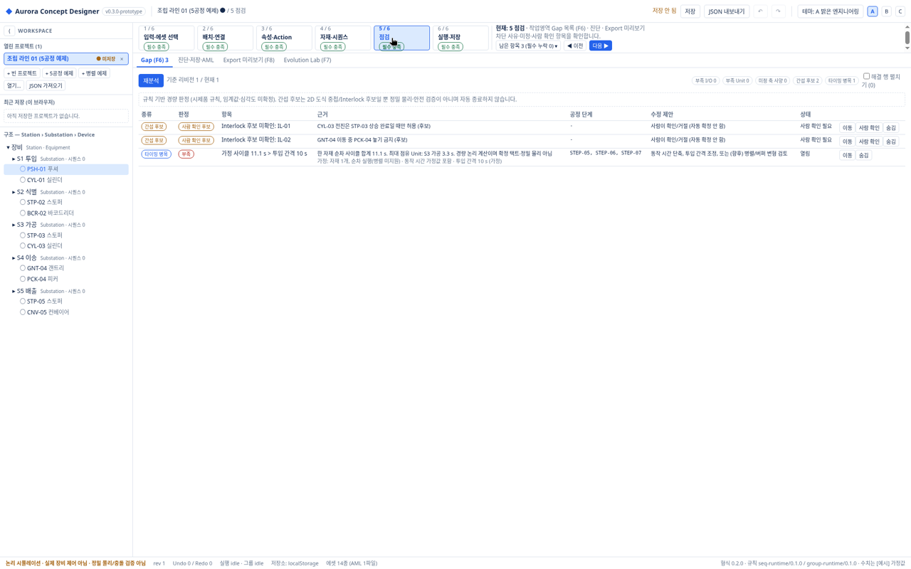

*그림 14. 5단계 「점검」 → 「Gap (F6) 3」 — 행 3개: Interlock 후보 IL-01·IL-02(「간섭 후보」, 「사람 확인 필요」)와 타이밍 병목(「부족」). 오른쪽에 「이동」「사람 확인」「숨김」 버튼 (1280×800 화면 캡처, 2026-11-08)*

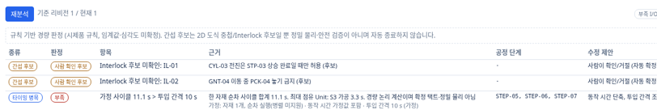

*그림 15. 그림 14의 부분 확대 — 「재분석」 버튼, 안내 문구, 종류·판정·항목·근거. 세 번째 행은 "가정 사이클 11.1 s > 투입 간격 10 s"(시간은 모두 [예시] 가정값)*

## 11. 6단계 실행·저장 — Station 실행과 Substation 그룹 실행

### 11.1 실행 대상 고르기

「6 / 6 실행·저장」 화면 맨 왼쪽의 「Station 시퀀스」 / 「Substation 그룹」 중 하나를 고릅니다. 둘은 **동시에 돌릴 수 없습니다**(한쪽이 실행·일시정지 중이면 먼저 초기화).

### 11.2 Station 시퀀스 실행 (MF-17) [구현]

| 버튼 | 동작 |
|---|---|
| 「▶ 실행」 | 실행 전 검사 후 시작. 통과하지 못하면 "실행 준비 실패: …" 안내 |
| 「❚❚ 일시정지」 | 가상 시간 동결 |
| 「재개」 | 남은 시간부터 이어서 진행 |
| 「+0.1s」 | 일시정지 중 가상 0.1초만 진행 |
| 「⟲ 초기화」 | 실행 시작 시점의 초기 조건으로 복원 (Undo와 별개) |
| 「끝까지」 | 실행 중에만 활성. 남은 단계를 즉시 계산 |
| 속도 `0.25x`~`4x` | 화면 재생 속도만 바꿈. 결과에는 영향 없음 |

- 오른쪽 패널에 실행 상태·로그가 나오고, 「검증용 오류 주입 (시뮬 설정)」으로 "결과 실패"·"완료 신호 미발생"을 일부러 넣어 오류 처리(TIMEOUT 등)를 확인할 수 있습니다.
- 툴바의 배지: 「저장됨/저장 안 됨」, 「시뮬 완료」 등, 「실행 전 검사 통과/미통과」.

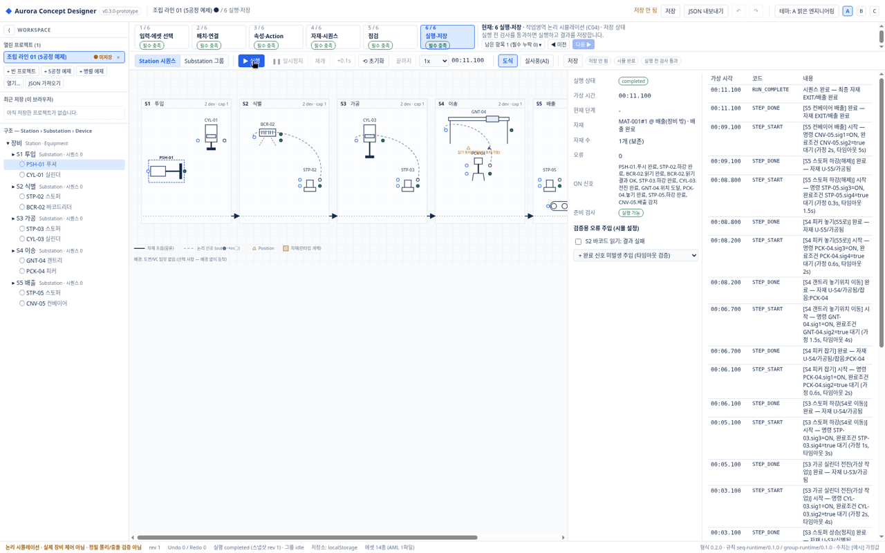

*그림 16. 6단계 「실행·저장」 → 「Station 시퀀스」 실행이 끝난 상태 — 가운데 Canvas, 실행 상태 패널(「completed」, 가상 시간 00:11.100, 오류 0, 「검증용 오류 주입 (시뮬 설정)」), 오른쪽 로그 (1280×800 화면 캡처, 2026-11-08)*

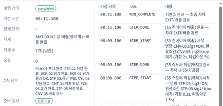

*그림 17. 그림 16의 부분 확대 — 실행 상태 「completed」, 가상 시간 `00:11.100`, 자재 위치, 오류 0, 준비 검사 「실행 가능」, 로그 맨 위 `RUN_COMPLETE 시퀀스 완료 — 최종 자재 EXIT/배출 완료`*

### 11.3 Substation 그룹 실행·일시정지·재개·초기화 (MF-18) [구현, 설계 제안]


*그림 18. 「Substation 그룹」 실행 완료 화면 (`docs/screenshots/v0.3-group-complete.png`, 이전 1920×1200 GUI 검수 캡처)*

1. 「Substation 그룹」을 누릅니다.
2. 옆 목록에서 Substation을 고릅니다(예: 「S1 듀얼 클램프 · 시퀀스 2」).
3. 「▶ 그룹 실행」: 그 Substation의 모든 시퀀스가 **같은 가상 시계로 동시에** 시작합니다. 차단되면 "그룹 실행 전 검사 차단: …" 안내와 함께 오른쪽에 「실행 전 검사 — 차단 N건」 목록이 보입니다. 차단 중에는 실행이 시작되지 않습니다(그룹 상태 대기, 시계 0).
4. 「❚❚ 그룹 일시정지」: **묶음 전체**가 동결됩니다(개별 시퀀스만 멈추는 기능은 없음).
5. 「그룹 재개」: 남은 시간부터 이어 갑니다. 로그에 `GROUP_RESUME 그룹 재개 — 남은 시간 유지: …`가 남습니다.
6. 「끝까지」: 실행 중에만 활성. 남은 부분을 즉시 계산합니다.
7. 「⟲ 그룹 초기화」: 그룹 시작 시점의 초기 조건으로 되돌립니다.

#### 차단 목록 읽는 법과 이동 버튼 (r3, TURN-001)

「실행 전 검사 — 차단 N건」의 각 항목은 차단 메시지 아래에 **세 종류 중 하나**의 안내를 보여 줍니다. 종류는 코드만이 아니라 실제 원인(어느 단계·Action·자재인지)으로 정해집니다.

| 종류 | 화면 표시 | 버튼 | 뜻 |
|---|---|---|---|
| 수정 위치 | 「수정 위치: 4 자재·시퀀스 › Substation 시퀀스」처럼 단계 번호·단계 이름 › 위치 | 「… 화면으로 이동」 | 그 화면에 원인을 고치는 편집기가 있습니다 |
| 원인 확인 | 「원인 확인: 5 점검 › 점검 — 이유」 | 「…에서 원인 확인」 | 원인을 볼 수 있는 곳입니다. **직접 고치는 위치는 아닙니다** |
| 현재 화면에서 직접 편집 불가 | 경고 배지 「현재 화면에서 직접 편집 불가」 + 이유 | 볼 곳이 있으면 「…에서 원인 확인」만, 없으면 버튼 없음 | 이 시제품 화면에는 그 값을 고치는 편집기가 없습니다 |

- 이동 버튼은 **화면(단계·하위 탭·선택)만 바꾸고 모델은 바꾸지 않습니다**(rev·Undo/Redo 그대로). 3단계로 갈 때는 원인 Device(수용 개수는 대상 Unit)를 선택해 줍니다. 그룹 실행 대상 Substation은 바뀌지 않으므로 6단계로 돌아오면 같은 Substation이 선택되어 있습니다.
- 「수정 위치」 대상: `DEVICE_CONFLICT`, `SHARED_MATERIAL_CONFLICT`, `NO_SUB_SEQUENCES`, `NO_STEPS`, `DEVICE_OUTSIDE_SUBSTATION` → 4 자재·시퀀스 › Substation 시퀀스, `NO_COMPLETE_SIGNAL`, `DURATION_UNDEFINED`, Action의 `TIMEOUT_UNDEFINED`·Action 사전/사후 조건의 `CONDITION_UNDEFINED` → 3 속성·Action › Action, `CAPACITY_UNDEFINED` → 3 속성·Action › 속성 (수용 개수), 자재 0개·자재 초기 위치/상태 미정 → 4 자재·시퀀스 › 자재·Flow (F4).
- 「현재 화면에서 직접 편집 불가」: **단계 진입 조건**의 미정, **단계 타임아웃(덮어쓰기)** 의 미정(주로 가져온 파일에서 생김), **자재 2개 이상**. 앞의 두 경우 "Action 값을 고쳐도 이 차단은 풀리지 않습니다"라고 표시됩니다. 이 값들을 고치는 편집기는 아직 없습니다(18.1절).
- 「원인 확인」: 참조 무결성 오류 → 5 점검 › 진단·저장·AML, 선택한 Substation을 찾을 수 없음(`NO_SUBSTATION`) → 5 점검 + "6단계 Substation 목록에서 다시 선택하세요", 그 밖의 코드 → 5 점검.

예: 병렬 예제에서 DEVICE_CONFLICT를 만든 뒤(12.3 실습) 3단계에서 `CYL-B1`의 「B 실린더 전진」 Action 타임아웃 값을 비우면, 6단계 차단 목록에 `TIMEOUT_UNDEFINED` 2건(두 시퀀스에 같은 Action이 있음)과 기존 `DEVICE_CONFLICT`가 함께 보입니다. `TIMEOUT_UNDEFINED`의 「3 속성·Action › Action 화면으로 이동」을 누르면 3단계 「Action」 탭이 열리고 `CYL-B1`이 선택되어, 「타임아웃」 칸(「미정」)을 바로 채울 수 있습니다.

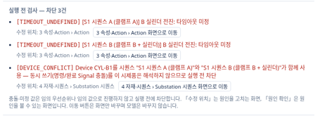

*그림 19. 부분 확대 — 「실행 전 검사 — 차단 3건」: 각 항목 아래 「수정 위치: 3 속성·Action › Action」 / 「수정 위치: 4 자재·시퀀스 › Substation 시퀀스」와 이동 버튼, 아래 안내문(「수정 위치」·「원인 확인」의 뜻) (r3 검토용 빌드, 1280×800, 상태 표시줄 rev 3)*

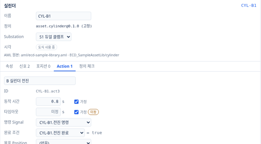

*그림 20. 부분 확대 — 이동 버튼을 누른 뒤의 3단계: 오른쪽 패널에 `CYL-B1`(실린더)이 선택되고 「Action 1」 탭에서 「B 실린더 전진」의 「타임아웃」이 「미정」으로 표시됨 (r3 검토용 빌드, 1280×800, 이동 전후 rev 3·Undo 2·Redo 0 그대로)*

- 「현재 화면에서 직접 편집 불가」와 「원인 확인」 항목은 실제 GUI 캡처가 없습니다(검증 환경의 파일 선택/업로드 제약으로 해당 시험 파일을 열지 못함). 위 표의 설명은 화면 문구 원본과 자동 테스트 기준입니다.

- 오른쪽 「그룹 실행 — 이름 (Substation)」: 공통 가상 시계, 「그룹 상태」 배지, 실행 묶음 ID·모델 rev.
- 「시퀀스별 상태」 표: 시퀀스 / 상태(「대기」「진행 중」「완료」「오류」「그룹 정지」) / 현재 단계 / 진행 / 종료 시각.
- 「공통 로그 (N)」: `GROUP_START`, `STEP_START`, `STEP_DONE`, `SEQ_COMPLETE`, `GROUP_PAUSE`, `GROUP_RESUME`, `GROUP_COMPLETE` 등.
- 한 시퀀스에서 오류(`PRE_UNMET`/`TIMEOUT`/`POST_UNMET`/`READ_FAILED`/`CAPACITY_FULL`)가 나면 **묶음 전체가 정지**하고 나머지는 「그룹 정지」가 됩니다(보수적 정책, 설계 제안).
- 그룹 실행 상태는 저장되지 않으며 다시 열어도 자동 재개하지 않습니다.
- 그룹 실행 중에도 모델 편집·Undo는 막힙니다.

### 11.4 결과 저장

실행 결과(로그·순간 상태)는 프로젝트 파일에 저장되지 않습니다. 툴바의 「저장」은 **모델**을 저장합니다(14절).

## 12. 따라 하기 실습 — 샘플 3가지

### 12.1 실습 A: 기본 5공정 Station 예제 — 11.100 s (MF-19)

1. 탐색기에서 「+ 5공정 예제」를 누릅니다(또는 처음 열린 「조립 라인 01 (5공정 예제)」 사용).
2. 「6 / 6 실행·저장」 → 「Station 시퀀스」.
3. 「▶ 실행」 → (기다리거나) 「끝까지」.
4. 확인: 가상 시간 **`00:11.100`**, 로그 `RUN_COMPLETE`, 자재가 장비 밖(배출)으로 나감, 오류 0.
5. 「⟲ 초기화」로 `00:00.000`으로 되돌립니다.

> 기본 예제: Substation 5개(S1 투입·S2 식별·S3 가공·S4 이송·S5 배출), Device 10개, 자재 1개, 12단계 순차. 시간은 모두 [예시] 가정값입니다. (GUI 검수: v0.3에서 RUN_COMPLETE 11.100 s 통과)

### 12.2 실습 B: 병렬 Substation 예제 — A 1.2 s / B 1.6 s (MF-20)

1. 탐색기에서 「+ 병렬 예제」를 누릅니다. Station 「Station A (예시)」, Substation 「S1 듀얼 클램프」(Device STP-A1·STP-B1·CYL-B1)와 「S2 푸시 아웃」(PSH-21).
2. (확인용) 「4 / 6 자재·시퀀스」 → 「Substation 시퀀스 (3)」에서 S1의 시퀀스 2개를 봅니다.
   - 「S1 시퀀스 A (클램프 A)」: A 클램프 상승 0.5 s → A 클램프 하강 0.7 s
   - 「S1 시퀀스 B (클램프 B + 실린더)」: B 클램프 상승 0.4 s → B 실린더 전진 0.8 s → B 클램프 하강 0.4 s
3. 「6 / 6 실행·저장」 → 「Substation 그룹」 → 「S1 듀얼 클램프 · 시퀀스 2」 선택.
4. 「▶ 그룹 실행」. 중간에 「❚❚ 그룹 일시정지」 → 시계가 멈추는지 확인 → 「그룹 재개」.
5. 확인: 「시퀀스별 상태」에서 시퀀스 A 종료 **`00:01.200`**, 시퀀스 B 종료 **`00:01.600`**, 로그 `GROUP_COMPLETE 그룹 완료 — 시퀀스 2개 모두 완주` (그림 18).
6. 「⟲ 그룹 초기화」로 되돌립니다.

### 12.3 실습 C: DEVICE_CONFLICT 충돌 대처와 Undo (MF-21)


1. 실습 B의 병렬 예제에서 「4 / 6 자재·시퀀스」 → 「Substation 시퀀스 (3)」 → Substation 「S1 듀얼 클램프 · 시퀀스 2」.
2. 「S1 시퀀스 A (클램프 A)」 카드 아래 「(이 Substation의 Action 선택)」에서 **`CYL-B1 · B 실린더 전진`** 을 고르고 「단계 추가」.
3. 위쪽에 빨간 상자 「그룹 실행 전 검사: 차단 1건」과 `[DEVICE_CONFLICT] Device CYL-B1를 시퀀스 "S1 시퀀스 A (클램프 A)"와 "S1 시퀀스 B (클램프 B + 실린더)"가 함께 사용 — …실행 전 차단`이 표시됩니다(상태 표시줄 rev 2).
4. 이 상태로 6단계에서 「▶ 그룹 실행」을 눌러도 시작되지 않습니다. 앱은 임의 우선순위로 진행하지 않습니다.
5. 대처 방법 둘 중 하나:
   - **Undo**: 헤더 「↶」 또는 Ctrl/Cmd+Z → rev 1로 복원, 차단 해소.
   - **직접 수정**: 시퀀스 A 카드에서 추가한 「B 실린더 전진」 행의 「×」(단계 삭제).
   - (r3) 6단계 「Substation 그룹」의 차단 항목에는 「수정 위치: 4 자재·시퀀스 › Substation 시퀀스」와 버튼 「4 자재·시퀀스 › Substation 시퀀스 화면으로 이동」이 표시됩니다(그림 21·22). 버튼을 누르면 4단계 「Substation 시퀀스」 탭으로 바로 이동하며 모델은 바뀌지 않습니다(그림 23, rev 2·Undo 1·Redo 0 그대로).
6. 「그룹 실행 전 검사: 통과」를 확인합니다. (GUI 확인: v0.3 검수에서 DEVICE_CONFLICT 차단·Undo rev 2→1 통과. r3 검토용 빌드에서 이동 버튼 경로 확인 — 부록 C.4)

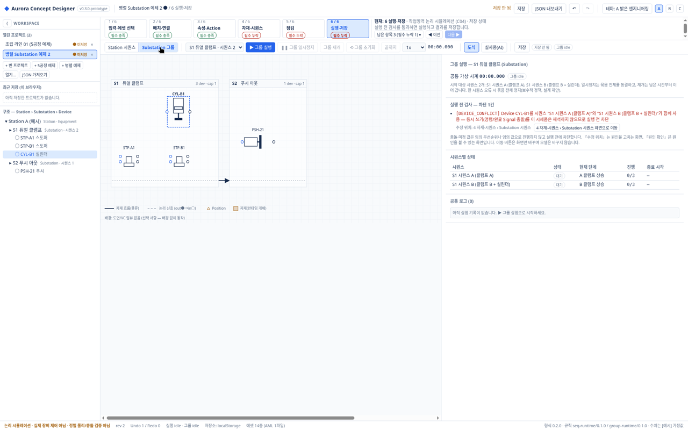

*그림 21. 6단계 「Substation 그룹」, 「S1 듀얼 클램프 · 시퀀스 2」 선택: 오른쪽 「실행 전 검사 — 차단 1건」에 `DEVICE_CONFLICT`와 이동 버튼, 그룹 상태 대기·시계 00:00.000 (r3 검토용 빌드, 1280×800, 상태 표시줄 rev 2·Undo 1·Redo 0)*


*그림 22. 그림 21의 부분 확대 — 「수정 위치: 4 자재·시퀀스 › Substation 시퀀스」와 버튼 「4 자재·시퀀스 › Substation 시퀀스 화면으로 이동」*

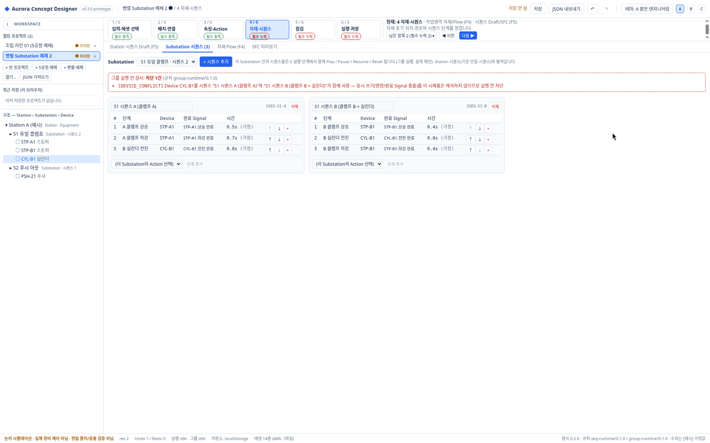

*그림 23. 그림 22의 버튼을 누른 뒤: 「4 / 6 자재·시퀀스」 › 「Substation 시퀀스 (3)」 탭, 위쪽 「그룹 실행 전 검사: 차단 1건」, 「S1 시퀀스 A (클램프 A)」 3번째 단계 「B 실린더 전진 / CYL-B1」 — 여기서 「×」 또는 Undo로 해소 (r3 검토용 빌드, 1280×800, rev 2·Undo 1·Redo 0 그대로)*

## 13. 보기 설정 — 도식/실사풍(AI) 토글과 테마

r5부터 화면에서 고르는 테마는 라이트와 다크입니다. 13절 아래의 A/B/C 설명과 그림은 그 이전 화면의 기록입니다. 저장값 대응과 현재 화면은 21절입니다.

### 13.1 도식 / 실사풍(AI) 토글 (MF-22) [구현]

- 1단계 라이브러리, 2단계 툴바, 6단계 툴바에 「도식」 / 「실사풍(AI)」 버튼이 있습니다.
- 전환은 **표시 이미지만** 바꿉니다. Device 상자 크기·위치·연결 앵커·ID·선택·모델 리비전은 바뀌지 않습니다(GUI 검수: 전환 전후 rev 1 유지).
- 실사풍 모드에서는 Device 동작 애니메이션이 이미지에 반영되지 않고 활성 테두리만 표시됩니다. 포트 위치 등 세부 형상은 도식과 다를 수 있으며, 연결 앵커는 항상 모델 좌표를 씁니다.

### 13.2 테마 A/B/C (MF-23) [구현]

| 테마 | 라벨 |
|---|---|
| A | 「A 밝은 엔지니어링」(기본) |
| B | 「B 어두운 관제」 |
| C | 「C 따뜻하고 차분함」 |

- 헤더 「테마: …」 버튼은 A→B→C 순서로 돌아가고, 「A」「B」「C」 버튼은 바로 선택합니다.
- 테마·토글·현재 단계는 브라우저의 보기 설정에만 저장되며 프로젝트 파일에는 들어가지 않습니다.

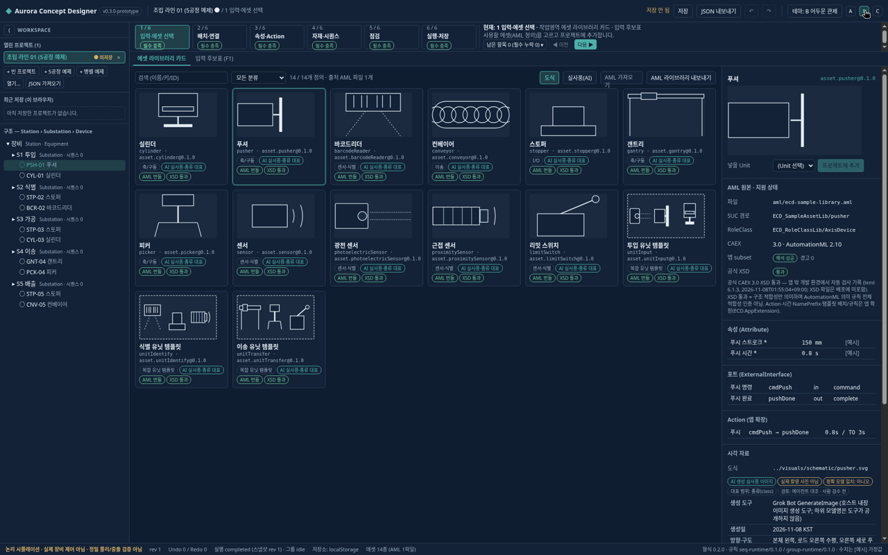

*그림 24. 테마 「B 어두운 관제」 — 헤더 버튼이 「테마: B 어두운 관제」로 바뀌고 「B」가 선택된 상태. 화면 구성과 내용은 테마 A(그림 4)와 같고 색만 바뀝니다 (1280×800 화면 캡처, 2026-11-08)*

## 14. 저장·열기와 JSON 내보내기/가져오기

### 14.1 저장 (MF-24) [구현]

- 헤더 또는 6단계 툴바의 「저장」 → "브라우저 저장소에 저장됨 (저장 후 읽기 확인 완료)". (r4) 메시지에 현재 Workspace 이름이 함께 나오고, 프로젝트는 현재 Workspace에 들어갑니다. 저장이 실패하면 아무 것도 바뀌지 않거나 원래 상태로 되돌립니다(20.6).
- 저장 위치는 **이 브라우저의 localStorage**입니다. 다른 브라우저·다른 PC와 자동 동기화되지 않습니다. 자동 저장은 없습니다.
- 저장소를 쓸 수 없으면 상태 표시줄이 `저장소: 메모리 전용`이 되고, 이때는 「JSON 내보내기」로 보관해야 합니다.

### 14.2 열기 [구현]

- 탐색기 「최근 저장 (Workspace 이름)」에서 이름을 클릭하거나, (r4) 「프로젝트…」 → 「저장된 프로젝트 — Workspace 이름」 창에서 「열기」. 목록에는 **현재 Workspace의 프로젝트만** 보입니다.
- 이미 열려 있는 프로젝트면 새로 열지 않고 기존 탭으로 이동합니다.

### 14.3 JSON 내보내기 / 가져오기 — 형식 0.2.0 (MF-25) [구현]

**내보내기**
1. 헤더 「JSON 내보내기」를 누릅니다.
2. `프로젝트이름.ecd.json` 파일이 내려받아집니다. 파일 안 `formatVersion`은 `0.2.0`, `appVersion`은 `0.3.0-prototype`입니다.

**가져오기**
1. 탐색기 「JSON 가져오기」를 누르고 `.json` 파일을 고릅니다.
2. 성공하면 새 탭으로 열리고 "가져오기 완료 … — 아직 브라우저 저장소에는 저장되지 않음"이 표시됩니다. 필요하면 「저장」을 누르세요.
3. 같은 ID의 프로젝트가 이미 열려 있으면 덮어쓰지 않고 「새 ID 사본으로 열기」 / 「기존 탭으로 이동」 중에서 고릅니다.
   - (r4) 가져온 프로젝트와 같은 ID가 **다른 Workspace**에 저장되어 있으면 「저장」 때 덮어쓰지 않고 막습니다. 「새 ID 사본으로 저장」을 고르면 새 ID로 현재 Workspace에 저장됩니다(20.4).
4. 형식이 틀리거나 손상된 파일은 「가져오기 거부 — 현재 모델 불변」 창과 함께 거부되고, 원본은 5단계 「진단·저장·AML」의 격리 보관함에 그대로 보존됩니다.

(GUI 검수: v0.3에서 JSON 내보내기 formatVersion 0.2.0 → 가져오기 UI 통과)

### 14.4 v0.1 형식 파일 (0.1.x) [구현, GUI 미검증]

- 0.1.x 파일은 열 때 0.2.0으로 자동 변환되고 `MIGRATED_FORMAT` 경고가 표시됩니다. 기존 단일 시퀀스는 Station 시퀀스로 유지되고 Substation 시퀀스는 비어 있습니다. 원본 파일은 바뀌지 않습니다.
- 이 변환은 **자동 테스트로만** 확인되었고, v0.1 파일 가져오기 화면 조작은 검수하지 않았습니다.
- 지원하지 않는 버전(0.1.x·0.2.x 외)은 `VERSION_UNSUPPORTED`로 거부됩니다.

## 15. Mac과 Windows 사이에서 쓰기

> 이 앱은 Mac·Windows Chrome에서 **GUI로 검수한 기록이 없습니다**. 아래는 저장소 문서(`docs/DEVELOPMENT-WORKFLOW.md`)에 정해진 작업 방법입니다.

### 15.1 앱·소스 받기

| 방법 | 동작 | 비고 |
|---|---|---|
| 앱만 보기 | GitHub에서 `release/equipment-concept-designer.html` → Download raw file | 2.2절로 열기 |
| ZIP | 저장소 화면 Code → Download ZIP | git 이력 없음 |
| git | `git clone https://github.com/kotaeji/EquipCD_G.git` | push하려면 GitHub 인증 필요 |

### 15.2 프로젝트 데이터 옮기기 (가장 중요)

1. 원래 PC의 앱에서 「JSON 내보내기」.
2. 파일을 다른 PC로 옮깁니다(USB, 메일, 저장소 `samples/` 등에 커밋 등).
3. 다른 PC의 앱에서 「JSON 가져오기」 → 「저장」.

- git은 **코드·문서·에셋 파일만** 동기화합니다. 브라우저 localStorage의 프로젝트는 옮겨지지 않습니다.
- 가져온 AML 정의도 그 브라우저에만 남습니다. 그런 정의를 쓴 프로젝트를 옮기려면 AML 파일도 함께 옮겨 먼저 「AML 가져오기」를 하세요.
- 단축키는 Mac은 Cmd, Windows는 Ctrl입니다(Undo: Cmd/Ctrl+Z).

### 15.3 개발자가 두 PC를 오갈 때

- 시작 전 `git pull --ff-only`, 옮기기 전 commit·push. 두 PC에서 같은 파일(특히 `release/*.html`, `assets/aml/*.aml`, `package-lock.json`)을 동시에 고치지 않습니다.
- Windows PowerShell에서 `npm run typecheck && npm test`가 안 되면 한 줄씩 실행합니다.

## 16. AML 지원 범위와 표준 관련 제한

### 16.1 지원하는 것 (MF-26) [구현]

- 앱의 에셋 라이브러리는 `assets/aml/ecd-sample-library.aml`(CAEX 3.0, `SuperiorStandardVersion` AutomationML 2.10 표기) **한 파일을 읽어** 만듭니다.
- 이 앱이 정한 **부분집합(subset)** 만 해석합니다: `SystemUnitClass`(정의), `SupportedRoleClass`, 숫자 `Attribute`(xs:double + Unit), 신호 `ExternalInterface`, 도식/사진 참조, 유닛 템플릿 `InternalElement`/`InternalLink`. Action·시간·템플릿 규칙은 **앱 확장**(`ECD.AppExtension`)이며 AutomationML 표준 의미가 아닙니다.
- 불러올 때 판정 단계를 따로 표시합니다: ① XML 구문 ② CAEX 루트·namespace·SchemaVersion 3.0 ③ 앱 subset 의미 검사 ④ 공식 XSD.

### 16.2 표준 관련 제한

- **공식 CAEX XSD 검사는 브라우저 안에서 하지 않습니다.** 번들 AML은 개발 환경에서 미리 검사한 기록이 있을 때만 「XSD 통과」로 표시되고, 가져온 파일은 항상 「XSD 미검증」입니다.
- 공식 XSD 파일은 재배포 조건 미확인으로 **저장소에 없습니다.** XSD 검사(`npm run validate:aml`, Python+lxml, XSD 직접 다운로드 필요)는 선택이며, 이 매뉴얼 작성 범위에서는 다루지 않았습니다.
- **XSD 통과 = 구조 적합성만** 뜻합니다. AutomationML 의미 규칙 전체 적합성, AutomationML Editor 등 다른 도구와의 상호 운용은 검증하지 않았습니다. "AutomationML 준수"를 주장하지 않습니다.
- `InstanceHierarchy`, 외부 참조(`ExternalReference`), 상속(중첩 SUC) 등은 경고 후 무시되고, CAEX 2.15 파일은 거부됩니다.
- 가져온 AML의 사진 참조는 파일을 함께 받을 수 없어 도식으로 표시됩니다.

자세한 표는 [`AML-SUPPORT.md`](../../AML-SUPPORT.md)를 보세요.

## 17. 문제 해결

| 증상 | 원인 | 해결 |
|---|---|---|
| 「▶ 실행」을 눌러도 시작 안 함, "실행 준비 실패" | 완료 Signal·동작 시간·타임아웃·수용 개수 미정, 미정 조건, 자재 정의 0개 또는 2개 이상 | 「남은 항목」→「편집으로 이동」, 5단계 Gap 확인 후 3·4단계에서 값 채우기 |
| 「▶ 그룹 실행」이 시작 안 함, "그룹 실행 전 검사 차단" | 9.3절 표의 차단 코드 | 오른쪽 차단 목록의 「수정 위치」 버튼으로 이동해 고치기(11.3절). `DEVICE_CONFLICT`는 12.3 실습 참고 |
| 차단 항목에 「현재 화면에서 직접 편집 불가」 | 단계 진입 조건·단계 타임아웃(덮어쓰기) 미정, 또는 자재 2개 이상 — 고치는 편집기 없음 | Action 값을 고쳐도 풀리지 않음. 그 값이 없는 원본 파일로 다시 가져오기. 편집기는 미구현(18.1절) |
| 차단 항목이 「원인 확인」만 안내 | 직접 고칠 위치가 정해지지 않은 원인 | 안내된 화면(5 점검 등)에서 원인 객체 확인. `NO_SUBSTATION`이면 6단계 목록에서 Substation 다시 선택 |
| 「Station 시퀀스 실행 중에는 그룹 실행을 시작할 수 없습니다」(또는 그 반대) | 두 실행은 동시 불가 | 실행 중인 쪽에서 「⟲ 초기화」/「⟲ 그룹 초기화」 |
| 편집·Undo가 안 됨, 「실행 중 — 모델 편집 잠금」 | 실행·일시정지 중 편집 차단 | 「⟲ 초기화」 후 편집 |
| 실행 중 `PRE_UNMET` 오류 | 전제 조건 불충족(대기 기능 없음). 유닛 템플릿 Action은 센서 신호 미구현으로 항상 해당 | 조건 수정. 템플릿 Action은 현재 실행 시나리오에 쓰지 않기 |
| `TIMEOUT` 오류 | 완료 Signal이 타임아웃 안에 안 켜짐(오류 주입 포함) | 오류 주입 해제, 시간/타임아웃 확인 |
| 「끝까지」가 회색 | 실행 중에만 활성 | 먼저 「▶ 실행」/「▶ 그룹 실행」 |
| 프로젝트를 다른 PC에서 찾을 수 없음 | localStorage는 PC·브라우저별 | 15.2절 JSON 내보내기→가져오기 |
| 가져온 프로젝트가 `ASSET_UNKNOWN`으로 거부 | 가져온 AML 정의가 이 브라우저에 없음 | 해당 AML을 먼저 「AML 가져오기」 |
| 「가져오기 거부 — 현재 모델 불변」 | 형식·버전·참조 오류, 손상 파일 | 오류 코드 확인. 원본은 5단계 격리 보관함에 보존 |
| `저장소: 메모리 전용` | 브라우저 저장소 사용 불가 | 「JSON 내보내기」로 보관, 2.2절 HTTP 방식으로 열어 보기 |
| 오른쪽 끝 Substation이 안 보임 | Canvas 내부 가로 스크롤 | Canvas를 가로 스크롤 |
| 같은 이름 Device가 여러 개라 헷갈림 | 새 Device 기본 이름 = 에셋 이름 | 3단계 「속성」에서 이름 변경 (ID는 항상 고유) |
| 파일 더블클릭으로 열었더니 이상함 | file:// 직접 열기는 v0.3·Mac/Windows 미검증 | 2.2절 HTTP 방식으로 열기 |
| (r4) 「Workspace 전환 불가 — 저장하지 않은 변경」 | 저장 안 된 편집이 있는 탭이 있음(전환하면 탭이 닫힘) | 먼저 「저장」하거나 탭을 닫은 뒤 전환(20.3) |
| (r4) 「실행 중이거나 일시정지된 프로젝트가 있어 Workspace를 바꿀 수 없습니다」 | 실행·일시정지 중 | 「⟲ 초기화」 후 전환 |
| (r4) Workspace 「삭제」가 회색 | 프로젝트가 있음 / 현재 Workspace / 마지막 Workspace | 버튼 설명의 이유 확인. 프로젝트를 먼저 삭제하거나 다른 Workspace로 전환(20.2) |
| (r4) 프로젝트 「이름 변경」·「삭제」가 회색 | 열려 있는 프로젝트 | 이름은 탭의 「✎」로, 삭제는 탭을 닫은 뒤(20.4) |
| (r4) 「다른 Workspace에 같은 ID가 저장되어 있음」 | 가져온 JSON의 ID가 다른 Workspace에 있음 | 「새 ID 사본으로 저장」 또는 취소(20.4) |
| (r4) 「저장소 내용이 이 화면이 알고 있는 상태와 다릅니다 … 새로 고친 뒤 다시 시도하세요」 | 시작 때 Workspace 목록을 읽지 못했거나 다른 탭에서 바뀜 | 「JSON 내보내기」로 현재 작업을 보관한 뒤 페이지 새로 고침(20.6) |
| (r4) 「복구 기록(journal)이 손상되었거나 검증되지 않아 자동 복구하지 않았습니다 …」 | 저장 도중 중단된 기록을 믿을 수 없음 | 데이터는 그대로이고 저장이 계속 막힙니다. **「JSON 내보내기」로 작업을 보관**하세요. 앱 안 정리 기능은 없음(20.6, 18.1) |

## 18. 미구현·미검증 목록

### 18.1 미구현 [미구현·예정] — 조작 방법 없음

- WPF(데스크톱) 버전, 웹/WPF 동등성
- 실제 장비 제어, PLC·실주소 연결, 정밀 물리·충돌·안전 검증
- 개별 시퀀스만 일시정지, 여러 Substation 동시 실행, 시퀀스 사이 대기/동기화, 동적 충돌 판정·동적 자원 예약
- Aurora Core 매핑: 실제 Export·SignalMap·역매핑, Core 용어 대응표(N01-AC4) — 5단계는 읽기 전용 미리보기만
- 한 시퀀스 안의 분기·병렬·루프, 다중 자재·버퍼, 캐리어 적재 관계 편집
- Substation 단계의 진입 조건·단계 타임아웃(덮어쓰기) 편집, 자재 삭제·2개 이상 자재 관리 (r3: 차단 목록은 이 경우를 「현재 화면에서 직접 편집 불가」로 안내만 함)
- 유닛 템플릿 센서 신호 생성(템플릿 Action 실행 시 PRE_UNMET)
- F7 Evolution Lab 전체, F1 문서/USD 자동 추출, 자연어·AI 시퀀스 해석, AI/평가기 어댑터
- 일반 AutomationML 파일 전체 해석, 브라우저 내 XSD 검사
- Station 이름 변경 UI, 자동 저장, 패널 폭 조절, Canvas 키보드 배치·이동 (r4: 프로젝트 이름 변경은 구현됨, 20.4)
- (r4, TURN-002 범위 밖) Workspace 파일·파일시스템 폴더, Workspace 단위 파일 묶음·내보내기, 공유 에셋(Workspace별 라이브러리), 협업·여러 PC 동기화, 프로젝트를 다른 Workspace로 이동/복사하는 화면, WPF 버전
- (r4) 손상된 복구 기록(journal)을 앱 안에서 보관·해제하는 기능, 저장 차단 상태를 계속 보여 주는 표시, 이전 버전의 50개 상한 때문에 목록에서 빠진 저장 본문을 다시 찾아 넣는 기능
- (r4에 없었음) 대화상자 안에서 Tab이 창 밖으로 나가지 않게 가두는 동작은 r5에서 넣었습니다. 스크린리더로 읽히는지는 확인하지 않았습니다

### 18.2 미검증 [미검증]

- Mac / Windows Chrome에서의 GUI 동작
- 1280×800 화면의 전체 사용성·넘침 검수(개정 r2에서 1280×800 화면 캡처로 각 단계 화면이 보이는 것만 확인), 더 작은 화면, 문서 전체(body) 가로 넘침 측정
- file:// 직접 열기의 GUI 검수 (v0.2 Linux headless 자동 확인만)
- v0.1 형식 파일 가져오기 화면 조작 (자동 변환 테스트만)
- 2단계 연결·레이어·정렬·삭제, 3단계 신호/Action 편집, 자재·Flow, 시퀀스 편집, 키보드 포커스 순회, 탐색기 접기 일부, 실행 중 편집 차단 화면 확인
- **14종 에셋 모두가 실행 시나리오에서 동작한다는 보장 없음** (실행 확인은 기본 5공정·병렬 예제만)
- AI 이미지의 방향·정렬은 에이전트 대조만, 사람 검수 전
- 사람(최종 사용자) 검수
- (r4) TURN-002: 실제 GUI는 rev 2·rev 3·rev 4 빌드에서 부분 확인만 했습니다(20.9). 빈 Workspace 실제 삭제(취소·확정), 프로젝트가 있는 Workspace의 삭제 차단, 새로 고침 뒤 접기 유지, 실행·일시정지 중 전환 차단, 대화상자 뒤 Undo 차단(이력 있는 상태)은 실제 GUI 미검증입니다. 실제 저장 공간 부족(quota), 여러 탭 동시 사용, 쓰기 도중 브라우저 강제 종료, Mac/Windows, 사람의 스크린리더·OS 보조기술 확인은 하지 않았습니다(자동 테스트는 메모리 저장소·jsdom 모의).
- (r3) TURN-001: 실제 GUI에서는 DEVICE_CONFLICT → 4단계, Action 타임아웃 미정 → 3단계 Action 두 경로만 확인. **수용 개수 왕복(그룹 Substation 유지), 단계 진입 조건, 단계 타임아웃 덮어쓰기, 자재 2개, 완료 Signal 사례는 실제 GUI 미검증**(검증 환경의 파일 선택/업로드 제약으로 시험 파일을 열지 못함, 앱 결함으로 확정된 것 아님) — 개발 자동 테스트·독립 에이전트 재검증만. 이동 버튼의 키보드 포커스 미검증

## 21. 웹 화면 (r5, 검토용)

이 절의 그림은 작업 환경의 Chrome이 1280×800 또는 1920×800으로 연 실제 웹 화면입니다. 설계 시안 이미지를 붙이지 않았습니다. 화면 번호와 미구현 경계의 전체 표는 `docs/turns/TURN-003.md`입니다.

보이는 테마는 라이트와 다크 두 개입니다. 저장값 A는 라이트, B는 다크입니다. 예전에 저장된 C는 지우지 않고 라이트 색으로만 보여 주며, 사용자가 라이트 또는 다크를 누르면 그 때 A 또는 B로 바뀝니다.

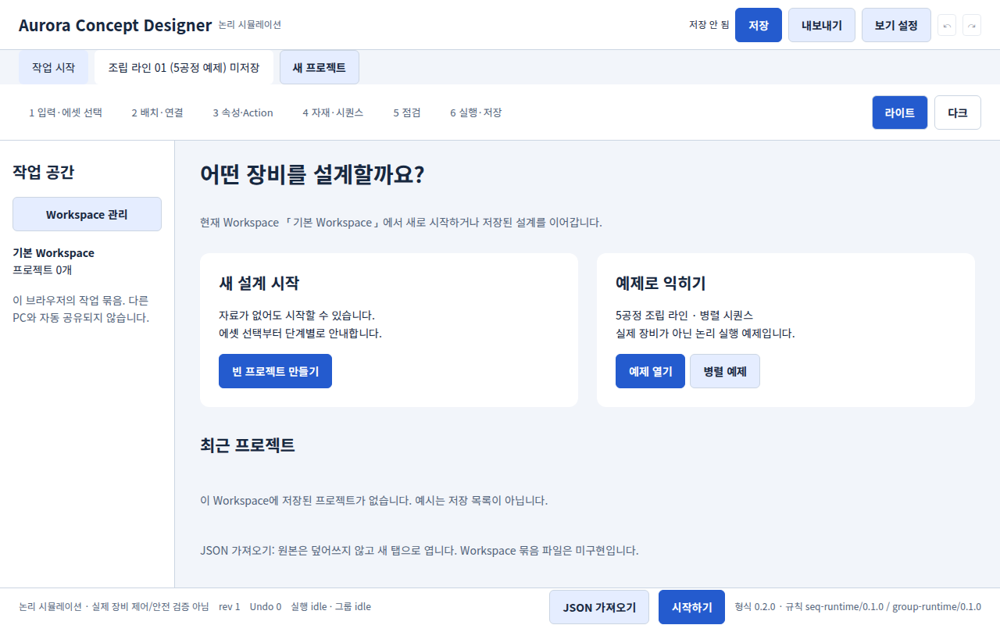

그림 33. 작업 시작. 저장된 프로젝트가 없으면 예시 이름을 채우지 않습니다.

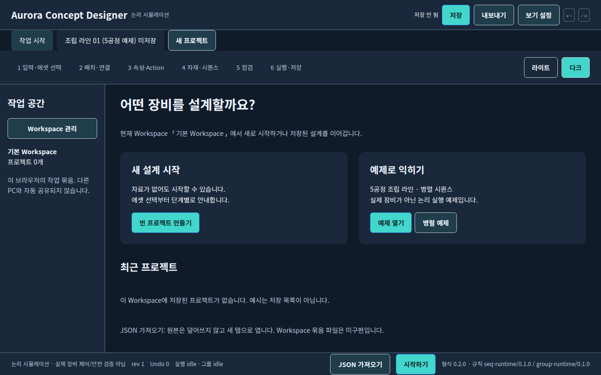

그림 34. 같은 시작 화면의 다크. 열린 탭과 문장은 그대로입니다.

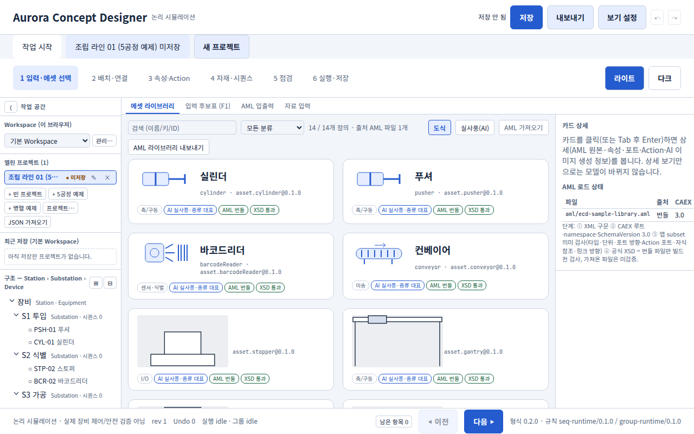

그림 35. 에셋 카드. 푸셔·실린더·바코드리더·컨베이어 도식은 공식 SVG를 100×48 칸에 둡니다. 실린더 칸은 인계 파일이 푸셔와 같은 SVG라 같은 그림입니다.

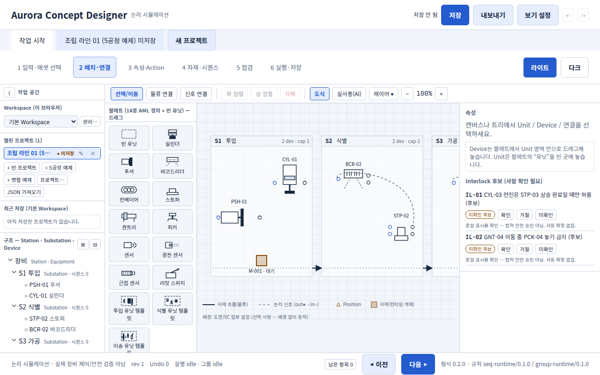

그림 36. 배치·연결. 드래그, 물류·신호 연결, 트리 접기는 이전과 같이 동작합니다.

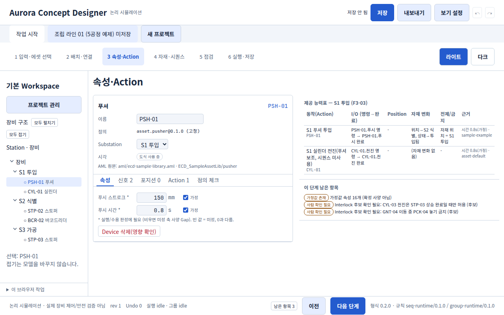

그림 37. 속성 편집.

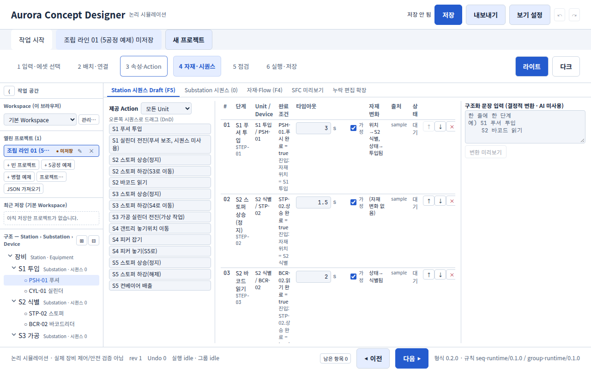

그림 38. Station 시퀀스.

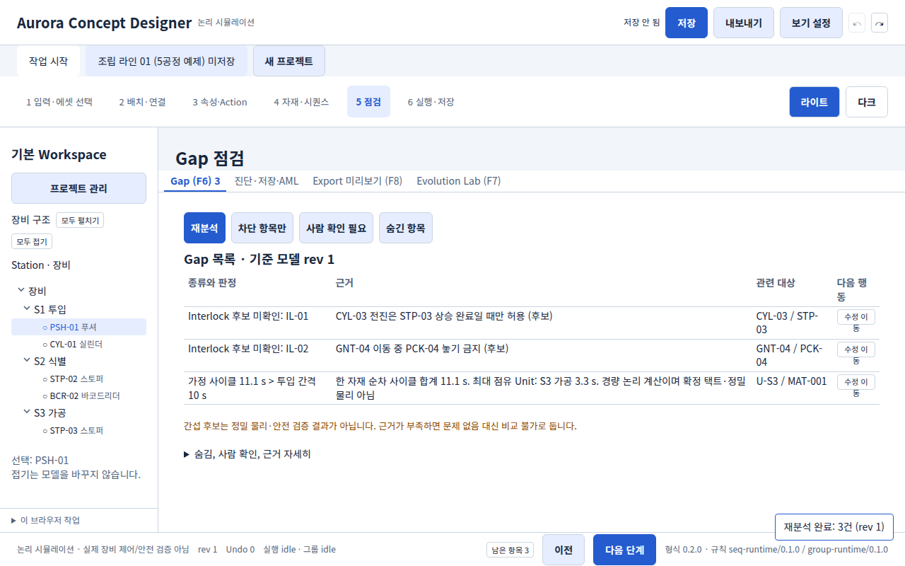

그림 39. Gap 점검.

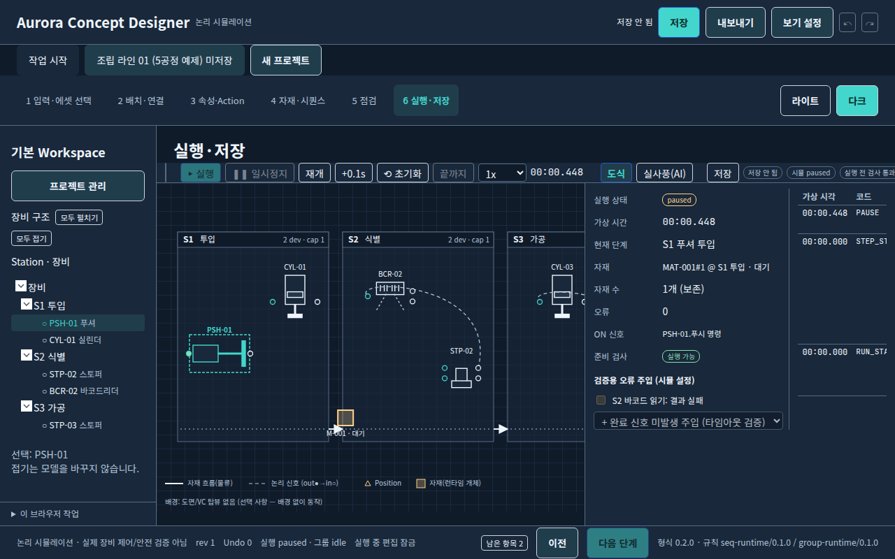

그림 40. 실행을 일시정지한 뒤 다크로 바꾼 화면. 가상 시각과 rev는 테마를 바꿔도 유지됩니다.

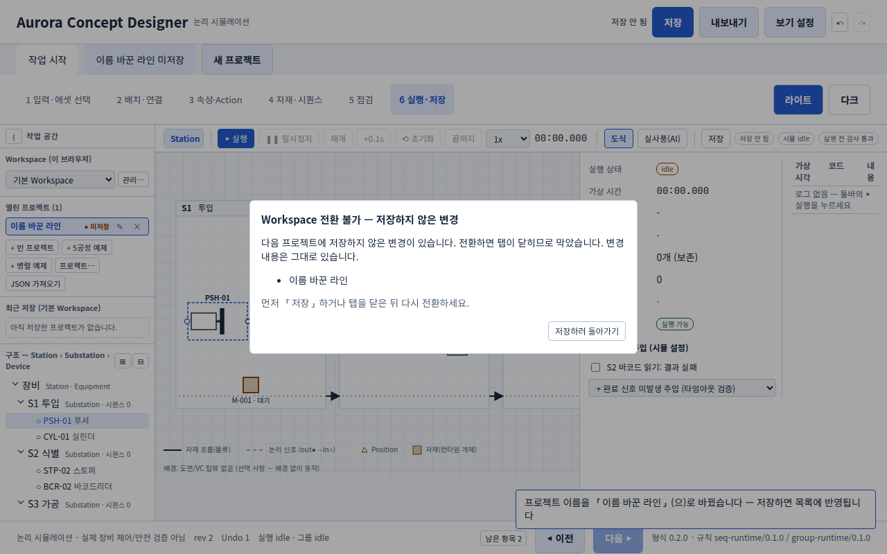

그림 41. 저장하지 않은 변경이 있으면 Workspace 전환을 막습니다. 버튼은 편집으로 돌아가며 자동 저장하지 않습니다.


그림 42. 깨진 JSON은 거부하고 현재 모델을 유지합니다.

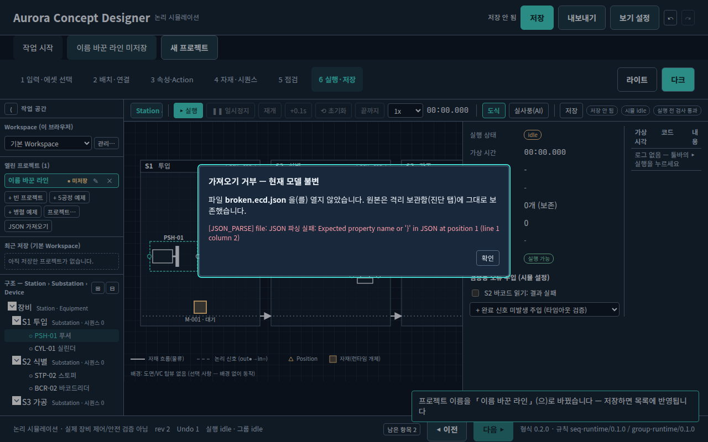

그림 43. 같은 거부 창의 다크.

1920 폭에서는 탐색 224, 라이브러리 상세 256을 유지하고 가운데만 넓어집니다. 글자 크기는 20px 제목을 유지했습니다. 그림은 `images/gui-r5/s00-light-1920.png`, `s00-dark-1920.png`, `s10-library-dark-1920.png`입니다.

## 19. 검증 기록 요약

아래는 기준 commit에 **이미 기록된** 결과입니다. 이 매뉴얼을 쓰면서 다시 실행하지 않았습니다.

출처 약칭: 요구검증표 = `REQUIREMENTS-VERIFICATION.md`, 브라우저검증 = `BROWSER-VERIFICATION.md`, AML지원 = `AML-SUPPORT.md`.

| 구분 | 기록된 결과 | 출처 |
|---|---|---|
| 자동 테스트 | `npm test` 7개 파일 **72개 통과**(실패 0) = 기존 57 + 신규 15(group 12, visuals 3) | README, 요구검증표 0절 |
| 타입 검사·빌드 | `npm run typecheck` 성공, `npm run build` 성공(단일 HTML, 외부 script/link 0) | 요구검증표 0절 |
| XSD 검사 | v0.3 기록에서는 저장소 XSD 검사를 생략(공식 XSD 미포함, 선택 사항). v0.2 때 작업 폴더의 로컬 XSD 사본으로 번들 AML 통과 기록이 있음 | AML지원 5절, README |
| v0.3 GUI 검수 | 작업 에이전트의 실제 브라우저 조작, 사람 검수 아님, Linux Chrome, `http://127.0.0.1:8767/…`, CSS 뷰포트 1920×1200. AI 카드 14·배지·메타데이터·토글 rev 불변, 테마 A/B/C, 1~6단계 상시 탐색기, 병렬 예제 1.200/1.600 s, DEVICE_CONFLICT 차단·Undo, 그룹 실행/일시정지/재개/끝까지·GROUP_COMPLETE, 프로젝트 전환 자동 일시정지·복귀 재개, 기본 Station 11.100 s, JSON 0.2 내보내기/가져오기 통과 | 브라우저검증 7절 |
| 콘솔 | 현재 페이지 콘솔 오류 0건 (세션 전체의 외부 `collector.github.com` 503 기록 6건은 원인 불명으로 앱 오류로 단정하지 않음) | 브라우저검증 7.2 |
| 화면 관찰 | 1920 폭에서 6단계 Canvas 내부 가로 스크롤 (헤더·탐색기·실행 조작은 보임) | 브라우저검증 7절 |
| 미검증 | 1280×800 전체 사용성·넘침 검수, Mac/Windows, file://, v0.1 가져오기 GUI | 브라우저검증 7.2 |
| TURN-001 (r3, 검토용) | ① 개발 자동 테스트: `npm test` 9개 파일 **114개 통과**(= 기존 72 + TURN-001 42), typecheck·build 성공. ② 독립 에이전트 재검증(사람 검수 아님): 코드·단위·React(jsdom) 테스트·메모리 내 빌드 범위 PASS. ③ 실제 GUI(작업 에이전트, Linux Chrome 1280×800, 검토용 빌드 sha256 `e72dd046…`): DEVICE_CONFLICT → 4 Substation 시퀀스 정확 이동(rev 2·Undo 1·Redo 0 유지), Action 타임아웃 미정 → `TIMEOUT_UNDEFINED` 2건 + 3 Action·`CYL-B1` 정확 이동(rev 3·Undo 2·Redo 0 유지), 테마 B/C 문구 가독성·줄바꿈 관찰 PASS. 특수 사례·키보드 포커스는 미검증(18.2) | `docs/turns/TURN-001.md` |
| TURN-002 (r4, 검토 후보) | ① 개발 자동 346 통과·실패 주입 162/162 ② 독립 재검수 rev 4 PASS(코드·자동 범위) ③ 실제 GUI rev 2·3·4 빌드 부분 PASS — 상세와 미검증은 20.9절 | `docs/turns/TURN-002.md`(main 미반영 검토본) |
| 화면 캡처 (매뉴얼 r2) | 1280×800에서 1~6단계·카드 상세·테마 B 화면을 열어 캡처(그림 2~17, 24). 사용성 검수가 아니며, 병렬 실행·JSON 조작은 이번에 다시 확인하지 않음 | 이 매뉴얼 |

## 20. Workspace와 프로젝트 관리, 구조 트리 접기/펼치기 (r4)

> 이 절은 **TURN-002 검토용 빌드** 기준입니다(정식 릴리스 아님, 검토 후보). 앱 버전 표기, 프로젝트 파일 형식 0.2.0, 실행 규칙은 바뀌지 않았습니다. 기존 C01·N03 요구를 구체화한 것이며 새 요구가 아닙니다. 검증 상태는 20.9절에 있습니다.

### 20.1 Workspace란 (MF-27) [구현, 검토용]

- **Workspace는 이 브라우저 저장소(localStorage) 안의 프로젝트 묶음**입니다. 파일·폴더가 아니며, 다른 PC·다른 브라우저와 자동으로 공유되지 않습니다. 옮기려면 지금처럼 프로젝트마다 「JSON 내보내기」→「JSON 가져오기」를 씁니다(15.2).
- Workspace 정보는 프로젝트 파일(JSON)에 들어가지 않습니다. 그래서 내보낸 JSON 형식은 그대로입니다.
- 처음 r4 빌드를 열면 이미 저장해 둔 프로젝트들이 **「기본 Workspace」** 에 자동으로 들어갑니다. 이때 프로젝트 내용과 저장 목록은 바꾸지 않습니다. 다만 들어가는 것은 **저장 목록에 있는 프로젝트만**입니다. 이전 버전의 50개 제한 때문에 목록에서 이미 빠진 오래된 프로젝트는 다시 나타나지 않습니다(20.10).
- 이 Workspace는 AutomationML/CAEX의 표준 개념이 아니라 이 앱이 정한 화면 관리 단위입니다(16절 AML 지원 범위와 무관).
- **하지 않는 것 [미구현]**: Workspace 파일·폴더, Workspace 단위 파일 묶음·내보내기, Workspace별 공유 에셋(라이브러리), 협업·동기화, 프로젝트를 다른 Workspace로 옮기거나 복사하는 화면, WPF 버전.

### 20.2 Workspace 만들기·이름 변경·삭제 (MF-27) [구현, 검토용]

1. 탐색기 「관리…」를 눌러 「Workspace 관리」 창을 엽니다.
2. **만들기**: 「+ 새 Workspace」 → 이름 입력 → 「만들기」. 만든 뒤 **자동으로 바뀌지 않습니다.** 옮겨 가려면 목록의 「전환」을 누릅니다(20.3).
3. **이름 변경**: 해당 줄의 「이름 변경」 → 새 이름 → 「이름 변경」. Workspace ID는 바뀌지 않습니다.
4. **삭제**: 해당 줄의 「삭제」 → 확인 창 「Workspace 삭제」. 확인 창의 기본 선택은 「취소」입니다.

이름 규칙(Workspace와 프로젝트 공통):

| 경우 | 결과 |
|---|---|
| 비어 있음·공백만 | 버튼이 비활성되고 이유가 표시됨 |
| 앞뒤 공백, 연속 공백 | 앞뒤는 지우고 연속 공백은 한 칸으로 |
| 60자 초과 | 거부 |
| 같은 이름(대소문자 무시) | 거부 — Workspace는 전체에서, 프로젝트는 같은 Workspace 안에서 |
| 이름이 바뀌지 않음 | 버튼 비활성 |

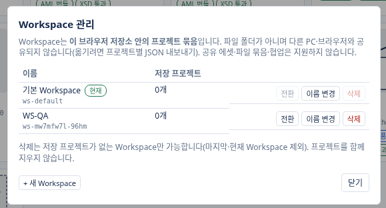

*그림 25. 「Workspace 관리」 창 — 안내문(이 브라우저 저장소 안의 프로젝트 묶음, 파일 폴더 아님), 「기본 Workspace」(「현재」)는 「전환」「삭제」가 회색, 빈 비현재 「WS-QA」는 「삭제」 가능 표시, 「+ 새 Workspace」 (TURN-002 rev 2 검토용 빌드, 작업 에이전트의 실제 화면 1280×800 캡처에서 원본 픽셀 그대로 자른 부분 확대, 2026-11-08). 이 빌드에서 빈 Workspace를 실제로 삭제(취소·확정)하는 조작은 GUI로 확인하지 않았습니다*

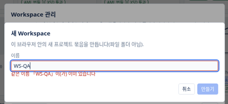

*그림 26. 「새 Workspace」 창에서 이미 있는 이름 「WS-QA」를 넣은 상태 — 「같은 이름 「WS-QA」이(가) 이미 있습니다」 표시와 회색 「만들기」 (TURN-002 rev 2 검토용 빌드, 작업 에이전트의 실제 화면 1280×800 캡처에서 원본 픽셀 그대로 자른 부분 확대, 2026-11-08)*

삭제 규칙: **저장 프로젝트가 없는 빈 Workspace만** 지울 수 있고, **현재 Workspace**와 **마지막 남은 Workspace**는 지울 수 없습니다. 이럴 때 「삭제」는 회색이며 이유가 버튼 설명에 나옵니다. 프로젝트를 함께 지우는 연쇄 삭제는 없습니다.

### 20.3 Workspace 전환 (MF-28) [구현, 검토용, 실제 GUI 일부]

- 탐색기 「Workspace 선택」 목록에서 고르거나, 관리 창의 「전환」을 누릅니다.
- 전환하면 **열린 탭을 모두 닫고** 새 Workspace에서 가장 최근에 저장한 프로젝트를 엽니다. 저장한 프로젝트가 없으면 빈 새 프로젝트가 열립니다. 저장된 프로젝트는 원래 Workspace에 그대로 남습니다.
- 다음 경우에는 전환을 **막습니다**:
  - 실행 중이거나 일시정지된 프로젝트가 있을 때 → 「⟲ 초기화」 후 다시 시도
  - **저장하지 않은 편집이 있는 탭**이 있을 때 → 「Workspace 전환 불가 — 저장하지 않은 변경」 창. 변경은 그대로 있으니 먼저 「저장」하거나 탭을 닫으세요.
- 저장한 적 없고 편집도 없는 새 탭만 있으면 「… 닫힙니다」 확인 창이 뜹니다(기본 「취소」, 「닫고 전환」).

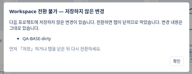

*그림 27. 이름을 바꾸고 저장하지 않은 「QA-BASE-dirty」 탭이 있을 때 Workspace를 바꾸려 한 결과 — 「Workspace 전환 불가 — 저장하지 않은 변경」, 변경 탭은 그대로 유지 (TURN-002 rev 3 검토용 빌드, 작업 에이전트의 실제 화면 1280×800 캡처에서 원본 픽셀 그대로 자른 부분 확대, 2026-11-08). 저장한 뒤에는 전환되었습니다*

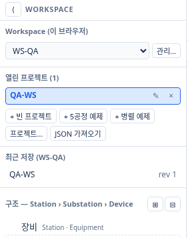

*그림 28. 「WS-QA」로 전환한 뒤 탐색기 — 열린 프로젝트·「최근 저장 (WS-QA)」에 이 Workspace의 「QA-WS」만 보임. 「기본 Workspace」의 프로젝트 목록에는 「QA-BASE」만 보였습니다 (TURN-002 rev 3 검토용 빌드, 작업 에이전트의 실제 화면 1280×800 캡처에서 원본 픽셀 그대로 자른 부분 확대, 2026-11-08)*

### 20.4 프로젝트 추가·이름 변경·삭제 (MF-29) [구현, 검토용]

**추가**: 기존과 같이 「+ 빈 프로젝트」「+ 5공정 예제」「+ 병렬 예제」「JSON 가져오기」로 탭을 만들고(5.1), **「저장」하는 순간 현재 Workspace에 들어갑니다.** 가져온 프로젝트와 같은 ID가 다른 Workspace에 저장되어 있으면 덮어쓰지 않고 「다른 Workspace에 같은 ID가 저장되어 있음」 창을 띄웁니다. 기본은 「취소」이고, 「새 ID 사본으로 저장」을 고르면 새 ID로 현재 Workspace에 저장합니다. 사본 저장이 실패하면 사본은 만들어지지 않고 현재 탭도 그대로입니다.

**열린 프로젝트 이름 변경**: 탭의 「✎」 → 새 이름 → 「이름 변경」.
- 모델 변경이라 rev가 1 오르고 **Undo/Redo로 되돌릴 수 있습니다.** 「● 미저장」이 표시됩니다.
- 탭·헤더·내보내기 이름은 바로 바뀌고, 저장 목록의 이름은 「저장」할 때 바뀝니다. ID는 바뀌지 않습니다.

**닫힌 저장 프로젝트 이름 변경**: 「프로젝트…」 → 해당 줄 「이름 변경」.
- 저장본을 새 이름으로 다시 저장합니다(rev +1). **Undo 대상이 아닙니다.**
- 열린 프로젝트는 여기서 바꿀 수 없고(버튼 회색) 탭의 「✎」를 쓰라고 안내합니다.

**삭제**: 「프로젝트…」 → 해당 줄 「삭제」 → 「프로젝트 영구 삭제 — 이름」 창.
- 창에 이름·ID·rev, "영구 삭제", "되돌릴 수 없습니다(Undo 대상 아님)"가 표시됩니다. 버튼은 「취소」(기본 선택), 「JSON 내보내기」, 「영구 삭제」입니다.
- **열린 프로젝트는 지울 수 없습니다**(버튼 회색). 먼저 탭을 닫으세요.
- 지우면 그 프로젝트의 본문·저장 목록 항목·Workspace 소속이 함께 지워지고, 다른 프로젝트와 다른 Workspace는 바뀌지 않습니다.

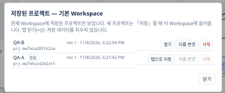

*그림 29. 「저장된 프로젝트 — 기본 Workspace」 — 닫힌 「QA-B」는 「열기」「이름 변경」「삭제」, 열린 「QA-A」(「열림」)는 「탭으로 이동」만 되고 「이름 변경」「삭제」가 회색 (TURN-002 rev 2 검토용 빌드, 작업 에이전트의 실제 화면 1280×800 캡처에서 원본 픽셀 그대로 자른 부분 확대, 2026-11-08)*

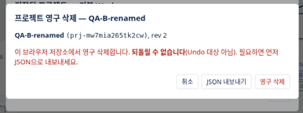

*그림 30. 「프로젝트 영구 삭제 — QA-B-renamed」 — 이름·ID·rev 2, 「되돌릴 수 없습니다(Undo 대상 아님)」 안내, 「취소」「JSON 내보내기」「영구 삭제」 (TURN-002 rev 2 검토용 빌드, 작업 에이전트의 실제 화면 1280×800 캡처에서 원본 픽셀 그대로 자른 부분 확대, 2026-11-08). 이 빌드에서 취소(목록 유지)와 확정 삭제를 확인했습니다*

### 20.5 닫기와 삭제의 차이 (MF-29) [구현, 검토용]

| 조작 | 하는 일 | 저장 데이터 |
|---|---|---|
| 탭 「×」(닫기) | 화면의 탭만 닫음. 저장 안 된 변경이 있으면 확인 | **그대로 남음** — 「프로젝트…」·최근 저장에서 다시 열 수 있음 |
| 「프로젝트…」 → 「삭제」 | 이 브라우저 저장소에서 영구 삭제 | **지워짐** — 되돌릴 수 없음. 필요하면 먼저 「JSON 내보내기」 |
| Workspace 전환 | 열린 탭을 닫고 다른 Workspace를 엶 | 그대로 남음 |
| Workspace 「삭제」 | 빈 Workspace만 지움 | 프로젝트 데이터는 원래 없음 |

### 20.6 저장소가 실패할 때의 안전 정책 (MF-30) [구현, 검토용]

브라우저 저장소는 공간이 부족하거나 브라우저 정책 때문에 쓰기·읽기가 실패할 수 있습니다. r4 빌드는 다음을 지킵니다.

- **한꺼번에 쓰기**: 저장, 새 ID 사본 저장, 닫힌 프로젝트 이름 변경, 삭제, Workspace 변경은 관련된 값(프로젝트 본문·저장 목록·Workspace 목록)을 하나의 묶음으로 씁니다. 중간에 실패하면 원래대로 되돌리고 실패를 알립니다. 되돌리기도 실패하면 잠깐 남겨 둔 복구 기록으로 **다음 저장 직전 또는 다음 시작 때** 원래 상태로 되돌립니다. 그래서 프로젝트가 목록에서 사라진 채로 남지 않게 합니다.
- **실패를 성공으로 표시하지 않습니다.** 실패하면 오류 메시지만 나오고 탭의 「● 미저장」도 그대로입니다.
- **원본을 덮어쓰지 않습니다**:
  - Workspace 목록이 깨져 있으면 원문을 별도 보관에 성공한 뒤에만 새로 만듭니다. 보관에 실패하면 원문을 그대로 두고 이번에는 메모리에서만 동작합니다.
  - Workspace 목록을 읽지 못하면 이번 실행은 메모리에서만 동작합니다. 이 실행 동안은 **Workspace 변경·저장·삭제가 거부**됩니다. 「JSON 내보내기」로 작업을 보관하고 페이지를 새로 고치세요.
  - 저장 목록이 깨져 있으면 덮어쓰지 않고 저장·이름 변경·삭제를 거부합니다.
- **다른 탭과 동시에 쓰는 경우**: 화면이 알고 있는 Workspace 목록과 저장소의 목록이 다르면 쓰지 않고 새로 고침을 안내합니다. 여러 탭에서 동시에 편집하는 경우를 완전히 맞춰 주는 기능은 아닙니다.
- **복구 기록이 손상된 경우**: 자동으로 고치지 않고 데이터와 기록을 그대로 둡니다. 그 뒤로 저장·Workspace 변경은 계속 막힙니다. **현재 작업은 「JSON 내보내기」로 보관할 수 있습니다.** 앱 안에서 기록을 정리하는 기능은 없습니다 **[미구현]**(18.1). 보기 설정(테마·접기 상태 등) 저장은 이와 별개로 계속 동작합니다.

### 20.7 구조 트리 접기/펼치기와 키보드 (MF-31) [구현, 검토용]

| 조작 | 결과 |
|---|---|
| Station·Substation 행의 「▸」/「▾」 클릭 | 접기/펼치기(행을 선택하지는 않음) |
| 「⊞」 (트리 모두 펼치기) | Station과 모든 Substation 펼침 |
| 「⊟」 (트리 모두 접기) | **Station과 Substation 모두 접기** — Station 행만 보임. Station을 펼치면 Substation은 접힌 채 |
| → / ← | 펼치기 / 접기. Device에서 ←는 부모 Substation으로 이동 |
| ↑ / ↓ | 보이는 항목 사이 이동 |
| Enter / Space | 항목 선택(기존과 같음). Station은 접기/펼치기 |

- 처음에는 모두 펼쳐져 있습니다. 접기 상태는 프로젝트마다 기억됩니다.
- 선택한 항목이 접힌 행 안에 있으면 그 행에 「● 선택 포함」이 표시됩니다. 단계를 옮겨도 **자동으로 펼치지 않습니다**. 선택은 Canvas·속성 패널에서 계속 보입니다.
- 접기/펼치기는 **보기만 바꿉니다**. 모델, 선택, rev, Undo/Redo, 그룹 실행 대상, JSON 내보내기 내용은 바뀌지 않습니다.
- 보조기술용으로 트리는 계층 구조(하위 묶음이 부모 항목 안에 있음)와 펼침 상태를 알립니다. 실제 스크린리더로 사람이 확인하지는 않았습니다.

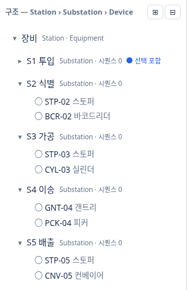

*그림 31. 구조 트리에서 「S1 투입」을 접은 상태 — 그 안의 선택 항목 때문에 「● 선택 포함」 표시, 나머지 Substation은 펼친 채, 오른쪽 위 「⊞」「⊟」 (TURN-002 rev 4 검토용 빌드, 작업 에이전트의 실제 화면 1280×800 캡처에서 원본 픽셀 그대로 자른 부분 확대, 2026-11-08)*

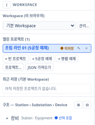

*그림 32. 「⊟」(트리 모두 접기) 뒤 — Station 「장비」 행만 보이고 「● 선택 포함」 표시 (TURN-002 rev 4 검토용 빌드, 작업 에이전트의 실제 화면 1280×800 캡처에서 원본 픽셀 그대로 자른 부분 확대, 2026-11-08)*

### 20.8 대화상자 키보드 규칙과 보기 설정 분리 (MF-32) [구현, 검토용, 실제 GUI 일부]

- (20.8은 실제 GUI에서 관리 창 Esc·포커스 복귀만 확인했습니다 — 20.9.)
- 관리 창·이름 창·확인 창이 열리면 포커스가 창 안으로 들어갑니다. 확인 창의 기본 선택은 「취소」입니다.
- **Esc는 맨 위 창 하나만 닫습니다.** 확인 창에서 Esc나 창 바깥 클릭은 「취소」와 같아서 아무 동작도 하지 않습니다. 닫히면 포커스는 창을 연 버튼으로 돌아갑니다.
- 창이 열려 있는 동안에는 뒤쪽 프로젝트의 단축키(Ctrl/Cmd+Z, Ctrl+Y, Ctrl/Cmd+Shift+Z, Delete, Backspace)가 동작하지 않습니다. 이름 입력칸 안에서는 브라우저의 기본 입력 실행 취소를 쓸 수 있습니다.
- Tab으로 창 밖의 버튼으로 이동하는 것을 막는 처리(포커스 가두기)는 없습니다 **[미구현]**.
- **보기 설정 분리**: 테마, 도식/실사풍 토글, 현재 단계, 트리 접기 상태는 브라우저의 보기 설정(UserView)에만 저장됩니다. 프로젝트 파일·Workspace 목록에는 들어가지 않고, 모델과 rev도 바꾸지 않습니다.

### 20.9 검증 상태 (2026-11-08 KST)

| 구분 | 결과 | 범위와 한계 |
|---|---|---|
| ① 개발 자동 테스트 | `npm test` 12개 파일 **346개 통과**, typecheck·build 성공. 저장소 실패 주입 162건에서 주입한 실패가 162건 모두 실제로 발생 | 메모리 저장소와 jsdom 모의. 실제 브라우저가 아님 |
| ② 독립 에이전트 재검수 (사람 검수 아님) | rev 1·rev 2 보류 → rev 3 저장소 안전 PASS → **rev 4 PASS**(346 tests, 162 hit, typecheck, 메모리 빌드, 새 고위험 결함 없음) | 코드·자동 테스트 범위. 실제 GUI·스크린리더 확인 아님 |
| ③ 실제 GUI — rev 2 빌드 (작업 에이전트, 사람 검수 아님) | Workspace 만들기·이름 변경, 빈 이름·같은 이름 거부, 현재·마지막 Workspace 「삭제」 회색과 빈 비현재 Workspace 「삭제」 가능 표시(그림 25·26). 프로젝트 「QA-A」 저장·이름 변경, 열린 프로젝트의 이름 변경·삭제 회색과 이유(그림 29). 닫힌 「QA-B」 이름 변경, 삭제 취소 시 목록 유지, 확정 삭제(그림 30). 트리·테마 B/C 부분 확인 | 부분 PASS |
| ③ 실제 GUI — rev 3 빌드 | 기본 Workspace에서 「QA-BASE」 저장 → 「WS-QA」로 전환 → 「QA-WS」 저장 → 각 Workspace 목록에 자기 프로젝트만 보임(그림 28). 「QA-BASE-dirty」 이름 변경 후 저장하지 않고 전환 → 차단, 변경 탭 유지(그림 27). 저장 뒤 전환 성공 | 부분 PASS. 이 전환 시나리오는 rev 4에서 반복하지 않음 |
| ③ 실제 GUI — rev 4 빌드 | 관리 창 Esc 닫힘·맨 위 입력 창만 Esc·포커스 복귀. 트리 계층 level 1~3, 키보드 선택·접기, 모두 접기(Station 포함, 그림 32), 숨은 선택 표시(그림 31), rev·Undo 불변 | 부분 PASS. 대화상자가 열린 동안 Ctrl+Z/Y를 눌러도 rev 1·Undo 0 상태가 바뀌지 않았지만, **Undo 이력이 없는 샘플**이어서 "뒤쪽 Undo 차단"의 실제 GUI 증명은 아님(독립 jsdom에서만 증명) |
| 실제 GUI 미검증 | 빈 Workspace 실제 삭제(취소·확정), 프로젝트가 있는 Workspace의 삭제 차단, 새로 고침 뒤 접기 상태 유지, 실행·일시정지 중 전환 차단, Mac/Windows·OS 보조기술·사람의 스크린리더, 실제 quota·여러 탭 동시 사용 | 자동 테스트 결과를 GUI 결과로 옮겨 적지 않음 |

이 판은 **정식 릴리스가 아니라 검토 후보**입니다. 실제 GUI 확인은 집중 검증 시간 안에서 위 항목까지만 했고 더 진행하지 않았습니다.

### 20.10 알려진 제한 (미구현과 미검증 구분)

| 항목 | 구분 | 내용 |
|---|---|---|
| 이전 50개 제한으로 목록에서 빠진 프로젝트 | 미구현 | 본문은 남아 있지만 자동으로 다시 찾아 넣지 않음. r4부터 새 저장에서는 이런 누락이 생기지 않음 |
| 손상된 복구 기록 | 미구현(정리 기능) | 저장이 계속 막힘. 「JSON 내보내기」로 보관. 앱 안 정리·차단 상태 상시 표시 없음 |
| 실제 저장 공간 부족(quota)·쓰기 도중 강제 종료 | 미검증 | 모의 실패로만 확인 |
| 여러 탭·여러 창 동시 사용 | 미검증·부분 | 오래된 Workspace 목록으로 덮어쓰는 것만 막음. 완전한 동기화·잠금 아님 |
| Mac/Windows, OS 보조기술, 사람의 스크린리더 확인 | 미검증 | — |
| 대화상자 포커스 가두기 | 미구현 | Tab으로 창 밖 이동 가능 |
| 실행·일시정지 중 전환 차단, 빈 Workspace 실제 삭제, 프로젝트가 있는 Workspace 삭제 차단, 새로 고침 뒤 접기 유지의 실제 GUI 확인 | 미검증 | 자동 테스트만 |

## 부록 A. 기능 ID와 절 번호 — 향후 요구 추가 규칙

### A.1 기능 ID 표

| 기능 ID | 기능 | 절 | 관련 요구 | 상태 | 검증 근거 |
|---|---|---|---|---|---|
| MF-01 | 제품 성격·범위 | 1 | C04, C09 | 구현 | — |
| MF-02 | 왼쪽 탐색기 | 3.2 | N03 | 구현 | v0.3 GUI |
| MF-03 | 새 프로젝트·예제 | 5.1 | C01, N02, N03 | 구현 | v0.3 GUI(예제) |
| MF-04 | 프로젝트 전환·자동 일시정지 | 5.2 | N03 | 구현 | v0.3 GUI |
| MF-05 | 라이브러리 검색·분류 | 6.1 | C03-07/08 | 구현 | v0.2 GUI |
| MF-06 | 카드 상세 | 6.2 | C03-08, C02-05 | 구현 | v0.3 GUI |
| MF-07 | 프로젝트에 추가 | 6.3 | C03-AC5, C02-09 | 구현 | v0.2 GUI |
| MF-08 | AI 실사풍 이미지 14종 | 6.4 | N04 | 구현 | v0.3 GUI |
| MF-09 | AML 가져오기/내보내기 | 6.5 | C02-04~10 | 구현 | v0.2 GUI, 자동 |
| MF-10 | 배치·연결 | 7 | F2 | 구현 | 자동, v0.1 일부 |
| MF-11 | 계층 Station › Substation › Device | 8.1 | N01 | 구현(부분) | 자동 |
| MF-12 | 속성·Signal·Action 편집 | 8.2 | F3 | 구현 | 자동, v0.1 일부 |
| MF-13 | Station 시퀀스 Draft | 9.1 | F5 | 구현 | 자동 |
| MF-14 | 자재·Flow | 9.2 | F4 | 구현 | 자동 |
| MF-15 | Substation 시퀀스 편집·충돌 검사 | 9.3 | N02 | 구현(설계 제안) | 자동, v0.3 GUI(충돌) |
| MF-16 | 점검(Gap·진단·Export 미리보기) | 10 | F6, F8, C08 | 구현(부분) | 자동 |
| MF-17 | Station 실행 | 11.2 | C04 | 구현 | v0.3 GUI(11.100 s) |
| MF-18 | Substation 그룹 실행 (r3: 차단 안내·이동 버튼) | 11.3 | N02, C10 | 구현(설계 제안) | v0.3 GUI; r3 안내는 자동만 |
| MF-19 | 실습 A 5공정 | 12.1 | SC-AC1 | 구현 | v0.3 GUI |
| MF-20 | 실습 B 병렬 | 12.2 | N02 | 구현 | v0.3 GUI |
| MF-21 | 실습 C DEVICE_CONFLICT·Undo | 12.3 | N02, C06 | 구현 | v0.3 GUI |
| MF-22 | 도식/실사풍(AI) 토글 | 13.1 | N04, C03 | 구현 | v0.3 GUI |
| MF-23 | 테마 A/B/C | 13.2 | C03, N05 | 구현 | v0.3 GUI |
| MF-24 | 저장·열기 | 14.1–14.2 | C01, D02 | 구현 | v0.1 일부 |
| MF-25 | JSON 0.2 내보내기/가져오기 | 14.3–14.4 | C05 | 구현 | v0.3 GUI, 자동(0.1 변환) |
| MF-26 | AML subset 지원 | 16 | C02 | 구현(subset) | 자동 |
| MF-27 | Workspace(브라우저 안 관리 단위) 만들기·이름 변경·삭제 (r4) | 20.1–20.2 | C01, N03 | 구현(검토용) | 자동, 독립; GUI rev 2 부분(실제 삭제 미검증) |
| MF-28 | Workspace 전환 규칙 (r4) | 20.3 | N03 | 구현(검토용) | 자동, 독립; GUI rev 3 부분(실행 중 차단 미검증) |
| MF-29 | 프로젝트 이름 변경·삭제·Workspace 소속, 닫기와 삭제 구분 (r4) | 20.4–20.5 | C01, N03 | 구현(검토용) | 자동, 독립; GUI rev 2·3 부분 |
| MF-30 | 저장소 실패 안전 정책 (r4) | 20.6 | C01, D02 | 구현(검토용) | 자동(메모리 저장소 모의), 독립; 실제 quota·동시성 미검증 |
| MF-31 | 구조 트리 접기/펼치기·키보드 (r4) | 20.7 | N03 | 구현(검토용) | 자동, 독립; GUI rev 4 부분(새로 고침 유지·스크린리더 미검증) |
| MF-32 | 대화상자 키보드 규칙·보기 설정 분리 (r4) | 20.8 | N03, N05 | 구현(검토용) | 자동, 독립; GUI rev 4 부분(Esc·복귀. Undo 차단은 GUI 증명 아님) |
| MF-33~ | (예약) 다음 요구용 | 21~ | — | — | — |

### A.2 요구를 추가할 때의 규칙

1. **기존 번호는 바꾸지 않습니다.** 절 번호 0~19와 MF-01~MF-26은 고정합니다. (r4에서 20절과 MF-27~MF-32를 이 규칙대로 추가했습니다.)
2. 새 기능은 다음 빈 번호(MF-27, MF-28 …)를 받고, A.1 표에 한 줄을 추가합니다.
3. 기존 단계의 세부 기능이면 해당 절에 하위 번호를 붙입니다(예: 9.4). 새로운 영역이면 **20절부터** 새 절을 만듭니다(부록은 항상 맨 뒤).
4. 아직 구현되지 않은 요구는 18.1절에 **[미구현·예정]** 으로만 적고 조작 절차를 쓰지 않습니다. 구현·검증되면 본문 절차를 쓰고 18절에서 지웁니다.
5. 사라진 기능은 번호를 재사용하지 않고 A.1 표에서 상태를 "삭제(버전)"로 남깁니다.
6. 매뉴얼 버전(UM-앱버전-rN)을 올리고 부록 C 체크리스트를 따릅니다.

## 부록 B. 용어

| 용어 | 뜻 |
|---|---|
| Station | 장비 전체 (내부 이름 Equipment). 프로젝트당 1개 |
| Substation | 장비 안의 구간 유닛 (내부 이름 Unit) |
| Device | Substation 안의 실린더·스토퍼·센서 등 |
| Action | Device가 하는 동작(명령 Signal → 완료 Signal, 동작 시간, 타임아웃) |
| Station 시퀀스 | Station 전체의 순차 단계 목록(기존 단일 시퀀스) |
| Substation 시퀀스 | 한 Substation 안의 여러 시퀀스. 그룹 실행 단위 |
| 그룹 실행 | 한 Substation의 시퀀스들을 공통 가상 시계로 함께 실행 |
| 가상 시간 | 실제 시계가 아닌 정수 ms 단위 계산 시간. 재생 속도와 무관하게 결과가 같음 |
| rev | 모델 리비전. 모델을 바꿀 때마다 1 증가 |
| UserView | 테마·토글·현재 단계 등 보기 설정. 브라우저에만 저장, 프로젝트 파일에 없음 |
| AML / CAEX | AutomationML 파일 / 그 기반 XML 형식. 이 앱은 CAEX 3.0 subset만 해석 |
| XSD | XML 구조 규칙 파일. 이 앱은 브라우저 안에서 XSD 검사를 하지 않음 |
| [예시] 가정값 | 실제 사양이 아닌 임시 값 |
| Workspace (r4) | 이 브라우저 저장소 안의 프로젝트 묶음. 파일·폴더가 아니며 다른 PC·브라우저와 공유되지 않음. 프로젝트 파일(JSON)에 들어가지 않음 |
| 닫기 / 삭제 (r4) | 닫기 = 탭만 닫음(저장 데이터 그대로). 삭제 = 저장 데이터를 이 브라우저에서 영구 삭제 |
| 복구 기록 (journal, r4) | 저장 중 중단에 대비해 잠깐 남기는 기록. 정상이면 저장이 끝날 때 지워짐 |

## 부록 C. PDF 생성 재현법과 버전 갱신 체크리스트

### C.1 PDF 생성 재현법

이 PDF는 같은 Markdown 원고(`docs/user-manual/USER-MANUAL.ko.md`)를 **브라우저 없이 파일 변환만으로** 만든 것입니다. 생성 스크립트와 의존성 목록은 매뉴얼과 같은 폴더에 있습니다.

| 파일 | 내용 |
|---|---|
| [`build_user_manual_pdf.py`](build_user_manual_pdf.py) | Markdown → HTML(인쇄용 CSS, A4, 쪽 번호) → PDF. Python `markdown` + `WeasyPrint`만 사용. 웹 브라우저·네트워크 사용 안 함 |
| [`requirements-pdf.txt`](requirements-pdf.txt) | 고정 버전: `markdown==3.11.3`, `weasyprint==70.0` |

- 필요: Python 3.9 이상, 위 패키지, WeasyPrint가 쓰는 시스템 라이브러리(Pango 등 — 운영체제별 설치법은 WeasyPrint 문서 참고), 한글 글꼴(Noto Sans CJK KR 또는 나눔고딕 등). 이번 PDF는 Linux에서 Noto Sans CJK KR로 만들었으며, Mac/Windows에서의 생성은 확인하지 않았습니다 **[미검증]**.
- 그림은 `../screenshots/`와 `images/`의 PNG 파일을 읽어 PDF 안에 넣습니다. 파일 이름이 `-zoom.png`로 끝나는 부분 확대 그림은 원본 1픽셀을 0.25 mm로 크게 표시하고(쪽 너비가 상한), 그림과 바로 아래 캡션은 같은 쪽에 놓입니다. 저장소 상대 링크는 `--ref`로 지정한 commit에 고정된 GitHub 주소로 바꿔, PDF에 로컬 파일 경로가 남지 않게 합니다. 목차 링크는 PDF 안의 절로 이동합니다.

```bash
# 저장소 루트에서
python3 -m venv .venv-manual
.venv-manual/bin/pip install -r docs/user-manual/requirements-pdf.txt
.venv-manual/bin/python docs/user-manual/build_user_manual_pdf.py \
  --md docs/user-manual/USER-MANUAL.ko.md \
  --out docs/user-manual/USER-MANUAL.ko.pdf \
  --ref <링크를 고정할 commit SHA>
# 확인(poppler-utils): pdffonts / pdfinfo / pdftotext / pdftoppm
```

### C.2 버전 갱신 체크리스트

1. 기준 commit·앱 버전(`src/model/types.ts`의 `APP_VERSION`, `FILE_FORMAT_VERSION`)을 확인하고 표지 표를 고칩니다.
2. 바뀐 화면 라벨을 소스(`src/ui/*.tsx`, `src/ui/wizard.ts`)에서 다시 확인합니다.
3. 새 기능은 부록 A 규칙으로 번호를 붙이고, 미구현은 18절에만 적습니다.
4. 검증 수치(테스트 개수, GUI 검수 항목)는 `REQUIREMENTS-VERIFICATION.md`·`BROWSER-VERIFICATION.md`의 기록만 옮기고, 직접 다시 실행하지 않았으면 "재실행"이라고 쓰지 않습니다.
5. 스크린샷을 바꾸면 실제 GUI 캡처만 쓰고(`docs/screenshots/` 또는 `docs/user-manual/images/`, 없는 UI 합성 금지) 주소창·개인 정보가 없는지 확인합니다. 그림은 설명하는 절 바로 뒤에 두고 캡션에 그림 번호·볼 곳·캡처 조건을 적습니다. 부분 확대는 파일 이름을 `-zoom.png`로 끝내고 캡션에 "부분 확대"라고 씁니다.
6. C.1 방법으로 PDF를 다시 만들고 확인합니다: 한글 글꼴 내장(`pdffonts`의 emb=yes), 표·코드 넘침 없음(`pdftoppm` 페이지 이미지 확인), 쪽 번호, 목차·외부 링크, `pdftotext`로 핵심 절·문구 존재.
7. 공개 안전 확인: 개인 로컬 절대 경로, 개인 노트 URL, 계정 메일, 토큰이 MD/PDF(메타데이터 포함)에 없어야 합니다.
8. Markdown과 PDF를 **같은 commit**에 함께 올립니다. 이전 버전은 git 이력(릴리스별 commit)으로 보존하고 별도 사본 파일을 만들지 않습니다. 기능 ID MF-01~MF-32는 유지하고, 바뀐 기능·미검증 항목만 갱신합니다.

### C.3 개정 이력

| 매뉴얼 개정 | 날짜 (KST) | 앱 버전 | 내용 |
|---|---|---|---|
| UM-0.3.0-r1 | 2026-11-08 | v0.3.0-prototype | 첫 판 (MD + 오프라인 PDF) |
| UM-0.3.0-r2 | 2026-11-08 | v0.3.0-prototype | 기능별 실제 화면 그림 추가(1280×800 캡처 8장 + 부분 확대 9장, 기존 1920×1200 캡처 3장 유지, 그림 1~20), 1280×800 관련 표기 범위 정정. **기능 추가·변경 없음** |
| UM-0.3.0-r3 (검토용, 정식 릴리스 아님) | 2026-11-08 | v0.3.0-prototype + TURN-001 (Draft PR, 미병합, 버전 미정) | TURN-001 반영: 9.3 차단 표, 11.3 차단 목록 안내 3종·이동 버튼(그림 19·20), 12.3 기존 "화면 문구 불일치" 주의 삭제·버튼 설명, 그림 19(이전 1920×1200 충돌 캡처)를 r3 실제 화면 그림 21~23으로 교체, 테마 B 그림 번호 20→24, 17 문제 해결, 18 미구현/미검증, 19 검증 요약 3종 구분. PDF 링크는 검토 브랜치 주소 사용(병합 시 다시 고정). **새 기능 아님** |
| UM-0.3.0-r4 (검토용, 정식 릴리스 아님) | 2026-11-08 | v0.3.0-prototype + 기준 `main` `cd54f4c` + TURN-002 미커밋 검토본 | TURN-002 반영: 20절 새로 추가(MF-27~MF-32), 3.2·5·14·17·18·19절 해당 부분과 부록 A·B·D 갱신. 새 그림 25~32는 TURN-002 rev 2·3·4 검토용 빌드의 실제 화면 부분 확대 8장. 기존 절·기능 ID·그림 번호 1~24 유지. 검토 후보 — commit 전 |
| UM-0.3.0-r5 (검토용, 정식 릴리스 아님) | 2026-11-08 | v0.3.0-prototype. 기준 `main`은 PR #5 병합 `179ac28` | 웹 껍데기·라이트/다크·31화면 연결. 21절, 그림 33~43. 사람 검수 전 |

### C.4 TURN 이력

| TURN | 날짜 (KST) | 내용 | 상태 |
|---|---|---|---|
| TURN-002 | 2026-11-08 | Workspace 만들기·이름 변경·삭제·전환, 프로젝트 이름 변경·삭제(닫기와 구분), 저장소 실패 안전 정책, 구조 트리 접기/펼치기·키보드, 대화상자 키보드 규칙. 파일 형식·실행 규칙 변경 없음 | `main`에 병합됨(PR #5, 병합 `179ac28`) |
| TURN-003 | 2026-11-08 | Figma 기준 웹 껍데기, 라이트/다크, 6단계와 기존 편집·실행 연결. 미구현 화면은 비활성 안내 | 검토 후보. 자동 테스트와 Chrome 캡처는 `docs/turns/TURN-003.md`. 사람 검수 전 |
| TURN-001 | 2026-11-08 | Substation 그룹 실행 차단 항목에 원인별 안내(수정 위치 / 원인 확인 / 현재 화면에서 직접 편집 불가)와 이동 버튼 추가, 잘못된 "3 시퀀스 단계" 문구 제거. 규칙·파일 형식·편집기 변경 없음 | 개발 자동 테스트 114 통과, 독립 에이전트 재검증(코드·자동 범위) PASS, 실제 GUI 대표 2경로 PASS(특수 사례·키보드 미검증). **검토용 Draft PR, 정식 릴리스 HOLD** — 상세 `docs/turns/TURN-001.md`. (이후 `main`에 병합됨 — 병합 commit `cd54f4c`) |

## 부록 D. 참조 파일

앱 기준 commit `28c962f`(= `main` 병합 commit `7351018`과 같은 앱 내용)의 저장소 파일입니다. (아래 링크는 저장소 안 상대 경로이며, PDF에서는 commit 고정 GitHub 주소로 열립니다.)

| 파일 | 내용 |
|---|---|
| [`README.md`](../../README.md) | 빠른 시작, v0.3 요약, 런타임 규칙, 알려진 한계 |
| [`BROWSER-VERIFICATION.md`](../../BROWSER-VERIFICATION.md) | 실제 브라우저 관찰 기록 (v0.3 = 7절) |
| [`REQUIREMENTS-VERIFICATION.md`](../../REQUIREMENTS-VERIFICATION.md) | 요구별 구현·검증표, 자동 테스트 72개 |
| [`AMBIGUITIES.md`](../../AMBIGUITIES.md) | 임시 가정과 결정 필요 항목 (v0.3 = A41~A50) |
| [`AML-SUPPORT.md`](../../AML-SUPPORT.md) | AML/CAEX 지원 범위 |
| [`docs/DEVELOPMENT-WORKFLOW.md`](../DEVELOPMENT-WORKFLOW.md) | Mac/Windows 작업 방법 |
| [`docs/requirements-v0.3.md`](../requirements-v0.3.md) | v0.3 요구 공개 통합본 (N01~N08) |
| [`docs/turns/TURN-001.md`](../turns/TURN-001.md) | TURN-001 범위·인수 조건·검토 이력 (r3) |
| `docs/turns/TURN-002.md` (TURN-002 검토본 — 아직 `main`에 없어 링크를 걸지 않음) | TURN-002 범위·데이터 규칙·인수 조건·검토 이력 |
| [`docs/UX-SCENARIOS.md`](../UX-SCENARIOS.md), [`docs/WIREFRAMES.md`](../WIREFRAMES.md) | UX 시나리오, 화면안 |
| (r4) `src/ui/WorkspacePanels.tsx`, `src/ui/ProjectTree.tsx`, `src/storage/workspaces.ts`, `src/storage/txn.ts` | Workspace·프로젝트 관리 창, 구조 트리, Workspace 목록·한꺼번에 쓰기 규칙 |
| `src/ui/App.tsx`, `src/ui/wizard.ts`, `src/ui/Library.tsx`, `src/ui/SubstationPanels.tsx`, `src/ui/Inspector.tsx`, `src/ui/Panels.tsx`, `src/ui/viewSettings.ts` | 화면 라벨 원본 |
| `src/runtime/group.ts`, `src/storage/fileFormat.ts`, `src/model/sample.ts`, `src/model/types.ts` | 그룹 실행 규칙·차단 코드, 파일 형식, 예제, 버전 상수 |
| `docs/screenshots/v0.3-library-ai.png`, `v0.3-group-complete.png` | 실제 GUI 캡처(Linux Chrome, 1920×1200) — 그림 1·18. (`v0.3-device-conflict.png`는 TURN-001 이전 화면이라 r3부터 매뉴얼에서 쓰지 않음, 파일은 기록용으로 유지) |
| `docs/user-manual/images/*.png` | r4: TURN-002 검토용 빌드 실제 화면 부분 확대 8장(`ws-manage-rev2-zoom.png`, `ws-name-duplicate-rev2-zoom.png`, `ws-switch-blocked-rev3-zoom.png`, `ws-qa-explorer-rev3-zoom.png`, `project-list-rev2-zoom.png`, `project-delete-confirm-rev2-zoom.png`, `tree-hidden-selection-rev4-zoom.png`, `tree-fold-all-rev4-zoom.png`) — 그림 25~32. r2: 1280×800 화면 캡처 8장과 부분 확대 9장 — 그림 2~17, 24. r3: TURN-001 검토용 빌드 캡처 2장(`step6-group-blocker-conflict.png`, `step4-subseq-after-move.png`)과 부분 확대 3장(`step6-group-blocker-timeout-zoom.png`, `step3-action-timeout-arrival-zoom.png`, `step6-group-blocker-conflict-zoom.png`) — 그림 19~23 |
