# Aurora Concept Designer 사용자 매뉴얼

| 항목 | 내용 |
|---|---|
| 대상 앱 | Aurora Concept Designer 웹 시제품 **0.3.0-prototype** |
| 파일 형식 | `0.2.0` |
| 기준 | 공개 저장소 `kotaeji/EquipCD_G`의 `main` `4bc0f6a` (`4bc0f6a64263eb40232b84e074a67fb6589921fa`, 2026-11-12). 6.2 · 6.3 · 16.2 의 신호 연결은 TURN-012 `b4004fe` 기준 |
| 작성일 | 2026-11-12 |
| 상태 | **사람 검수 전(검토 후보)**. 정식 릴리스가 아니고, 완료·인증을 뜻하지 않습니다 |
| 대상 독자 | 앱을 처음 쓰는 설비 개념 설계 담당자. 프로그래밍은 필요 없습니다. 개발 서버로 여는 방법만 Node.js가 필요합니다 |
| 원고 | `docs/user-manual/USER-MANUAL.ko.md`. PDF `docs/user-manual/USER-MANUAL.ko.pdf`는 TURN-011 판(`4bc0f6a`)이라 6.2 · 6.3 · 16.2의 신호 연결 설명이 이 원고와 다릅니다. 이 원고가 최신입니다 |

> **이 앱이 하지 않는 것**
>
> - 설비의 초기 컨셉을 그리고, 정해 둔 순서대로 **논리 시뮬레이션**을 해 보는 시제품입니다.
> - 실제 장비 제어, PLC 연결, 정밀 물리·충돌 검증, 안전 판정, AI 최적화, Aurora Core 실제 연동은 하지 않습니다.
> - 화면의 시간·크기·무게·타임아웃은 **[예시] 가정값**입니다. 실제 장비 사양이 아닙니다.
> - 「실사풍(AI)」은 AI로 만든 일반형 그림이며 실제 촬영 사진이 아닙니다.

기능 번호 `FL-NN`과 화면 번호 `Sxx`는 [`docs/FEATURE-LIST.md`](../FEATURE-LIST.md)를 따릅니다. 그 문서의 상태 표기는 ✅ 구현, ◐ 일부만, 📄 안내 화면만, ✗ 없음입니다.

## 목차

- [0. 읽는 법](#0-읽는-법)
- [1. 범위와 한계](#1-범위와-한계)
- [2. 시작하기](#2-시작하기)
- [3. 화면 구성](#3-화면-구성)
- [4. Workspace와 프로젝트](#4-workspace와-프로젝트)
- [5. 1단계 입력·에셋 선택](#5-1단계-입력에셋-선택)
- [6. 2단계 배치·연결](#6-2단계-배치연결)
- [7. 3단계 속성·Action](#7-3단계-속성action)
- [8. 4단계 자재·시퀀스](#8-4단계-자재시퀀스)
- [9. 5단계 점검](#9-5단계-점검)
- [10. 6단계 실행·저장](#10-6단계-실행저장)
- [11. 보기 설정](#11-보기-설정)
- [12. 저장, JSON, Mac과 Windows](#12-저장-json-mac과-windows)
- [13. 따라 하기 실습](#13-따라-하기-실습)
- [14. AML 범위](#14-aml-범위)
- [15. 문제 해결](#15-문제-해결)
- [16. 안 되는 것](#16-안-되는-것)
- [부록 A. 기능 ID와 절](#부록-a-기능-id와-절)
- [부록 B. 용어](#부록-b-용어)
- [부록 C. PDF](#부록-c-pdf)
- [부록 D. 참조](#부록-d-참조)

## 0. 읽는 법

- 버튼·탭 이름은 **「」** 로 적습니다. 이름은 기준 커밋의 화면에서 그대로 옮겼습니다.
- 하는 법은 번호 목록입니다. 누를 곳, 그다음 보이는 것을 적습니다.
- 절이 다루는 기능은 절 머리에 `FL-NN`과 화면 `Sxx`로 적습니다.
- ◐ 기능은 그 절에서 되는 일을 적고, 안 되는 부분을 같은 자리에 한 줄로 적습니다.
- 📄와 ✗는 [16. 안 되는 것](#16-안-되는-것)에 모읍니다. 본문에서는 그 절로만 안내합니다.
- 그림은 2026-11-12에 Chrome 156으로 이 커밋의 개발 서버를 **1280×800, 기기 픽셀 배율 1**에서 찍은 실제 화면입니다. 그림 위에 화살표는 그리지 않았습니다. 가리킬 곳은 그림 아래 글에 적습니다. 다크 그림은 화면 구성과 Workspace 탭, 두 장입니다.
- 이 따라 하기는 구현 에이전트가 빈 저장소 상태에서 한 것입니다. 사람 검수가 아닙니다. 자동 테스트 통과는 CI 결과로만 말합니다. 검증 기록의 본문은 [`REQUIREMENTS-VERIFICATION.md`](../../REQUIREMENTS-VERIFICATION.md)와 [`docs/turns/`](../turns/)에 있습니다.

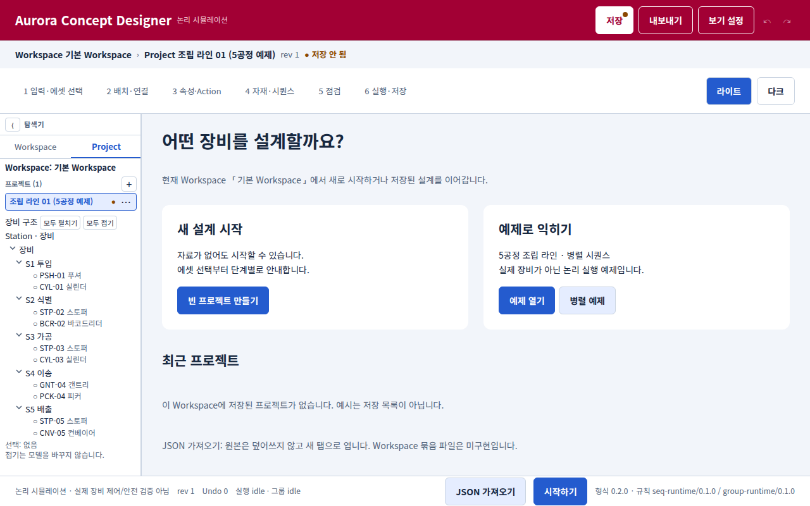

*그림 0. 이 매뉴얼의 그림은 이런 실제 화면이다. 주소창은 넣지 않았다. 같은 화면의 조작은 2절 그림 2에서 이어 설명한다.*

## 1. 범위와 한계

화면 맨 아래에는 항상 「논리 시뮬레이션 · 실제 장비 제어/안전 검증 아님」이 있습니다.


*그림 1. 1단계 「입력·에셋 선택」. 아래 줄 왼쪽이 이 앱의 한계 문구다. 2026-11-12, Chrome 156, 1280×800, 라이트.*

되는 일은 대략 이것입니다.

- Station › Substation › Device 로 구성을 그린다. 화면의 Substation은 내부 이름 Unit과 같습니다.
- 에셋 14종을 AML 라이브러리에서 골라 프로젝트에 넣는다.
- 물류 연결과 신호 연결을 만든다.
- 속성, 신호, Action, 자재 하나, 순차 시퀀스를 적는다.
- 가상 시간으로 Station 시퀀스를 실행하거나, 한 Substation의 시퀀스 여러 개를 한 시계로 실행한다.
- 이 브라우저에 저장하고, JSON 파일로 내보내거나 가져온다.

하지 않는 일은 [16절](#16-안-되는-것)에 모았습니다. 안전 항목을 자동으로 끝내 주지도 않습니다. Interlock은 사람이 보는 후보입니다.

요구 문서의 [확정]과 [설계 제안]은 요구의 승인 상태입니다. 이 매뉴얼의 ✅ · ◐와는 다릅니다. 6단계 구성과 단계 판정은 요구상 설계 제안이고, 시제품이 그 제안을 화면으로 만든 것입니다.

## 2. 시작하기

### 2.1 파일 하나로 열기

앱은 `release/equipment-concept-designer.html` 한 파일입니다. React, 스타일, AML 라이브러리, 도식, AI 그림이 들어 있고 외부 CDN은 쓰지 않습니다.

1. 저장소에서 그 파일을 받습니다. 저장소 전체를 받았다면 `release` 폴더에 있습니다.
2. `release`의 상위 폴더에서 터미널을 열고 다음 중 하나를 실행합니다.

```bash
python3 -m http.server 8766 --directory release
```

3. Chrome 주소창에 `http://localhost:8766/equipment-concept-designer.html`을 입력합니다.
4. 위쪽 붉은 줄에 「Aurora Concept Designer」와 「논리 시뮬레이션」이 보이면 열린 것입니다. 버전 번호는 그 줄의 읽는 이름에 들어 있고, 글자로는 `0.3.0-prototype`이 따로 찍혀 있지 않습니다.

파일을 더블클릭해 `file://`로 여는 방법은 README에 있습니다. 이 매뉴얼의 그림과 실습은 그 방식이 아니라, 이 커밋을 `npm run dev`로 연 주소에서 확인했습니다. `file://`에서는 Chrome이 로컬 HTML끼리 저장 공간을 공유할 수 있습니다. 중요한 작업은 「내보내기」로 파일에 남기세요.

Windows에서 `python3` 명령이 없으면 설치 상태에 따라 명령 이름이 다를 수 있습니다. 그 경우는 이 매뉴얼에서 확인하지 않았습니다.

### 2.2 개발 서버

소스에서 실행하려면 Node.js 20 이상이 필요합니다.

```bash
git clone https://github.com/kotaeji/EquipCD_G.git
cd EquipCD_G
npm ci
npm run dev
```

주소는 `http://localhost:5173`입니다. 이 매뉴얼의 그림은 이 방법으로 연 화면입니다.

### 2.3 처음 열면

저장이 없으면 5공정 예제가 이미 열려 있고, 가운데는 작업 시작 화면입니다.


*그림 2. 처음 연 화면. 위쪽 줄은 「기본 Workspace」와 「조립 라인 01 (5공정 예제)」이고, 가운데 제목은 「어떤 장비를 설계할까요?」다. 2026-11-12, Chrome 156, 1280×800, 라이트.*

- 위쪽 줄: `Workspace 기본 Workspace › Project 조립 라인 01 (5공정 예제) rev 1 ● 저장 안 됨`
- 가운데 「빈 프로젝트 만들기」, 「예제 열기」, 「병렬 예제」
- 아래 「JSON 가져오기」, 「시작하기」
- 「시작하기」는 이미 열린 예제의 1단계로 갑니다. 「예제 열기」는 예제 사본을 하나 더 만듭니다.
- 이 브라우저에 저장이 있으면 그 Workspace에서 마지막으로 저장한 프로젝트가 열리고, 마지막으로 보던 단계가 복원됩니다. 실행 중이던 상태는 복원하지 않습니다.

## 3. 화면 구성

`FL-01` `FL-02` `FL-03` `FL-15` `FL-16` `FL-17`. 화면은 모든 단계에서 공통입니다.

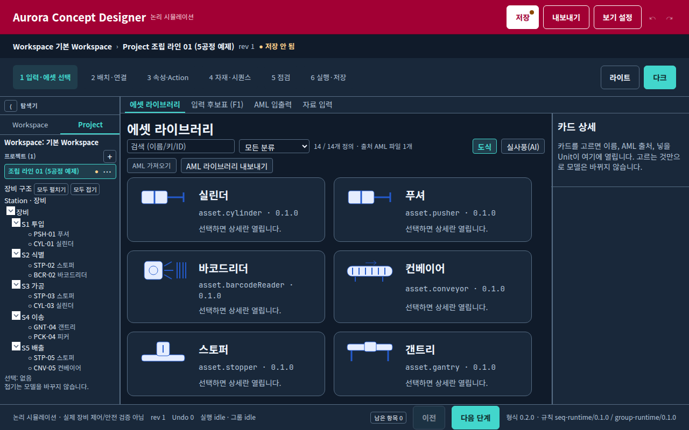

*그림 3. 그림 1과 같은 1단계를 다크로 본 것. 헤더 붉은색은 그대로다. 2026-11-12, Chrome 156, 1280×800, 다크.*

### 3.1 헤더 (`FL-01`)

위쪽 붉은 줄입니다.

| 보이는 것 | 하는 일 |
|---|---|
| Aurora Concept Designer · 논리 시뮬레이션 | 제품 이름 |
| 「저장」 | 이 브라우저에 저장합니다. 저장 안 된 변경이 있으면 단추에 점이 있습니다. [12절](#12-저장-json-mac과-windows) |
| 「내보내기」 | 지금 프로젝트를 `.ecd.json` 파일로 받습니다 |
| 「보기 설정」 | 도식과 실사풍을 바꿉니다. [11절](#11-보기-설정) |
| 「↶」「↷」 | 실행 취소, 다시 실행. 단축키는 Ctrl 또는 Cmd+Z, Shift+Z, Ctrl+Y. 편집 하나당 한 번입니다. 실행 중이거나 일시정지면 편집과 실행 취소가 막힙니다 |

### 3.2 작업 정보 줄 (`FL-02`, 화면 `S00`)

헤더 바로 아래입니다.

`Workspace 이름 › Project 이름  rev N  ● 저장 안 됨`

또는 점 없이 「저장됨」.

- Workspace 이름을 누르면 탐색기 Workspace 탭이 열립니다.
- Project 이름을 누르면 탐색기 Project 탭이 열립니다.
- `rev`는 모델을 바꿀 때마다 1씩 오릅니다. 보기만 바꿔도 오르지 않습니다.
- `● 저장 안 됨`은 마지막 저장보다 모델이 앞선 상태입니다. 처음 연 예제도 한 번도 저장하지 않았으면 이렇게 보입니다.

### 3.3 단계 바 (`FL-03`)

여섯 단추입니다. 「1 입력·에셋 선택」부터 「6 실행·저장」까지. 고른 단계가 가운데 화면입니다.

단추 안의 판정 문구(필수 충족, 필수 누락, 재확인 필요, 확인됨)는 화면에서 숨겨져 있고, 화면 읽기 프로그램용입니다. 눈으로 보는 판정은 아래 상태 줄의 「남은 항목 N」입니다.

- 「남은 항목 N」을 누르면 목록이 열립니다. 항목은 필수 데이터 누락, 가정값 존재, 미정, 선택 사항 미확보, 사람 확인 필요로 나뉩니다. 「편집으로 이동」이 있는 항목은 그 단추로 갑니다.
- 「이전」, 「다음 단계」는 상태 줄 오른쪽에 있습니다.
- 필수 항목이 남은 단계에서 「다음 단계」를 누르면 원인 창이 열립니다. 「머무르며 수정」 또는 「확인 없이 다음 화면 보기」를 고릅니다. 넘어가도 6단계 실행 전 검사는 따로 막습니다.
- 고른 단계, 탐색기 탭, 배치 탭, 테마는 이 브라우저의 보기 설정에만 남습니다. 프로젝트 JSON에는 들어가지 않습니다.
- 오른쪽 「라이트」「다크」는 [11절](#11-보기-설정)입니다.

### 3.4 왼쪽, 가운데, 오른쪽

- 왼쪽은 탐색기입니다. [4절](#4-workspace와-프로젝트). 「⟨」로 접고 「⟩」로 펼칩니다.
- 가운데는 지금 단계의 작업 화면입니다. [5절](#5-1단계-입력에셋-선택)부터 [10절](#10-6단계-실행저장)까지.
- 오른쪽은 단계마다 다릅니다. 1단계는 카드 상세, 2단계는 배치 속성, 6단계는 실행 로그입니다.
- 아래 상태 줄: 한계 문구, `rev`, `Undo` 횟수, 실행 상태, 저장소를 쓸 수 없으면 「메모리 전용」에 해당하는 안내, `형식 0.2.0`, 규칙 `seq-runtime/0.1.0` / `group-runtime/0.1.0`.

### 3.5 칸 너비와 접는 칸 (`FL-15`, `FL-16`)

칸 경계의 세로 막대(탐색기 너비, 카드 상세 너비, 속성 패널 너비, 실행 패널 너비)를 마우스로 끌면 너비가 바뀝니다. 막대에 포커스를 두고 ← → 를 눌러도 16픽셀씩 움직입니다. 두 번 누르면 기본 너비로 돌아갑니다. 너비는 이 브라우저에만 기억되고 프로젝트 파일에는 들어가지 않습니다.

팔레트, 속성 자세히, 실행 도면 같은 접는 칸은 열릴 때 펼쳐져 있습니다. 접은 상태는 저장하지 않습니다. 화면을 다시 열면 다시 펼쳐집니다.

## 4. Workspace와 프로젝트

`FL-04` `FL-05` `FL-06` `FL-07` `FL-08` `FL-09` `FL-10` `FL-11` `FL-13`. 화면 `S01` `S02` `S03` `S70` `S72`. `FL-12` 파일 묶음은 [16절](#16-안-되는-것)입니다.

탐색기 위쪽 탭은 「Workspace」와 「Project」입니다. ← → 로 탭을 바꿀 수 있고, 고른 탭은 이 브라우저에 남습니다.

### 4.1 Workspace 탭 (`FL-05`, `S01`)

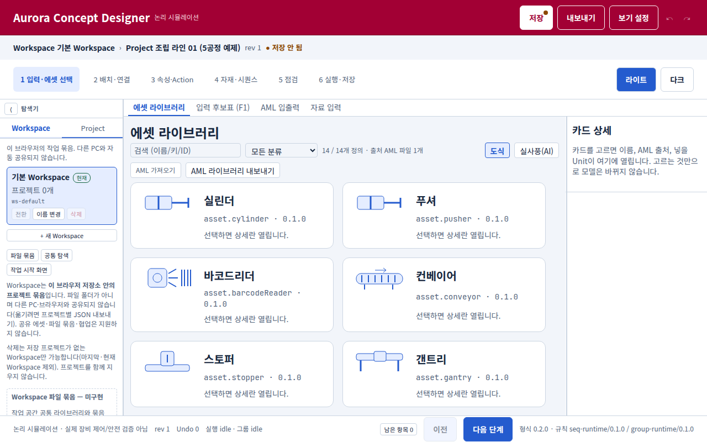

*그림 4. Workspace 탭. 「기본 Workspace」에 「현재」가 붙어 있고, 프로젝트 수는 0으로 보일 수 있다. 예제가 열려 있어도 저장 전에는 저장된 수가 아니다. 2026-11-12, Chrome 156, 1280×800, 라이트.*

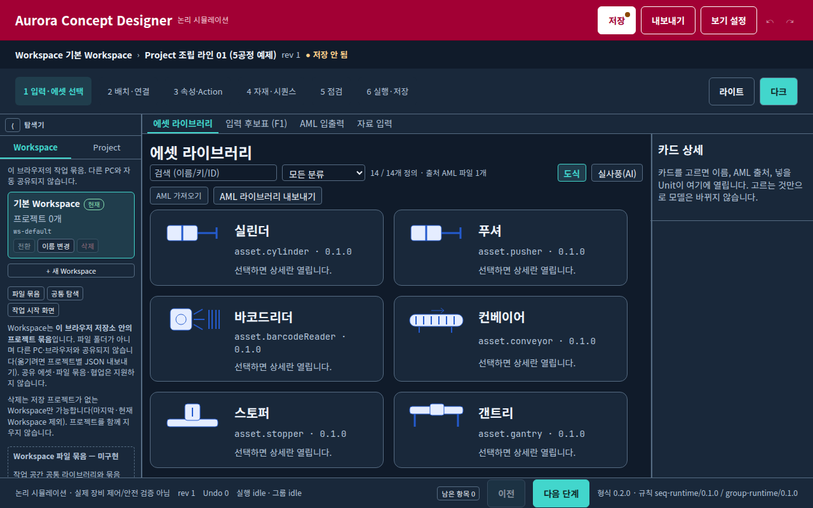

*그림 5. 같은 Workspace 탭의 다크. 2026-11-12, Chrome 156, 1280×800, 다크.*

Workspace는 이 브라우저 저장소 안의 프로젝트 묶음입니다. 폴더가 아니고, 다른 PC나 브라우저와 공유되지 않습니다.

1. 「+ 새 Workspace」를 누르면 이름 창이 열립니다. 앞뒤 공백은 지워지고, 같은 범위에서 대소문자 무시로 중복될 수 없습니다.
2. 카드의 「이름 변경」「삭제」로 고칩니다. 삭제는 저장된 프로젝트가 없는 Workspace만 됩니다. 마지막 Workspace와 지금 Workspace는 지울 수 없습니다. 프로젝트를 같이 지우지는 않습니다.
3. 「전환」은 그 Workspace로 이동합니다. 열린 탭은 닫힙니다.
   - 저장하지 않은 편집이 있으면 「Workspace 전환 불가 — 저장하지 않은 변경」이 뜨고 「저장하러 돌아가기」만 있습니다. 먼저 저장하거나, Project 탭에서 탭을 닫은 뒤 다시 전환합니다.
   - 저장한 적 없고 편집도 없는 탭만 있으면 「취소」와 「닫고 전환」이 있습니다.
   - 실행 중이거나 일시정지면 전환이 막힙니다. 먼저 「초기화」하세요.
4. 「작업 시작 화면」은 가운데를 그림 2로 되돌립니다. 열린 프로젝트는 바뀌지 않습니다.
5. 「공통 탐색」(`FL-13`, `S70`)은 열린 탭과 지금 트리를 한 화면에서 고르게 합니다. 검색 입력칸은 없습니다.
6. 「파일 묶음」은 안내만 있습니다. [16절](#16-안-되는-것).

### 4.2 Project 탭의 목록 (`FL-06`, `FL-07`, `S02`)


*그림 6. Project 탭. 목록은 「프로젝트 (1)」이고, 그 아래가 장비 구조다. 2026-11-12, Chrome 156, 1280×800, 라이트.*

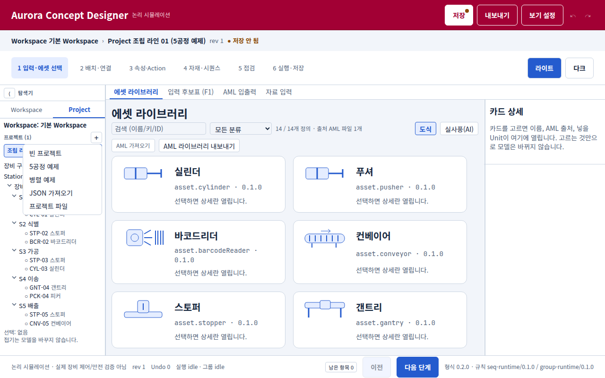

*그림 7. 목록 오른쪽 「+」를 연 메뉴. 빈 프로젝트, 5공정 예제, 병렬 예제, JSON 가져오기, 프로젝트 파일. 2026-11-12, Chrome 156, 1280×800, 라이트.*

- 목록은 열린 프로젝트를 먼저 두고, 그다음 이 Workspace에 저장돼 있으면서 아직 열리지 않은 것을 나중에 저장된 것부터 붙입니다. 같은 ID는 한 줄입니다.
- 줄을 누르면 열린 프로젝트는 그쪽으로 바뀌고, 닫힌 저장 프로젝트는 열립니다.
- 지금 편집 중인 줄은 강조됩니다. 열려 있지만 편집 중이 아니면 작은 점이 있습니다. 저장 안 된 줄에는 `●`가 있습니다.
- 일곱 줄부터는 목록 칸만 스크롤합니다. 탐색기 전체가 밀리지는 않습니다.
- 「+」 메뉴 (`FL-07`, 빈 프로젝트는 `V09`, 파일 화면은 `S03`):
  1. 「빈 프로젝트」는 빈 모델을 새 탭으로 엽니다.
  2. 「5공정 예제」「병렬 예제」는 예제 사본입니다. 이미 탭이 열려 있으면 이름 뒤 번호가 2부터일 수 있습니다.
  3. 「JSON 가져오기」는 파일을 고릅니다. [12절](#12-저장-json-mac과-windows).
  4. 「프로젝트 파일」(`FL-11`, `S03`)은 이 Workspace에 저장된 이름과 rev를 보여주고, 「열기」, 「JSON 가져오기」, 「현재 탭 JSON 내보내기」가 있습니다.

위쪽 「Workspace: 기본 Workspace」를 누르면 Workspace 탭으로 갑니다.

### 4.3 상세 팝업 (`FL-08`, `S02` `S72`)

각 줄의 「…」를 누르면 팝업이 열립니다. 줄의 연필 단추나 닫기 단추는 없습니다.

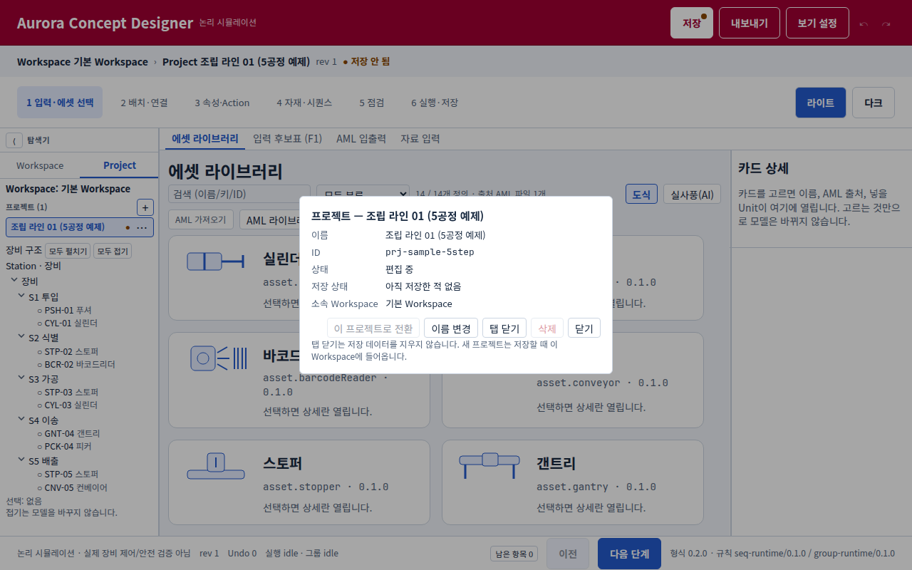

*그림 8. 「…」 팝업. 이름, ID, 상태, 저장 상태, 소속 Workspace, 그리고 전환·이름 변경·탭 닫기·삭제·닫기. 2026-11-12, Chrome 156, 1280×800, 라이트.*

| 단추 | 하는 일 |
|---|---|
| 「이 프로젝트로 전환」 또는 「열기」 | 열린 프로젝트는 전환, 닫힌 저장 프로젝트는 열기. 이미 편집 중이면 비활성 |
| 「이름 변경」 | 이름 창. 열린 프로젝트는 모델 변경이라 rev가 오르고 실행 취소가 됩니다. 닫힌 저장본은 rev만 오르고 실행 취소 대상이 아닙니다 |
| 「탭 닫기」 | 탭만 닫습니다. 저장 데이터는 남습니다. 닫힌 프로젝트에는 닫을 탭이 없어 비활성 |
| 「삭제」 | 저장된 프로젝트를 지웁니다. 열린 프로젝트는 비활성입니다. 먼저 탭을 닫으세요 |
| 「닫기」 | 팝업만 닫습니다. Esc도 같습니다 |

### 4.4 저장 안 된 탭을 닫을 때 (`FL-09`)

저장 안 된 변경이 있는 탭을 닫으면 「저장하지 않은 변경」이 열립니다.

- 「취소 (변경 유지)」
- 「저장 후 닫기」 — 저장이 된 뒤에만 닫습니다
- 「저장하지 않고 닫기」

Workspace 전환은 4.1의 규칙입니다. 편집이 있으면 세 단추 중 고르는 창이 아니라, 전환 자체가 막힙니다.

### 4.5 장비 구조 (`FL-10`)

목록 아래 「장비 구조」입니다. Station, 그 아래 Substation, 그 아래 Device입니다.

- 줄을 누르면 선택됩니다. Tab 뒤 Enter로도 고를 수 있습니다.
- 「모두 펼치기」「모두 접기」, 줄의 꺾쇠로 접습니다. 접기는 모델을 바꾸지 않고 rev도 오르지 않습니다.
- 접힌 줄 안에 선택이 있으면 「● 선택 포함」이 보입니다.
- 「선택: …」 아래에 「접기는 모델을 바꾸지 않습니다」가 있습니다.

다른 프로젝트로 바꾸면, 돌고 있던 실행은 일시정지됩니다. 자동으로 다시 시작하지 않습니다. 돌아와서 「재개」 또는 「그룹 재개」를 누릅니다. `FL-74`.

## 5. 1단계 입력·에셋 선택

`FL-20` `FL-21` `FL-22` `FL-23` `FL-24` `FL-25`. 화면 `S10` `S11` `S12` `S13`. `FL-26` 자료 입력은 [16절](#16-안-되는-것)입니다.

단계 단추 「1 입력·에셋 선택」 또는 상태 줄에서 이 단계로 옵니다. 위쪽 하위 탭은 「에셋 라이브러리」「입력 후보표 (F1)」「AML 입출력」「자료 입력」입니다.

### 5.1 라이브러리 카드 (`FL-20`, `S10`)

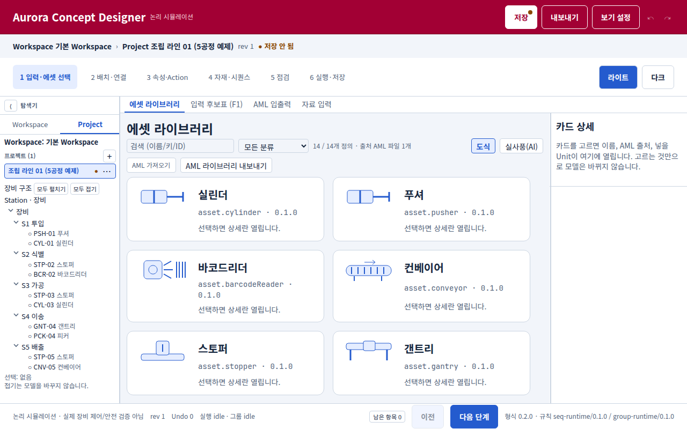

*그림 9. 「에셋 라이브러리」. 검색, 분류, 14/14, 「도식」과 「실사풍(AI)」, 「AML 가져오기」. 2026-11-12, Chrome 156, 1280×800, 라이트.*

1. 검색칸에 이름, 키, ID를 입력합니다. 분류는 「모든 분류」에서 고릅니다.
2. 카드는 14종입니다. 그림 칸은 100×48이고 바탕은 투명합니다. 배지로 분류, AI 그림 유무, AML이 번들인지 가져온 것인지, XSD 기록이 있는지를 봅니다.
3. 카드를 누르는 것만으로 프로젝트는 바뀌지 않습니다. 오른쪽 상세가 열립니다.

「실사풍(AI)」(`FL-22`)을 누르면 같은 카드가 생성된 그림으로 바뀌고, 「AI 생성 · 실제 촬영 아님」 취지의 안내가 납니다. 모델, rev, 배치, 선택은 그대로입니다. 그림의 방향은 사람 검수 전입니다.

### 5.2 카드 상세와 프로젝트에 추가 (`FL-21`, `S11`)

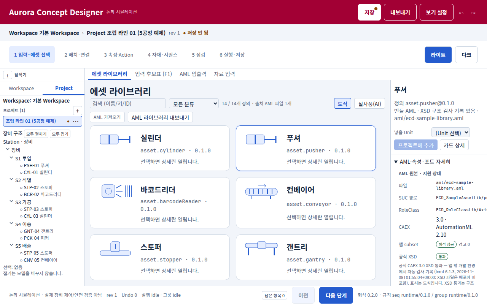

*그림 10. 「푸셔」를 고르면 오른쪽에 정의, 넣을 Unit, 「프로젝트에 추가」, AML 출처가 열린다. 2026-11-12, Chrome 156, 1280×800, 라이트.*

1. Device 카드는 「넣을 Unit」에서 Substation을 고른 뒤 「프로젝트에 추가」를 누릅니다. Unit이 없으면 단추가 비활성입니다. 먼저 [6절](#6-2단계-배치연결)에서 빈 유닛이나 유닛 템플릿을 놓으세요.
2. 「투입 유닛 템플릿」「식별 유닛 템플릿」「이송 유닛 템플릿」(`FL-24`)은 Unit 선택이 필요 없습니다. 추가하면 새 ID의 Unit과 그 안의 Device가 생깁니다. 놓을 때마다 ID가 새로 나옵니다.
3. 「카드 상세」는 AML 파일, RoleClass, 속성, 포트, Action, 템플릿 자식을 더 보여 줍니다. 「선택 에셋 추가」도 모델을 바꾸는 단추입니다. 상세를 보는 것과 추가하는 것은 나뉘어 있습니다.

식별 유닛 템플릿의 광전 센서 조건처럼, 센서 신호를 만들어 주는 주체가 없는 Action을 시퀀스에 넣으면 실행이 `PRE_UNMET`으로 멈춥니다. 이번 실습에서는 그 템플릿 실행을 다시 돌리지 않았습니다. 빈 프로젝트 실습은 푸셔를 씁니다.

### 5.3 AML 입출력 (`FL-23`, `S12`)

하위 탭 「AML 입출력」은 검사 결과를 네 줄로 보여 줍니다. XML 문법, CAEX 구조, 앱 부분집합, 공식 XSD. 기준 커밋의 번들 라이브러리 화면은 XML 「읽음」, CAEX 「스키마 3.0」, 부분집합 「경고 0」, XSD 「구조 검사 기록 있음」이었습니다. 브라우저 안에서 XSD를 다시 돌리지는 않습니다. 건너뛴 검사를 통과로 세지 않습니다.

같은 단계의 「AML 가져오기」「AML 라이브러리 내보내기」로 다른 AML을 더하거나 라이브러리를 파일로 받습니다. 오류가 있는 정의는 라이브러리에 넣지 않고, 이미 열린 프로젝트는 바꾸지 않습니다. 범위는 [14절](#14-aml-범위)입니다.

### 5.4 입력 후보표 (`FL-25`, `S13`)

하위 탭 「입력 후보표 (F1)」에서 이름과 종류를 적어 「+ 후보표에 추가」를 누릅니다. 후보는 확인 전에 모델에 들어가지 않습니다.

1. 줄의 「확인」 또는 「거절」을 누릅니다.
2. 「반영 미리보기」로 어떤 줄이 들어갈지 봅니다.
3. 「확인된 항목 Canvas에 반영」을 눌러야 배치에 들어갑니다.

직접 입력한 후보만 됩니다. PDF, DWG, XLSX, VC, USD에서 뽑는 경로는 없습니다. 「자료 입력」 탭은 안내 화면입니다. [16절](#16-안-되는-것).

## 6. 2단계 배치·연결

`FL-30` `FL-31` `FL-32` `FL-33` `FL-34` `FL-35` `FL-36`. 화면 `S20` `S21`. `FL-37` 배경 도면·잠금·서브플로는 [16절](#16-안-되는-것)입니다.

### 6.1 팔레트와 두 탭 (`FL-30`, `FL-31`)

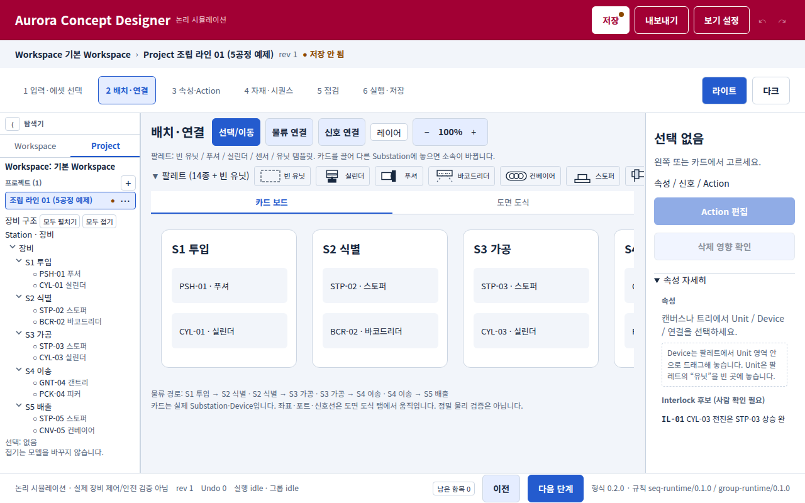

*그림 11. 「배치·연결」의 「카드 보드」. 팔레트는 펼친 한 줄이고, S1부터 카드가 놓여 있다. 2026-11-12, Chrome 156, 1280×800, 라이트.*

1. 팔레트는 「빈 유닛」과 14종입니다. 처음에는 펼쳐져 있습니다. 종류가 많으면 그 줄만 가로로 움직입니다.
2. 「빈 유닛」이나 유닛 템플릿을 카드 보드로 끌어 놓으면 Substation이 생깁니다.
3. Device는 그 Substation 카드 위로 끌어 놓습니다. 카드 밖에는 놓이지 않습니다.
4. 아래 탭은 「카드 보드」와 「도면 도식」입니다. 고른 탭은 이 브라우저에 남습니다. 기본은 카드 보드입니다.
5. 「신호 연결」을 누르면 도면 도식 탭으로 바뀝니다. 카드 보드는 다시 고를 수 있습니다.

1280×800에서는 5공정 예제의 S4·S5 카드가 한 화면에 다 들어오지 않습니다. 카드 줄을 가로로 움직이면 이어서 보입니다.

카드 아래 문장은 물류 경로입니다. 예제에서는 `S1 투입 → S2 식별 → S3 가공 → S4 이송 → S5 배출`입니다. 카드는 실제 Substation과 Device입니다. 좌표와 포트는 도면 도식에서 움직입니다.

### 6.2 도면 도식 (`FL-32`, `FL-34`)

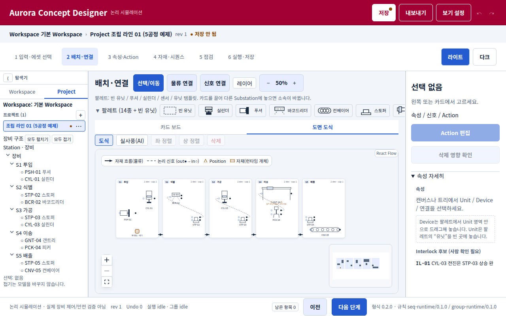

*그림 12. 「도면 도식」. 다섯 Substation과 장치, 미니맵, 범례. 위쪽 「도식」「좌 정렬」「상 정렬」「삭제」. 2026-11-12, Chrome 156, 1280×800, 라이트.*

- 휠로 0.5배에서 2배까지 확대합니다. 빈 곳을 끌면 도면이 이동합니다. 왼쪽 아래에 미니맵, 왼쪽 위에 범례가 있습니다.
- 노드를 끌어 놓으면 이동 한 번이고, 실행 취소도 한 번입니다.
- Shift, Ctrl, Cmd를 누른 채 누르면 여러 개를 고릅니다. 둘 이상이면 「좌 정렬」「상 정렬」이 켜집니다.
- 「삭제」 또는 Delete 키는 영향 확인 뒤에 지웁니다. 실행 중에는 막힙니다.
- 「도식」「실사풍(AI)」은 그림만 바꿉니다.

도구 줄 위에 「신호: 출력● 포트를 입력○ 포트로 끌어 연결 · 장치 이동은 몸체를 끌기」가 적혀 있습니다. 포트를 누르면 장치는 움직이지 않습니다. 장치를 옮기려면 몸체를 끕니다. 연결하는 법은 6.3입니다.

### 6.3 연결과 소속 (`FL-33`, `FL-35`, `FL-36`)

1. 「물류 연결」을 누르고 Unit을 누른 뒤 다른 Unit을 누르면 Unit에서 Unit으로 이어집니다. 도면 도식에서는 Unit 안의 Device를 눌러도 그 Unit을 누른 것으로 칩니다. 카드 보드에서 「신호 연결」 모드일 때 Unit을 누르면 물류 연결이 아니라 「신호 연결은 도면 도식 탭의 포트에서 합니다」 안내가 나옵니다.
2. 신호는 도면 도식에서 잇습니다. 두 가지 방법이 있습니다.
   - **끌어서**: 어느 모드에서든 출력● 포트를 눌러 다른 Device의 입력○ 포트까지 끌어 놓습니다. 끄는 동안 점선이 따라오고, 놓을 수 있는 입력 포트가 강조되며, 안 되는 포트는 흐려집니다.
   - **두 번 눌러서**: 「신호 연결」을 누르면 도면 도식으로 이동합니다. 출력 포트를 누르면 도면 왼쪽 위에 「연결 시작: CYL-01 실린더 · fwdDone (출력)」처럼 뜹니다. 그다음 입력 포트를 누릅니다.
   - 입력 포트에서 시작하면 바로 거부되고 「출력(out) 포트에서 시작하세요」가 나옵니다. 같은 Device끼리, 이미 있는 연결도 거부됩니다. 빈 곳에 놓거나 Esc를 누르면 취소되고 아무것도 바뀌지 않습니다. 실행 중에는 시작되지 않습니다.
   - 연결 하나는 rev +1이고, 실행 취소 한 번에 사라집니다.
3. 「레이어」에서 배경, Substation, 축·이송, 포트·신호선, 포지션, 물류·자재를 숨길 수 있습니다. 숨김은 삭제가 아니고 실행에서도 빠지지 않습니다.
4. Device를 다른 Substation 카드에 끌어 놓거나, 오른쪽 소속 목록을 바꾸면 확인 창이 열립니다. 소속 변경과 이동, 좌표만 이동, 취소를 고릅니다. 시퀀스에 쓰이던 Device면 영향 개수를 보여 줍니다.

오른쪽 칸은 고른 이름의 속성 요약입니다. 「Action 편집」은 3단계로 가고, 「삭제 영향 확인」은 지우기 전에 묻습니다. 「속성 자세히」를 펼치면 값 편집이 더 있습니다.

## 7. 3단계 속성·Action

`FL-40` `FL-41` `FL-42` `FL-43`. 화면 `S30` `S31` `S32`.

왼쪽 트리에서 Device를 고르거나, 2단계에서 「Action 편집」으로 옵니다. 고른 Device가 없으면 프로젝트의 첫 Device가 열립니다.

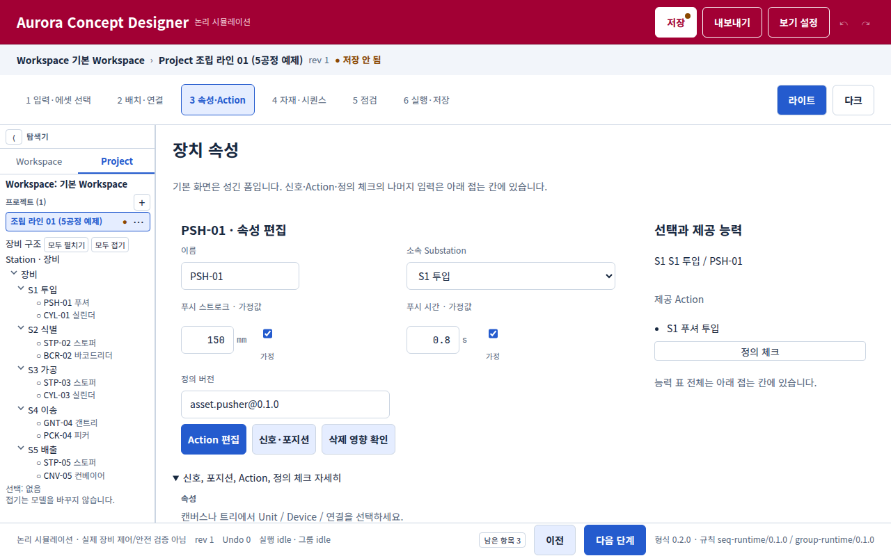

*그림 13. 「장치 속성」. PSH-01의 이름, 소속, 스트로크와 시간. 값은 가정으로 표시된다. 2026-11-12, Chrome 156, 1280×800, 라이트.*

1. 이름, 소속 Substation, 속성을 고칩니다. 빈 값은 「미정」으로 남고, 앱이 임의로 채우지 않습니다. 숫자가 가정값이면 「가정」이 붙습니다.
2. 「신호·포지션」(`FL-41`)은 신호의 방향과 역할, 포지션 값을 보여 줍니다. 주소는 비어 있으면 「미정 · 실제 장비 주소 아님」입니다.
3. 「Action 편집」(`FL-42`)은 동작 시간, 타임아웃, 명령 신호, 완료 신호를 보여 줍니다. 「시퀀스 끝에 추가」는 그 Action을 Station 시퀀스 끝에 넣습니다.
4. 「정의 체크」(`FL-43`)는 완료 신호, 시간, 타임아웃, 실제 주소가 있는지를 적습니다. 오른쪽 「선택과 제공 능력」은 이 Device의 Action 목록입니다. 능력표 전체와 Interlock 후보는 아래 접는 칸에 있습니다. Interlock은 사람이 확인하며, 자동으로 확정되지 않습니다.

실행 중에는 이 값들이 잠깁니다.

## 8. 4단계 자재·시퀀스

`FL-50` `FL-51` `FL-52` `FL-53`. 화면 `S40` `S41` `S42` `S43`. `FL-54` 누락 편집 확장은 [16절](#16-안-되는-것)입니다.

하위 탭은 「Station 시퀀스 Draft (F5)」「Substation 시퀀스」「자재·Flow (F4)」「SFC 미리보기」「누락 편집 확장」입니다.

### 8.1 Station 시퀀스 (`FL-51`, `S41`)

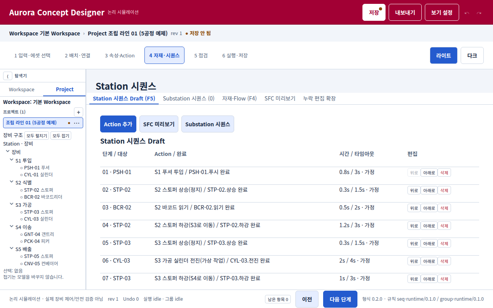

*그림 14. 「Station 시퀀스 Draft」. 단계, Action, 완료 신호, 시간과 타임아웃, 위로·아래로·삭제. 2026-11-12, Chrome 156, 1280×800, 라이트.*

1. 「Action 추가」는 프로젝트의 첫 Action을 단계로 넣습니다. 특정 Action을 고르려면 아래 「단계 편집, 구조화 문장, 순서 변경」을 펼칩니다.
2. 펼친 칸의 Action 이름을 시퀀스 표로 끌어 넣습니다.
3. 「위로」「아래로」로 순서를 바꾸고 「삭제」로 뺍니다.
4. 시간 칸은 그 단계의 타임아웃입니다. Action 기본값을 이 단계만 덮어씁니다.
5. 구조화 문장은 한 줄에 한 단계로 적고 「변환 미리보기」를 누릅니다. 이름이 맞으면 그 Action으로, 여러 후보면 사람이 고르고, 없으면 미해결로 남습니다. 「확정된 줄만 시퀀스에 추가」가 모델을 바꿉니다. 자연어를 해석하는 AI는 없습니다.

한 시퀀스 안의 분기, 병렬, 루프는 없습니다. 화면에도 「한 시퀀스 안의 분기, 병렬, 루프는 미구현입니다」라고 나와 있습니다.

### 8.2 자재 (`FL-50`, `S40`)

「자재·Flow (F4)」에서 자재가 없으면 「자재 추가」가 있습니다. 추가하면 자재 하나가 생기고, 초기 위치는 첫 Substation, 초기 상태는 「대기」입니다.

이름, 투입 간격, 초기 위치, 초기 상태, 크기, 무게, Unit 경로를 볼 수 있습니다. 크기와 무게의 나머지 편집은 접는 칸 「자재 값과 경로 편집」에 있습니다.

자재를 여러 개 두거나 캐리어에 싣는 편집은 없습니다. 실행도 자재 하나만 지원합니다.

### 8.3 Substation 시퀀스 (`FL-52`, `S42`)

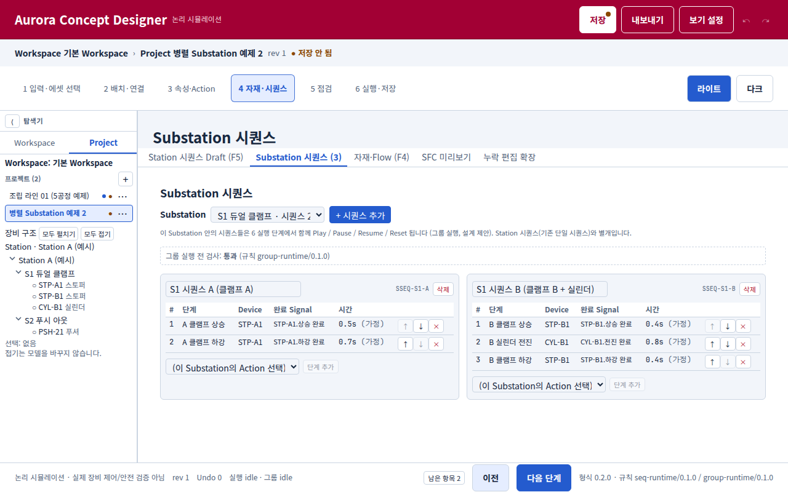

*그림 15. 병렬 예제, S1의 시퀀스 A와 B. 단계마다 시간 가정이 보인다. 2026-11-12, Chrome 156, 1280×800, 라이트.*

1. Substation을 고릅니다.
2. 「+ 시퀀스 추가」로 시퀀스를 늘리고, 이름 변경과 「삭제」로 정리합니다.
3. 「단계 추가」로 그 Substation의 Action을 넣고, ↑ ↓ 와 × 로 순서와 삭제를 합니다.

이 시퀀스들은 6단계 「Substation 그룹」에서 한 시계로 돕니다. Station 시퀀스와는 별도입니다.

### 8.4 SFC 미리보기 (`FL-53`, `S43`)

「SFC 미리보기」는 Station 시퀀스를 순서대로만 보여 줍니다. 읽기 전용입니다. 분기와 루프는 그리지 않습니다.

## 9. 5단계 점검

`FL-60` `FL-61` `FL-62`. 화면 `S50` `S51` `S52`. `FL-63` Evolution Lab은 [16절](#16-안-되는-것)입니다.

하위 탭은 「Gap (F6)」, 「진단·저장·AML」, 「Export 미리보기 (F8)」, 「Evolution Lab (F7)」입니다.

### 9.1 Gap (`FL-60`, `S50`)

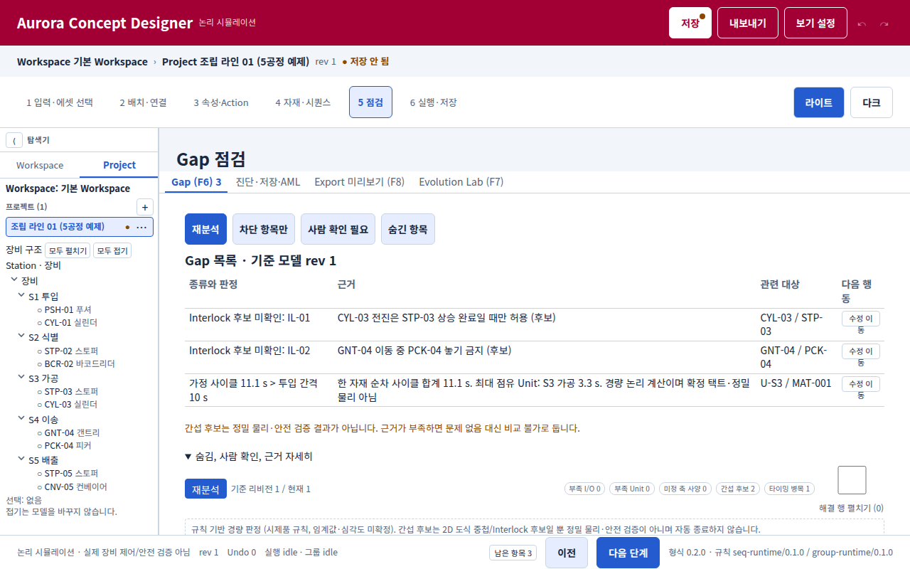

*그림 16. 「Gap 점검」. 재분석, 차단 항목만, 사람 확인 필요, 숨긴 항목. 각 줄의 「수정 이동」. 2026-11-12, Chrome 156, 1280×800, 라이트.*

1. 「재분석」은 지금 모델로 다시 계산합니다.
2. 「차단 항목만」「사람 확인 필요」「숨긴 항목」으로 거릅니다.
3. 「수정 이동」은 그 항목을 고치는 단계로 갑니다.
4. 접는 칸에서 숨기거나 사람 확인으로 표시합니다. 안전 항목은 자동으로 끝나지 않습니다.

판정은 부족, 미정, 사람 확인으로 나뉩니다. 근거가 부족하면 문제 없음이 아니라 비교 불가로 둡니다. 판정식과 임계값은 승인된 값이 아니고, 실행 결과로 병목을 계산하지는 않습니다. 예제 화면의 「가정 사이클 11.1 s」도 예시 계산입니다.

### 9.2 진단·저장 (`FL-61`, `S51`)

「진단·저장·AML」은 참조가 빠진 곳, 저장소 상태, 거부된 파일의 격리 보관함을 보여 줍니다. 격리된 원본은 내려받을 수 있습니다. 저장에 실패하면 모델은 그대로 두고, 저장소를 쓸 수 없으면 메모리 전용으로 안내합니다. 그때는 「내보내기」로 파일을 남기세요.

### 9.3 Export 미리보기 (`FL-62`, `S52`)

「Export 미리보기 (F8)」는 이 프로젝트의 후보 표를 읽기만 합니다. 가정과 미정이 표시됩니다. 「Core로 보내기」와 「Core 전송」은 눌리지 않습니다. 실제 Export와 역매핑은 없습니다.

## 10. 6단계 실행·저장

`FL-70` `FL-71` `FL-72` `FL-73` `FL-74`. 화면 `S60` `S61` `S62`.

위쪽 「Station 시퀀스」와 「Substation 그룹」 중 하나를 고릅니다. 둘을 동시에 돌리지는 않습니다.

### 10.1 Station 시퀀스 (`FL-70`, `FL-73`, `S60`)

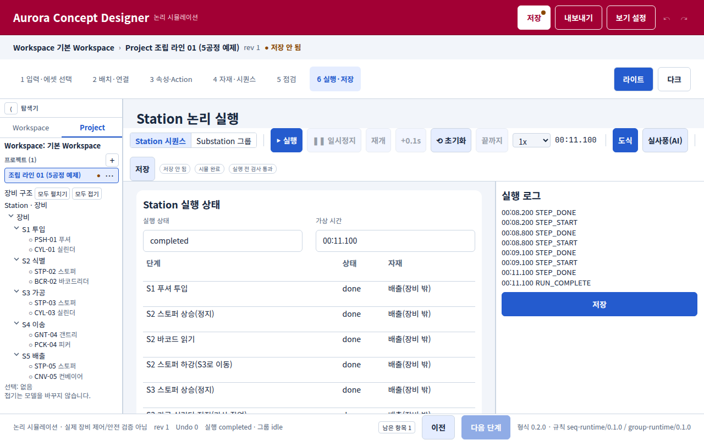

*그림 17. 「끝까지」 뒤. 시계 00:11.100, 상태 completed, 오른쪽 로그 마지막 RUN_COMPLETE. 2026-11-12, Chrome 156, 1280×800, 라이트. 같은 따라 하기는 13.1절이다.*

1. 「▶ 실행」으로 시작합니다. 준비가 안 되면 6단계가 「실행 차단과 수정」으로 바뀝니다. [15절](#15-문제-해결).
2. 「❚❚ 일시정지」는 가상 시간을 멈춥니다. 「재개」는 남은 시간부터입니다. 「+0.1s」는 일시정지 중에만 가상 0.1초를 진행합니다.
3. 「⟲ 초기화」는 실행 시작 시점의 초기 조건으로 되돌립니다. 실행 취소와는 별개입니다.
4. 「끝까지」는 실행 중에만 켜지고, 남은 단계를 바로 계산합니다.
5. 옆의 배속(0.25x~4x)은 화면이 흐르는 속도입니다. 논리 결과는 같습니다.
6. 가운데 표는 단계 상태와 자재 위치입니다. 오른쪽 「실행 로그」(`FL-73`)는 시각과 코드입니다. 경계 막대로 너비를 바꿉니다.
7. 접는 칸 「실행 도면, 로그, 차단 이동」에 도면, 자재 상태, 신호, 검증용 오류 주입이 있습니다. 「완료 신호 미발생」과, 읽기 Action이 있으면 「결과 실패」를 켤 수 있습니다.

실행 중이거나 일시정지면 모델 편집과 실행 취소가 막힙니다. 선택, 테마, 레이어, 확대는 됩니다. 모델을 고치면 이전 실행 결과는 지워집니다.

완료 신호가 타임아웃과 같은 시각이면 그 단계는 성공으로 봅니다. 타임아웃까지 완료가 없으면 `TIMEOUT`이고 이후 단계는 지나가지 않습니다. 진입 조건이 안 맞으면 기다리지 않고 `PRE_UNMET`입니다.

### 10.2 Substation 그룹 (`FL-71`, `S61`)

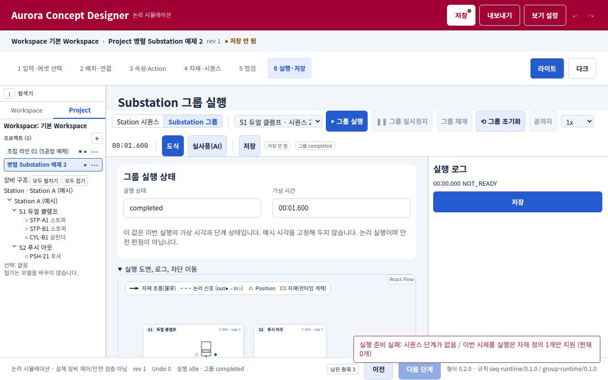

*그림 18. S1 그룹을 「끝까지」 실행한 뒤. 시계 00:01.600, 배지 「그룹 completed」. 오른쪽 로그의 NOT_READY는 그 전에 Station 실행이 막힌 기록이다. 그룹 로그는 접는 칸에 있다. 2026-11-12, Chrome 156, 1280×800, 라이트.*

1. Substation 목록에서 대상을 고릅니다. 시퀀스가 있는 Substation이 처음에 선택됩니다.
2. 「▶ 그룹 실행」「❚❚ 그룹 일시정지」「그룹 재개」「⟲ 그룹 초기화」「끝까지」는 Station과 같은 역할이고, 일시정지는 묶음 전체입니다. 시퀀스 하나만 멈추지는 않습니다.
3. 같은 Device를 두 시퀀스가 쓰거나, 자재를 다루는 시퀀스가 둘 이상이면 실행 전에 막습니다.
4. 시퀀스 하나가 오류면 묶음 전체가 멈춥니다.
5. 다른 Substation을 같이 돌리거나, 시퀀스끼리 기다리게 하지는 못합니다.

오른쪽 「실행 로그」는 Station 실행의 로그입니다. 그룹의 시퀀스별 종료 시각과 `GROUP_COMPLETE`는 접는 칸의 「공통 로그」에 있습니다.

다른 프로젝트로 바꾸면 돌던 그룹도 일시정지되고 자동으로 재개되지 않습니다 (`FL-74`).

### 10.3 실행이 막힐 때 (`FL-72`, `S62`)

제목이 「실행 차단과 수정」으로 바뀝니다. 원인마다 코드, 문장, 「수정 위치」 또는 「원인 확인」, 이동 단추가 있습니다. 이동은 화면만 바꿉니다. 모델을 고친 뒤 「다시 검사」 또는 초기화 뒤 다시 실행합니다. 예는 [15절](#15-문제-해결)입니다.

## 11. 보기 설정

`FL-14` `FL-22`. 화면 `S71`.

헤더 「보기 설정」 또는 단계 바 오른쪽 「라이트」「다크」.

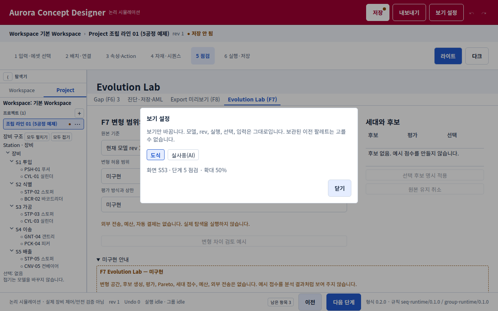

*그림 19. 「보기 설정」. 도식과 실사풍만 바꾸고, 모델과 rev는 그대로라고 적혀 있다. 2026-11-12, Chrome 156, 1280×800, 라이트.*

- 「라이트」「다크」만 고릅니다. 예전에 저장된 값 C는 지우지 않고, 화면은 라이트로 보입니다. 사용자가 라이트나 다크를 누르기 전에는 그 저장값을 건드리지 않습니다. 세 번째 테마 단추는 없습니다.
- 「도식」「실사풍(AI)」은 1단계, 2단계 도면, 6단계에서도 같은 설정입니다.
- 이 설정은 프로젝트 파일에 들어가지 않습니다. 다른 PC로 JSON을 가져가도 테마는 따라가지 않습니다.

## 12. 저장, JSON, Mac과 Windows

`FL-18` `FL-19`. 화면 `S51` `S03`.

### 12.1 저장 (`FL-18`)

헤더 「저장」 또는 6단계의 「저장」.

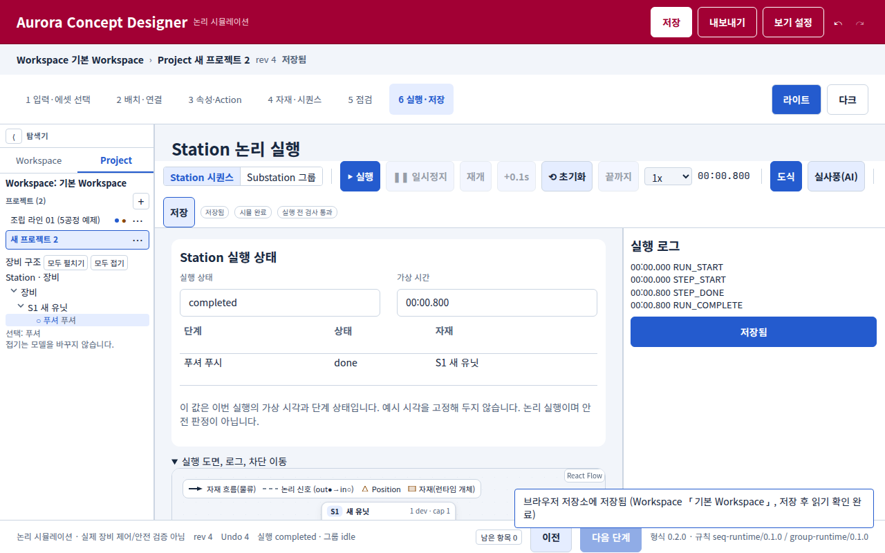

*그림 20. 저장 직후. 위쪽 줄의 점이 사라지고 「저장됨」이 된다. 알림은 브라우저 저장소에 저장됐고 읽기 확인까지 끝났다는 문장이다. 2026-11-12, Chrome 156, 1280×800, 라이트.*

- 저장 위치는 이 브라우저의 localStorage입니다. 다른 PC, 다른 브라우저로 자동으로 옮겨지지 않습니다.
- 성공하면 「브라우저 저장소에 저장됨 (Workspace 「…」, 저장 후 읽기 확인 완료)」이 잠시 보입니다.
- 저장에 실패하면 모델은 그대로입니다. 저장소를 쓸 수 없으면 메모리에서만 작업합니다. 그 경우 Project 상세의 저장 줄은 「브라우저 저장소 사용 불가」이고, 목록은 열린 프로젝트만 보여 줍니다. 「내보내기」로 파일을 남기세요.

### 12.2 JSON 내보내기와 가져오기 (`FL-19`)

1. 「내보내기」는 `이름.ecd.json`을 받습니다. 보기 설정은 파일에 들어가지 않습니다.
2. 가져오기는 작업 시작 화면의 「JSON 가져오기」, Project 탭 「+」의 「JSON 가져오기」, 또는 「프로젝트 파일」 화면에서 합니다.
3. 형식이 맞으면 새 탭으로 열리고, 아직 저장 전이라 `● 저장 안 됨`입니다. 원본 파일을 덮어쓰지 않습니다.
4. 같은 ID가 이미 열려 있으면 「같은 ID의 프로젝트가 이미 열려 있음」이 나옵니다. 「새 ID 사본으로 열기」 또는 「기존 탭으로 이동」입니다. 열린 탭을 덮어쓰지 않습니다.
5. 거절된 파일은 열리지 않고, 원본은 5단계 「진단·저장·AML」의 격리 보관함에 남습니다. 「가져오기 거부 — 현재 모델 불변」 창이 이유를 보여 줍니다.
6. 0.1대 파일은 열 때 0.2로 바뀌고 경고가 붙습니다. 원본 파일 자체는 앱이 수정하지 않습니다.

### 12.3 Mac과 Windows

- 앱을 받는 방법은 2절과 같습니다. git은 코드와 문서를 맞추고, 프로젝트 데이터는 맞추지 않습니다.
- 집과 회사를 오갈 때는 「내보내기」한 `.ecd.json`을 다른 PC에서 「JSON 가져오기」로 엽니다.
- 저장한 뒤 다시 「내보내기」해야 그 변경이 파일에 있습니다. 브라우저 저장만으로는 다른 PC에 없습니다.

## 13. 따라 하기 실습

세 실습 모두 2026-11-12, Chrome 156, 1280×800, 빈 저장소, `npm run dev`에서 처음부터 끝까지 따라 했습니다. 시간은 화면의 가상 시계입니다. 모두 [예시] 가정값입니다.

이미 탭이 열려 있으면 「예제 열기」「병렬 예제」「빈 프로젝트 만들기」가 만드는 이름 뒤의 번호는 열린 탭 수에 따라 2, 3…이 됩니다. 위쪽 줄의 이름으로 확인하세요.

### 13.1 실습 A — 5공정 예제

1. 앱을 엽니다. 위쪽 줄이 `Project 조립 라인 01 (5공정 예제)`이면 그 예제가 이미 열린 것입니다.
2. 아래 「시작하기」를 누릅니다. 「예제 열기」는 사본을 또 만들므로 이 실습에서는 누르지 않습니다.
3. 단계 바 「6 실행·저장」을 누릅니다. 제목은 「Station 논리 실행」이고 「Station 시퀀스」가 선택돼 있습니다.
4. 「▶ 실행」을 누른 뒤 「끝까지」를 누릅니다.

볼 것:

- 시계 `00:11.100`, 배지 「시뮬 완료」, 실행 상태 `completed`
- 오른쪽 로그의 마지막 줄 `00:11.100 RUN_COMPLETE`
- 단계 표는 모두 `done`, 자재 위치는 「배출(장비 밖)」
- 접는 칸의 오류는 0, 준비 검사는 「실행 가능」
- 위쪽 줄은 그대로 `● 저장 안 됨`입니다. 실행은 저장이 아닙니다


*그림 21. 실습 A. 시계 00:11.100, RUN_COMPLETE. 2026-11-12, Chrome 156, 1280×800, 라이트.*

### 13.2 실습 B — 병렬 예제 그룹 실행

1. 작업 시작 화면으로 갑니다. 탐색기 Workspace 탭의 「작업 시작 화면」, 또는 앱을 다시 열었을 때의 가운데 화면입니다.
2. 「병렬 예제」를 누릅니다. 위쪽 줄에 「병렬 Substation 예제」가 보이면 맞습니다. 5공정 탭이 이미 있으면 이름은 「병렬 Substation 예제 2」처럼 번호가 붙습니다.
3. 「6 실행·저장」에서 먼저 「Station 시퀀스」의 「▶ 실행」을 눌러 보면 막힙니다. 이 예제의 Station 시퀀스는 비어 있고 자재도 없습니다. 제목 「실행 차단과 수정」, 코드 `NO_STEPS`와 `MATERIAL_COUNT`. 고장이 아니라 이 예제가 그룹 실행용이라는 뜻입니다. 그림은 [15절](#15-문제-해결)에 있습니다.
4. 「Substation 그룹」을 누릅니다. 대상이 「S1 듀얼 클램프 · 시퀀스 2」인지 봅니다.
5. 「▶ 그룹 실행」, 이어서 「끝까지」를 누릅니다.
6. 접는 칸 「실행 도면, 로그, 차단 이동」을 내려 「시퀀스별 상태」와 「공통 로그」를 봅니다.

볼 것:

- 시계 `00:01.600`, 배지 「그룹 completed」
- S1 시퀀스 A는 2/2, 종료 `00:01.200`
- S1 시퀀스 B는 3/3, 종료 `00:01.600`
- 공통 로그 마지막 `00:01.600 GROUP_COMPLETE`, 문장 「그룹 완료 — 시퀀스 2개 모두 완주」
- 오른쪽 「실행 로그」에 `NOT_READY`가 남아 있을 수 있습니다. 3번에서 Station 실행이 막힌 기록입니다. 그룹 결과가 아닙니다


*그림 22. 실습 B. 그룹 시계 00:01.600. 2026-11-12, Chrome 156, 1280×800, 라이트.*

4단계 「Substation 시퀀스 (3)」에서 같은 예제의 단계 시간을 미리 볼 수 있습니다. 그림 15입니다.

### 13.3 실습 C — 빈 프로젝트에서 한 단계 실행

1. 작업 시작 화면에서 「빈 프로젝트 만들기」를 누릅니다. 위쪽 줄이 「새 프로젝트」로 바뀝니다.
2. 「2 배치·연결」로 갑니다. 팔레트의 「빈 유닛」을 카드 보드의 빈 곳으로 끌어 놓습니다. 카드 「S1 새 유닛」이 생기고 rev는 1이 됩니다.

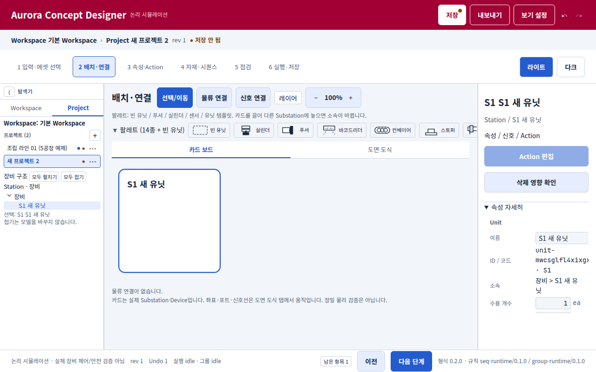

*그림 23. 실습 C, 빈 유닛만 놓은 뒤. 오른쪽 제목은 「S1 새 유닛」. 2026-11-12, Chrome 156, 1280×800, 라이트.*

3. 팔레트의 「푸셔」를 그 카드 위로 끌어 놓습니다. 카드 안에 「푸셔 · 푸셔」가 생깁니다. 카드 밖에 놓으면 들어가지 않습니다.
4. 「4 자재·시퀀스」로 가서 「자재·Flow (F4)」를 누르고 「자재 추가」를 누릅니다. 초기 위치는 「S1 새 유닛」, 초기 상태는 「대기」입니다. 크기와 무게는 미정으로 남습니다.
5. 「Station 시퀀스 Draft (F5)」로 돌아와 「Action 추가」를 누릅니다. 한 줄이 생깁니다. 대상은 푸셔, Action은 「푸셔 푸시」, 완료는 「푸셔.푸시 완료」, 시간은 `0.8s / 3s · 가정`입니다.

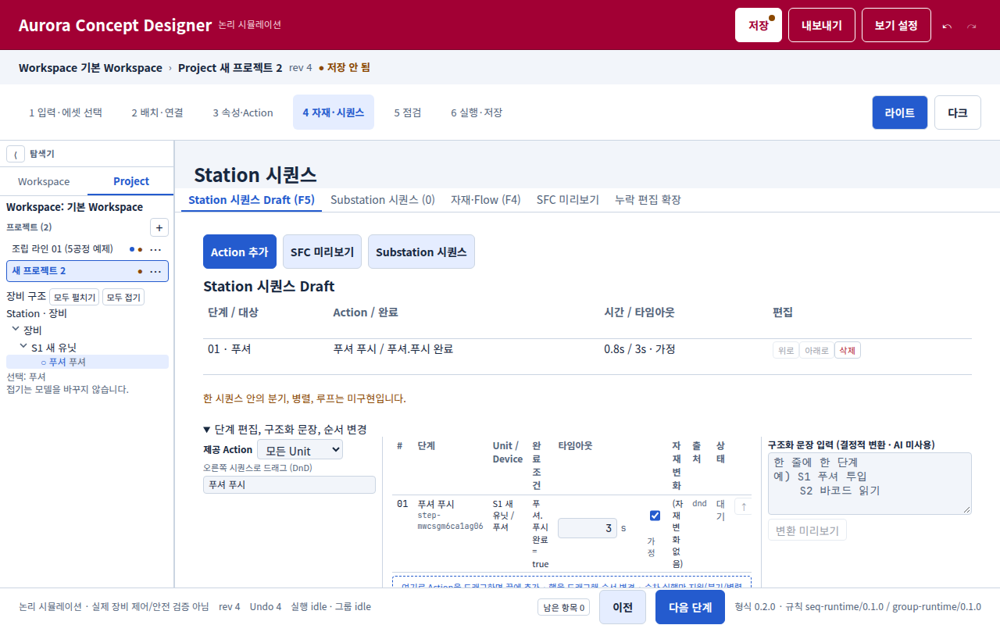

*그림 24. 실습 C의 시퀀스 한 줄. 2026-11-12, Chrome 156, 1280×800, 라이트.*

6. 「6 실행·저장」에서 「▶ 실행」, 「끝까지」를 누릅니다.

볼 것:

- 시계 `00:00.800`, 상태 `completed`, 로그 `00:00.800 RUN_COMPLETE`
- 단계 「푸셔 푸시」는 `done`, 자재는 「S1 새 유닛」의 「대기」 그대로입니다. 이 Action은 자재를 옮기지 않습니다
- 오류 0, 준비 검사 「실행 가능」
- rev 4, Undo 4. 유닛, 푸셔, 자재, 단계가 편집 네 번입니다

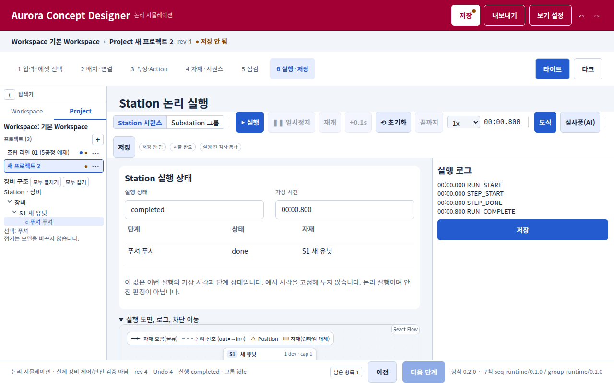

*그림 25. 실습 C. 시계 00:00.800, RUN_COMPLETE, 자재는 S1 새 유닛. 2026-11-12, Chrome 156, 1280×800, 라이트.*

7. 「저장」을 누릅니다. 위쪽 줄이 「저장됨」으로 바뀌고, 알림은 그림 20과 같습니다.

## 14. AML 범위

`FL-23`. 화면 `S12`. 자세한 표는 [`AML-SUPPORT.md`](../../AML-SUPPORT.md)입니다.

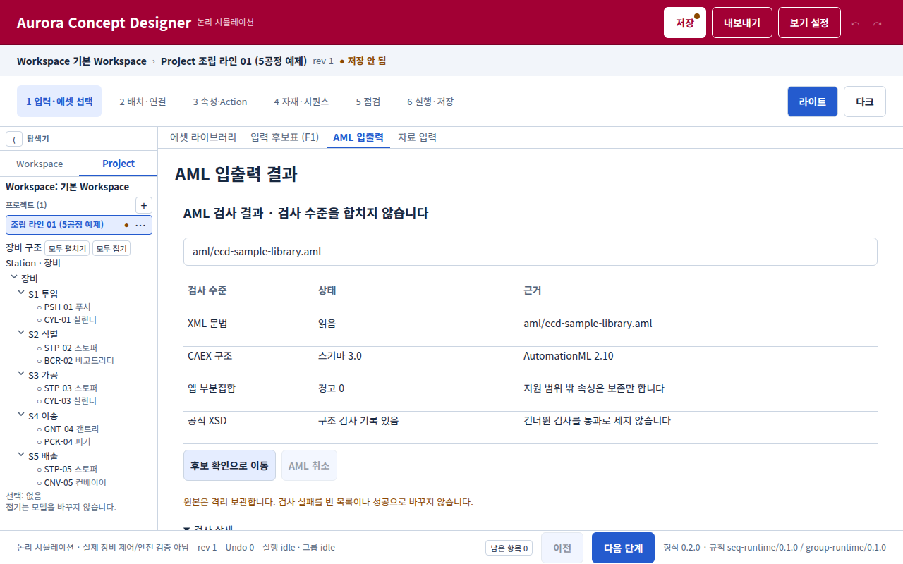

*그림 26. 번들 라이브러리의 네 검사 줄. XSD는 기록이 있다고 표시되고, 브라우저에서 다시 검사하지는 않는다. 2026-11-12, Chrome 156, 1280×800, 라이트.*

이 앱이 읽는 것은 CAEX 3.0의 일부입니다.

- 되는 것: 포함 AML에서 14종 정의를 읽기, 다른 AML 가져오기, 라이브러리 AML 내보내기, 앱 부분집합 진단, 가져와 둔 AML을 이 브라우저에 기억.
- 안 되는 것: 일반 AutomationML 전체(InstanceHierarchy, 외부 참조, 상속 등), 브라우저 안 XSD 검사, 가져온 AML에 사진 파일을 같이 넣기. 공식 XSD 원문은 재배포 조건이 확인되지 않아 저장소에 없습니다.

1단계 카드의 「XSD 통과」는 저장소에 넣어 둔 검사 기록이 정의와 맞을 때의 표시입니다. 검사를 건너뛰었으면 통과로 세지 않습니다.

## 15. 문제 해결

| 보이는 것 | 의미와 다음 행동 |
|---|---|
| 위쪽 `● 저장 안 됨` | 아직 브라우저에 반영되지 않음. 「저장」 |
| 저장 줄 「브라우저 저장소 사용 불가」 | 저장이 안 됨. 「내보내기」로 파일을 남기고, HTTP로 다시 열기 |
| 「가져오기 거부 — 현재 모델 불변」 | 파일을 열지 않음. 5단계 진단의 격리 보관함에서 원본을 받을 수 있음 |
| 「실행 차단과 수정」 | 아래 그림. 이동 단추로 간 뒤 고치고 다시 실행 |
| `PRE_UNMET` | 진입 조건이 안 맞음. 센서 조건이 있는 템플릿 Action을 그대로 실행하면 이렇게 멈출 수 있음 |
| `TIMEOUT` | 완료 신호가 타임아웃 안에 오지 않음. 검증용 「완료 신호 미발생」이 켜져 있는지도 확인 |
| 그룹 중 오른쪽 로그 `NOT_READY` | Station 실행이 막힌 기록일 수 있음. 그룹 결과는 접는 칸의 공통 로그 |
| 실행 중 편집이 안 됨 | 일시정지가 아니라 「초기화」해야 편집이 돌아옴 |
| Workspace가 안 바뀜 | 저장 안 된 편집이 있거나 실행이 일시정지 중. 4.1 |

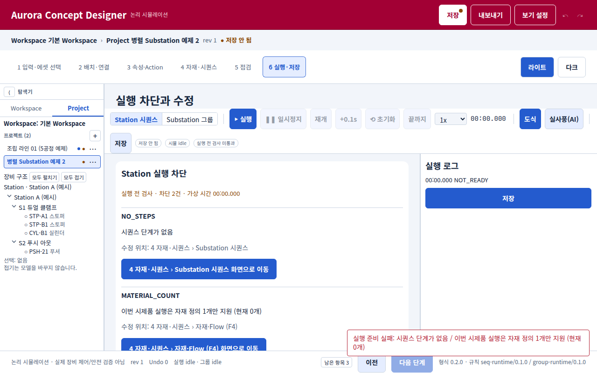

*그림 27. 실습 B의 3번. NO_STEPS는 Substation 시퀀스 화면으로, MATERIAL_COUNT는 자재 화면으로 가는 단추가 있다. 가상 시간 00:00.000. 2026-11-12, Chrome 156, 1280×800, 라이트.*

이동 단추는 세 가지로 나뉩니다. 고치는 화면으로 가는 「수정 위치」, 원인을 보여 주는 「원인 확인」, 그리고 이 화면에서 직접 고칠 수 없는 항목. 단추는 모델과 실행 취소를 바꾸지 않습니다.

## 16. 안 되는 것

기능 목록의 📄는 안내 화면만 있고, ✗는 그 기능이 없습니다. ◐ 안에서 없다고 적힌 부분도 여기 16.2에 모았습니다. 완료된 기능으로 읽지 마세요.

### 16.1 안내 화면만 있음 (📄)

단추는 보이지만 눌리지 않거나, 미구현이라고 적혀 있습니다. 예시 데이터를 만든 것처럼 보여 주지 않습니다.

| ID | 화면 | 가는 곳 | 보이는 것 |
|---|---|---|---|
| FL-12 | `S04` | Workspace 탭 「파일 묶음」 | 이 Workspace의 프로젝트 수만 보여 줌. 「묶음 내보내기」는 비활성 |
| FL-26 | `S14` | 1단계 「자료 입력」 | PDF, DWG, XLSX, USD는 「추출 미구현」. 「자료 선택 예시」는 비활성 |
| FL-54 | `S44` | 4단계 「누락 편집 확장」 | 후속 단계 편집과 다중 자재 확장이 비활성 |
| FL-63 | `S53` | 5단계 「Evolution Lab (F7)」 | 변형, 평가, 후보 생성이 없음. 「평가 실행」은 비활성 |

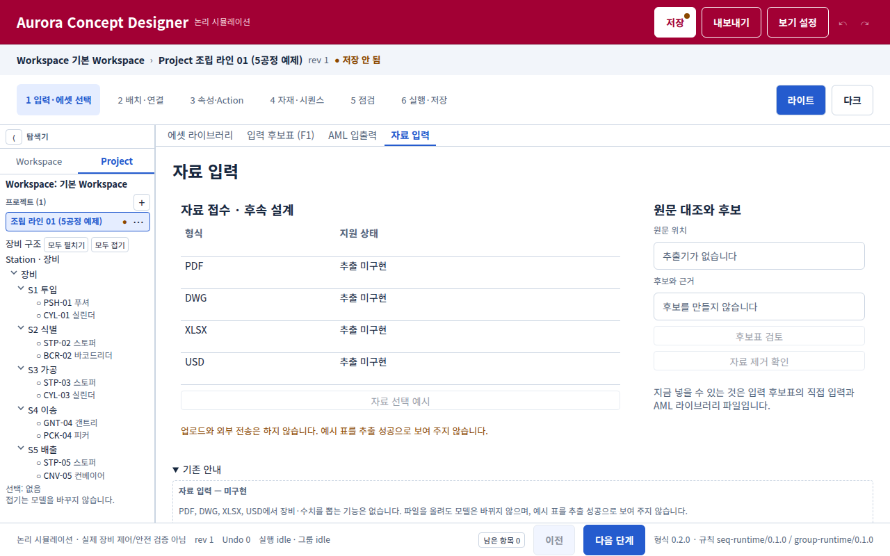

*그림 28. FL-26. 자료 입력은 추출하지 않는다고 적혀 있다. 2026-11-12, Chrome 156, 1280×800, 라이트.*

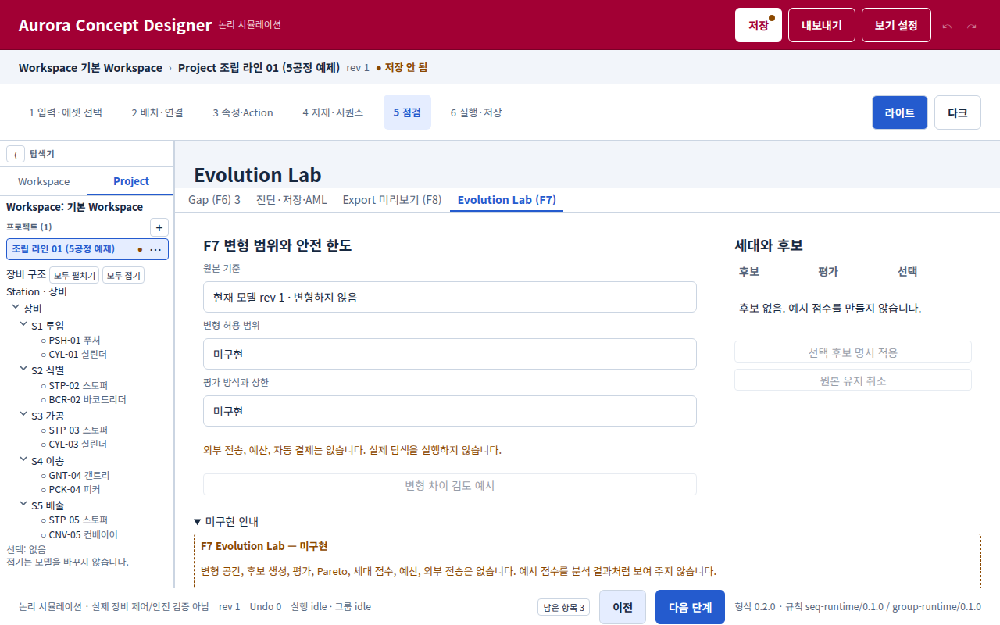

*그림 29. FL-63. 변형 허용 범위와 평가 방식이 미구현이다. 2026-11-12, Chrome 156, 1280×800, 라이트.*

### 16.2 아예 없음 (✗와, 일부 구현 안의 없는 부분)

| ID | 없는 것 |
|---|---|
| FL-37 | 배경 도면 이미지, 도면 잠금, Unit 안의 Device를 서브플로로 두기 |
| FL-13 | 공통 탐색의 검색 입력칸. 탭과 트리를 고르는 화면은 있음 |
| FL-25 | 문서(PDF·DWG·XLSX)와 VC/USD에서 후보를 만들기. 직접 입력 후보는 있음 |
| FL-33 | 물류 연결을 Unit에서 끌어 잇기. 물류는 두 번 누르기로, 신호는 끌기와 두 번 누르기로 잇는 연결은 있음 |
| FL-50 | 자재 여러 개, 캐리어 적재. 자재 하나와 경로는 있음 |
| FL-51 | 한 시퀀스의 분기·병렬, 자연어 AI. 순차 단계와 구조화 문장은 있음 |
| FL-53 | SFC의 분기·루프 표시. 순차 미리보기는 있음 |
| FL-60 | 승인된 판정식, 실행 결과로 계산하는 병목. Gap 목록과 이동은 있음 |
| FL-62 | 실제 Core Export, 역매핑. 읽기 전용 미리보기는 있음 |
| FL-71 | 시퀀스 하나만 일시정지, 다른 Substation을 동시에 실행, 시퀀스 사이 대기 |

그 밖에 앱 밖에 있는 것: WPF 버전, 실제 장비 제어, 브라우저 안 XSD, 일반 AutomationML 전체, AI 평가기 교체. 웹과 WPF가 같다는 검증은 WPF가 없으므로 하지 않았습니다.

## 부록 A. 기능 ID와 절

[`FEATURE-LIST.md`](../FEATURE-LIST.md)의 52개입니다. ✅와 ◐는 본문 절, 📄와 ✗는 16절입니다.

| ID | 기능 | 상태 | 절 |
|---|---|---|---|
| FL-01 | 헤더, 저장, 내보내기, 보기 설정, 실행 취소 | ✅ | 3 |
| FL-02 | 작업 정보 줄 | ✅ | 3 |
| FL-03 | 6단계 단계 바, 남은 항목 | ✅ | 3 |
| FL-04 | 탐색기 Workspace · Project 탭 | ✅ | 4 |
| FL-05 | Workspace 목록 | ✅ | 4 |
| FL-06 | 프로젝트 목록 | ✅ | 4 |
| FL-07 | 프로젝트 추가 메뉴 | ✅ | 4 |
| FL-08 | 프로젝트 상세 팝업 | ✅ | 4 |
| FL-09 | 저장 안 된 변경이 있을 때의 닫기·전환 | ✅ | 4 |
| FL-10 | 장비 구조 트리 | ✅ | 4 |
| FL-11 | 프로젝트 파일 화면 | ✅ | 4 |
| FL-12 | Workspace 파일 묶음 | 📄 | 16 |
| FL-13 | 공통 탐색 | ◐ | 4 |
| FL-14 | 라이트·다크, 도식·실사풍 | ✅ | 11 |
| FL-15 | 칸 너비 | ✅ | 3 |
| FL-16 | 접는 칸은 처음에 펼침 | ✅ | 3 |
| FL-17 | 실행 취소·다시 실행 | ✅ | 3 |
| FL-18 | 브라우저 저장 | ✅ | 12 |
| FL-19 | JSON 내보내기·가져오기 | ✅ | 12 |
| FL-20 | 에셋 카드 14종 | ✅ | 5 |
| FL-21 | 카드 상세와 프로젝트에 추가 | ✅ | 5 |
| FL-22 | 도식·실사풍 전환 | ✅ | 5, 11 |
| FL-23 | AML 읽기·입출력 | ✅ | 5, 14 |
| FL-24 | 유닛 템플릿 3종 | ✅ | 5 |
| FL-25 | 입력 후보표 | ◐ | 5 |
| FL-26 | 자료 입력 | 📄 | 16 |
| FL-30 | 팔레트에서 배치 | ✅ | 6 |
| FL-31 | 카드 보드·도면 도식 탭 | ✅ | 6 |
| FL-32 | 도면 캔버스 | ✅ | 6 |
| FL-33 | 물류·신호 연결 | ✅ | 6 |
| FL-34 | 다중 선택, 정렬, 삭제 | ✅ | 6 |
| FL-35 | Device 소속 변경 확인 | ✅ | 6 |
| FL-36 | 레이어 숨기기 | ✅ | 6 |
| FL-37 | 배경 도면, 잠금, 서브플로 | ✗ | 16 |
| FL-40 | 장치 속성 | ✅ | 7 |
| FL-41 | 신호와 포지션 | ✅ | 7 |
| FL-42 | Action | ✅ | 7 |
| FL-43 | 제공 능력, Interlock 후보 | ✅ | 7 |
| FL-50 | 자재 정의 | ◐ | 8 |
| FL-51 | Station 시퀀스 Draft | ◐ | 8 |
| FL-52 | Substation 시퀀스 | ✅ | 8 |
| FL-53 | SFC 미리보기 | ◐ | 8 |
| FL-54 | 누락 편집 확장 | 📄 | 16 |
| FL-60 | Gap 점검 | ◐ | 9 |
| FL-61 | 진단·저장·AML | ✅ | 9 |
| FL-62 | Export 미리보기 | ◐ | 9 |
| FL-63 | Evolution Lab | 📄 | 16 |
| FL-70 | Station 논리 실행 | ✅ | 10 |
| FL-71 | Substation 그룹 실행 | ◐ | 10 |
| FL-72 | 실행 차단과 이동 | ✅ | 10, 15 |
| FL-73 | 오른쪽 실행 로그 | ✅ | 10 |
| FL-74 | 프로젝트를 바꾸면 실행 일시정지 | ✅ | 4, 10 |

## 부록 B. 용어

| 용어 | 뜻 |
|---|---|
| Station | 장비 전체. 내부 이름은 Equipment. 프로젝트당 하나 |
| Substation | 구간. 내부 이름은 Unit |
| Device | Substation 안의 실린더, 센서 등 |
| Action | 명령 신호, 완료 신호, 동작 시간, 타임아웃을 가진 동작 |
| Station 시퀀스 | Station 전체의 순차 단계 |
| Substation 시퀀스 | 한 Substation 안의 시퀀스. 그룹 실행의 단위 |
| 그룹 실행 | 그 시퀀스들을 하나의 가상 시계로 실행 |
| 가상 시간 | 정수 밀리초로 계산하는 시간. 재생 속도와 결과가 무관 |
| rev | 모델을 바꿀 때마다 증가하는 번호 |
| 보기 설정 | 테마, 도식·실사풍, 단계, 탭, 칸 너비. 프로젝트 파일 밖 |
| Workspace | 이 브라우저 안의 프로젝트 묶음. 폴더가 아님 |
| 탭 닫기 | 화면에서만 닫음. 저장 데이터는 남음 |
| 삭제 | 이 브라우저의 저장을 지움. 실행 취소되지 않음 |
| AML / CAEX | AutomationML 파일과 그 XML. 이 앱은 CAEX 3.0의 일부만 읽음 |
| [예시] 가정값 | 실제 사양이 아닌 임시 값 |

## 부록 C. PDF

PDF는 이 마크다운을 브라우저 없이 파일로 변환한 것입니다. 스크립트는 [`build_user_manual_pdf.py`](build_user_manual_pdf.py), 꾸러미 목록은 [`requirements-pdf.txt`](requirements-pdf.txt)입니다. 프로젝트 npm 의존성에 넣지 않습니다.

```bash
python3 -m venv .venv-manual
.venv-manual/bin/pip install -r docs/user-manual/requirements-pdf.txt
.venv-manual/bin/python docs/user-manual/build_user_manual_pdf.py \
  --md docs/user-manual/USER-MANUAL.ko.md \
  --out docs/user-manual/USER-MANUAL.ko.pdf \
  --ref <링크를 고정할 commit SHA>
```

한글 글꼴은 Noto Sans CJK KR 또는 나눔고딕이 필요합니다.

| 판 | 날짜 | 내용 |
|---|---|---|
| UM-0.3.0-r1 ~ r5 | 2026-11-08 ~ 09 | 이전 매뉴얼. 화면은 TURN-007 이전과 r5 검토 화면이 섞여 있음 |
| UM-0.3.0-r6 | 2026-11-12 | 이 원고. `main` `4bc0f6a`의 화면으로 다시 씀. 사람 검수 전 |

이번 PDF는 2026-11-12에 Linux에서 WeasyPrint 70.0으로 다시 만들었습니다. 35쪽, A4, 약 5.0 MB입니다. `pdffonts`에서 Noto Sans CJK KR이 포함(emb=yes)됩니다. `--ref`는 `4bc0f6a`입니다. 이 브랜치에서 새로 넣은 그림은 PDF 안에 직접 들어 있습니다. Mac과 Windows에서 같은 명령을 다시 돌린 기록은 없습니다.

## 부록 D. 참조

| 파일 | 내용 |
|---|---|
| [`README.md`](../../README.md) | 빠른 시작, 런타임 규칙, 알려진 한계 |
| [`docs/FEATURE-LIST.md`](../FEATURE-LIST.md) | 기능 52개의 상태와 화면 번호 |
| [`docs/requirements-v0.3.md`](../requirements-v0.3.md) | 공개 요구 통합본 |
| [`REQUIREMENTS-VERIFICATION.md`](../../REQUIREMENTS-VERIFICATION.md) | 요구별 검증 기록 |
| [`AML-SUPPORT.md`](../../AML-SUPPORT.md) | AML 지원 범위 |
| [`docs/DEVELOPMENT-WORKFLOW.md`](../DEVELOPMENT-WORKFLOW.md) | Mac / Windows 개발 절차 |
| [`docs/turns/`](../turns/) | TURN별 화면 변경 기록 |
