# Aurora Concept Designer 사용자 매뉴얼

| 항목 | 내용 |
|---|---|
| 대상 앱 | Aurora Concept Designer 웹 시제품 **0.3.0-prototype** |
| 파일 형식 | `0.3.0` (`0.2.x` · `0.1.x` 파일은 그대로 열림) |
| 기준 | 공개 저장소 `kotaeji/EquipCD_G`의 `main` `4bc0f6a` (`4bc0f6a64263eb40232b84e074a67fb6589921fa`, 2026-11-12). 6.2 · 6.3 · 16.2 의 신호 연결은 TURN-012 `b4004fe`, 6.1 · 6.2 의 Unit 크기는 TURN-013 `5677185`, 6.2 의 「배치 ▾」는 TURN-014 `5210e71`, 센서 신호 · 실행 결과 요약 · 공통 탐색 검색 · 「준비 중」 표시 · 끌어서 고르기 · 여러 개 삭제 · 복제는 TURN-017~021 `d021a01`, 흐름 블록 · SFC · Substation 단계 · 그룹 실행 통합(8.1 · 8.3 · 8.4 · 10.2 · 13.2 · 16.2)은 TURN-022 `0298c26`, 블록 이름 · 블록 옮기기 · 「정지」 표시 · 실행 규칙 `0.3.1`(3.4 · 8.1 · 8.4 · 10.2)은 TURN-023~024 `84c1628` 기준. 라이트 테마 색 · 카드 열 수 · 팔레트 줄바꿈 · 실행 취소 아이콘 · Ctrl + A · Ctrl + 클릭 · 「자동 정렬」(3.1 · 5.1 · 6.1 · 6.2)은 TURN-026~028 `70fe623` 기준. 17절 전체(조건 검사 · 명령 · 대상 찾기 · 도움말 · 내 템플릿 · Evolution Lab · 배경 도면 · 자료 입력 · 아이콘 · 세 갈래 분기 · 타이밍 차트 · 보고서 · 확인 이력 · 여러 개체 흐름 실행 등)은 TURN-052~082 `2b54a60`, 18절 전체(표 · 알림 · 헤더 · 화면 배치 · 키보드 도면 · Substation 흐름 · 자재 혼류 · 차이 보기 · 실행 되감기 · 3D 시점)는 TURN-068~086 `b3e44fb`, 19절 전체(시각 표시 · 낮고 좁은 화면 · 흐름 표 밀도 · 자재 종류 색 · 조건 반복 · 실행 준비 점검표 · 저장 지점 · 보고서와 인쇄용 보기 · Unit 복제와 정렬)는 TURN-087~096 `1cfe47d`, 물류 끌어 잇기 · 우클릭 메뉴(6.3) · 신호 기다림(8.1 · 8.4 · 10.2) · Substation 하나만 일시정지(10.2) · 문제 안내 세 줄(10.3 · 15) · 빈 화면 · 준비 중 화면(16.1)은 TURN-049~051 `18eea71`, 임시 저장(3.2 · 12.1) · 복사와 붙여넣기 · 선 강조 · 미니맵 · 팔레트(6.1 · 6.2 · 6.3) · 위험 단추 · 숫자 칸 · Interlock 규칙(7) · 실행 결과 Gap(9.1) · Interlock 차단(10.3)은 TURN-043~048 `90bb4bb`, 시작 화면 둘러보기(2.3) · 단계 바 배지(3.3) · 상태 표시(3.6) · 자재 여러 개(8.2 · 10.5) · Export 초안 파일(9.3)은 TURN-038~042 `5d3ca6f`, 자동 정렬 뒤 Unit 밀기(6.2) · 6단계 도면 맞춤(10.1)은 TURN-036 · 037 `6d3e96d`, 6단계 틀(10.1) · 3D 움직임(10.4) · 탐색기 접기(3.4)는 TURN-032 · 035 `2a914f4`, 6단계 3D 보기(10.4)는 TURN-029 `9d15eae`, 6단계 탭 · 3D 바닥 이름 · 실사풍 · 3D 숫자 · 흐름 표 다듬기(8.1 · 10.1 · 10.4)는 TURN-030 · 031 · 033 · 034 `272d69a` 기준. TURN-022~029의 새 화면 그림은 아직 없고, PDF에도 없습니다. **그림은 모두 TURN-026 이전의 푸른 라이트 테마 화면입니다** |
| 작성일 | 2026-11-12 |
| 상태 | **사람 검수 전(검토 후보)**. 정식 릴리스가 아니고, 완료·인증을 뜻하지 않습니다 |
| 대상 독자 | 앱을 처음 쓰는 설비 개념 설계 담당자. 프로그래밍은 필요 없습니다. 개발 서버로 여는 방법만 Node.js가 필요합니다 |
| 원고 | `docs/user-manual/USER-MANUAL.ko.md`. PDF `docs/user-manual/USER-MANUAL.ko.pdf`는 TURN-011 판(`4bc0f6a`)이라 6.2 · 6.3 · 16.2의 신호 연결, 6.1 · 6.2의 Unit 크기, 6.2의 「배치 ▾」 설명이 이 원고와 다르고, TURN-017~021에서 바뀐 곳(3.4 · 4.1 · 5.2 · 6.2 · 10.1 · 10.2 · 15 · 16)도 PDF에는 없습니다. TURN-017~021의 새 화면 그림은 이 원고에도 아직 없습니다. 이 원고가 최신입니다 |

> **이 앱이 하지 않는 것**
>
> - 설비의 초기 컨셉을 그리고, 정해 둔 순서대로 **논리 시뮬레이션**을 해 보는 시제품입니다.
> - 실제 장비 제어, PLC 연결, 정밀 물리·충돌 검증, 안전 판정, AI 최적화, Aurora Core 실제 연동은 하지 않습니다.
> - 화면의 시간·크기·무게·타임아웃은 **[예시] 가정값**입니다. 실제 장비 사양이 아닙니다.
> - 「실사풍(AI)」은 AI로 만든 일반형 그림이며 실제 촬영 사진이 아닙니다.

기능 번호 `FL-NN`과 화면 번호 `Sxx`는 [`docs/FEATURE-LIST.md`](../FEATURE-LIST.md)를 따릅니다. 그 문서의 상태 표기는 ✅ 구현, ◐ 일부만, 📄 안내 화면만, ✗ 없음입니다.

## 목차

- [0. 읽는 법](#0-읽는-법)
- [1. 범위와 한계](#1-범위와-한계)
- [2. 시작하기](#2-시작하기)
- [3. 화면 구성](#3-화면-구성)
- [4. Workspace와 프로젝트](#4-workspace와-프로젝트)
- [5. 1단계 입력·에셋 선택](#5-1단계-입력에셋-선택)
- [6. 2단계 배치·연결](#6-2단계-배치연결)
- [7. 3단계 속성·Action](#7-3단계-속성action)
- [8. 4단계 자재·시퀀스](#8-4단계-자재시퀀스)
- [9. 5단계 점검](#9-5단계-점검)
- [10. 6단계 실행·저장](#10-6단계-실행저장)
- [11. 보기 설정](#11-보기-설정)
- [12. 저장, JSON, Mac과 Windows](#12-저장-json-mac과-windows)
- [13. 따라 하기 실습](#13-따라-하기-실습)
- [14. AML 범위](#14-aml-범위)
- [15. 문제 해결](#15-문제-해결)
- [16. 안 되는 것](#16-안-되는-것)
- [17. TURN-052 ~ 082 로 더해진 것](#17-turn-052--082-로-더해진-것)
- [18. TURN-068 ~ 086 으로 더해진 것](#18-turn-068--086-으로-더해진-것)
- [19. TURN-087 ~ 096 으로 더해진 것](#19-turn-087--096-으로-더해진-것)
- [부록 A. 기능 ID와 절](#부록-a-기능-id와-절)
- [부록 B. 용어](#부록-b-용어)
- [부록 C. PDF](#부록-c-pdf)
- [부록 D. 참조](#부록-d-참조)

## 0. 읽는 법

- 버튼·탭 이름은 **「」** 로 적습니다. 이름은 기준 커밋의 화면에서 그대로 옮겼습니다.
- 하는 법은 번호 목록입니다. 누를 곳, 그다음 보이는 것을 적습니다.
- 절이 다루는 기능은 절 머리에 `FL-NN`과 화면 `Sxx`로 적습니다.
- ◐ 기능은 그 절에서 되는 일을 적고, 안 되는 부분을 같은 자리에 한 줄로 적습니다.
- 📄와 ✗는 [16. 안 되는 것](#16-안-되는-것)에 모읍니다. 본문에서는 그 절로만 안내합니다.
- 그림은 2026-11-12에 Chrome 156으로 이 커밋의 개발 서버를 **1280×800, 기기 픽셀 배율 1**에서 찍은 실제 화면입니다. 그림 위에 화살표는 그리지 않았습니다. 가리킬 곳은 그림 아래 글에 적습니다. 다크 그림은 화면 구성과 Workspace 탭, 두 장입니다.
- 이 따라 하기는 구현 에이전트가 빈 저장소 상태에서 한 것입니다. 사람 검수가 아닙니다. 자동 테스트 통과는 CI 결과로만 말합니다. 검증 기록의 본문은 [`REQUIREMENTS-VERIFICATION.md`](../../REQUIREMENTS-VERIFICATION.md)와 [`docs/turns/`](../turns/)에 있습니다.

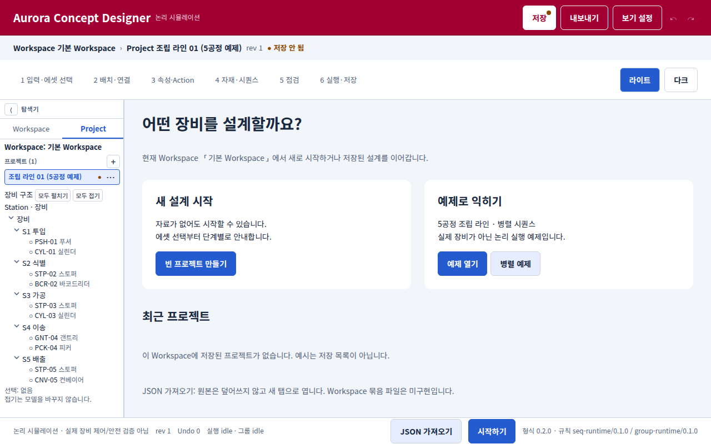

*그림 0. 이 매뉴얼의 그림은 이런 실제 화면이다. 주소창은 넣지 않았다. 같은 화면의 조작은 2절 그림 2에서 이어 설명한다.*

## 1. 범위와 한계

화면 맨 아래에는 항상 「논리 시뮬레이션 · 실제 장비 제어/안전 검증 아님」이 있습니다.


*그림 1. 1단계 「입력·에셋 선택」. 아래 줄 왼쪽이 이 앱의 한계 문구다. 2026-11-12, Chrome 156, 1280×800, 라이트.*

되는 일은 대략 이것입니다.

- Station › Substation › Device 로 구성을 그린다. 화면의 Substation은 내부 이름 Unit과 같습니다.
- 에셋 14종을 AML 라이브러리에서 골라 프로젝트에 넣는다.
- 물류 연결과 신호 연결을 만든다.
- 속성, 신호, Action, 자재 하나, 순차 시퀀스를 적는다.
- 가상 시간으로 Station 시퀀스를 실행하거나, 한 Substation의 시퀀스 여러 개를 한 시계로 실행한다.
- 이 브라우저에 저장하고, JSON 파일로 내보내거나 가져온다.

하지 않는 일은 [16절](#16-안-되는-것)에 모았습니다. 안전 항목을 자동으로 끝내 주지도 않습니다. Interlock은 사람이 보는 후보입니다.

요구 문서의 [확정]과 [설계 제안]은 요구의 승인 상태입니다. 이 매뉴얼의 ✅ · ◐와는 다릅니다. 6단계 구성과 단계 판정은 요구상 설계 제안이고, 시제품이 그 제안을 화면으로 만든 것입니다.

## 2. 시작하기

### 2.1 파일 하나로 열기

앱은 `release/equipment-concept-designer.html` 한 파일입니다. React, 스타일, AML 라이브러리, 도식, AI 그림이 들어 있고 외부 CDN은 쓰지 않습니다.

1. 저장소에서 그 파일을 받습니다. 저장소 전체를 받았다면 `release` 폴더에 있습니다.
2. `release`의 상위 폴더에서 터미널을 열고 다음 중 하나를 실행합니다.

```bash
python3 -m http.server 8766 --directory release
```

3. Chrome 주소창에 `http://localhost:8766/equipment-concept-designer.html`을 입력합니다.
4. 위쪽 붉은 줄에 「Aurora Concept Designer」와 「논리 시뮬레이션」이 보이면 열린 것입니다. 버전 번호는 그 줄의 읽는 이름에 들어 있고, 글자로는 `0.3.0-prototype`이 따로 찍혀 있지 않습니다.

파일을 더블클릭해 `file://`로 여는 방법은 README에 있습니다. 이 매뉴얼의 그림과 실습은 그 방식이 아니라, 이 커밋을 `npm run dev`로 연 주소에서 확인했습니다. `file://`에서는 Chrome이 로컬 HTML끼리 저장 공간을 공유할 수 있습니다. 중요한 작업은 「내보내기」로 파일에 남기세요.

Windows에서 `python3` 명령이 없으면 설치 상태에 따라 명령 이름이 다를 수 있습니다. 그 경우는 이 매뉴얼에서 확인하지 않았습니다.

### 2.2 개발 서버

소스에서 실행하려면 Node.js 20 이상이 필요합니다.

```bash
git clone https://github.com/kotaeji/EquipCD_G.git
cd EquipCD_G
npm ci
npm run dev
```

주소는 `http://localhost:5173`입니다. 이 매뉴얼의 그림은 이 방법으로 연 화면입니다.

### 2.3 처음 열면

저장이 없으면 5공정 예제가 이미 열려 있고, 가운데는 작업 시작 화면입니다.


*그림 2. 처음 연 화면. 위쪽 줄은 「기본 Workspace」와 「조립 라인 01 (5공정 예제)」이고, 가운데 제목은 「어떤 장비를 설계할까요?」다. 2026-11-12, Chrome 156, 1280×800, 라이트.*

- 위쪽 줄: `Workspace 기본 Workspace › Project 조립 라인 01 (5공정 예제) rev 1 ● 저장 안 됨`
- 가운데 「빈 프로젝트 만들기」, 「예제 열기」, 「병렬 예제」, 「흐름 예제」
- 이 브라우저에서 둘러보기를 본 적이 없고 저장된 프로젝트도 없으면 맨 앞에 「5공정 예제로 둘러보기」가 있습니다(TURN-042). 그림 2 는 이 단추가 생기기 전 화면입니다.
  - 누르면 열려 있는 5공정 예제 위에 안내 말풍선이 뜨고, 일곱 걸음으로 1~6단계 화면을 차례로 보여 준 뒤 단계 바와 「저장」을 설명합니다.
  - 걸음마다 「이전」 · 「다음」 · 「건너뛰기」와 「n / 7」이 있습니다. ← → 로 넘기고 Esc 로 닫습니다(= 건너뛰기).
  - 여섯째 걸음에서 말풍선이 떠 있는 채로 「실행」을 눌러 볼 수 있습니다. 안내는 모델을 바꾸지 않습니다(rev · Undo 그대로).
  - 한 번 닫으면 다시 저절로 뜨지 않습니다. 다시 보려면 헤더 「보기 설정」의 「둘러보기 다시 보기」를 누릅니다([11절](#11-보기-설정)).
- 아래 「JSON 가져오기」, 「시작하기」
- 「시작하기」는 이미 열린 예제의 1단계로 갑니다. 「예제 열기」는 예제 사본을 하나 더 만듭니다.
- 이 브라우저에 저장이 있으면 그 Workspace에서 마지막으로 저장한 프로젝트가 열리고, 마지막으로 보던 단계가 복원됩니다. 실행 중이던 상태는 복원하지 않습니다.

## 3. 화면 구성

`FL-01` `FL-02` `FL-03` `FL-15` `FL-16` `FL-17`. 화면은 모든 단계에서 공통입니다.

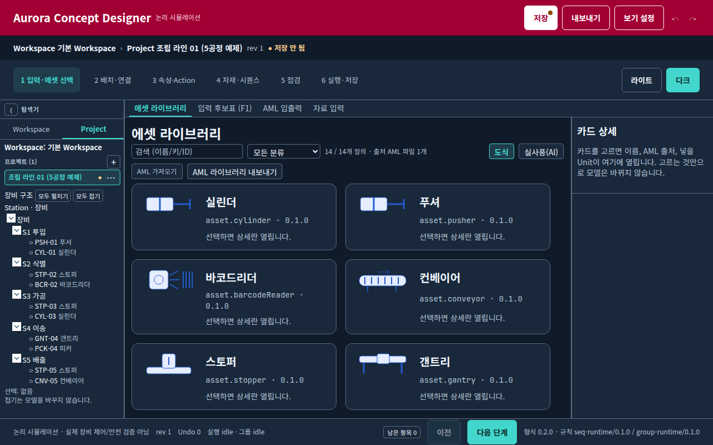

*그림 3. 그림 1과 같은 1단계를 다크로 본 것. 헤더 붉은색은 그대로다. 2026-11-12, Chrome 156, 1280×800, 다크.*

### 3.1 헤더 (`FL-01`)

위쪽 붉은 줄입니다. 헤더 아래 화면은 라이트 테마에서 흰색 · 회색 · 검정 계열입니다(TURN-026). 고른 단추 · 단계 · 줄은 회색 바탕에 짙은 테두리가 더해져 구별됩니다. 성공 · 경고 · 위험을 뜻하는 초록 · 주황 · 빨강은 그대로입니다.

| 보이는 것 | 하는 일 |
|---|---|
| Aurora Concept Designer · 논리 시뮬레이션 | 제품 이름 |
| 「저장」 | 이 브라우저에 저장합니다. 저장 안 된 변경이 있으면 단추에 점이 있습니다. [12절](#12-저장-json-mac과-windows) |
| 「내보내기」 | 지금 프로젝트를 `.ecd.json` 파일로 받습니다 |
| 「보기 설정」 | 도식과 실사풍을 바꿉니다. [11절](#11-보기-설정) |
| 화살표 아이콘 두 개 | 왼쪽으로 도는 화살표가 실행 취소, 오른쪽으로 도는 화살표가 다시 실행입니다(44px 단추). 단축키는 Ctrl 또는 Cmd+Z, Shift+Z, Ctrl+Y. 편집 하나당 한 번입니다. 실행 중이거나 일시정지면 편집과 실행 취소가 막힙니다 |

### 3.2 작업 정보 줄 (`FL-02`, 화면 `S00`)

헤더 바로 아래입니다.

`Workspace 이름 › Project 이름  rev N  ● 저장 안 됨`

또는 점 없이 「저장됨」.

- Workspace 이름을 누르면 탐색기 Workspace 탭이 열립니다.
- Project 이름을 누르면 탐색기 Project 탭이 열립니다.
- `rev`는 모델을 바꿀 때마다 1씩 오릅니다. 보기만 바꿔도 오르지 않습니다.
- `● 저장 안 됨`은 마지막 저장보다 모델이 앞선 상태입니다. 처음 연 예제도 한 번도 저장하지 않았으면 이렇게 보입니다.
- 그 옆에 마지막 저장 시각과 임시 저장 시각이 나옵니다(TURN-047) — 예: 「저장 14:02 · 임시 저장 14:05」. 임시 저장에 실패하면 「임시 저장 실패」가 보이고 편집은 그대로 됩니다. [12.1절](#121-저장-fl-18).

### 3.3 단계 바 (`FL-03`)

여섯 단추입니다. 「1 입력·에셋 선택」부터 「6 실행·저장」까지. 고른 단계가 가운데 화면입니다.

단추마다 이름 아래에 배지가 있습니다(TURN-038 · 039). 배지는 기호 + 판정 + 남은 항목 수입니다 — 「✓ 필수 충족 3」, 「! 필수 누락 2」, 「? 재확인 필요 1」, 「✓ 확인됨 0」. 「필수 충족」은 필수 누락이 없다는 뜻이고, 숫자에는 가정 · 미정 · 사람 확인 항목도 들어갑니다. 이 절의 그림들은 배지가 생기기 전 화면입니다.

- 단추의 이름 부분을 누르면 그 단계로 갑니다. **배지**를 누르면 그 단계의 남은 항목 목록이 열리고, 지금 단계는 바뀌지 않습니다.
- 목록의 항목을 누르면 고칠 단계 · 하위 탭으로 가서 대상이 골라지고, 고칠 칸이 약 2초 동안 테두리로 강조됩니다. 입력 칸이면 초점도 갑니다. 갈 곳이 없는 항목은 「이동할 화면 없음」이라고 적혀 있습니다.
- 목록은 Esc 나 바깥을 눌러 닫습니다. 실행 중에도 열 수 있습니다. 목록과 이동은 모델을 바꾸지 않습니다.

- 아래 상태 줄의 「남은 항목 N」도 지금 단계의 같은 목록을 엽니다. 항목은 필수 데이터 누락, 가정, 미정, 선택 사항 미확보, 사람 확인 필요로 나뉩니다.
- 「이전」, 「다음 단계」는 상태 줄 오른쪽에 있습니다.
- 필수 항목이 남은 단계에서 「다음 단계」를 누르면 원인 창이 열립니다. 「머무르며 수정」 또는 「확인 없이 다음 화면 보기」를 고릅니다. 넘어가도 6단계 실행 전 검사는 따로 막습니다.
- 고른 단계, 탐색기 탭, 배치 탭, 테마는 이 브라우저의 보기 설정에만 남습니다. 프로젝트 JSON에는 들어가지 않습니다.
- 오른쪽 「라이트」「다크」는 [11절](#11-보기-설정)입니다.

### 3.4 왼쪽, 가운데, 오른쪽

- 왼쪽은 탐색기입니다. [4절](#4-workspace와-프로젝트). 「⟨」로 접고 「⟩」로 펼칩니다. 접으면 탐색기가 좁은 띠(40px)로 줄고 가운데 작업 화면이 그만큼 넓어집니다(TURN-035). 도면과 3D도 새 폭에 맞춰 다시 그려집니다. 접은 상태는 이 브라우저에 남습니다.
- 가운데는 지금 단계의 작업 화면입니다. [5절](#5-1단계-입력에셋-선택)부터 [10절](#10-6단계-실행저장)까지.
- 오른쪽은 단계마다 다릅니다. 1단계는 카드 상세, 2단계는 배치 속성, 6단계는 가동 조건입니다.
- 아래 상태 줄: 한계 문구, `rev`, `Undo` 횟수, 실행 상태, 저장소를 쓸 수 없으면 「메모리 전용」에 해당하는 안내, `형식 0.3.0`, 규칙 `seq-runtime/0.11.0`.

### 3.5 칸 너비와 접는 칸 (`FL-15`, `FL-16`)

칸 경계의 세로 막대(탐색기 너비, 카드 상세 너비, 속성 패널 너비)를 마우스로 끌면 너비가 바뀝니다. 막대에 포커스를 두고 ← → 를 눌러도 16픽셀씩 움직입니다. 두 번 누르면 기본 너비로 돌아갑니다. 너비는 이 브라우저에만 기억되고 프로젝트 파일에는 들어가지 않습니다.

팔레트, 속성 자세히 같은 접는 칸은 열릴 때 펼쳐져 있습니다. 접은 상태는 저장하지 않습니다. 화면을 다시 열면 다시 펼쳐집니다. 6단계의 칸(왼쪽 「단계」, 요약 띠, 오른쪽 「가동 조건」, 아래 「자세히」)과 탐색기는 다릅니다 — 접은 상태가 이 브라우저에 남습니다. 6단계 오른쪽 칸에는 너비 막대가 없고 「접기」만 있습니다(TURN-035).

### 3.6 상태 표시 (TURN-039)

상태는 어느 화면에서나 같은 기호 · 낱말 · 색으로 나옵니다. 색만으로 구분하지 않습니다.

| 기호 | 낱말 | 쓰는 곳 |
|---|---|---|
| ▶ | 진행 중 | 6단계 단계 줄 · 요약 표, 흐름 표, SFC, 도면 · 3D 표식, 트리 |
| ✓ | 완료 | 위와 같음. 단계 바의 「필수 충족」 · 「확인됨」도 이 모양 |
| ! | 오류 | 위와 같음. 단계 바의 「필수 누락」, Gap 의 「부족」도 이 모양 |
| ○ | 대기 | 위와 같음. 「건너뜀」 · 「일시정지」도 이 모양 |
| ? | 미정 | 속성 · Action 칸, Gap, Export, 남은 항목. 단계 바의 「재확인 필요」도 이 모양 |
| △ | 가정 | 속성 · Action 칸, Gap, Export, 남은 항목. 「정지」도 이 모양 |

- 탐색기 트리처럼 좁은 곳은 기호만 보입니다. 낱말은 마우스를 올리거나 화면 읽기 프로그램으로 알 수 있습니다.
- 이 매뉴얼의 그림은 이 체계가 생기기 전 화면이라 「▼ 동작 중」, 「가정값」 같은 옛 글자가 보입니다.

## 4. Workspace와 프로젝트

`FL-04` `FL-05` `FL-06` `FL-07` `FL-08` `FL-09` `FL-10` `FL-11` `FL-13`. 화면 `S01` `S02` `S03` `S70` `S72`. `FL-12` 파일 묶음은 [16절](#16-안-되는-것)입니다.

탐색기 위쪽 탭은 「Workspace」와 「Project」입니다. ← → 로 탭을 바꿀 수 있고, 고른 탭은 이 브라우저에 남습니다.

### 4.1 Workspace 탭 (`FL-05`, `S01`)

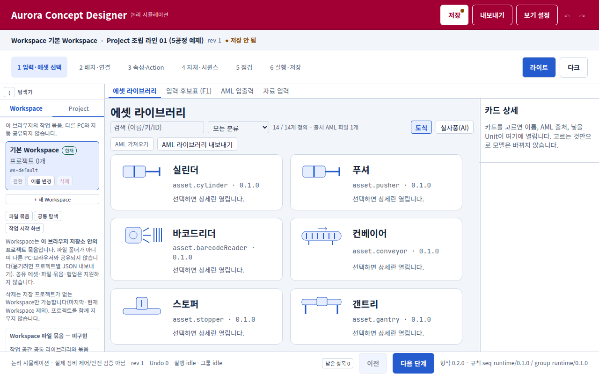

*그림 4. Workspace 탭. 「기본 Workspace」에 「현재」가 붙어 있고, 프로젝트 수는 0으로 보일 수 있다. 예제가 열려 있어도 저장 전에는 저장된 수가 아니다. 2026-11-12, Chrome 156, 1280×800, 라이트.*

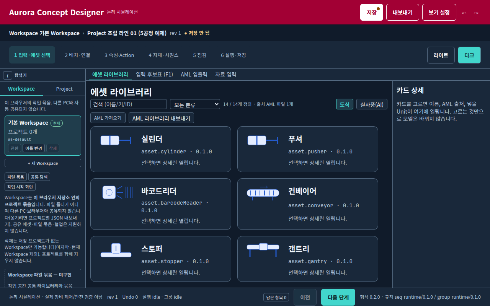

*그림 5. 같은 Workspace 탭의 다크. 2026-11-12, Chrome 156, 1280×800, 다크.*

Workspace는 이 브라우저 저장소 안의 프로젝트 묶음입니다. 폴더가 아니고, 다른 PC나 브라우저와 공유되지 않습니다.

1. 「+ 새 Workspace」를 누르면 이름 창이 열립니다. 앞뒤 공백은 지워지고, 같은 범위에서 대소문자 무시로 중복될 수 없습니다.
2. 카드의 「이름 변경」「삭제」로 고칩니다. 삭제는 저장된 프로젝트가 없는 Workspace만 됩니다. 마지막 Workspace와 지금 Workspace는 지울 수 없습니다. 프로젝트를 같이 지우지는 않습니다.
3. 「전환」은 그 Workspace로 이동합니다. 열린 탭은 닫힙니다.
   - 저장하지 않은 편집이 있으면 「Workspace 전환 불가 — 저장하지 않은 변경」이 뜨고 「저장하러 돌아가기」만 있습니다. 먼저 저장하거나, Project 탭에서 탭을 닫은 뒤 다시 전환합니다.
   - 저장한 적 없고 편집도 없는 탭만 있으면 「취소」와 「닫고 전환」이 있습니다.
   - 실행 중이거나 일시정지면 전환이 막힙니다. 먼저 「초기화」하세요.
4. 「작업 시작 화면」은 가운데를 그림 2로 되돌립니다. 열린 프로젝트는 바뀌지 않습니다.
5. 「공통 탐색」(`FL-13`, `S70`)은 열린 탭과 지금 트리를 한 화면에서 고르게 합니다. 「이름으로 찾기」에 글자를 넣으면 이름에 그 글자가 든 트리 항목과 그 위 단계만 남고, 「N개 찾음」이 나옵니다. 위쪽 탭 단추는 거르지 않습니다. 맞는 것이 없으면 「찾는 이름이 없습니다」와 「지우기」가 나옵니다.
6. 「파일 묶음」은 안내만 있습니다. [16절](#16-안-되는-것).

### 4.2 Project 탭의 목록 (`FL-06`, `FL-07`, `S02`)


*그림 6. Project 탭. 목록은 「프로젝트 (1)」이고, 그 아래가 장비 구조다. 2026-11-12, Chrome 156, 1280×800, 라이트.*

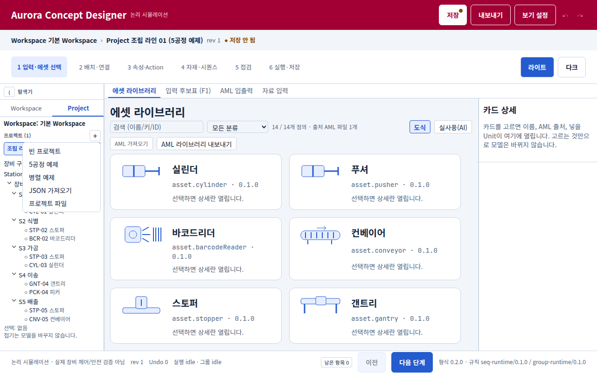

*그림 7. 목록 오른쪽 「+」를 연 메뉴. 빈 프로젝트, 5공정 예제, 병렬 예제, JSON 가져오기, 프로젝트 파일. 2026-11-12, Chrome 156, 1280×800, 라이트.*

- 목록은 열린 프로젝트를 먼저 두고, 그다음 이 Workspace에 저장돼 있으면서 아직 열리지 않은 것을 나중에 저장된 것부터 붙입니다. 같은 ID는 한 줄입니다.
- 줄을 누르면 열린 프로젝트는 그쪽으로 바뀌고, 닫힌 저장 프로젝트는 열립니다.
- 지금 편집 중인 줄은 강조됩니다. 열려 있지만 편집 중이 아니면 작은 점이 있습니다. 저장 안 된 줄에는 `●`가 있습니다.
- 일곱 줄부터는 목록 칸만 스크롤합니다. 탐색기 전체가 밀리지는 않습니다.
- 「+」 메뉴 (`FL-07`, 빈 프로젝트는 `V09`, 파일 화면은 `S03`):
  1. 「빈 프로젝트」는 빈 모델을 새 탭으로 엽니다.
  2. 「5공정 예제」「병렬 예제」「흐름 예제」는 예제 사본입니다. 「흐름 예제」는 5공정 예제의 장치에 분기 · 병렬 · 반복 · 재시도를 넣은 것입니다. 이미 탭이 열려 있으면 이름 뒤 번호가 2부터일 수 있습니다.
  3. 「JSON 가져오기」는 파일을 고릅니다. [12절](#12-저장-json-mac과-windows).
  4. 「프로젝트 파일」(`FL-11`, `S03`)은 이 Workspace에 저장된 이름과 rev를 보여주고, 「열기」, 「JSON 가져오기」, 「현재 탭 JSON 내보내기」가 있습니다.

위쪽 「Workspace: 기본 Workspace」를 누르면 Workspace 탭으로 갑니다.

### 4.3 상세 팝업 (`FL-08`, `S02` `S72`)

각 줄의 「…」를 누르면 팝업이 열립니다. 줄의 연필 단추나 닫기 단추는 없습니다.

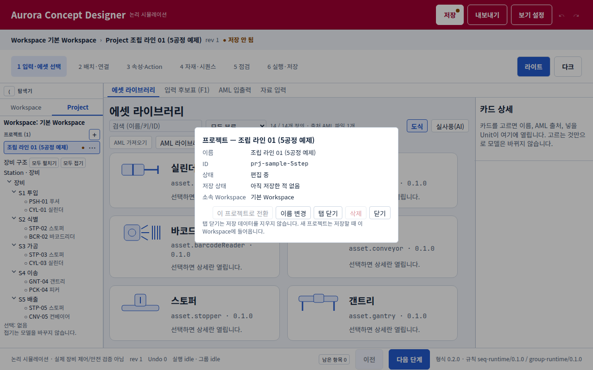

*그림 8. 「…」 팝업. 이름, ID, 상태, 저장 상태, 소속 Workspace, 그리고 전환·이름 변경·탭 닫기·삭제·닫기. 2026-11-12, Chrome 156, 1280×800, 라이트.*

| 단추 | 하는 일 |
|---|---|
| 「이 프로젝트로 전환」 또는 「열기」 | 열린 프로젝트는 전환, 닫힌 저장 프로젝트는 열기. 이미 편집 중이면 비활성 |
| 「이름 변경」 | 이름 창. 열린 프로젝트는 모델 변경이라 rev가 오르고 실행 취소가 됩니다. 닫힌 저장본은 rev만 오르고 실행 취소 대상이 아닙니다 |
| 「탭 닫기」 | 탭만 닫습니다. 저장 데이터는 남습니다. 닫힌 프로젝트에는 닫을 탭이 없어 비활성 |
| 「삭제」 | 저장된 프로젝트를 지웁니다. 열린 프로젝트는 비활성입니다. 먼저 탭을 닫으세요 |
| 「닫기」 | 팝업만 닫습니다. Esc도 같습니다 |

### 4.4 저장 안 된 탭을 닫을 때 (`FL-09`)

저장 안 된 변경이 있는 탭을 닫으면 「저장하지 않은 변경」이 열립니다.

- 「취소 (변경 유지)」
- 「저장 후 닫기」 — 저장이 된 뒤에만 닫습니다
- 「저장하지 않고 닫기」

Workspace 전환은 4.1의 규칙입니다. 편집이 있으면 세 단추 중 고르는 창이 아니라, 전환 자체가 막힙니다.

### 4.5 장비 구조 (`FL-10`)

목록 아래 「장비 구조」입니다. Station, 그 아래 Substation, 그 아래 Device입니다.

- 줄을 누르면 선택됩니다. Tab 뒤 Enter로도 고를 수 있습니다.
- 「모두 펼치기」「모두 접기」, 줄의 꺾쇠로 접습니다. 접기는 모델을 바꾸지 않고 rev도 오르지 않습니다.
- 접힌 줄 안에 선택이 있으면 「● 선택 포함」이 보입니다.
- 「선택: …」 아래에 「접기는 모델을 바꾸지 않습니다」가 있습니다.

다른 프로젝트로 바꾸면, 돌고 있던 실행은 일시정지됩니다. 자동으로 다시 시작하지 않습니다. 돌아와서 「재개」 또는 「그룹 재개」를 누릅니다. `FL-74`.

## 5. 1단계 입력·에셋 선택

`FL-20` `FL-21` `FL-22` `FL-23` `FL-24` `FL-25`. 화면 `S10` `S11` `S12` `S13`. `FL-26` 자료 입력은 [16절](#16-안-되는-것)입니다.

단계 단추 「1 입력·에셋 선택」 또는 상태 줄에서 이 단계로 옵니다. 위쪽 하위 탭은 「에셋 라이브러리」「입력 후보표 (F1)」「AML 입출력」「자료 입력」입니다.

### 5.1 라이브러리 카드 (`FL-20`, `S10`)

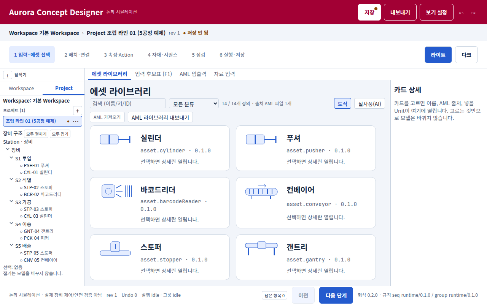

*그림 9. 「에셋 라이브러리」. 검색, 분류, 14/14, 「도식」과 「실사풍(AI)」, 「AML 가져오기」. 2026-11-12, Chrome 156, 1280×800, 라이트.*

1. 검색칸에 이름, 키, ID를 입력합니다. 분류는 「모든 분류」에서 고릅니다.
2. 카드는 14종입니다. 화면 폭에 맞춰 열 수가 바뀝니다 — 1280 폭에서 2열, 1920 폭에서 4열이고, 더 좁으면 1열입니다. 그림 칸은 100×48이고 바탕은 투명합니다. 배지로 분류, AI 그림 유무, AML이 번들인지 가져온 것인지, XSD 기록이 있는지를 봅니다.
3. 카드를 누르는 것만으로 프로젝트는 바뀌지 않습니다. 오른쪽 상세가 열립니다.

「실사풍(AI)」(`FL-22`)을 누르면 같은 카드가 생성된 그림으로 바뀌고, 「AI 생성 · 실제 촬영 아님」 취지의 안내가 납니다. 모델, rev, 배치, 선택은 그대로입니다. 그림의 방향은 사람 검수 전입니다.

### 5.2 카드 상세와 프로젝트에 추가 (`FL-21`, `S11`)

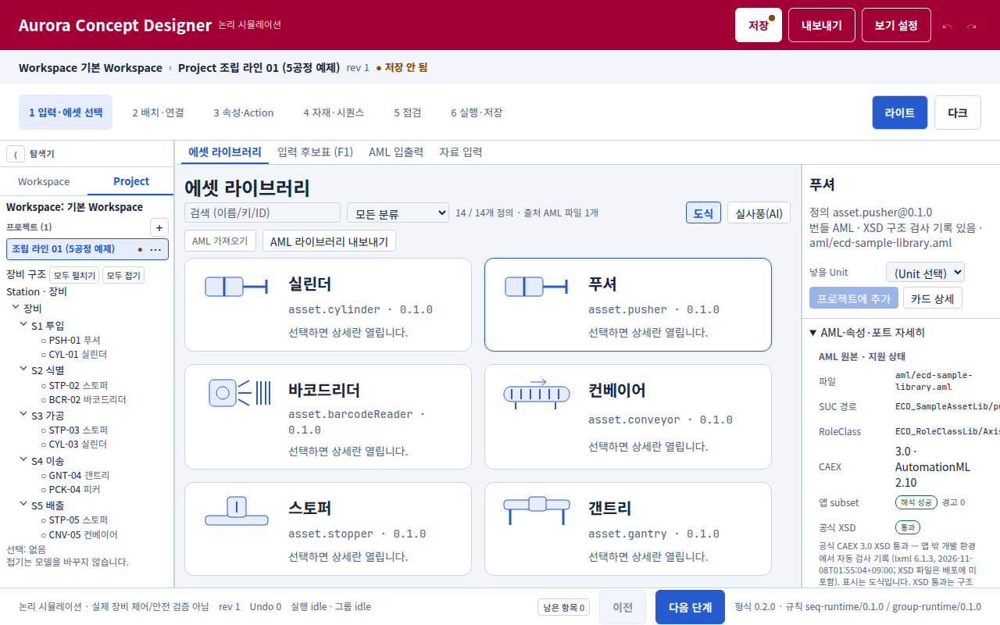

*그림 10. 「푸셔」를 고르면 오른쪽에 정의, 넣을 Unit, 「프로젝트에 추가」, AML 출처가 열린다. 2026-11-12, Chrome 156, 1280×800, 라이트.*

1. Device 카드는 「넣을 Unit」에서 Substation을 고른 뒤 「프로젝트에 추가」를 누릅니다. Unit이 없으면 단추가 비활성입니다. 먼저 [6절](#6-2단계-배치연결)에서 빈 유닛이나 유닛 템플릿을 놓으세요.
2. 「투입 유닛 템플릿」「식별 유닛 템플릿」「이송 유닛 템플릿」(`FL-24`)은 Unit 선택이 필요 없습니다. 추가하면 새 ID의 Unit과 그 안의 Device가 생깁니다. 놓을 때마다 ID가 새로 나옵니다.
3. 「카드 상세」는 AML 파일, RoleClass, 속성, 포트, Action, 템플릿 자식을 더 보여 줍니다. 「선택 에셋 추가」도 모델을 바꾸는 단추입니다. 상세를 보는 것과 추가하는 것은 나뉘어 있습니다.

유닛 템플릿의 Action에는 센서 조건이 붙습니다(예: 투입 유닛의 「푸시」는 광전 센서가 켜져 있어야 함). 센서 신호는 **자재가 그 Unit에 있을 때** 자동으로 켜집니다. 그래서 자재의 초기 위치를 그 Unit으로 두면 템플릿 Action을 시퀀스에 넣어 끝까지 실행할 수 있습니다. 자재가 다른 Unit에 있으면 `PRE_UNMET`으로 멈춥니다. 규칙은 [10.1절](#101-station-시퀀스-fl-70-fl-73-s60)입니다. 13절의 실습은 이 규칙이 들어가기 전에 따라 한 것이고, 빈 프로젝트 실습은 푸셔를 씁니다.

### 5.3 AML 입출력 (`FL-23`, `S12`)

하위 탭 「AML 입출력」은 검사 결과를 네 줄로 보여 줍니다. XML 문법, CAEX 구조, 앱 부분집합, 공식 XSD. 기준 커밋의 번들 라이브러리 화면은 XML 「읽음」, CAEX 「스키마 3.0」, 부분집합 「경고 0」, XSD 「구조 검사 기록 있음」이었습니다. 브라우저 안에서 XSD를 다시 돌리지는 않습니다. 건너뛴 검사를 통과로 세지 않습니다.

같은 단계의 「AML 가져오기」「AML 라이브러리 내보내기」로 다른 AML을 더하거나 라이브러리를 파일로 받습니다. 오류가 있는 정의는 라이브러리에 넣지 않고, 이미 열린 프로젝트는 바꾸지 않습니다. 범위는 [14절](#14-aml-범위)입니다.

### 5.4 입력 후보표 (`FL-25`, `S13`)

하위 탭 「입력 후보표 (F1)」에서 이름과 종류를 적어 「+ 후보표에 추가」를 누릅니다. 후보는 확인 전에 모델에 들어가지 않습니다.

1. 줄의 「확인」 또는 「거절」을 누릅니다.
2. 「반영 미리보기」로 어떤 줄이 들어갈지 봅니다.
3. 「확인된 항목 Canvas에 반영」을 눌러야 배치에 들어갑니다.

직접 입력한 후보만 됩니다. PDF, DWG, XLSX, VC, USD에서 뽑는 경로는 없습니다. 「자료 입력」 탭은 안내 화면입니다. [16절](#16-안-되는-것).

## 6. 2단계 배치·연결

`FL-30` `FL-31` `FL-32` `FL-33` `FL-34` `FL-35` `FL-36`. 화면 `S20` `S21`. `FL-37` 배경 도면·잠금·서브플로는 [16절](#16-안-되는-것)입니다.

### 6.1 팔레트와 두 탭 (`FL-30`, `FL-31`)

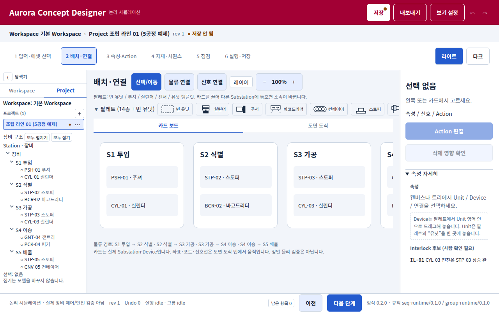

*그림 11. 「배치·연결」의 「카드 보드」. 팔레트는 펼친 한 줄이고, S1부터 카드가 놓여 있다. 2026-11-12, Chrome 156, 1280×800, 라이트.*

1. 팔레트는 「빈 유닛」과 14종입니다. 처음에는 펼쳐져 있습니다. 한 줄에 다 못 놓으면 다음 줄로 이어지고, 잘리거나 가로로 밀리지 않습니다(TURN-026). 1280 폭에서는 3줄이 되어 그만큼 도면이 낮아지므로, 도면을 넓게 보려면 팔레트를 접습니다. 그림 11은 한 줄이던 때의 화면입니다.
2. 「빈 유닛」이나 유닛 템플릿을 카드 보드로 끌어 놓으면 Substation이 생깁니다.
3. Device는 그 Substation 카드 위로 끌어 놓습니다. 카드 밖에는 놓이지 않습니다. 놓은 Device는 그 Substation 안에서 다른 Device와 겹치지 않는 다음 자리에 들어가고, 자리가 모자라면 Substation이 커집니다.
4. 아래 탭은 「카드 보드」와 「도면 도식」입니다. 고른 탭은 이 브라우저에 남습니다. 기본은 카드 보드입니다.
5. 「신호 연결」을 누르면 도면 도식 탭으로 바뀝니다. 카드 보드는 다시 고를 수 있습니다.

1280×800에서는 5공정 예제의 S4·S5 카드가 한 화면에 다 들어오지 않습니다. 카드 줄을 가로로 움직이면 이어서 보입니다.

카드 아래 문장은 물류 경로입니다. 예제에서는 `S1 투입 → S2 식별 → S3 가공 → S4 이송 → S5 배출`입니다. 카드는 실제 Substation과 Device입니다. 좌표와 포트는 도면 도식에서 움직입니다.

### 6.2 도면 도식 (`FL-32`, `FL-34`)

TURN-044 · 048 로 더해진 것(아래 그림들은 그 전 화면입니다):

- **복사 · 붙여넣기** — Unit 이나 Device 를 고르고 Ctrl/Cmd+C, 붙일 곳을 고르고 Ctrl/Cmd+V. 도구 줄의 「복사」 · 「붙여넣기」도 같습니다. 카드 보드와 탐색기 트리에서도 됩니다.
  - Device 는 지금 고른 Unit 에, 고른 것이 없으면 원래 Unit 에 붙습니다. Unit 은 안의 Device 와 함께 새 Unit 으로, 다른 Unit 과 겹치지 않는 자리에 붙습니다.
  - 속성 · 신호 · 포지션 · Action 과, 함께 복사한 것끼리의 연결이 따라갑니다. 시퀀스 단계 · 복사하지 않은 것과의 연결 · 자재 경로 · Interlock 은 따라가지 않고, 붙인 뒤 알림에 「빠짐: …」으로 나옵니다.
  - 다른 프로젝트 탭에도 붙일 수 있습니다(이 앱 창 안에서만 — 운영체제 클립보드는 쓰지 않습니다). 새 ID 와 「사본」 이름을 받고, 붙여넣기 한 번은 실행 취소 한 번입니다.
  - Unit 과 그 밖의 Device 를 함께 고르면 Unit 쪽만 복사됩니다. 글자 입력 칸에서는 평소의 글자 복사 · 붙여넣기입니다.
- **고른 것과 이어진 선** — Device · Unit · 선을 고르면 이어진 선과 반대편만 진하고 굵게, 나머지 선은 흐리게 보입니다. 선에 마우스를 올리거나 선을 고르면 「출발 Device · 포트 → 도착 Device · 포트」(물류는 「Unit → Unit」)가 뜹니다. 6단계 실행 도면도 같습니다.
- **미니맵** — 오른쪽 아래 「접기」로 접고 「미니맵」 단추로 다시 폅니다. 2단계와 6단계가 따로 기억하고, 6단계는 처음에 접혀 있습니다. 6단계 「화면 맞춤」은 펼쳐진 미니맵 자리를 피해서 맞춥니다.
- **팔레트** — 도면 높이가 320px 이상 남으면 모든 줄을 보여 줍니다. 모자라면(1280×800 등) 한 줄만 보이고 머리 줄에 「+N개 더」가 뜨며 그 안에서 스크롤합니다.

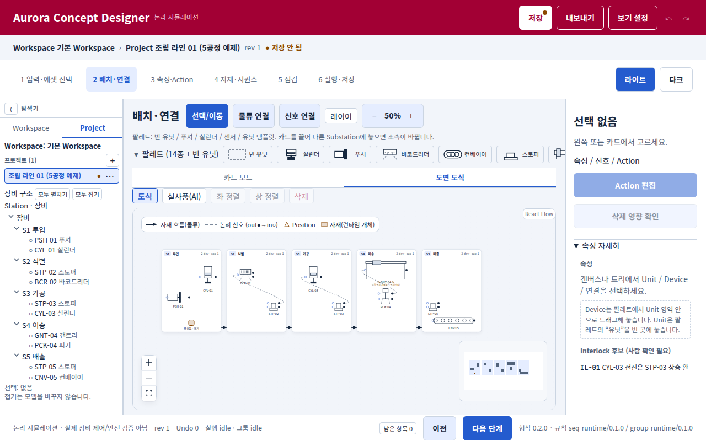

*그림 12. 「도면 도식」. 다섯 Substation과 장치, 미니맵, 범례. 위쪽 「도식」「좌 정렬」「상 정렬」「삭제」. 2026-11-12, Chrome 156, 1280×800, 라이트.*

- 휠로 0.5배에서 2배까지 확대합니다. 빈 곳을 끌면 도면이 이동합니다. 왼쪽 아래에 미니맵, 왼쪽 위에 범례가 있습니다.
- 노드를 끌어 놓으면 이동 한 번이고, 실행 취소도 한 번입니다.
- Shift를 누른 채 누르면 선택에 더합니다. Ctrl(Mac은 Cmd)을 누른 채 누르면 **선택과 해제를 번갈아** 합니다 — 고르지 않은 것은 더하고, 이미 고른 것은 뺍니다. 뺄 때 남은 선택은 움직이지 않습니다. 둘 이상이면 「좌 정렬」「상 정렬」이 켜집니다. 카드 보드에서도 Ctrl + 누르기는 같습니다.
- **Ctrl + A**(Mac은 Cmd + A)는 고른 것에 따라 다릅니다(TURN-027).
  - 아무것도 고르지 않았으면 모든 Substation을 고릅니다. 바로 「배치 ▾」를 쓸 수 있습니다.
  - Substation 하나를 골랐거나, 한 Substation의 Device만 골랐으면 그 Substation의 Device를 모두 고릅니다. Substation 자신은 선택에서 빠집니다.
  - Substation을 둘 이상 골랐거나 선택이 여러 Substation에 걸쳐 있으면 모든 Substation을 고릅니다.
  - Device가 없는 Substation이면 선택은 그대로이고 「이 Unit 에는 Device 가 없습니다」가 나옵니다.
  - Device가 골라진 뒤 다시 누르면 계속 그 Substation의 Device입니다. 모든 Substation으로 가려면 빈 곳을 눌러 선택을 비우고 누릅니다.
  - 입력 칸에 커서가 있으면 그 칸의 글자 전체 선택이고, 대화상자가 열려 있으면 아무 일도 없습니다. 2단계에서만 동작합니다.
- 「선택/이동」 모드에서 Shift를 누른 채 빈 곳을 끌면 네모가 그려지고, 그 안의 Substation과 Device가 한꺼번에 골라집니다. 끄는 동안 도면은 움직이지 않습니다. 고르기만으로는 rev가 바뀌지 않습니다.
- Substation을 여러 개 고르면 「배치 ▾」 메뉴로 간격과 크기를 맞춥니다. 선택에 섞인 Device는 빠지고 Substation만 움직입니다. Substation이 움직이면 안의 Device도 같이 움직입니다.
  - **가로 간격 같게 · 세로 간격 같게**: 3개 이상 고릅니다. 가장 왼쪽(위쪽)과 가장 오른쪽(아래쪽)은 그대로 두고, 사이 Substation을 옮겨 빈 간격을 같게 합니다. 결과가 여전히 겹치면 「먼저 겹침 풀기를 누르세요」가 나옵니다.
  - **너비 같게 · 높이 같게**: 2개 이상 고릅니다. 고른 것 중 가장 큰 값에 맞춥니다. 왼쪽 위 위치는 그대로입니다.
  - **겹침 풀기**: 2개 이상 고릅니다. 왼쪽부터 차례로, 앞 Substation과 20px보다 가깝거나 겹치면 오른쪽으로 밉니다. 가장 왼쪽과 이미 떨어진 것은 그대로입니다. 고르지 않은 Substation은 움직이지 않으므로, 밀린 Substation이 그 이웃과 새로 겹칠 수 있습니다. 줄 전체를 고르고 누르세요.
  - 명령 하나는 rev +1이고 실행 취소 한 번에 되돌아갑니다. 이미 맞으면 「바뀐 것 없음」입니다. 실행 중에는 막힙니다.
- 「삭제」 또는 Delete 키는 영향 확인 뒤에 지웁니다. 여러 개를 골랐으면 「여러 개 삭제 — 참조 영향 확인」 창 하나에서 지워질 Unit · Device 수와 영향을 보여 주고, 한 번에 지웁니다(rev +1, 실행 취소 한 번). 실행 중에는 막힙니다.
- 「복제」 또는 Ctrl + D(Mac은 Cmd + D)는 고른 Device를 같은 Substation 안에 하나 더 만듭니다. 이름은 「원래 이름 사본」이고, 신호 · 포지션 · Action도 사본 것으로 따로 생깁니다. Substation은 복제하지 않습니다. Device를 고르지 않았으면 단추가 꺼져 있습니다. 실행 중에는 막힙니다.
- 「도식」「실사풍(AI)」은 그림만 바꿉니다.

**Substation 안 Device 자동 정렬 (TURN-028)**

- Substation 하나를 고르거나 한 Substation의 Device만 고르면 도구 줄의 「자동 정렬」이 켜집니다(「크기 맞춤」 옆). 그 밖에는 꺼져 있고 단추에 마우스를 올리면 이유가 나옵니다.
- 누르면 그 Substation의 Device만 다시 놓입니다. 신호를 보내는 Device가 왼쪽, 받는 Device가 오른쪽 열로 가고, 다른 Substation과 이어진 Device는 그 Substation이 있는 쪽 가장자리 열로 갑니다. 연결이 없는 Device는 남는 자리에 놓입니다. Device와 이름표, 포트는 서로 겹치지 않습니다.
- Substation은 내용에 맞는 크기가 됩니다. **작아질 수도 있습니다.** 왼쪽 위 위치는 그대로이고 다른 Substation은 움직이지 않습니다. 여러 Substation을 차례로 정렬해 높이가 달라지면 「배치 ▾」로 맞춥니다.
- 한 번의 편집입니다(rev +1). 실행 취소 한 번에 Device 위치와 Substation 크기가 함께 돌아옵니다. 이미 정렬돼 있으면 「바뀐 것 없음」입니다. 연결, 소속, 이름, 속성은 바뀌지 않습니다. 실행 중에는 막힙니다.
- 한 번에 Substation 하나만 됩니다. 규칙으로 놓는 것이고 AI는 쓰지 않습니다.

**Substation(Unit) 크기**

- Device를 Substation 밖으로 끌어 놓으면 Substation이 그 Device를 감싸도록 커집니다. 왼쪽이나 위로 나가면 Substation의 위치도 함께 옮겨집니다. 템플릿 배치, 정렬, 소속 변경 뒤에도 같습니다. 이동과 커지기는 rev +1 한 번이고, 실행 취소 한 번에 함께 되돌아갑니다.
- 자동으로 줄지는 않습니다. 손으로 넓힌 크기는 그대로 남습니다(「크기 맞춤」과 「자동 정렬」을 누를 때는 줄 수 있습니다).
- 「자동 정렬」로 Substation이 넓어져 옆 Substation과 겹치게 되면, 같은 명령에서 겹치는 Substation을 밀어 냅니다(TURN-036). 오른쪽은 「겹침 풀기」와 같은 규칙(최소 20px, 세로 위치는 그대로)으로 오른쪽으로, 왼쪽에서 겹치면 왼쪽으로 밉니다. 정렬한 Substation의 왼쪽 위는 움직이지 않습니다. 겹치지 않으면 다른 Substation은 그대로입니다. 실행 취소 한 번에 Device 위치 · 크기 · 밀린 Substation이 함께 돌아옵니다.
- 「선택/이동」 모드에서 Substation을 고르면 오른쪽 아래 모서리에 손잡이가 보입니다. 끄는 동안은 미리보기만 바뀌고, 놓을 때 한 번 반영됩니다(rev +1, 실행 취소 한 번). 왼쪽 위 위치는 그대로입니다. 소속 Device를 자르는 크기보다 작게는 줄지 않습니다.
- 「크기 맞춤」은 도구 줄과 오른쪽 칸에 있습니다. Substation을 소속 Device를 감싸는 가장 작은 크기로 줄입니다. 이때 위치도 Device에 맞춰질 수 있습니다. Device가 없으면 기본 크기(216×300)가 됩니다.
- 커진 Substation이 이웃과 겹쳐도 이웃을 밀지 않습니다. 겹친 Substation들은 테두리가 경고색이 됩니다. 「크기 맞춤」이나 손잡이로 줄이면 사라집니다.
- 실행 중에는 크기 바꾸기와 「크기 맞춤」이 막힙니다.

도구 줄 위에 「신호: 출력● 포트를 입력○ 포트로 끌어 연결 · 장치 이동은 몸체를 끌기」가 적혀 있습니다. 포트를 누르면 장치는 움직이지 않습니다. 장치를 옮기려면 몸체를 끕니다. 연결하는 법은 6.3입니다.

### 6.3 연결과 소속 (`FL-33`, `FL-35`, `FL-36`)

1. 「물류 연결」을 누르고 Unit을 누른 뒤 다른 Unit을 누르면 Unit에서 Unit으로 이어집니다. 도면 도식에서는 Unit 안의 Device를 눌러도 그 Unit을 누른 것으로 칩니다. 카드 보드에서 「신호 연결」 모드일 때 Unit을 누르면 물류 연결이 아니라 「신호 연결은 도면 도식 탭의 포트에서 합니다」 안내가 나옵니다.
2. 신호는 도면 도식에서 잇습니다. 두 가지 방법이 있습니다.
   - **끌어서**: 어느 모드에서든 출력● 포트를 눌러 다른 Device의 입력○ 포트까지 끌어 놓습니다. 끄는 동안 점선이 따라오고, 놓을 수 있는 입력 포트가 강조되며, 안 되는 포트는 흐려집니다.
   - **두 번 눌러서**: 「신호 연결」을 누르면 도면 도식으로 이동합니다. 출력 포트를 누르면 도면 왼쪽 위에 「연결 시작: CYL-01 실린더 · fwdDone (출력)」처럼 뜹니다. 그다음 입력 포트를 누릅니다.
   - 입력 포트에서 시작하면 바로 거부되고 「출력(out) 포트에서 시작하세요」가 나옵니다. 같은 Device끼리, 이미 있는 연결도 거부됩니다. 빈 곳에 놓거나 Esc를 누르면 취소되고 아무것도 바뀌지 않습니다. 실행 중에는 시작되지 않습니다.
   - 연결 하나는 rev +1이고, 실행 취소 한 번에 사라집니다.
3. 「레이어」에서 배경, Substation, 축·이송, 포트·신호선, 포지션, 물류·자재를 숨길 수 있습니다. 숨김은 삭제가 아니고 실행에서도 빠지지 않습니다.
4. Device를 다른 Substation 카드에 끌어 놓거나, 오른쪽 소속 목록을 바꾸면 확인 창이 열립니다. 소속 변경과 이동, 좌표만 이동, 취소를 고릅니다. 시퀀스에 쓰이던 Device면 영향 개수를 보여 줍니다.
5. **물류를 끌어서 잇기**(TURN-050) — 「선택/이동」에서 Unit 오른쪽 가운데의 손잡이를 다른 Unit 으로 끌어 놓으면 물류 연결이 하나 생깁니다. 모드를 바꾸지 않아도 됩니다.
   - 끄는 동안 화살표가 따라오고 놓을 수 있는 Unit 만 강조됩니다. Unit 안의 Device 위에 놓아도 그 Unit 으로 잇습니다.
   - 손잡이에서 시작한 끌기는 Unit 을 옮기지 않습니다. 몸체를 끄는 이동, 신호 포트 끌기, 오른쪽 아래 크기 손잡이는 그대로이고, 1번의 「물류 연결」 두 번 누르기도 남아 있습니다.
   - 자기 자신, 이미 있는 같은 방향, Unit 도 Device 도 아닌 곳에 놓으면 잇지 않고 까닭을 알려 줍니다. 빈 곳에 놓으면 아무 일도 없습니다. 한 번 잇기는 rev +1 이고 실행 취소 한 번에 사라집니다. 실행 중에는 시작되지 않습니다.
6. **우클릭 메뉴**(TURN-050) — 도면 도식 · 카드 보드 · 탐색기 트리에서 우클릭(키보드는 Shift+F10 또는 메뉴 키)하면 그 대상의 메뉴가 뜹니다.
   - 항목은 속성 열기 · 이름 변경 · 복사 · 붙여넣기 · 복제 · 정렬 · 자동 정렬 · 크기 맞춤 · 삭제처럼 이미 있는 명령입니다(대상에 따라 다름). 단축키가 오른쪽에 적혀 있고, 지금 못 하는 항목은 흐리며 툴팁에 까닭이 있습니다.
   - 「✕ 삭제」는 맨 아래 구분선 다음에 있습니다. Unit · Device 는 전과 같은 영향 확인 창을 거치고, 연결만 지울 때는 바로 지워집니다.
   - 고르지 않은 것을 우클릭하면 그것만 고르고, 여러 개 고른 것 중 하나를 우클릭하면 선택이 유지됩니다. Esc 나 바깥을 누르면 닫히고, 방향키와 Enter 로 고릅니다. 열고 닫기만 하면 rev 와 실행 취소 기록은 그대로입니다.
   - 6단계 도면에는 「화면 맞춤」과 「속성 보기」만 있습니다. 글자 입력 칸 위에서는 브라우저 메뉴가 그대로 뜹니다. 4단계 흐름 표와 3D 장면에는 우클릭 메뉴가 없습니다.

오른쪽 칸은 고른 이름의 속성 요약입니다. 「Action 편집」은 3단계로 가고, 「삭제 영향 확인」은 지우기 전에 묻습니다. 「속성 자세히」를 펼치면 값 편집이 더 있습니다.

## 7. 3단계 속성·Action

`FL-40` `FL-41` `FL-42` `FL-43`. 화면 `S30` `S31` `S32`.

왼쪽 트리에서 Device를 고르거나, 2단계에서 「Action 편집」으로 옵니다. 고른 Device가 없으면 프로젝트의 첫 Device가 열립니다.

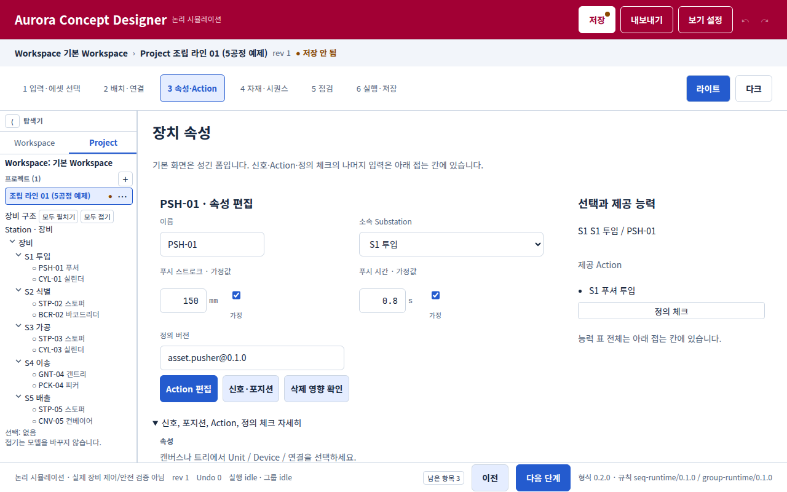

*그림 13. 「장치 속성」. PSH-01의 이름, 소속, 스트로크와 시간. 값은 가정으로 표시된다. 2026-11-12, Chrome 156, 1280×800, 라이트.*

1. 이름, 소속 Substation, 속성을 고칩니다. 빈 값은 「미정」으로 남고, 앱이 임의로 채우지 않습니다. 숫자가 가정값이면 「가정」이 붙습니다.
2. 「신호·포지션」(`FL-41`)은 신호의 방향과 역할, 포지션 값을 보여 줍니다. 주소는 비어 있으면 「미정 · 실제 장비 주소 아님」입니다.
3. 「Action 편집」(`FL-42`)은 동작 시간, 타임아웃, 명령 신호, 완료 신호를 보여 줍니다. 「시퀀스 끝에 추가」는 그 Action을 Station 시퀀스 끝에 넣습니다.
4. 「정의 체크」(`FL-43`)는 완료 신호, 시간, 타임아웃, 실제 주소가 있는지를 적습니다. 오른쪽 「선택과 제공 능력」은 이 Device의 Action 목록입니다. 능력표 전체와 Interlock 후보는 아래 접는 칸에 있습니다. Interlock은 사람이 확인하며, 자동으로 확정되지 않습니다.

실행 중에는 이 값들이 잠깁니다.

TURN-045 · 046 로 더해진 것(그림 13 은 그 전 화면입니다):

- **숫자 칸** — 단위(mm · s 등)가 칸 안 오른쪽에 보입니다. 숫자가 아닌 값, 음수가 될 수 없는 값(시간 · 길이 · 무게 · 개수)의 음수, 정수여야 하는 값의 소수를 넣으면 칸에 붉은 테두리와 까닭(「음수는 허용되지 않습니다」 등)이 나오고 모델에 들어가지 않습니다. 빈 칸은 전처럼 「미정」입니다. 허용 범위(최소 · 최대) 검사는 없습니다.
- **지우는 단추** — 붉은 외곽선 + ✕ + 글자 모양이고 그 줄의 오른쪽 끝에 있습니다.
- **쓰이고 있는 것을 지울 때** — 전에는 시퀀스에서 쓰는 Action, 조건에서 쓰는 Signal 은 지울 수 없었습니다. 이제 「단계 1에서 쓰임」처럼 쓰이는 곳의 수를 보여 주고, 확인하면 함께 정리합니다.
  - Action — 그 Action 을 쓰는 Station · Substation 단계도 빠집니다.
  - Signal — 명령 · 완료 · 조건에서 풀고(조건은 「미정」) 그 신호의 연결과 함께 지웁니다.
  - Position — 단계의 목표 참조를 비우고 지웁니다.
  - 쓰이지 않는 것은 묻지 않고 바로 지웁니다. 확인 창의 처음 초점은 「취소」이고, 실행 취소 한 번으로 돌아옵니다.
- **Interlock 규칙**(TURN-046) — Interlock 줄마다 규칙을 정할 수 있고 한 줄 요약이 보입니다.
  - 「막을 Action」을 고르고, 꼴을 고릅니다: **허용 조건**(조건이 모두 참일 때만 그 Action 이 시작) 또는 **동시 금지**(상대 Action 이 진행 중인 동안에는 시작하지 않음).
  - Interlock 을 더하고 지울 수 있습니다. 5공정 예제의 후보 2건에는 규칙이 들어 있고 「미확인」입니다.
  - **「확인」한 것 중 규칙이 있는 것만** 실행에 적용됩니다([10.3절](#103-실행이-막힐-때-fl-72-s62)). 확인했지만 규칙이 없으면 실행 전 검사에 「확인됨 · 규칙 없음 — 실행에 적용되지 않음」 안내가 나옵니다.
  - 규칙이 가리키는 Action · Signal 을 지우면 규칙은 「미정」으로 풀립니다. 자동 안전 승인은 없습니다 — 논리 시뮬레이션이며 실제 장비의 Interlock 이 아닙니다.

## 8. 4단계 자재·시퀀스

`FL-50` `FL-51` `FL-52` `FL-53`. 화면 `S40` `S41` `S42` `S43`. `FL-54` 누락 편집 확장은 [16절](#16-안-되는-것)입니다.

하위 탭은 「Station 시퀀스 Draft (F5)」「Substation 시퀀스」「자재·Flow (F4)」「SFC 미리보기」「누락 편집 확장」입니다.

### 8.1 Station 시퀀스 (`FL-51`, `S41`)

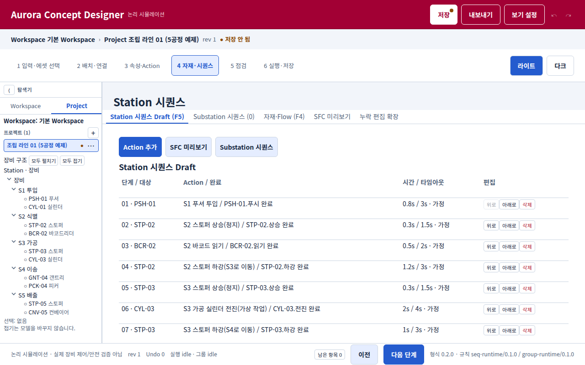

*그림 14. 「Station 시퀀스 Draft」. 단계, Action, 완료 신호, 시간과 타임아웃, 위로·아래로·삭제. 2026-11-12, Chrome 156, 1280×800, 라이트.*

1. 「Action 추가」는 프로젝트의 첫 Action을 단계로 넣습니다. 특정 Action을 고르려면 아래 「단계 편집, 구조화 문장, 순서 변경」을 펼칩니다.
2. 펼친 칸의 Action 이름을 시퀀스 표로 끌어 넣습니다.
3. 「위로」「아래로」로 순서를 바꾸고 「삭제」로 뺍니다.
4. 시간 칸은 그 단계의 타임아웃입니다. Action 기본값을 이 단계만 덮어씁니다.
5. 구조화 문장은 한 줄에 한 단계로 적고 「변환 미리보기」를 누릅니다. 이름이 맞으면 그 Action으로, 여러 후보면 사람이 고르고, 없으면 미해결로 남습니다. 「확정된 줄만 시퀀스에 추가」가 모델을 바꿉니다. 자연어를 해석하는 AI는 없습니다.

**흐름 블록 (TURN-022, 이름 · 옮기기는 TURN-023).** 「Station 시퀀스 Draft」 제목 바로 아래의 「Station 흐름」 표에서 분기 · 병렬 · 반복 · 재시도를 만듭니다. 이 표와 묶기 단추 줄은 화면에 하나뿐이고, 그 아래 접는 칸에는 단계 편집과 구조화 문장 입력만 있습니다. 그림 14는 이 표가 생기기 전 화면입니다.

1. 맨 앞 칸의 체크로 같은 갈래에서 **이어진** 줄을 고릅니다(키보드는 줄에서 Space). 단계뿐 아니라 블록과 Substation 단계도 고를 수 있어, 「재시도 블록 + 그 뒤 단계」를 반복으로 묶는 식으로 겹칠 수 있습니다. 「분기로 묶기」「병렬로 묶기」「반복으로 묶기」「재시도로 묶기」 중 하나를 누릅니다. rev +1이고 실행 취소 한 번에 돌아갑니다.
2. 블록은 머리 줄과 들여쓴 줄로 보입니다. 머리 줄의 굵은 제목은 종류 낱말(「분기」「병렬」「반복」「재시도」)만이고, 이름은 그 옆 입력 칸에 있습니다(TURN-034). SFC에는 「분기 검사 결과」처럼 종류 + 이름으로 나옵니다. 머리 줄의 이름 칸에 이름을 적고 Enter를 누르거나 칸을 벗어나면 바뀝니다. 빈 이름은 거부되고 원래 이름으로 돌아옵니다. 이름이 종류 낱말과 같으면 제목은 「분기」처럼 한 번만, 다르면 「분기 검사 결과」처럼 종류 + 이름으로 나옵니다. 머리 줄에서 조건, 반복 횟수(1~10), 재시도 횟수(0~2), 갈래 수도 고칩니다. 조건 목록은 「STP-02 · 상승 완료 = 참」처럼 Device 이름이 앞에 붙습니다.
3. 「병렬로 묶기」는 고른 줄을 **갈래마다 하나씩** 나눕니다(TURN-034). 2~4개를 고르면 줄마다 한 갈래, 1개면 갈래 1에 넣고 갈래 2를 비워 두며, 5개 이상이면 앞의 셋은 갈래 1~3에 하나씩, 나머지는 갈래 4에 순서대로 들어갑니다. 묶은 뒤에는 옮길 줄을 체크하고 갈래 줄의 「선택 넣기」로 다른 갈래에 넣습니다. 블록과 Substation 단계도 같은 방법으로 넣습니다. 블록을 자기 자신 안에 넣을 수는 없습니다. 분기의 「참」「거짓」 줄도 같은 방법입니다. 갈래는 2~4개이고 빈 갈래가 있으면 실행이 막힙니다.
4. 단계 줄, 블록 머리 줄, Substation 단계 줄의 「위로」「아래로」(키보드는 ↑↓)는 같은 갈래 안에서 옮기고, 「밖으로」는 한 겹 바깥으로 뺍니다. 블록은 안의 단계 · 조건 · 횟수 · 갈래와 함께 통째로 옮겨집니다. 「블록 풀기」는 블록만 없애고 안의 단계는 남깁니다.
5. 「Substation 시퀀스 넣기」는 고른 Substation의 시퀀스 전부를 한 단계로 부르는 줄을 흐름 맨 끝에 넣습니다. 넣은 뒤 4번처럼 옮깁니다([8.3절](#83-substation-시퀀스-fl-52-s42)).
6. 병렬 갈래 안에 병렬을 또 넣지는 못합니다. 옮기기 · 넣기 · 묶기 모두 같은 문구로 거부됩니다. 분기 안의 병렬 같은 다른 겹침은 됩니다. **병렬 갈래 안의 Substation 단계는 TURN-049 부터 넣을 수 있습니다**(전에는 거부 — Substation 둘을 함께 돌려야 하나만 멈출 수 있어서 풀었습니다. Matthew 결정 2026-11-23).
7. 「신호 기다림」(TURN-049)은 조건과 타임아웃을 가진 한 줄짜리 블록입니다. 추가하고 이름 · 조건(신호 · 자재 위치 · 자재 상태 · 잡음) · 타임아웃을 정한 뒤 위로 · 아래로 · 밖으로 옮기거나 지웁니다. 병렬 갈래에 넣을 수 있습니다. 타임아웃이 미정이면 실행 전 검사가 막습니다(`WAIT_TIMEOUT_UNDEFINED`). 조건을 바꾸는 단계가 이 블록 뒤에만 있거나 없으면 실행 전 검사에 안내가 나옵니다(차단은 아님). 예제에는 들어 있지 않습니다.
8. 블록을 하나도 만들지 않은 시퀀스는 예전처럼 위에서 아래로 돕니다. 블록을 만든 뒤에 흐름에 넣지 않은 단계는 실행되지 않고 5단계 Gap에 「흐름에 없음」으로 나옵니다.

흐름 표의 「상태」 칸은 실행 표와 같은 낱말을 씁니다 — 대기 · 진행 중 · 완료 · 오류 · 건너뜀 · 정지. 한 단계가 여러 번 돌면 「완료 N회」, 한 번 돌고 한 번 건너뛰면 「완료 · 건너뜀」입니다. 다른 갈래의 오류로 멈춘 단계는 「정지」로 나옵니다(TURN-034). 접는 칸의 단계 표도 같습니다.

실행에서의 뜻은 [10.2절](#102-흐름-실행과-substation-단계-fl-70-fl-71-s60)입니다. 구조화 문장은 순차 단계만 만듭니다.

### 8.2 자재 (`FL-50`, `S40`)

「자재·Flow (F4)」에서 자재가 없으면 「자재 추가」가 있습니다. 추가하면 자재 하나가 생기고, 초기 위치는 첫 Substation, 초기 상태는 「대기」입니다.

이름, 투입 개수, 투입 간격, 초기 위치, 초기 상태, 크기, 무게, Unit 경로를 볼 수 있습니다. 크기와 무게의 나머지 편집은 접는 칸 「자재 값과 경로 편집」에 있습니다.

자재 **정의**는 하나입니다. 「투입 개수」(기본 1)를 2 이상으로 하면 실행할 때 같은 자재를 그 수만큼 「투입 간격」을 두고 이어서 넣습니다(TURN-040, [10.5절](#105-자재-여러-개-투입-fl-50-fl-70)). 투입 개수가 2 이상이면 투입 간격을 정해야 합니다. 6단계 「가동 조건」에서도 같은 값을 바꿉니다.

자재 정의를 여러 종류 두거나 캐리어에 싣는 편집은 없습니다.

### 8.3 Substation 시퀀스 (`FL-52`, `S42`)

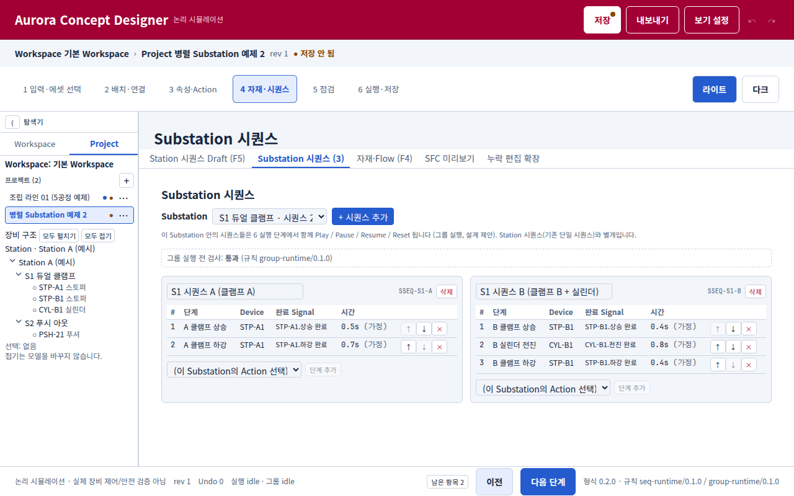

*그림 15. 병렬 예제, S1의 시퀀스 A와 B. 단계마다 시간 가정이 보인다. 2026-11-12, Chrome 156, 1280×800, 라이트.*

1. Substation을 고릅니다.
2. 「+ 시퀀스 추가」로 시퀀스를 늘리고, 이름 변경과 「삭제」로 정리합니다.
3. 「단계 추가」로 그 Substation의 Action을 넣고, ↑ ↓ 와 × 로 순서와 삭제를 합니다.

이 시퀀스들은 Station 시퀀스에 넣은 「Substation 단계」가 불러서 한 시계로 함께 돕니다([8.1절](#81-station-시퀀스-fl-51-s41) 5번). 6단계에 따로 누르는 그룹 실행은 없습니다. Substation 시퀀스 안에는 분기 · 병렬 · 반복을 넣지 못합니다.

### 8.4 SFC 미리보기 (`FL-53`, `S43`)

「SFC 미리보기」는 Station 흐름을 읽기 전용 그림으로 보여 줍니다. 분기는 갈림과 갈래별 조건 글자, 병렬은 이중 가로선, 반복은 되돌림 화살표와 「×2」, 재시도는 되돌림과 「최대 2회」, 신호 기다림은 조건이 적힌 점선 둥근 칸(TURN-049), Substation 단계는 시퀀스 이름이 든 병렬로 그립니다. 블록 제목은 흐름 표와 같은 글자입니다([8.1절](#81-station-시퀀스-fl-51-s41)). 줄이지 않고 그리므로 길면 스크롤합니다.

## 9. 5단계 점검

`FL-60` `FL-61` `FL-62`. 화면 `S50` `S51` `S52`. `FL-63` Evolution Lab은 [16절](#16-안-되는-것)입니다.

하위 탭은 「Gap (F6)」, 「진단·저장·AML」, 「Export 미리보기 (F8)」, 「Evolution Lab (F7)」입니다.

### 9.1 Gap (`FL-60`, `S50`)

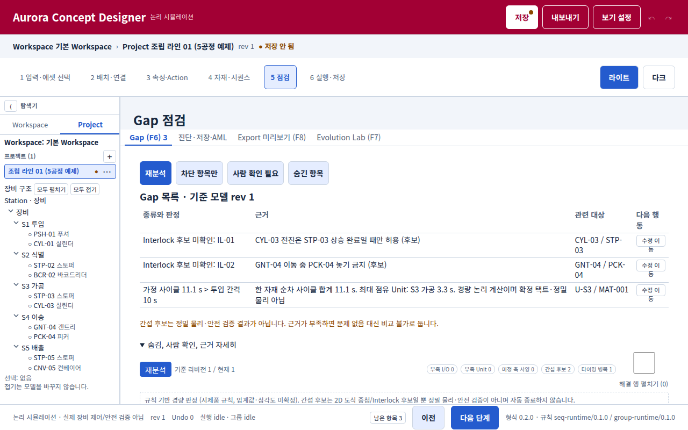

*그림 16. 「Gap 점검」. 재분석, 차단 항목만, 사람 확인 필요, 숨긴 항목. 각 줄의 「수정 이동」. 2026-11-12, Chrome 156, 1280×800, 라이트.*

1. 「재분석」은 지금 모델로 다시 계산합니다.
2. 「차단 항목만」「사람 확인 필요」「숨긴 항목」으로 거릅니다.
3. 「수정 이동」은 그 항목을 고치는 단계로 갑니다.
4. 접는 칸에서 숨기거나 사람 확인으로 표시합니다. 안전 항목은 자동으로 끝나지 않습니다.
5. 목록 맨 위 「실행 결과」(TURN-043)는 마지막으로 끝난 실행(완료 또는 오류)에서 나온 Gap 입니다. 그림 16 은 이 묶음이 생기기 전 화면입니다.
   - **병목 Unit** — 개체들이 기다린 시간 합이 가장 큰 Substation(기다림이 있을 때만). 근거에 기다린 시간 합 · 기다린 개체 수 · 까닭.
   - **사이클 > 투입 간격** — 개체 3개 이상이고 정상 상태 사이클이 투입 간격보다 길 때. 근거에 두 값과 배출 시각.
   - **한 단계가 큰 몫** — 한 단계가 한 개 통과 시간의 30% 이상일 때([설계 제안] 기준).
   - **실행 오류** — 타임아웃 · 조건 불충족 · 교착 · Interlock 차단으로 끝난 실행의 그 단계.
   - 줄마다 근거(가상 시각 · 로그 코드 · 단계 이름), 수정 제안, 「이동」이 있습니다. 실행한 뒤 모델을 고치면 「이전 rev 의 실행 결과」가 붙고, 다시 실행하면 바뀝니다. 실행 전에는 안내 한 줄만 있습니다.
   - 이 항목들은 프로젝트 파일에 저장되지 않습니다. 6단계 요약 띠의 Gap 건수와 단계 바 5단계 배지에는 들어갑니다.

판정은 부족, 미정, 사람 확인으로 나뉩니다. 근거가 부족하면 문제 없음이 아니라 비교 불가로 둡니다. 판정식과 임계값은 승인된 값이 아니고, 실행 결과로 병목을 계산하지는 않습니다. 예제 화면의 「가정 사이클 11.1 s」도 예시 계산입니다.

### 9.2 진단·저장 (`FL-61`, `S51`)

「진단·저장·AML」은 참조가 빠진 곳, 저장소 상태, 거부된 파일의 격리 보관함을 보여 줍니다. 격리된 원본은 내려받을 수 있습니다. 저장에 실패하면 모델은 그대로 두고, 저장소를 쓸 수 없으면 메모리 전용으로 안내합니다. 그때는 「내보내기」로 파일을 남기세요.

### 9.3 Export 미리보기 (`FL-62`, `S52`)

「Export 미리보기 (F8)」에는 초안 형식 파일 만들기와 후보 표가 있습니다. 「Core로 보내기」와 「Core 전송」은 눌리지 않습니다 — Aurora Core 로 보내는 기능은 없습니다.

**초안 형식 파일 (TURN-041)** — 화면과 파일에 「초안 형식 — Aurora Core 가 바로 읽는 형식 아님」이라고 적혀 있습니다. Core 가 받는 실제 형식은 아직 정해지지 않았습니다.

1. 미정 · 가정 항목의 개수와 목록을 봅니다(예: 5공정 예제는 미정 29 · 가정 52 — 주소가 없는 신호는 「개념 신호」로 미정에 셉니다).
2. 「미정 N · 가정 M 을 표시한 채 내보내기」를 체크하면 「Export 파일 만들기」가 켜집니다. 실행 전 검사를 통과하지 못한 모델은 만들 수 없고, 까닭과 이동 단추가 나옵니다.
3. 누르면 `<프로젝트 이름>.aurora-export.json` 이 내려받아집니다.
   - 들어가는 것: 장비 구조(Station › Unit › Device, 에셋 정의, 속성) · 신호(방향, 주소와 확인 상태) · 포지션 · Station 시퀀스(단계, 명령 / 완료 신호, 동작 시간, 타임아웃, 조건, 흐름 블록) · Substation 시퀀스 · 확인된 Interlock
   - 제외 목록에 까닭과 함께 적히는 것: 자재, 확인되지 않은 Interlock
   - 들어가지 않는 것: 배치 좌표, 연결선, 입력 후보, Gap 검토, 가정 메모
   - 값마다 상태(`confirmed` / `assumption` / `undetermined`)가 붙고, 미정 값은 `null` 입니다. 같은 모델은 언제나 같은 파일이 됩니다.
4. 만든 직후 「빠진 것 0 · 다른 것 0」과 종류별 개수 표(모델 · 파일)가 나옵니다.
5. 「Export 파일 검사」로 예전에 만든 파일을 고르면 지금 모델과의 차이(추가 · 삭제 · 변경)를 보여 줍니다. 읽기만 하고 모델은 바꾸지 않습니다. Export 파일을 읽어 모델에 반영하는 기능은 없습니다.

아래 후보 표는 읽기 전용이고 가정과 미정이 표시됩니다.

## 10. 6단계 실행·저장

`FL-70` `FL-71` `FL-72` `FL-73` `FL-74` `FL-75`. 화면 `S60` `S61` `S62`.

실행은 Station 시퀀스 하나입니다. 「Station 시퀀스 / Substation 그룹」 선택은 없어졌고(TURN-022), Substation 시퀀스는 Station 시퀀스의 Substation 단계로 함께 돕니다([10.2절](#102-흐름-실행과-substation-단계-fl-70-fl-71-s60)).

### 10.1 Station 시퀀스 (`FL-70`, `FL-73`, `S60`)

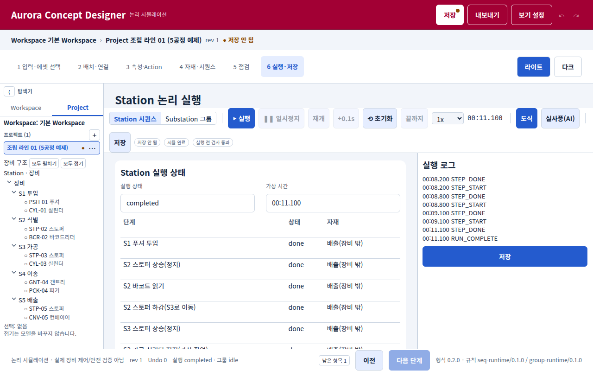

*그림 17. (이전 판 화면) 「끝까지」 뒤. 시계 00:11.100, 상태 completed, 오른쪽 로그 마지막 RUN_COMPLETE. 지금은 상태가 「완료」로 나오고 로그는 「자세히」에 있다. 2026-11-12, Chrome 156, 1280×800, 라이트. 같은 따라 하기는 13.1절이다.*

1. 「▶ 실행」으로 시작합니다. 준비가 안 되면 6단계가 「실행 차단과 수정」으로 바뀝니다. [15절](#15-문제-해결).
2. 「❚❚ 일시정지」는 가상 시간을 멈춥니다. 「재개」는 남은 시간부터입니다. 「+0.1s」는 일시정지 중에만 가상 0.1초를 진행합니다.
3. 「⟲ 초기화」는 실행 시작 시점의 초기 조건으로 되돌립니다. 실행 취소와는 별개입니다.
4. 「끝까지」는 실행 중에만 켜지고, 남은 단계를 바로 계산합니다.
5. 옆의 배속(0.25x~4x)은 화면이 흐르는 속도입니다. 논리 결과는 같습니다.
6. 6단계는 **한 가지 틀**입니다(TURN-035). 실행 단추 줄의 「도면 / 3D」는 가운데 캔버스만 바꾸고, 나머지 칸은 그대로입니다. 전환해도 실행 · 선택 · 칸 접힘이 유지됩니다. 그림 17은 이 틀이 생기기 전 화면입니다.
   - **요약 띠(가운데 위)** — 첫 줄에 실행 상태 · 가상 시간 · 실행 중인 단계 · 자재의 위치와 상태. 둘째 줄에 사이클 시간 · 시간당 생산량(가정) · 병목 Substation · Gap 건수와 「5단계에서 보기」. 폭이 모자라면 맨 앞의 프로젝트 이름부터 줄어들고, 실행 상태 · 가상 시간 · 자재는 줄어들지 않습니다. 「접기」로 한 줄만 남깁니다.
     - 「사이클」은 자재 한 개가 투입부터 끝까지 가는 가상 시간입니다. 실행이 끝나야 나오고 그 전에는 「실행 뒤 표시」입니다.
     - 「시간당」은 3600을 사이클 시간(초)으로 나눈 값입니다. 자재를 한 개씩 쉬지 않고 이어서 넣는다고 본 값이라 **실제 택트가 아닙니다**(「ⓘ」에 마우스를 올리면 안내). 실행이 끝나지 않았거나 오류로 끝났으면 「—」입니다.
     - 「병목」은 Unit 별 합계가 가장 큰 Substation입니다. Gap의 종류별 건수는 숫자에 마우스를 올리면 나옵니다.
   - **왼쪽 「단계」** — 「단계별 시간」 목록(이름 · 갈래와 회차 · 상태 · 시간 막대), 「Unit 별 합계」, 「선택한 Device」. 실행 전의 막대는 Action의 가정 동작 시간이고, 실행 뒤에는 실제 걸린 가상 시간입니다. 「가장 긴 단계」와 건너뜀 · 정지 · 오류는 글자로 표시됩니다.
     - **진행 중인 줄**은 옅은 바탕과 굵은 테두리, 굵은 글자로 강조됩니다(TURN-035). 병렬이면 여러 줄입니다. 목록 밖에 있으면 보이는 자리로 스크롤됩니다. 오류와 정지 줄은 다른 색 테두리입니다.
   - **가운데 캔버스** — 「도면」이면 실행 도면, 「3D」이면 3D 장면([10.4절](#104-3d-보기-fl-75-s60))입니다.
     - 실행 도면은 장비 전체가 가운데 칸에 맞게 맞춰집니다(TURN-037). 처음 열 때, 「도면 / 3D」를 오갈 때, 칸 크기가 바뀔 때(탐색기 · 「단계」 · 「가동 조건」 · 「자세히」 접기와 펼치기, 창 크기) 다시 맞춥니다.
     - 직접 확대하거나 옮긴 뒤에는 칸 크기가 바뀌어도 그 보기를 유지합니다. 캔버스 오른쪽 위의 「화면 맞춤」을 누르면 다시 맞춰집니다. 6단계의 확대 · 축소 단추 묶음에는 전체 보기 아이콘이 없습니다.
     - 미니맵은 오른쪽 아래에 그대로 있어, 장비가 칸을 가득 채우면 오른쪽 끝 Substation의 아래쪽을 조금 가릴 수 있습니다.
     - 2단계 도면 도식의 맞춤은 전과 같습니다.
   - **오른쪽 「가동 조건」** — 위에서부터 배속과 표시 옵션, 준비 검사(「실행 가능」 또는 차단 목록과 이동 단추), 동작 시간 · 타임아웃, 오류 주입, 되돌리기.
     - 표시 옵션(「이름 표시」「동작 강조」「설비 동작」)은 3D에서 쓰는 것이라 「도면」에서는 꺼진 모양입니다.
     - Substation별로 묶인 Action의 **동작 시간**과 **타임아웃**을 슬라이더나 숫자로 바꾸면 3단계에서 고친 것과 똑같이 모델 값이 바뀝니다 — rev +1, 실행 취소로 되돌림, 저장하면 남습니다. 같은 Action을 이어서 고치면 실행 취소 한 번으로 묶입니다. 다시 실행하면 총 시간이 그만큼 달라집니다.
     - 타임아웃이 동작 시간보다 짧으면 「타임아웃이 동작 시간보다 짧습니다 — 실행하면 TIMEOUT」, 같으면 「타임아웃이 동작 시간과 같습니다 — 여유가 없습니다」가 그 줄에 뜹니다. 막지는 않습니다. 같은 값이면 실행은 통과합니다.
     - 실행 중이거나 일시정지면 동작 시간과 타임아웃은 잠기고 이유가 적혀 나옵니다. 배속과 표시 옵션은 바뀝니다. 고치려면 「초기화」합니다.
     - 오류 주입은 「완료 신호 미발생」과, 읽기 Action이 있으면 「결과 실패」(「처음 N회만」 포함)입니다.
     - 「이 화면에 들어온 뒤 바꾼 값 되돌리기」는 6단계에 들어온 뒤 이 칸에서 바꾼 동작 시간과 타임아웃만 원래대로 돌립니다. 다른 편집은 그대로입니다.
     - 모델에 없는 조건(컨베이어 속도 같은 것)은 없습니다. 시간은 모두 가정값입니다.
   - **「자세히」(가운데 아래, 처음에는 접힘)** — 탭 세 개입니다. 「실행 결과 요약」은 총 시간, 끝난 단계 수(예: `2 / 2 단계`), 가장 긴 단계와 단계별 시작 · 끝 · 걸린 시간 표입니다. 실행 전에는 「실행하면 단계별 시간이 여기에 나옵니다」입니다. 「실행 로그」(`FL-73`)는 시각과 코드 전체, 「신호」는 지금 신호 상태입니다. 접혀 있을 때는 머리 줄에 가장 최근 로그 한 줄이 보입니다.
7. 실행 상태는 한글로 나옵니다 — 대기 · 실행 중 · 일시정지 · 완료 · 오류.

실행 중이거나 일시정지면 모델 편집과 실행 취소가 막힙니다. 선택, 테마, 레이어, 확대는 됩니다. 모델을 고치면 이전 실행 결과는 지워집니다.

완료 신호가 타임아웃과 같은 시각이면 그 단계는 성공으로 봅니다. 타임아웃까지 완료가 없으면 `TIMEOUT`이고 이후 단계는 지나가지 않습니다. 진입 조건이 안 맞으면 기다리지 않고 `PRE_UNMET`입니다.

**센서 신호.** 역할이 센서인 신호는 자재가 그 신호가 속한 Device의 Substation에 있으면 켜지고, 다른 Substation에 있거나 배출됐거나 자재가 없으면 꺼집니다. 실행을 시작할 때와 자재 위치가 바뀐 직후에 다시 계산합니다. 값이 바뀌면 로그에 `SENSOR_ON` / `SENSOR_OFF`와 Device · 신호 이름이 남습니다. 센서 조건이 안 맞아 멈추면 문구에 신호 이름과 「센서는 자재가 이 Unit 에 있을 때 켜집니다」가 나옵니다. 센서마다 감지 대상을 고르지는 못하고, 리밋 스위치도 같은 규칙입니다.

### 10.2 흐름 실행과 Substation 단계 (`FL-70`, `FL-71`, `S60`)

Station 시퀀스에 흐름 블록([8.1절](#81-station-시퀀스-fl-51-s41))이 있으면 「▶ 실행」 하나로 그 흐름을 따라 끝까지 돕니다. 예전의 「Substation 그룹」 선택과 그룹 실행 단추는 없어졌습니다(TURN-022). 아래 그림 18은 그 전 화면입니다.


*그림 18. (이전 판) S1 그룹을 따로 실행하던 화면. 지금은 Station 시퀀스의 Substation 단계가 같은 일을 한다. 2026-11-12, Chrome 156, 1280×800, 라이트.*

| 블록 | 실행에서 하는 일 | 로그 |
|---|---|---|
| 분기 | 그 자리에 도달한 순간의 신호나 자재 상태로 한 번 판정해 참 · 거짓 중 한쪽만 실행. 안 간 쪽 단계는 「건너뜀」 | `BRANCH_TAKEN` (어느 쪽, 근거 이름) |
| 병렬 | 갈래들이 같은 시계로 겹쳐 돌고, 모두 끝나야 다음으로 | `PAR_JOIN` |
| 반복 | 본문을 정한 횟수(1~10)만큼 | `LOOP_ITER 1/2` |
| 재시도 | 본문을 한 번 돌리고 조건이 참이면 통과, 아니면 다시. 추가로 최대 2회(모두 3회 실행). 다 쓰고도 거짓이면 경고만 남기고 다음으로 | `RETRY 1/2`, `RETRY_EXHAUSTED` |
| Substation 단계 | 그 Substation의 시퀀스 전부를 갈래로 삼아 함께 돌리고, 모두 끝나면 다음으로 | `SEQ_COMPLETE`, `PAR_JOIN` |
| 신호 기다림(TURN-049) | 조건이 참이 될 때까지 그 갈래만 가상 시간을 보내며 기다림. 이미 참이면 0초. 타임아웃이 지나도 거짓이면 오류로 멈춤 | `WAIT_START`, `WAIT_TIMEOUT` |

1. 병렬 갈래끼리, 또는 한 Substation의 시퀀스끼리 같은 Device를 쓰거나, 자재를 다루는 쪽이 둘 이상이면 실행 전에 막습니다(`DEVICE_CONFLICT`, `SHARED_MATERIAL_CONFLICT`). 병렬 갈래에서 나온 것은 Station 시퀀스 화면으로, Substation 단계에서 나온 것은 Substation 시퀀스 화면으로 가는 단추가 붙습니다.
2. 한 갈래가 오류면 전체가 멈춥니다. 그 순간 다른 갈래에서 진행 중이던 단계는 「정지」로 닫히고, 끝 시각은 멈춘 시각입니다(TURN-024, 실행 규칙 `seq-runtime/0.3.1`). 갈래 하나만 일시정지하지는 못합니다(Substation 단계는 아래 7번처럼 됩니다). 갈래끼리 기다리게 하려면 「신호 기다림」 블록을 씁니다.
3. 읽기 Action이 「결과 실패」여도, 그 결과 신호를 조건으로 쓰는 분기나 재시도가 흐름에 있으면 멈추지 않고 결과를 거짓으로 둡니다. 없으면 예전처럼 `READ_FAILED`로 멈춥니다.
4. 오류 주입의 「결과 실패」 옆 「처음 N회만」에 숫자를 넣으면 그 횟수만 실패하고 그 뒤에는 성공합니다. 재시도 뒤 통과하는 경우를 보려면 1을 넣습니다. 그 읽기 결과를 조건으로 쓰는 분기나 재시도가 없으면(흐름이 없는 시퀀스 포함) 첫 실패에서 멈추므로 숫자가 쓰이지 않고, 입력 칸 아래에 「결과를 쓰는 분기 · 재시도가 없어 첫 실패에서 멈춥니다」가 보입니다.
5. 단계 표와 「실행 결과 요약」에 「갈래 · 회차」 칸이 생깁니다. 실행된 줄은 시작 시각 순이고, 요약 첫 줄에 「실행 N · 건너뜀 N」이 붙습니다(정지된 단계가 있으면 「정지 N」도). 「건너뜀」은 끝까지 한 번도 실행되지 않은 단계만 셉니다. 반복 안의 분기가 회차마다 다른 갈래로 가도, 한 번이라도 실행된 단계에는 건너뜀 줄이 남지 않습니다. 단계 표의 상태는 「대기」「진행 중」「완료」「오류」「건너뜀」「정지」 글자로 나옵니다.
6. 센서 신호, 일시정지, 재개, +0.1s, 초기화, 끝까지, 배속은 흐름 전체에 그대로 동작합니다.
7. **신호 기다림**(TURN-049, 실행 규칙 `seq-runtime/0.6.0`) — 기다리는 동안 단계 줄은 「○ 대기」와 조건을 보여 주고, 단계 기록에 「기다림」 줄(시작 · 끝 · 기다린 시간 · 조건)이 남습니다. 그 시간은 요약 표와 사이클에 들어갑니다. 타임아웃이면 `WAIT_TIMEOUT`(갈래 이름 · 기다린 조건 · 기다린 시간)으로 멈추고 다른 갈래는 「정지」로 닫힙니다. 5단계 「실행 결과」 Gap 에도 올라가며 「이동」은 그 흐름 줄로 갑니다. 병렬 밖(순차 흐름)에 둔 기다림은 조건을 참으로 만들 것이 없으면 타임아웃까지 기다렸다가 오류가 됩니다.
8. **Substation 하나만 일시정지**(TURN-049) — 실행 중에 진행 중인 Substation 단계 줄의 「이 Substation 일시정지」를 누르면 그 Substation 만 섭니다. 진행 중이던 Action 의 남은 시간과 타임아웃 시계가 함께 멈추고, 다른 갈래와 가상 시계는 계속 갑니다. 「재개」로 이어 갑니다. 도면과 3D 도 멈춘 장치를 「일시정지」로 구분하고 로그에 남습니다.
   - 남은 갈래가 모두 멈춘 Substation 을 기다리게 되면 실행은 「실행 중」인 채 가상 시간만 가지 않고, 「Substation N개 일시정지 중」이 보입니다. 오류가 아닙니다. 「초기화」는 언제나 됩니다.
   - 둘 이상의 Substation 을 함께 돌리려면 병렬 갈래에 Substation 단계를 하나씩 넣습니다([8.1절](#81-station-시퀀스-fl-51-s41) 6번).

다른 프로젝트로 바꾸면 돌던 실행은 일시정지되고 자동으로 재개되지 않습니다 (`FL-74`).

### 10.3 실행이 막힐 때 (`FL-72`, `S62`)

제목이 「실행 차단과 수정」으로 바뀝니다. 원인마다 코드, 문장, 「수정 위치」 또는 「원인 확인」, 이동 단추가 있습니다. 이동은 화면만 바꿉니다. 모델을 고친 뒤 「다시 검사」 또는 초기화 뒤 다시 실행합니다. 예는 [15절](#15-문제-해결)입니다.

확인한 Interlock 이 막은 경우(TURN-046)는 코드가 `INTERLOCK_BLOCK` 이고, 메시지에 Interlock ID · 설명 · 거짓인 조건(또는 진행 중인 상대 Action)이 나옵니다. Action 의 사전조건 불충족(`PRE_UNMET`)이나 오류 주입과는 다른 코드입니다. 6단계 「자세히」에 Interlock 차단 이력(가상 시각 · Interlock · 단계 · 까닭)이 있고, 「이동」은 3단계의 그 Interlock 줄을 엽니다. 병렬 갈래나 여러 개체 실행에서 「동시 금지」에 걸리면 오류가 아니라 상대 Action 이 끝날 때까지 기다립니다.

TURN-051 부터 막힘 안내는 세 줄입니다 — 굵은 **무엇**(단계 이름 등), 그 아래 **왜**, **어떻게**. 갈 곳이 있으면 「이동」 단추가 있고 누르면 그 칸을 약 2초 강조합니다. 갈 곳이 없으면 단추가 없습니다. 예전의 `[코드]` 와 「수정 위치: …」 문구는 「어떻게」 줄에 남아 있습니다. 실행 오류 다섯 가지(타임아웃 · 조건 불충족 · `CAPACITY_FULL` · `DEADLOCK` · `INTERLOCK_BLOCK`)는 실행 화면의 오류 칸과 「자세히」에 같은 세 줄로 나오고, 요약 띠는 한 줄 그대로입니다. 기다림 시간 초과(`WAIT_TIMEOUT`)도 TURN-062 부터 같은 세 줄로 나옵니다. 오른쪽 아래 알림의 붙여넣기 · 삭제 · 연결 거절은 「무엇」과 「왜」 두 줄입니다. 판정과 코드는 바뀌지 않았습니다.

### 10.4 3D 보기 (`FL-75`, `S60`)

실행 단추 줄의 「도면 / 3D」에서 「3D」를 고르면 가운데 캔버스가 3D 장면이 됩니다(TURN-029). 왼쪽 「단계」, 요약 띠, 오른쪽 「가동 조건」, 「자세히」는 도면일 때와 같습니다([10.1절](#101-station-시퀀스-fl-70-fl-73-s60)). 고른 보기는 이 브라우저에 남습니다. 그림은 아직 없습니다.

- 도면과 3D는 **같은 실행**을 봅니다. 보기를 바꿔도 가상 시간과 단계 기록이 그대로이고, 「▶ 실행」「일시정지」「재개」「+0.1s」「초기화」「끝까지」와 배속이 똑같이 동작합니다.
- 3D는 보기 전용입니다. 3D에서 Device를 옮기거나 잇지는 못합니다. 지금 열린 프로젝트 하나만 보여 줍니다.

**가운데 3D 장면**

- 2단계 도면의 자리를 바닥에 그대로 옮긴 것입니다. Substation은 바닥의 네모 구역, Device는 그 위의 입체, 물류는 바닥의 화살표, 자재는 「이름 · 상태」 이름표가 붙은 상자입니다.
- Substation 이름은 구역 **뒤쪽 가장자리 바깥의 바닥**에, 옅은 띠 위에 구역 변과 나란히 누워 있습니다(TURN-031). 장면을 돌리면 글자도 바닥과 함께 돌고, 반대편에서 볼 때는 뒤집혀서 항상 읽히는 쪽을 향합니다. 먼 쪽 Substation의 이름은 원근 때문에 작게 보이니 가까이 당겨 봅니다.
- Device 모양은 종류별 **기본 도형**(상자 · 원기둥 조합)입니다. 실제 설비 형상이 아니고, CAD나 외부 3D 모델은 쓰지 않습니다. 종류는 모양과 이름표로 구별합니다.
- 실행 단추 줄의 「도식 / 실사풍(AI)」이 3D에도 적용됩니다(TURN-031). 「실사풍(AI)」이면 금속 프레임, 롤러가 있는 컨베이어, 색 있는 센서 몸체처럼 부품별 재질과 더 자세한 부품, 조명과 그림자, 격자 바닥으로 그립니다. 모두 코드로 만든 표현이고, 2D의 AI 그림과 달리 AI로 만든 것이 아니며 실제 설비 형상도 아닙니다. 3D 칸 위에 그 안내가 뜹니다. 「도식」이면 한 가지 색의 단순한 모양입니다.
- 실행 중인 단계의 Device 위에 「▶ 진행 중」이 뜹니다(TURN-039 전에는 「▼ 동작 중」 — 그림은 옛 글자). 병렬 갈래에서는 여러 개가 함께 뜹니다. 오류로 멈춘 Device에는 「오류」가 붙습니다. 자재는 지금 있는 Substation으로 옮겨집니다.
- Device와 자재의 이름표는 멀리서도 읽히는 크기로 화면을 향해 그려지고, 겹치면 Device 이름부터 숨습니다. 「이름 표시」를 끄면 바닥의 Substation 이름까지 모두 꺼집니다.
- 끌면 회전, 오른쪽 단추로 끌거나 Shift를 누르고 끌면 이동, 휠로 확대합니다. 키보드는 화살표로 회전, + / −로 확대, Home으로 전체 보기입니다. 「전체 보기」 단추는 모든 Substation 구역이 칸 안에 들어오게 맞춥니다.
- Device를 누르면 선택되고 왼쪽에 그 Device의 이름 · 종류 · 소속 · 상태가 나옵니다.
- 3D를 그릴 수 없는 브라우저에서는 「이 브라우저에서는 3D 를 그릴 수 없습니다」와 「도면으로 보기」 단추가 나옵니다.

**움직임 (TURN-032)**

- 단계가 진행되는 동안 그 Device의 부품이 움직입니다 — 실린더 로드와 푸셔 밀판이 나갔다 돌아오고, 스토퍼 핀이 올라갔다 내려오고, 갠트리 헤드와 피커 집게가 움직이고, 컨베이어 벨트가 돌고, 센서류는 표시등이 켜집니다. 단계가 끝나면 원래 자세로 돌아옵니다.
- 자재는 다른 Substation으로 옮기는 단계 동안 물류 선을 따라 진행도에 맞춰 옮겨 갑니다. 물류 연결이 없으면 직선으로 갑니다. 배출 단계에서는 마지막 Substation 밖으로 나가 사라집니다.
- 일시정지면 그 자세에서 멈추고, 「+0.1s」는 그만큼만 움직입니다. 「끝까지」는 중간 자세 없이 끝 상태가 됩니다.
- 「가동 조건」의 「설비 동작」으로 켜고 끕니다. 끄면 표식만 보이고, 배출된 자재는 이전처럼 마지막 Substation 밖에 남습니다. 운영체제의 「동작 줄이기」가 켜져 있으면 처음부터 꺼져 있습니다.
- 표현용 움직임입니다. 실제 축 궤적이나 속도, 로봇 관절 동작이 아닙니다.

### 10.5 자재 여러 개 투입 (`FL-50`, `FL-70`)

TURN-040(실행 규칙 `seq-runtime/0.4.0` 에서 들어옴. 지금 규칙은 `0.11.0`).

1. 6단계 오른쪽 「가동 조건」의 「투입」에서 「투입 개수」와 「투입 간격」(초)을 정합니다. 모델 값이라 rev 가 오르고 실행 취소로 돌아갑니다. 실행 중 · 일시정지 중에는 잠깁니다.
2. 「▶ 실행」을 누르면 k 번째 개체가 (k − 1) × 투입 간격 뒤에, 시작 Substation 에 자리가 나면 들어옵니다. 개체마다 Station 시퀀스를 처음부터 끝까지 한 번 거칩니다.
3. 그 Action 의 Device 를 다른 개체가 쓰고 있거나 옮겨 갈 Substation 이 수용 개수만큼 차 있으면 **오류가 아니라 대기**합니다. 까닭(「Unit 가득 (S3 가공)」 등)과 기다린 시간이 남습니다. 서로 기다려 더 나아갈 수 없으면 오류(`DEADLOCK`)로 끝납니다.
4. 화면
   - 요약 띠 자재 칸 — 「투입 3/5 · 배출 0」
   - 왼쪽 「단계」 — 개체마다 지금 단계와 「▶ 진행 중」 / 「○ 대기」
   - 도면 · 3D — 개체를 여러 개 그리고, 기다리는 개체는 점선 · 「대기」 표식
   - 「자세히」 — 개체별 표(투입 시각 · 배출 시각 · 기다린 시간 · 상태)
5. 숫자
   - 개체가 3개 이상이면 사이클 시간은 두 번째 배출부터의 배출 간격 평균이고 「정상 상태(가정)」이 붙습니다. 3개보다 적으면 한 개가 지나간 시간이고 「한 개 기준」이 붙습니다.
   - 시간당 생산량은 3600 ÷ 사이클 시간입니다.
   - 병목은 개체들이 기다린 시간의 합이 가장 큰 Substation 입니다. 기다림이 없으면 전처럼 가장 오래 걸린 Substation 입니다. 실행 중에는 그때까지의 값이라 끝난 뒤와 다를 수 있습니다.
   - 예: 5공정 예제 · 투입 5 · 간격 0초 → 배출 11.1 / 15.6 / 20.1 / 24.6 / 29.1초, 사이클 `00:04.500`, 시간당 `800.0`, 병목 S2 식별.
   - 모두 가정한 동작 시간으로 계산한 값입니다. 실제 택트가 아닙니다.
6. 안 되는 것
   - 분기 · 병렬 · 반복 · 재시도 · Substation 단계가 있는 흐름은 투입 개수 2 이상을 실행 전 검사가 막습니다(「순차 시퀀스만 실행합니다」). 병렬 예제 · 흐름 예제가 여기에 해당합니다. 단계만 이어진 흐름은 실행됩니다.
   - 투입 개수가 2 이상인데 투입 간격이 미정이면 실행 전 검사가 막습니다.

## 11. 보기 설정

`FL-14` `FL-22`. 화면 `S71`.

헤더 「보기 설정」 또는 단계 바 오른쪽 「라이트」「다크」.

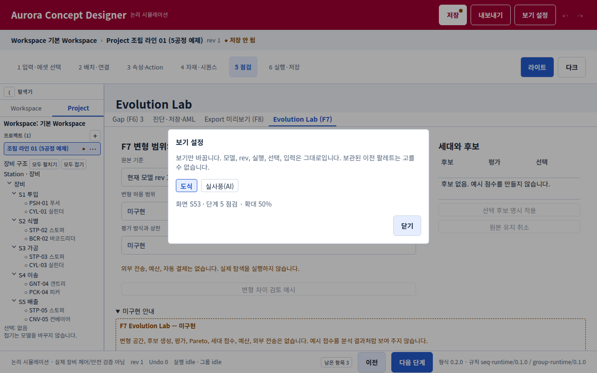

*그림 19. 「보기 설정」. 도식과 실사풍만 바꾸고, 모델과 rev는 그대로라고 적혀 있다. 2026-11-12, Chrome 156, 1280×800, 라이트.*

- 「라이트」「다크」만 고릅니다. 예전에 저장된 값 C는 지우지 않고, 화면은 라이트로 보입니다. 사용자가 라이트나 다크를 누르기 전에는 그 저장값을 건드리지 않습니다. 세 번째 테마 단추는 없습니다.
- 「도식」「실사풍(AI)」은 1단계, 2단계 도면, 6단계에서도 같은 설정입니다.
- 「둘러보기 다시 보기」는 처음 실행 안내([2.3절](#23-처음-열면))를 다시 엽니다(TURN-042).
- 이 설정은 프로젝트 파일에 들어가지 않습니다. 다른 PC로 JSON을 가져가도 테마는 따라가지 않습니다.

## 12. 저장, JSON, Mac과 Windows

`FL-18` `FL-19`. 화면 `S51` `S03`.

### 12.1 저장 (`FL-18`)

헤더 「저장」 또는 6단계의 「저장」.

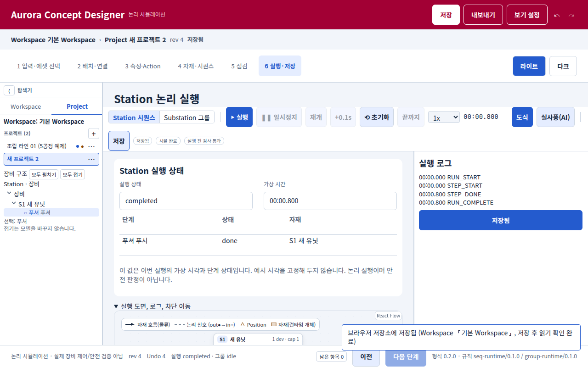

*그림 20. 저장 직후. 위쪽 줄의 점이 사라지고 「저장됨」이 된다. 알림은 브라우저 저장소에 저장됐고 읽기 확인까지 끝났다는 문장이다. 2026-11-12, Chrome 156, 1280×800, 라이트.*

- 저장 위치는 이 브라우저의 localStorage입니다. 다른 PC, 다른 브라우저로 자동으로 옮겨지지 않습니다.
- 성공하면 「브라우저 저장소에 저장됨 (Workspace 「…」, 저장 후 읽기 확인 완료)」이 잠시 보입니다.
- 저장에 실패하면 모델은 그대로입니다. 저장소를 쓸 수 없으면 메모리에서만 작업합니다. 그 경우 Project 상세의 저장 줄은 「브라우저 저장소 사용 불가」이고, 목록은 열린 프로젝트만 보여 줍니다. 「내보내기」로 파일을 남기세요.
- **자동 임시 저장**(TURN-047) — 모델을 고치면 마지막 편집에서 5초 뒤 이 브라우저에 임시 저장합니다. 「저장」한 내용과는 따로 두므로 저장 목록 · 「저장 안 됨」 표시는 바뀌지 않습니다. 한 번도 저장하지 않은 프로젝트도 임시 저장됩니다. 실행 중에는 하지 않습니다.
  - 다시 열었을 때 저장본보다 새로운 임시 저장이 있으면 「저장 안 된 변경이 있습니다 — 임시 저장 HH:MM · rev N」 창이 뜹니다. 「복구」는 임시 저장 내용으로 열고(「저장 안 됨」 상태, 실행 취소 기록은 비어 있음), 「버리기」는 저장본으로 열고 임시 저장을 지웁니다. 저장본이 없는 프로젝트도 같은 창으로 묻고, 시작 화면의 「저장 안 된 작업」에도 보입니다.
  - 「저장」하거나 「저장하지 않고 닫기」 · 프로젝트 삭제를 하면 임시 저장은 지워집니다. 깨진 임시 저장은 복구를 권하지 않고 격리 보관함으로 갑니다.
  - 「보기 설정」의 「자동 임시 저장」으로 끌 수 있습니다(기본 켬). 꺼도 이미 있는 임시 저장은 남습니다. 임시 저장도 이 브라우저 안에만 있습니다 — 다른 PC 로 옮겨지지 않습니다.

### 12.2 JSON 내보내기와 가져오기 (`FL-19`)

1. 「내보내기」는 `이름.ecd.json`을 받습니다. 보기 설정은 파일에 들어가지 않습니다.
2. 가져오기는 작업 시작 화면의 「JSON 가져오기」, Project 탭 「+」의 「JSON 가져오기」, 또는 「프로젝트 파일」 화면에서 합니다.
3. 형식이 맞으면 새 탭으로 열리고, 아직 저장 전이라 `● 저장 안 됨`입니다. 원본 파일을 덮어쓰지 않습니다.
4. 같은 ID가 이미 열려 있으면 「같은 ID의 프로젝트가 이미 열려 있음」이 나옵니다. 「새 ID 사본으로 열기」 또는 「기존 탭으로 이동」입니다. 열린 탭을 덮어쓰지 않습니다.
5. 거절된 파일은 열리지 않고, 원본은 5단계 「진단·저장·AML」의 격리 보관함에 남습니다. 「가져오기 거부 — 현재 모델 불변」 창이 이유를 보여 줍니다.
6. 0.1대 파일은 열 때 0.2로 바뀌고 경고가 붙습니다. 원본 파일 자체는 앱이 수정하지 않습니다.

### 12.3 Mac과 Windows

- 앱을 받는 방법은 2절과 같습니다. git은 코드와 문서를 맞추고, 프로젝트 데이터는 맞추지 않습니다.
- 집과 회사를 오갈 때는 「내보내기」한 `.ecd.json`을 다른 PC에서 「JSON 가져오기」로 엽니다.
- 저장한 뒤 다시 「내보내기」해야 그 변경이 파일에 있습니다. 브라우저 저장만으로는 다른 PC에 없습니다.

## 13. 따라 하기 실습

세 실습 모두 2026-11-12, Chrome 156, 1280×800, 빈 저장소, `npm run dev`에서 처음부터 끝까지 따라 했습니다. 시간은 화면의 가상 시계입니다. 모두 [예시] 가정값입니다.

이미 탭이 열려 있으면 「예제 열기」「병렬 예제」「빈 프로젝트 만들기」가 만드는 이름 뒤의 번호는 열린 탭 수에 따라 2, 3…이 됩니다. 위쪽 줄의 이름으로 확인하세요.

### 13.1 실습 A — 5공정 예제

1. 앱을 엽니다. 위쪽 줄이 `Project 조립 라인 01 (5공정 예제)`이면 그 예제가 이미 열린 것입니다.
2. 아래 「시작하기」를 누릅니다. 「예제 열기」는 사본을 또 만들므로 이 실습에서는 누르지 않습니다.
3. 단계 바 「6 실행·저장」을 누릅니다. 제목은 「Station 논리 실행」입니다. 가운데 캔버스는 「도면」이든 「3D」든 됩니다.
4. 「▶ 실행」을 누른 뒤 「끝까지」를 누릅니다.

볼 것:

- 시계 `00:11.100`, 배지 「시뮬 완료」, 요약 띠의 실행 상태 「완료」, 사이클 `00:11.100`
- 가운데 아래 「자세히」 머리 줄의 최근 로그 `00:11.100 RUN_COMPLETE`(펼치면 「실행 로그」 탭에 전체)
- 왼쪽 「단계」 목록은 모두 「완료」, 요약 띠의 자재는 「배출(장비 밖)」
- 오른쪽 「가동 조건」의 준비 검사는 「실행 가능」
- 위쪽 줄은 그대로 `● 저장 안 됨`입니다. 실행은 저장이 아닙니다


*그림 21. 실습 A. 시계 00:11.100, RUN_COMPLETE. 2026-11-12, Chrome 156, 1280×800, 라이트.*

### 13.2 실습 B — 병렬 예제를 Station 실행으로

이 실습은 TURN-022(2026-11-21)에 맞춰 글을 고쳤습니다. 값은 루카가 릴리스 빌드에서 확인한 것이고, 그림 22는 그 전 화면입니다.

1. 작업 시작 화면으로 갑니다. 탐색기 Workspace 탭의 「작업 시작 화면」, 또는 앱을 다시 열었을 때의 가운데 화면입니다.
2. 「병렬 예제」를 누릅니다. 위쪽 줄에 「병렬 Substation 예제」가 보이면 맞습니다. 다른 탭이 이미 있으면 이름 뒤에 번호가 붙습니다.
3. 「4 자재·시퀀스」의 Station 시퀀스에 「Substation S1 듀얼 클램프」「Substation S2 푸시 아웃」 두 줄이 있는지 봅니다. 이 두 줄이 각 Substation의 시퀀스를 부릅니다.
4. 「6 실행·저장」에서 「▶ 실행」, 이어서 「끝까지」를 누릅니다. 그룹 실행 단추는 없습니다.

볼 것:

- 실행 상태 「완료」, 「자세히」의 실행 결과 요약 「총 00:02.500 · 6 / 6 단계」
- 로그 `00:01.200 SEQ_COMPLETE`(S1 시퀀스 A), `00:01.600 SEQ_COMPLETE`(S1 시퀀스 B), `00:01.600 PAR_JOIN`
- 이어서 S2 푸시가 돌고 `00:02.500 RUN_COMPLETE`
- 자재 「M-P1 표시용」은 S1에 그대로 있습니다. 어느 시퀀스도 자재를 다루지 않습니다

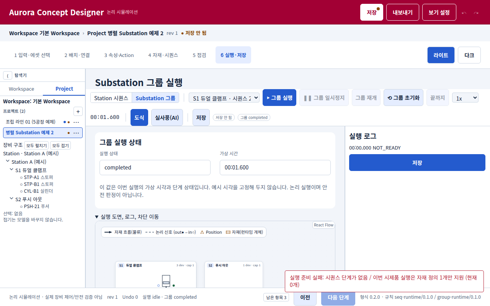

*그림 22. (이전 판) 실습 B를 그룹 실행으로 하던 화면. 그룹 시계 00:01.600. 2026-11-12, Chrome 156, 1280×800, 라이트.*

4단계 「Substation 시퀀스 (3)」에서 같은 예제의 단계 시간을 미리 볼 수 있습니다. 그림 15입니다.

### 13.3 실습 C — 빈 프로젝트에서 한 단계 실행

1. 작업 시작 화면에서 「빈 프로젝트 만들기」를 누릅니다. 위쪽 줄이 「새 프로젝트」로 바뀝니다.
2. 「2 배치·연결」로 갑니다. 팔레트의 「빈 유닛」을 카드 보드의 빈 곳으로 끌어 놓습니다. 카드 「S1 새 유닛」이 생기고 rev는 1이 됩니다.

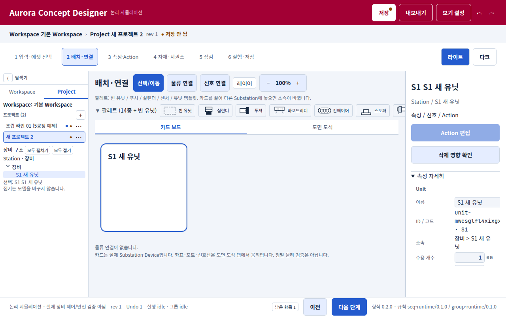

*그림 23. 실습 C, 빈 유닛만 놓은 뒤. 오른쪽 제목은 「S1 새 유닛」. 2026-11-12, Chrome 156, 1280×800, 라이트.*

3. 팔레트의 「푸셔」를 그 카드 위로 끌어 놓습니다. 카드 안에 「푸셔 · 푸셔」가 생깁니다. 카드 밖에 놓으면 들어가지 않습니다.
4. 「4 자재·시퀀스」로 가서 「자재·Flow (F4)」를 누르고 「자재 추가」를 누릅니다. 초기 위치는 「S1 새 유닛」, 초기 상태는 「대기」입니다. 크기와 무게는 미정으로 남습니다.
5. 「Station 시퀀스 Draft (F5)」로 돌아와 「Action 추가」를 누릅니다. 한 줄이 생깁니다. 대상은 푸셔, Action은 「푸셔 푸시」, 완료는 「푸셔.푸시 완료」, 시간은 `0.8s / 3s · 가정`입니다.

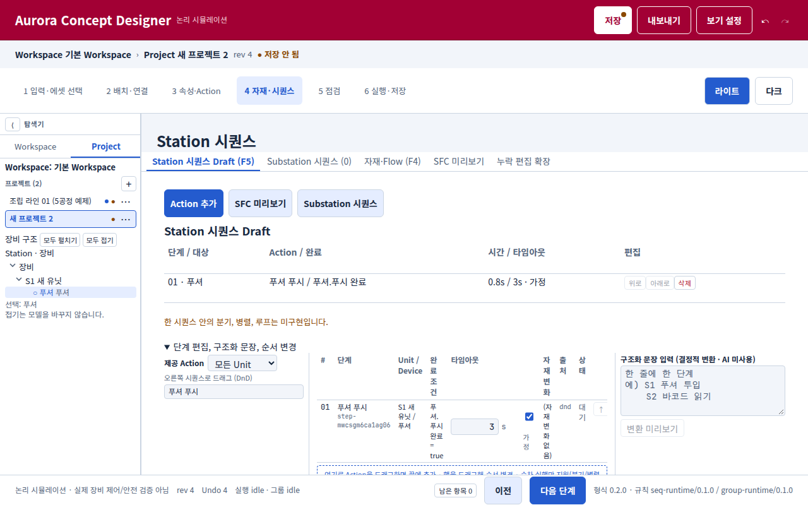

*그림 24. 실습 C의 시퀀스 한 줄. 2026-11-12, Chrome 156, 1280×800, 라이트.*

6. 「6 실행·저장」에서 「▶ 실행」, 「끝까지」를 누릅니다.

볼 것:

- 시계 `00:00.800`, 실행 상태 「완료」, 「자세히」의 최근 로그 `00:00.800 RUN_COMPLETE`
- 단계 「푸셔 푸시」는 `done`, 자재는 「S1 새 유닛」의 「대기」 그대로입니다. 이 Action은 자재를 옮기지 않습니다
- 오류 0, 준비 검사 「실행 가능」
- rev 4, Undo 4. 유닛, 푸셔, 자재, 단계가 편집 네 번입니다

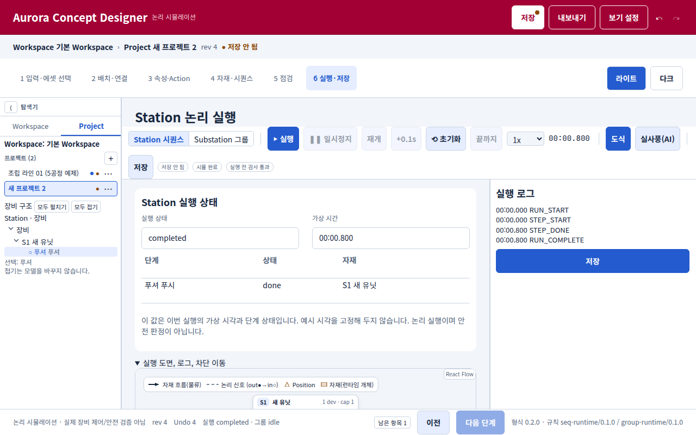

*그림 25. 실습 C. 시계 00:00.800, RUN_COMPLETE, 자재는 S1 새 유닛. 2026-11-12, Chrome 156, 1280×800, 라이트.*

7. 「저장」을 누릅니다. 위쪽 줄이 「저장됨」으로 바뀌고, 알림은 그림 20과 같습니다.

## 14. AML 범위

`FL-23`. 화면 `S12`. 자세한 표는 [`AML-SUPPORT.md`](../../AML-SUPPORT.md)입니다.

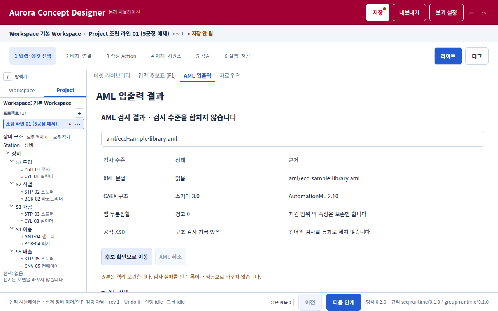

*그림 26. 번들 라이브러리의 네 검사 줄. XSD는 기록이 있다고 표시되고, 브라우저에서 다시 검사하지는 않는다. 2026-11-12, Chrome 156, 1280×800, 라이트.*

이 앱이 읽는 것은 CAEX 3.0의 일부입니다.

- 되는 것: 포함 AML에서 14종 정의를 읽기, 다른 AML 가져오기, 라이브러리 AML 내보내기, 앱 부분집합 진단, 가져와 둔 AML을 이 브라우저에 기억.
- 안 되는 것: 일반 AutomationML 전체(InstanceHierarchy, 외부 참조, 상속 등), 브라우저 안 XSD 검사, 가져온 AML에 사진 파일을 같이 넣기. 공식 XSD 원문은 재배포 조건이 확인되지 않아 저장소에 없습니다.

1단계 카드의 「XSD 통과」는 저장소에 넣어 둔 검사 기록이 정의와 맞을 때의 표시입니다. 검사를 건너뛰었으면 통과로 세지 않습니다.

## 15. 문제 해결

| 보이는 것 | 의미와 다음 행동 |
|---|---|
| 위쪽 `● 저장 안 됨` | 아직 브라우저에 반영되지 않음. 「저장」 |
| 저장 줄 「브라우저 저장소 사용 불가」 | 저장이 안 됨. 「내보내기」로 파일을 남기고, HTTP로 다시 열기 |
| 「가져오기 거부 — 현재 모델 불변」 | 파일을 열지 않음. 5단계 진단의 격리 보관함에서 원본을 받을 수 있음 |
| 「실행 차단과 수정」 | 아래 그림. 이동 단추로 간 뒤 고치고 다시 실행 |
| `PRE_UNMET` | 진입 조건이 안 맞음. 문구에 센서 안내가 있으면 자재가 그 Substation에 없는 것 — 4단계에서 자재의 초기 위치나 앞 단계의 이동을 확인 |
| `TIMEOUT` | 완료 신호가 타임아웃 안에 오지 않음. 검증용 「완료 신호 미발생」이 켜져 있는지도 확인 |
| `DEVICE_CONFLICT` · `SHARED_MATERIAL_CONFLICT` | 병렬 갈래끼리 또는 Substation 시퀀스끼리 같은 Device를 쓰거나, 자재를 다루는 쪽이 둘 이상. 이동 단추로 가서 갈래를 나누거나 순차로 바꿈 |
| 로그 `RETRY_EXHAUSTED` | 재시도를 다 쓰고도 조건이 거짓. 오류가 아니고 실행은 계속됨. 뒤의 분기가 어느 쪽으로 갔는지 `BRANCH_TAKEN`을 확인 |
| 실행 중 편집이 안 됨 | 일시정지가 아니라 「초기화」해야 편집이 돌아옴 |
| Workspace가 안 바뀜 | 저장 안 된 편집이 있거나 실행이 일시정지 중. 4.1 |

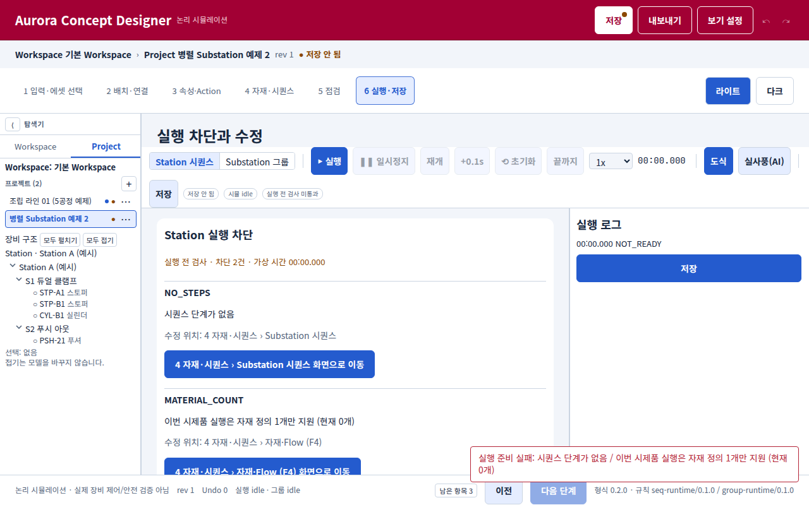

*그림 27. (이전 판) 병렬 예제의 Station 실행이 막히던 화면. TURN-022 뒤로 이 예제는 막히지 않고, 막힌 화면의 모양만 같다. NO_STEPS는 Substation 시퀀스 화면으로, MATERIAL_COUNT는 자재 화면으로 가는 단추가 있다. 가상 시간 00:00.000. 2026-11-12, Chrome 156, 1280×800, 라이트.*

이동 단추는 세 가지로 나뉩니다. 고치는 화면으로 가는 「수정 위치」, 원인을 보여 주는 「원인 확인」, 그리고 이 화면에서 직접 고칠 수 없는 항목. 단추는 모델과 실행 취소를 바꾸지 않습니다.

## 16. 안 되는 것

기능 목록의 📄는 안내 화면만 있고, ✗는 그 기능이 없습니다. ◐ 안에서 없다고 적힌 부분도 여기 16.2에 모았습니다. 완료된 기능으로 읽지 마세요.

### 16.1 안내 화면만 있음 (📄)

화면 위에 「준비 중 — 이 화면은 아직 동작하지 않습니다」 표시가 있습니다. 단추는 보이지만 눌리지 않거나, 미구현이라고 적혀 있습니다. 예시 데이터를 만든 것처럼 보여 주지 않습니다. TURN-051 부터 Evolution Lab · Workspace 파일 묶음 · 자료 입력은 그 화면이 할 일과 **지금 대신 쓸 수 있는 곳**, 그곳으로 가는 이동 단추를 함께 보여 줍니다.

빈 목록(프로젝트 · Unit · 물류 연결 · 자재 · 시퀀스 단계 · Interlock · Gap · 실행 로그 · 입력 후보 · 탐색 결과 없음)은 기호 + 한 줄 + 다음 행동 단추로 나옵니다(TURN-051). 실행 중이라 못 하는 행동은 단추가 흐리고 까닭이 적혀 있습니다. 3D 장면과 64KB 이상 파일 가져오기는 150ms 넘게 걸릴 때만 「불러오는 중」을 보여 줍니다.

| ID | 화면 | 가는 곳 | 보이는 것 |
|---|---|---|---|
| FL-26 | `S14` | 1단계 「자료 입력」 | XLSX · CSV · 표 붙여넣기는 동작(17절). PDF, DWG, USD는 「추출 미구현」 |
| FL-54 | `S44` | 4단계 「누락 편집 확장」 | 후속 단계 편집과 다중 자재 확장이 비활성 |

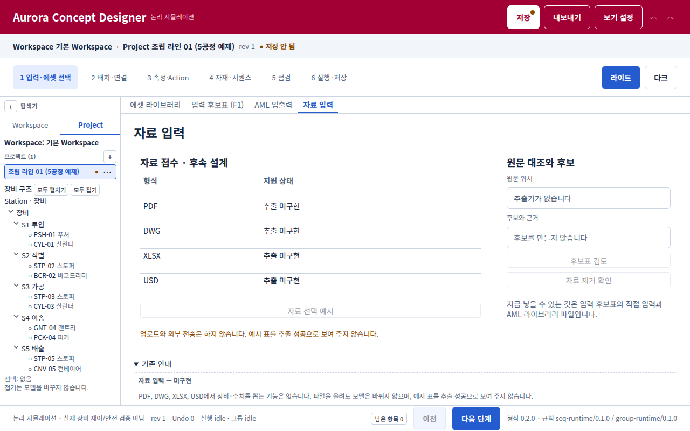

*그림 28. FL-26. 자료 입력은 추출하지 않는다고 적혀 있다. 2026-11-12, Chrome 156, 1280×800, 라이트.*

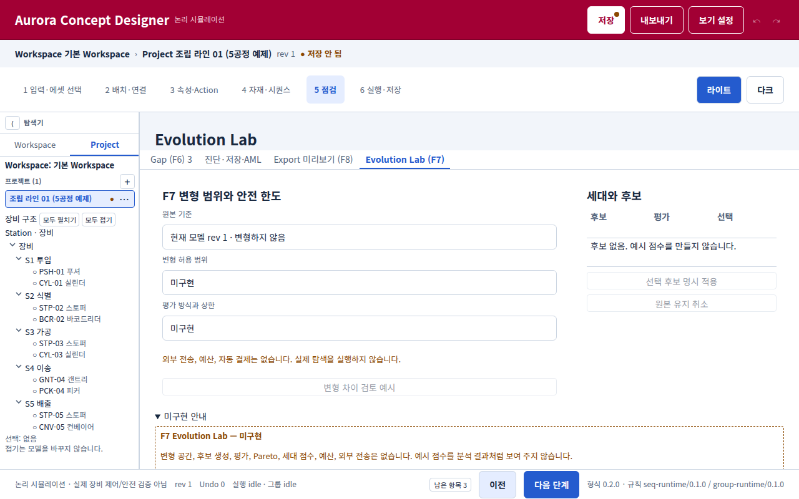

*그림 29. FL-63. 변형 허용 범위와 평가 방식이 미구현이다. 2026-11-12, Chrome 156, 1280×800, 라이트.*

### 16.2 아예 없음 (✗와, 일부 구현 안의 없는 부분)

| ID | 없는 것 |
|---|---|
| FL-37 | 배경 도면의 PDF · 여러 장 · 회전, Device 잠금, Unit 안의 Device를 서브플로로 두기. PNG · JPEG 배경과 Unit 위치 잠금은 있음(TURN-059) |
| FL-25 | 문서(PDF·DWG)와 VC/USD에서 후보를 만들기. 직접 입력 · XLSX · CSV · 표 붙여넣기 후보는 있음(TURN-060 · 076) |
| FL-80 | 3D 장면의 우클릭 메뉴. 도면 · 카드 보드 · 탐색기 트리 · 4단계 흐름 표의 우클릭 메뉴는 있음(TURN-050 · 073) |
| FL-50 | 캐리어 적재, 자재 합치기 / 나누기, 종류별 투입 간격, 종류 5개 이상, Substation 그룹 실행의 혼류. 자재 정의 4개까지 · 혼류 투입(TURN-080, 18절) · 흐름 블록 위의 여러 개체 실행(TURN-071)은 있음 |
| FL-51 | 갈래 5개 이상 분기, 상한 없는 반복 · 반복 중간 탈출, 구조화 문장으로 흐름 만들기, 자연어 AI. 분기(2~4 갈래 — TURN-063) · 병렬 · 반복 · 재시도 · 신호 기다림은 있음. 조건으로 도는 반복(상한 필수 — TURN-092, 19절)은 있음 |
| FL-60 | 승인된 판정식. Gap 목록 · 이동 · 실행 결과 Gap(TURN-043)은 있음 |
| FL-62 | Aurora Core 실제 형식 Export와 전송, Export 파일을 모델에 반영. 초안 형식 파일 · 역매핑 검사 · 읽기 전용 미리보기는 있음 |
| FL-71 | 시퀀스 하나만 일시정지, 서로 다른 Substation의 시퀀스를 한 병렬로 동시에 실행, 시퀀스 사이 대기, Substation 시퀀스 안의 병렬 · Substation 단계. Substation 시퀀스 안의 분기 · 반복 · 재시도 · 신호 기다림은 있음(TURN-072, 18절) |

그 밖에 앱 밖에 있는 것: WPF 버전, 실제 장비 제어, 브라우저 안 XSD, 일반 AutomationML 전체, AI 평가기 교체. 웹과 WPF가 같다는 검증은 WPF가 없으므로 하지 않았습니다.

## 17. TURN-052 ~ 082 로 더해진 것

2026-11-23 밤 ~ 11-24 새벽에 머지된 26개 TURN 의 사용법입니다. 모두 **검토 후보**이고 사람 검수 전입니다. 앞 절(2~12)의 본문과 그림은 이 TURN 들 전의 화면이므로, 아래 내용이 앞 절과 다르면 이 절이 맞습니다. 화면 그림은 각 `docs/turns/TURN-NNN.md` 의 스크린샷을 보세요.

> **고쳐진 문제 (Issue #212, PR #215)** — 용어 풀이(점선 밑줄)가 붙은 탭 · 단계 단추를 포인터가 한 번에 와서 바로 눌리는 방식으로 누르면 앱이 멈추던 문제는 2026-11-24 에 고쳐졌습니다. 터치 기기에서는 따로 확인하지 않았습니다.

### 17.1 어디서나

- **명령 · 대상 찾기**(TURN-053 · 066, `FL-83`) — Ctrl/Cmd+K 또는 헤더 「명령 · 대상 찾기」. 글자를 치면 명령(「병렬로 묶기」「3D 보기」…)과 대상(Unit · Device · 신호 · 포지션 · Action · 단계 · 블록 · Interlock · 자재)이 함께 걸러집니다. `>` 로 시작하면 명령만, `@` 로 시작하면 대상만. ↑↓ · Enter 로 실행 / 이동, Shift+Enter 는 단계를 옮기지 않고 고르기만, Esc 로 닫습니다. 지금 못 하는 명령은 흐리고 까닭이 적혀 있습니다.
- **단축키 목록** — 입력 칸 밖에서 `?`. 실제로 동작하는 단축키만 묶음별로 나옵니다.
- **도움말 칸**(TURN-056 · 062, `FL-84`) — 헤더 「도움말」. 지금 단계 · 탭의 「하는 일 / 자주 하는 일 / 막힐 때 / 매뉴얼 절」이 오른쪽 칸에 나오고, 화면을 바꾸면 따라 바뀝니다. 아래에 「둘러보기 다시 보기」 · 「단축키 목록」 · 「용어」.
- **용어 풀이** — 제목 · 탭 · 단계 바 · 표 머리의 용어(점선 밑줄)에 마우스를 올리거나 초점을 주면 한 줄 풀이가 뜹니다. 「보기 설정」에서 끌 수 있습니다.
- **실행 취소 이력**(TURN-067, `FL-89`) — 헤더 「이력」. 편집 이름과 rev 가 최신부터 나오고, 줄을 누르면 그 시점으로 갑니다. 실행 취소 단추의 툴팁에 다음에 취소될 편집 이름이 나옵니다. 저장되지 않으며 탭마다 따로입니다.
- **아이콘 · 글자 · 초점 · 움직임**(TURN-054 · 061 · 077 · 078, `FL-86`) — 단추 · 탭 · 메뉴가 한 세트의 아이콘 + 글자를 씁니다. 키보드 초점은 어디서나 2px 링입니다. 접기 · 창 · 알림의 전환은 같은 속도이고, 운영체제의 「움직임 줄이기」를 켜면 전환과 도면 움직임이 없어집니다.
- **인쇄용 보기**(TURN-079, `FL-93`) — 헤더 「내보내기」 메뉴 또는 명령 찾기의 「인쇄용 보기」. 넣을 구역(표지 · 장비 구조 · 도면 도식 · Station / Substation 시퀀스 · SFC · 신호 · Interlock · 가정 · 미정 · Gap)을 체크하고 「인쇄」로 브라우저 인쇄 창을 엽니다. 쪽마다 프로젝트 이름과 한계 문구가 들어갑니다.

### 17.2 시작 화면 · Workspace

- **예제 갤러리 · 뼈대부터**(TURN-075, `FL-92`) — 시작 화면에 예제 카드 3장(설명 · Unit / Device / 단계 수 · 끝까지의 가상 시간 · 「열기」). 「뼈대부터」는 이름 · Unit 수(1~8) → Unit 마다 빈 Unit / 번들 템플릿 / 내 템플릿 → 물류 연결의 세 걸음으로 새 프로젝트를 만듭니다. 시퀀스와 자재는 만들지 않습니다.
- **Workspace 파일 묶음**(TURN-055, `FL-12`) — Workspace 탭 「파일 묶음」. 「묶음 내보내기」는 이 Workspace 의 **저장된** 프로젝트를 `.aurora-workspace.json` 한 파일로 내려받습니다(저장 안 된 변경 · 임시 저장 · 보기 설정은 빠짐). 「묶음 파일 고르기」는 미리보기(새로 들어옴 / 같은 ID 있음 / 읽을 수 없음)를 보여 주고, 새 Workspace 로 받거나 지금 Workspace 에 더합니다. 같은 ID 는 사본(기본) / 건너뛰기 / 덮어쓰기. 읽을 수 없는 프로젝트는 격리 보관함으로 갑니다. 프로젝트 126개까지.

### 17.3 1단계 — 자료 입력 (TURN-060 · 076, `FL-25` `FL-26`)

1. 「자료 입력」에서 XLSX 또는 CSV 파일을 고르거나, 「표 붙여넣기」 칸에 엑셀에서 복사한 줄을 붙이고 「표 읽기」를 누릅니다. 파일은 이 브라우저 안에서만 읽습니다(5MB · 5,000줄까지, CSV 는 UTF-8).
2. 시트와 머리 줄을 고르면 열마다 뜻(Unit 이름 · Device 이름 · Device 종류 · 신호 이름 · 신호 방향 · 주소 · 메모 · 쓰지 않음)이 미리 채워집니다. 「추측」 표시가 붙은 것은 확인하고 바꿉니다. Device 이름 열은 꼭 있어야 합니다.
3. 「후보 만들기」로 Unit · Device · 신호 후보가 입력 후보표에 들어갑니다. 이때 모델은 바뀌지 않습니다. 후보표에서 확인한 것만 반영됩니다(낮은 신뢰도 Device · 신호는 반영되지 않음).
4. 입력 후보표 또는 5단계의 「IO 리스트 내보내기 (CSV)」는 모델의 신호를 한 줄에 하나씩 내보냅니다. 내보낸 CSV 를 다시 넣으면 모두 「이미 있음」으로 나옵니다.

PDF · DWG · USD 는 지금도 「추출 미구현」입니다.

### 17.4 2단계 — 배치 · 연결

- **이름표**(TURN-054) — 확대 70% 미만에서는 Unit 이름만(화면 11px 아래로 작아지지 않음), 70~120% 는 Device 코드까지, 120% 이상은 Device 이름 · 상태 · 포트 이름까지 보입니다. 고른 것의 이름은 항상 보입니다. 기준값은 설계 제안입니다.
- **내 템플릿**(TURN-057, `FL-85`) — Unit 을 고르고 「내 템플릿으로 저장」(도구 줄 · 우클릭). 이름을 정하면 이 브라우저에 저장되고 팔레트 · 1단계 라이브러리의 「내 템플릿」에 나옵니다. 끌어 놓으면 새 ID 의 Unit 이 생깁니다. 바깥 연결 · 시퀀스 단계 · 자재 경로 · Interlock 은 들어가지 않습니다. 1단계에서 이름 바꾸기 · 삭제 · JSON 내보내기 / 가져오기.
- **배경 도면**(TURN-059, `FL-37`) — 도면 도식의 「배경 도면」으로 PNG · JPEG 한 장(2MB · 긴 변 4096px 까지)을 도면 뒤에 깝니다. 불투명도 · 위치 · 배율을 조절하고, 그림 위 두 점과 실제 거리(mm)로 축척을 맞춥니다. 배경은 기본으로 잠겨 있어 클릭이 뒤의 도면으로 지나갑니다. 그림은 프로젝트 파일에 들어갑니다.
- **위치 잠금**(TURN-059) — Unit 을 고르고 「위치 잠금」. 잠긴 Unit 은 끌기 · 정렬 · 간격 · 겹침 풀기 · 크기 조절로 움직이지 않습니다. 「모두 잠금」 · 「모두 풀기」.

### 17.5 3단계 — 속성 · Action

- **일괄 편집**(TURN-074, `FL-91`) — 「일괄 편집」 접는 칸에 프로젝트의 Action 전체가 나옵니다. Unit · 종류 · 상태로 거르고, 체크한 줄의 동작 시간 / 타임아웃을 값 · 배율 · 더하기 / 빼기로(타임아웃은 「동작 시간 × 배율 + 여유」로도), 상태를 가정 / 확인 / 미정으로 바꿉니다. 미리보기에서 전 → 후와 경고를 본 뒤 「적용」 — rev +1, 실행 취소 한 번.
- **확인 이력**(TURN-070, `FL-90`) — 가정 → 확인, Interlock 확인, 후보 확인 / 거절, Gap 「사람 확인」, 주소 확인을 할 때 확인자 이름과 시각이 프로젝트에 남습니다. 이름은 「보기 설정」의 「확인자 이름」(비어 있으면 처음 확인할 때 물음). 로그인 · 인증은 없고 적은 글자가 그대로 남습니다. 5단계 「진단 · 저장」의 「확인 이력」 표에서 봅니다(시각은 이 컴퓨터의 시간 — TURN-088, 19절).

### 17.6 4단계 — 시퀀스

- **세 갈래 이상 분기**(TURN-063) — 분기 머리의 「갈래 추가」로 갈래를 4개까지 둡니다. 갈래마다 조건이 있고 마지막은 「그 밖」입니다. 실행은 위에서부터 처음 참인 갈래 하나만 돕니다. 분기의 빈 갈래는 막지 않고 그냥 지나갑니다. SFC 가 갈래 수만큼 갈립니다.
- **흐름 표 우클릭 · 끌기**(TURN-073, `FL-80`) — 줄에서 우클릭(Shift+F10)하면 위로 · 아래로 · 밖으로 · 묶기 · 풀기 · 이름 변경 · 3단계 Action 열기 · 삭제가 뜹니다. 줄 왼쪽 손잡이(⋮⋮)를 끌어 다른 자리 · 다른 갈래 · 블록 밖으로 옮깁니다.
- **조건 한 줄 식**(TURN-052, `FL-82`) — 조건이 어디서나 `STP-03.상승 완료 = ON 그리고 자재 위치 = S2 식별` 꼴로 보입니다.

### 17.7 5단계 — 점검

- **조건 검사**(TURN-052) — 「진단 · 저장」의 「조건」 묶음: 끊긴 참조 · 항상 거짓(같은 신호 ON + OFF 등)은 오류, 같은 조건 두 번 · 병렬의 반대 갈래 · 도달하지 않는 분기 갈래는 안내, 미정 조건은 미정. 줄마다 어디 · 식 · 까닭 · 「이동」. 진단만 하며 실행을 막지 않습니다.
- **Evolution Lab**(TURN-058, `FL-63`) — 「안 추가」로 변형 안(동작 시간: 고른 Action 또는 모든 Action × 배율, 타임아웃, 투입 개수 · 간격)을 3개까지 만들고 「모두 실행」. 기준과 안들의 끝남 / 오류 · 총 가상 시간 · 사이클 · 시간당 생산량 · 병목 · 가장 긴 단계 · 기준 대비 차이가 표로 나옵니다. 「모델에 반영」은 바뀌는 값 목록을 확인한 뒤 한 번에 반영합니다. 자동 탐색 · 최적화 · AI 는 없습니다.

### 17.8 6단계 — 실행

- **흐름 위의 여러 개체**(TURN-071, `FL-50` `FL-70`) — 분기 · 병렬 · 반복 · 재시도 · 기다림이 있어도 투입 개수를 2 이상으로 실행합니다. 개체마다 흐름을 처음부터 따라가고 분기는 개체마다 판정합니다. 실행 규칙 `seq-runtime/0.8.0`. 병렬 예제는 자재가 S1 을 비우지 않아 수용 1이면 둘째 개체가 교착(`DEADLOCK`)이 됩니다.
- **실행 도면**(TURN-078) — 진행 중 Device 에 진행률, 물류선 위로 옮겨 가는 자재, 기다림 표시가 보입니다.
- **타이밍 차트**(TURN-064, `FL-87`) — 「자세히」의 「타이밍 차트」. Unit 별 / Device 별 / 개체 별 줄에 단계 막대가 시간축으로 놓입니다. 기다림 · 대기는 빗금. 막대를 누르면 요약 표의 그 줄이 강조됩니다.
- **보고서 내보내기**(TURN-065, `FL-88`) — 실행이 끝나면 「실행 결과 요약」의 「보고서 내보내기 ▾」에서 HTML 보고서 · 단계 표 CSV · 로그 CSV 를 내려받습니다. HTML 은 파일 하나이고 한계 문구가 들어갑니다. 내보낸 시각은 이 컴퓨터의 시간으로 나오고(TURN-088), 표지 · 표 모양은 인쇄용 보기와 같습니다(TURN-095, 19절).
- **실행 시나리오**(TURN-082, `FL-94`) — 「가동 조건」 머리의 「시나리오」. 「저장…」으로 지금의 투입 · 오류 주입 · 배속에 이름을 붙여 프로젝트에 저장하고, 목록에서 골라 되돌립니다. 「시나리오 모두 실행」은 사본에서 차례로 돌려 결과 표를 보여 줍니다. Action 시간 · 타임아웃은 들어가지 않습니다(그 비교는 Evolution Lab).
- **기다림 시간 초과 · 남은 차단**(TURN-062) — `WAIT_TIMEOUT` 도 세 줄 안내로 나오고, 실행 전 차단이 2개 이상이면 「남은 차단 N개」가 보입니다.

## 18. TURN-068 ~ 086 으로 더해진 것

2026-11-24 에 머지된 9개 TURN(068 · 069 · 072 · 080 · 081 · 083 · 084 · 085 · 086)의 사용법입니다. 모두 **검토 후보**이고 사람 검수 전입니다. 앞 절(2~17)과 다르면 이 절이 맞습니다. 화면 그림은 각 `docs/turns/TURN-NNN.md` 의 스크린샷을 보세요. 실행 규칙은 `seq-runtime/0.10.0` 입니다.

### 18.1 어디서나

- **표**(TURN-068, `FL-95`) — 흐름 표 · 실행 결과 요약 · 진단 표 등이 같은 모양입니다. 숫자 · 시간 칸은 오른쪽 정렬, 스크롤해도 머리 줄이 붙어 있고, 긴 글은 줄임(…)이며 마우스를 올리면 전체가 나옵니다.
- **알림**(TURN-068, `FL-95`) — 화면 왼쪽 아래(상태 줄 위)에 뜹니다. 「○ 정보」 · 「✓ 성공」 · 「! 거절」로 기호 · 낱말 · 색이 함께 나오고 최대 3개까지 쌓입니다. 거절은 8초 또는 Esc · × 를 누를 때까지 남습니다. 상태 줄의 「알림」을 누르면 이번 세션의 최근 20개가 시각과 함께 나옵니다. 저장하지 않으므로 새로 고치면 비워집니다.
- **헤더**(TURN-069) — 저장 · 실행 취소 · 다시 실행 · 명령 찾기는 어느 폭에서나 헤더에 있습니다. 폭이 좁으면 내보내기 · 보기 설정 · 도움말 · 이력이 「더 보기」로 모입니다. 프로젝트 · Workspace 이름은 길면 줄임이고 마우스를 올리면 전체가 나옵니다.
- **도움말 칸**(TURN-069, `FL-84`) — 1440 폭 이상에서는 오른쪽에 나란히 서고, 그보다 좁으면 작업 칸을 좁히지 않고 위에 겹쳐 열립니다. 머리 줄을 끌어 왼쪽 · 오른쪽 가장자리로 옮기고, 「접기」는 머리 줄만 남깁니다.
- **화면 배치**(TURN-085, `FL-15` `FL-16`) — 창 폭에 따라 좁음(1024~1279) · 보통(1280~1599) · 넓음(1600 이상) 세 단계로 배치가 달라집니다.
  - 좁음: 탐색기가 접혀 시작하고, 속성 칸 · 가동 조건이 오른쪽 띠로 접힙니다. 단계 바의 이름이 짧아지고 도구 줄의 넘치는 단추는 「더 보기」로 갑니다.
  - 넓음: 가운데 작업 칸이 넓어집니다.
  - 패널 너비와 접힘은 단계마다 따로 기억합니다. 예전에 저장된 값은 「보통」에 남습니다.
  - 「보기 설정」의 「화면 배치 처음으로」는 배치만 처음 값으로 되돌립니다(테마 등은 그대로). 이때 뜨는 알림의 「되돌리기」로 한 번 취소할 수 있습니다.
  - 1024 폭 미만에서는 「화면이 좁습니다 — 1024 이상에서 쓰세요」 띠가 뜨고 앱은 계속 쓸 수 있습니다. 가로 스크롤이 조금 남습니다.

### 18.2 2단계 — 키보드로 도면 조작

TURN-084(`FL-98` `FL-32` `FL-34`). 「도면 도식」을 한 번 누르거나 초점을 준 뒤 씁니다. 입력 칸 안에서는 동작하지 않습니다.

| 키 | 하는 일 |
|---|---|
| Tab / Shift+Tab | 다음 / 이전 Unit(Unit 안에서는 Device)으로 |
| Enter | 고른 Unit 안의 Device 로 들어감 |
| Esc | Device → Unit → 선택 해제 순으로 나옴. 잇는 중이면 취소 |
| ← → ↑ ↓ | 고른 것을 10 씩 옮김. Shift 는 50, Alt 는 1 |
| `L` | 고른 Unit 에서 물류 연결을 시작. Tab 으로 대상을 바꾸고 Enter 로 확정 |
| `S` | 고른 Device 의 첫 출력에서 신호 연결을 시작. 같은 방식으로 확정 |
| `+` / `-` / `0` | 확대 / 축소 / 화면 맞춤 |

- 상태 줄에 지금 위치(「S2 식별 › BCR-02」)와 옮긴 좌표가 보입니다.
- 이어서 누른 방향키 이동은 실행 취소 한 번으로 묶입니다. 키를 떼고 0.5초가 지나면 다음 이동은 새 편집입니다.
- 위치 잠금된 Unit 은 움직이지 않고 까닭이 보입니다. 연결의 거부 규칙은 마우스로 이을 때와 같습니다.
- 실행 중에는 옮기기 · 잇기가 막히고, 순회와 확대는 됩니다.
- 카드 보드 · 3D 는 대상이 아닙니다. 출력이 여러 개인 Device 에서 `S` 로 포트를 고르는 조작은 없습니다.

### 18.3 4단계 — Substation 시퀀스 안의 흐름

TURN-072(`FL-52` `FL-71`, 실행 규칙 `seq-runtime/0.9.0` 에서 들어옴).

1. 4단계 「Substation 시퀀스」에서 시퀀스의 단계를 체크하고 「분기로 묶기」 · 「반복으로 묶기」 · 「재시도로 묶기」를 누르거나 「신호 기다림 추가」를 누릅니다. Station 흐름 표와 같은 방식으로 이름 · 조건 · 횟수를 고치고 옮깁니다. 묶기 한 번이 rev +1, 실행 취소 한 번입니다.
2. 「병렬로 묶기」와 「Substation 시퀀스 넣기」는 이 화면에서 거절됩니다(「Substation 시퀀스 안에는 병렬을 넣지 않습니다…」). 한 Substation 의 시퀀스들이 이미 함께 돌기 때문입니다. 모델은 그대로입니다.
3. 6단계에서 Station 시퀀스의 Substation 단계가 실행되면 그 안의 흐름대로 돕니다. 단계 표의 「갈래 · 회차」에 시퀀스 이름과 회차(「S1 시퀀스 A (클램프 A) · 2회」)가 나옵니다.
4. 미정 조건 · 타임아웃 미정은 실행 전에 막히고, 「이동」이 Substation 시퀀스 화면의 그 줄로 갑니다. 빈 갈래는 조건 검사 안내만 합니다.
5. 「SFC 미리보기」에서 Substation 단계를 펼치면 안의 흐름이 보입니다. 기본은 접힘입니다.

- 흐름을 넣지 않은 Substation 시퀀스와 기존 예제의 실행 시각 · 저장 파일은 그대로입니다.
- 병렬 Substation 예제는 수용이 1이라, 투입을 2 이상으로 하면 둘째 개체는 교착(`DEADLOCK`)입니다.

### 18.4 4단계 — 자재 여러 종류와 혼류 투입

TURN-080(`FL-50` `FL-70`, 실행 규칙 `seq-runtime/0.10.0`).

1. 4단계 「자재·Flow」의 「자재 종류」에서 「정의 추가」로 정의를 4개까지 둡니다. 각 정의에 이름 · 표식 · 상태 · 처음 상태 · 처음 위치가 있습니다. 표식을 비우면 순서대로 A, B, C, D 입니다.
2. 「투입 순서」에 `A, A, B` 처럼 적거나, 아래 단추로 순서를 바꾸고 종류별 개수를 정합니다. 투입 개수만큼 이 순서를 되풀이합니다(6개면 A A B A A B). 투입 간격은 모든 종류가 같습니다.
3. 조건에 「자재 종류 = B」를 쓸 수 있습니다(조건 편집 · 한 줄 식 · 조건 검사). 분기에 쓰면 종류에 따라 다른 갈래로 갑니다.
4. 6단계에서 실행하면 도면 · 3D 의 자재 표식에 종류 글자가 붙고, 「실행 결과 요약」에 「종류 A 생산 4 · 평균 00:11.100 · 종류 B 생산 2 · 평균 …」이 나옵니다.

- 쓰이는 정의를 지우면 영향 확인 창이 뜹니다. 5번째 정의는 막힙니다.
- 정의가 하나뿐인 프로젝트는 예전과 같은 파일로 저장되고 실행 시각 · 로그도 같습니다.
- Substation 그룹 실행은 정의가 둘 이상이면 막힙니다. 캐리어 적재 · 합치기 / 나누기 · 종류별 간격 · 추월은 없습니다.

### 18.5 5단계 — 저장본과 지금의 차이 보기

TURN-081(`FL-96`). 5단계 「진단·저장·AML」 맨 위의 「바뀐 것」입니다.

- 저장한 뒤 모델을 바꾸면 `추가 a · 삭제 b · 바뀜 c` 와 종류별(Unit · Device · 신호 · Action · 연결 · 시퀀스 · 흐름 블록 등) 접는 목록이 나옵니다. 바뀐 값은 전 → 후로 보입니다. 도면에서 옮긴 위치는 「위치」 한 줄로 묶입니다.
- 차이가 없으면 「저장본과 같습니다」입니다. 저장하면 목록이 비워집니다.
- 줄의 「이동」은 지금 모델의 그 대상으로 갑니다. 삭제된 줄에는 「이동」이 없습니다.
- 「다른 프로젝트」에서 저장된 프로젝트를 고르거나 「JSON 파일」로 파일을 골라 견줄 수 있습니다. 파일은 가져오기 검사를 통과해야 합니다. 견주기는 모델 · rev · Undo 를 바꾸지 않습니다.
- 임시 저장 복구 창의 「차이 보기」는 임시 저장과 저장본의 차이를 복구 / 버리기 전에 보여 줍니다.
- 합치기, 줄 단위로 되돌리기, 여러 저장 버전의 이력은 없습니다. 흐름 단계 순서가 바뀐 줄은 지금 단계 ID 목록으로 나옵니다.

### 18.6 6단계 — 끝난 실행 되감아 보기

TURN-083(`FL-97`).

- 실행이 끝나면(완료 · 오류) 도면 아래에 시간 막대가 생깁니다. 0부터 총 가상 시간까지이고, 단계 시작 · 끝 · 오류 시각에 눈금이 있습니다.
- 막대를 끌거나 ← / →(0.1초) · Shift+← / →(1초) · Home / End 로 옮깁니다.
- 끝보다 앞으로 옮기면 도면 · 3D · 단계 표 · 신호 · 자재 위치가 그 시각으로 바뀌고 「되감아 보는 중 — 00:02.300」이 붙습니다. 실행 단추 줄은 「되감기 끝」과 「여기서부터 다시 실행」이 됩니다.
- 타이밍 차트는 「지금」 선만 그 시각으로 움직이고, 로그는 그 시각까지 진하게 보입니다.
- 되감기는 모델 · rev · Undo 를 바꾸지 않습니다. 모델을 고치면 막대는 사라집니다.
- 실행 중 되감기, 거꾸로 재생, 기록을 파일로 저장하는 것은 없습니다.

### 18.7 6단계 — 3D 보기

TURN-086(`FL-75`).

- 장면 위의 **시점 단추** 「등각 · 위 · 앞 · 옆」으로 정한 시점에 갑니다. 「위」는 도면과 같은 방향입니다. 장면을 한 번 눌러 초점을 준 뒤에는 1~4 키로도 바꿉니다. 「전체 보기」는 지금 장면을 등각으로 맞춥니다. 운영체제의 「움직임 줄이기」가 켜져 있으면 바로 바뀝니다.
- 오른쪽 아래 **방향 표시**(앞 · 뒤 · 좌 · 우)는 카메라를 따라 돌고, 글자를 누르면 그 방향 시점으로 갑니다.
- **바닥 격자**는 도면과 같은 간격이고 가장자리에 mm 눈금이 있습니다. 「가동 조건 → 표시 옵션 → 바닥 격자」로 끕니다. 시점과 격자 켜짐은 이 브라우저에 기억됩니다.
- Device 아래에 **접지 그림자**가 있고, 고른 Device 는 윤곽선과 이름표가, 고른 Unit 은 구역 테두리가 강조됩니다.
- 1024×700 처럼 3D 칸이 낮으면 「위」 시점에서 구역의 아래쪽이 조금 잘립니다.

## 19. TURN-087 ~ 096 으로 더해진 것

2026-11-27 ~ 28 에 머지된 10개 TURN(087 ~ 096)의 사용법입니다. 모두 **검토 후보**이고 사람 검수 전입니다. 앞 절(2~18)과 다르면 이 절이 맞습니다. 화면 그림은 각 `docs/turns/TURN-NNN.md` 의 스크린샷을 보세요. 실행 규칙은 `seq-runtime/0.11.0` 입니다(TURN-092).

### 19.1 어디서나

- **시각**(TURN-088, `FL-88` `FL-90` `FL-93`) — 화면에서 사람이 읽는 시각은 이 컴퓨터의 시간으로 `2026-11-27 22:46 (UTC+9)` 처럼 나옵니다. 확인 이력, 확인자 창, 작업 정보 줄, 복구 창, 최근 프로젝트, 알림 이력(초까지), 보고서의 「내보낸 시각」, 인쇄용 보기 표지가 같습니다. 마우스를 올리면 저장된 값(UTC)이 나옵니다.
  - 파일 안의 값(프로젝트 파일 · 묶음 · Export 초안 · 임시 저장)과 내려받는 파일 이름의 날짜 · 시각은 그대로 UTC 입니다. 가상 시간(`00:11.100`)은 바뀌지 않았습니다.
  - 시간대를 고르는 설정과 12시간제는 없습니다. 묶음 화면 · Workspace 패널의 시각은 이 형식이 아닙니다.
- **낮고 좁은 화면**(TURN-089, `FL-15` `FL-75`) — 1024×700 에서 3D 의 정한 시점(등각 · 위 · 앞 · 옆)이 칸 안에 다 들어옵니다. 18.7 의 「위 시점 아래쪽이 조금 잘립니다」는 고쳐졌습니다. 창 크기를 바꾸면 정한 시점은 다시 맞추고, 손으로 돌리거나 확대한 뒤에는 그대로 둡니다. 3D 칸이 낮으면 방향 표시가 작아집니다.
  - 6단계 실행 도구 줄은 한 줄이고 넘치는 단추는 「더 보기」로 갑니다.
  - 1024 폭 미만에서 안내 띠가 떠도 문서 가로 스크롤은 생기지 않습니다(18.1 의 「가로 스크롤이 조금 남습니다」는 고쳐졌습니다).

### 19.2 2단계 — Unit 복제 · 고른 것 정렬

TURN-096(`FL-34`), TURN-087(`FL-98`).

1. Unit 을 고르고 도구 줄 · 우클릭의 「복제」 또는 Ctrl/Cmd+D 를 누릅니다. 그 Unit 안의 Device · 신호 · 포지션 · Action · Unit 안쪽 신호 연결이 새 ID 로 생깁니다. 이름은 「이름 사본」(같은 이름이 있으면 「이름 사본 2」), 코드는 비어 있는 다음 `S` 번호입니다. 사본은 원본 오른쪽 빈 자리에 놓입니다.
2. Unit 에 Substation 시퀀스가 있으면 확인 창이 뜨고 「Substation 시퀀스도 복사」를 고를 수 있습니다. 없으면 바로 복제됩니다.
3. Unit 을 둘 이상 고르면 「배치 ▾」의 「고른 것만 자동 정렬」이 고른 Unit 만 물류 순서대로 나란히 놓습니다. 잠긴 Unit 은 움직이지 않고 「잠긴 Unit N개는 제외」가 보입니다.
4. 같은 Unit 의 Device 를 둘 이상 고르면 「배치 ▾」의 간격 같게 · 너비/높이 같게가 Device 에도 듣습니다.

- 복사하지 않는 것: Unit 사이 물류 연결, 다른 Unit 과의 신호 연결, Station 시퀀스 단계, 자재 경로.
- 여러 Unit 을 한 번에 복제해도 rev +1, 실행 취소 한 번입니다.
- 1280 폭에서는 「복제」가 도구 줄의 「더 보기」 안에 있습니다. 사본 안의 Device 이름에는 「사본」이 붙습니다(「STP-02 사본」).
- 키보드로 고른 Unit · Device 의 상태 줄 좌표는 실행 취소 · 다시 실행 · 끌기를 따라 바뀝니다(TURN-087).

### 19.3 4단계 — 흐름 표와 조건으로 도는 반복

**표 모양**(TURN-090, `FL-51` `FL-52`)

- 흐름 표가 좁으면(720px 미만) 줄 끝 단추가 「⋯」 하나로 접힙니다. Enter · Space 로 열고 ↑↓ · Enter · Esc 로 움직입니다. 항목은 우클릭 메뉴와 같습니다.
- 블록 깊이는 16px 걸음이고 왼쪽 세로선으로 이어집니다. Station 흐름 표와 Substation 시퀀스 흐름 표가 같은 모양입니다.
- Substation 시퀀스 카드는 512px 보다 좁아지면 한 칸으로 쌓입니다.
- Substation 시퀀스 화면의 「병렬로 묶기」 · 「Substation 시퀀스 넣기」는 꺼져 있고 까닭이 툴팁에 있습니다(18.3 의 「거절됩니다」가 「꺼져 있습니다」로 바뀜).

**조건으로 도는 반복**(TURN-092, `FL-51` `FL-53` `FL-70`, 실행 규칙 `seq-runtime/0.11.0`)

1. 흐름 표의 반복 줄에서 방식을 고릅니다: 「횟수」(지금까지의 반복, 1~10) · 「참이 될 때까지」 · 「참인 동안」.
2. 「참이 될 때까지」는 몸통을 한 번 돈 뒤 조건을 봅니다. 「참인 동안」은 먼저 조건을 보고, 처음부터 거짓이면 한 번도 돌지 않습니다.
3. 조건은 분기 · 재시도와 같은 편집기로 고릅니다. **방식을 바꾸면 조건이 비어 있지 않고 결과 신호 하나로 미리 채워지므로 꼭 확인하세요.**
4. 상한은 꼭 있어야 합니다(기본 10, 1~999). 상한에 닿으면 실행이 `LOOP_LIMIT` 오류로 멈추고 세 줄 안내가 나옵니다. 끝없이 돌지 않습니다.
5. 조건이나 상한이 미정이면 실행 전에 막히고 「이동」이 그 반복 줄로 갑니다. 몸통의 어떤 Action 도 조건을 바꾸지 못하면 조건 검사에 안내가 뜹니다(실행은 됩니다).

- 로그에는 회차마다 `LOOP_ITER`, 조건으로 끝나면 `LOOP_EXIT` 가 남습니다. SFC 되돌림 선에는 조건 글과 `최대 N` 이 붙습니다.
- 횟수 반복과 기존 예제의 실행 시각 · 저장 파일은 그대로입니다.
- 상한 없는 반복, 반복 중간 탈출은 없습니다.

### 19.4 4 · 6단계 — 자재 종류를 색과 글자로

TURN-091(`FL-50` `FL-70`).

- 자재 정의가 둘 이상이면 종류 순서대로 색 네 가지와 무늬(민무늬 · 빗금 · 점 · 가로줄)가 붙고, 글자(표식)는 항상 함께 나옵니다.
- 적용되는 곳: 2 · 6단계 도면의 자재 표식, 3D(색만), 개체 표, 실행 요약, 타이밍 차트, 4단계 자재 종류, 보고서, 인쇄용 보기. 도면과 타이밍 차트에 범례가 생깁니다.
- 표식을 비운 칸에는 자동 글자(A · B · C · D)가 흐리게 보입니다.
- 정의가 하나면 색과 범례가 없습니다. 색을 고르는 설정은 없습니다.

### 19.5 5단계 — 차이 보기의 순서 줄과 저장 지점

**순서 줄**(TURN-087, `FL-96`) — 「바뀐 것」에서 시퀀스 · 블록의 순서가 바뀐 줄이 내부 ID 대신 `더함: 신호 기다림(S2 뒤)` · `뺌: S3 스토퍼 상승` · `옮김: S4 피커 잡기 3번째 → 5번째` 로 나옵니다(18.5 의 「지금 단계 ID 목록으로 나옵니다」는 고쳐졌습니다). 변화가 6개를 넘으면 앞의 6개와 「그 밖 N개」만 나옵니다.

**저장 지점**(TURN-094, `FL-99` `FL-18`) — 5단계 「바뀐 것」 아래의 「저장 지점」입니다.

1. 「저장 지점 만들기」(명령 찾기에도 있음)에서 이름(필수, 60자)과 메모(선택, 200자)를 적으면 지금 모델이 시각 · rev 와 함께 남습니다. 모델 · rev · Undo 는 바뀌지 않습니다.
2. 목록은 최신이 위입니다. 줄마다 「차이 보기」 · 「사본으로 열기」 · 「이 지점으로 되돌리기」 · 「이름 바꾸기」 · 「삭제」가 있습니다.
3. 「차이 보기」는 저장 지점과 지금의 차이를 18.5 의 목록으로 보여 줍니다.
4. 「이 지점으로 되돌리기」는 바뀌는 항목 수를 보여 준 뒤 모델을 그 상태로 둡니다. rev 는 +1 이고 실행 취소 한 번으로 돌아옵니다.

- **저장 지점은 이 브라우저에만 있습니다.** 프로젝트 JSON 에는 들어가지 않습니다. Workspace 묶음에는 「저장 지점 포함」을 켰을 때만 들어갑니다(기본은 꺼짐).
- 한 프로젝트에 20개까지입니다. 21번째를 만들 때 가장 오래된 것을 지울지 묻습니다. 프로젝트를 지우면 저장 지점도 지워집니다.
- 자동으로 만드는 저장 지점, 저장 지점끼리 합치기는 없습니다. 「사본으로 열기」로 연 프로젝트에는 저장 지점 목록이 따라가지 않습니다.

### 19.6 6단계 — 실행 준비 점검표

TURN-093(`FL-81` `FL-70`). 「가동 조건」의 「준비 검사」입니다.

- 실행을 막는 것(차단)과 볼 만한 것(경고)이 줄 목록으로 모두 나옵니다. 차단이 위, 경고가 아래이고 머리에 `차단 2 · 경고 3` 처럼 요약됩니다. 없으면 「실행 가능」입니다.
- 줄을 누르거나 Enter 를 누르면 세 줄 안내(무엇 · 왜 · 어떻게)가 펼쳐지고 Esc 로 접힙니다. 「이동」은 고칠 곳으로 갑니다.
- 경고는 실행을 막지 않습니다: 조건 검사의 미정 · 안내, 타임아웃이 동작 시간보다 짧은 Action, 가정인 동작 시간의 수, 미확인 Interlock 후보 수.
- 모델을 고치면 표가 바로 줄어듭니다. 실행 중 · 되감는 중에는 표가 접힙니다.
- **단계 바 6단계 배지의 숫자는 이제 차단 수입니다.** 배지를 열면 나오는 남은 항목(아직 실행하지 않음 등)과 개수가 다를 수 있습니다.
- 좁음(1024)에서는 가동 조건 띠에 차단 수가 숫자로 보이고, 띠를 펼치면 점검표가 나옵니다. 1280×800 에서는 가동 조건 칸을 내려야 보입니다.
- 예제는 가정인 동작 시간과 미확인 Interlock 이 있어 「실행 가능」 대신 경고 요약이 나옵니다(실행은 됩니다).

### 19.7 보고서 · 인쇄용 보기

TURN-095(`FL-88` `FL-93`).

- 실행 결과 보고서(HTML)와 인쇄용 보기가 같은 표지 · 표 · 쪽 머리를 씁니다. 문서 종류만 「실행 결과 보고서」와 「설계 요약」으로 다릅니다.
- 표지: 제품 이름, 프로젝트 이름, 문서 종류, 한계 문구, 표(프로젝트 · 문서 · 시각 · rev · 실행 규칙 · 앱 버전 · 장비).
- 브라우저에서 인쇄하면 쪽마다 프로젝트 이름과 한계 문구가 머리에 나오고 쪽 번호가 `n / N` 으로 붙습니다. 화면에서는 쪽 머리가 보이지 않습니다.
- 숫자 · 시간 칸은 오른쪽 정렬이고 줄바꿈하지 않습니다. 긴 글은 줄임표 없이 줄바꿈합니다. 상태와 자재 종류는 기호 · 글자가 함께 나와 흑백 인쇄에서도 읽힙니다.
- 보고서 HTML 은 여전히 파일 하나이고 밖의 파일을 부르지 않습니다. PDF 는 브라우저 인쇄로 만듭니다.

## 부록 A. 기능 ID와 절

[`FEATURE-LIST.md`](../FEATURE-LIST.md)의 52개입니다. ✅와 ◐는 본문 절, 📄와 ✗는 16절입니다.

| ID | 기능 | 상태 | 절 |
|---|---|---|---|
| FL-01 | 헤더, 저장, 내보내기, 보기 설정, 실행 취소 | ✅ | 3 |
| FL-02 | 작업 정보 줄 | ✅ | 3 |
| FL-03 | 6단계 단계 바, 남은 항목 | ✅ | 3 |
| FL-04 | 탐색기 Workspace · Project 탭 | ✅ | 4 |
| FL-05 | Workspace 목록 | ✅ | 4 |
| FL-06 | 프로젝트 목록 | ✅ | 4 |
| FL-07 | 프로젝트 추가 메뉴 | ✅ | 4 |
| FL-08 | 프로젝트 상세 팝업 | ✅ | 4 |
| FL-09 | 저장 안 된 변경이 있을 때의 닫기·전환 | ✅ | 4 |
| FL-10 | 장비 구조 트리 | ✅ | 4 |
| FL-11 | 프로젝트 파일 화면 | ✅ | 4 |
| FL-12 | Workspace 파일 묶음 | ✅ | 17 |
| FL-13 | 공통 탐색, 이름으로 찾기 | ✅ | 4 |
| FL-14 | 라이트·다크, 도식·실사풍 | ✅ | 11 |
| FL-15 | 칸 너비 | ✅ | 3, 18 |
| FL-16 | 접는 칸은 처음에 펼침(좁은 화면에서는 접혀 시작 — 18절) | ✅ | 3, 18 |
| FL-17 | 실행 취소·다시 실행 | ✅ | 3 |
| FL-18 | 브라우저 저장 | ✅ | 12, 19 |
| FL-19 | JSON 내보내기·가져오기 | ✅ | 12 |
| FL-20 | 에셋 카드 14종 | ✅ | 5 |
| FL-21 | 카드 상세와 프로젝트에 추가 | ✅ | 5 |
| FL-22 | 도식·실사풍 전환 | ✅ | 5, 11 |
| FL-23 | AML 읽기·입출력 | ✅ | 5, 14 |
| FL-24 | 유닛 템플릿 3종 | ✅ | 5 |
| FL-25 | 입력 후보표 | ◐ | 5 |
| FL-26 | 자료 입력 | ◐ | 16, 17 |
| FL-30 | 팔레트에서 배치 | ✅ | 6 |
| FL-31 | 카드 보드·도면 도식 탭 | ✅ | 6 |
| FL-32 | 도면 캔버스 | ✅ | 6, 18 |
| FL-33 | 물류·신호 연결 | ✅ | 6 |
| FL-34 | 다중 선택(끌어서 고르기 포함), 정렬, 「배치 ▾」(간격 · 크기 같게, 겹침 풀기), 삭제(여러 개), Device 복제, Unit 복제, 고른 것만 자동 정렬 | ✅ | 6, 19 |
| FL-35 | Device 소속 변경 확인 | ✅ | 6 |
| FL-36 | 레이어 숨기기 | ✅ | 6 |
| FL-37 | 배경 도면, 잠금, 서브플로 | ◐ | 16, 17 |
| FL-40 | 장치 속성 | ✅ | 7 |
| FL-41 | 신호와 포지션 | ✅ | 7 |
| FL-42 | Action | ✅ | 7 |
| FL-43 | 제공 능력, Interlock 후보 | ✅ | 7 |
| FL-50 | 자재 정의 | ◐ | 8, 18, 19 |
| FL-51 | Station 시퀀스 Draft, 흐름 블록 | ◐ | 8, 19 |
| FL-52 | Substation 시퀀스 | ✅ | 8, 18 |
| FL-53 | SFC 미리보기 | ✅ | 8, 19 |
| FL-54 | 누락 편집 확장 | 📄 | 16 |
| FL-60 | Gap 점검 | ◐ | 9 |
| FL-61 | 진단·저장·AML | ✅ | 9 |
| FL-62 | Export 미리보기 | ◐ | 9 |
| FL-63 | Evolution Lab | ◐ | 17 |
| FL-70 | Station 논리 실행 | ✅ | 10, 19 |
| FL-71 | Substation 단계(그룹 실행 통합) | ◐ | 8, 10, 18 |
| FL-72 | 실행 차단과 이동 | ✅ | 10, 15 |
| FL-73 | 실행 로그(「자세히」 탭) | ✅ | 10 |
| FL-74 | 프로젝트를 바꾸면 실행 일시정지 | ✅ | 4, 10 |
| FL-75 | 6단계 3D 보기 | ✅ | 10, 18 |
| FL-76 | 상태 표시 여섯 가지 | ✅ | 3 |
| FL-77 | 첫 실행 둘러보기 | ✅ | 2, 11 |
| FL-78 | Unit · Device 복사와 붙여넣기 | ✅ | 6 |
| FL-79 | 자동 임시 저장과 복구 | ✅ | 3, 12 |
| FL-80 | 우클릭 메뉴 | ✅ | 6 |
| FL-81 | 문제 안내 세 줄 · 빈 화면 · 실행 준비 점검표 | ✅ | 10, 16, 19 |
| FL-82 | 조건 한 줄 식 · 조건 검사 | ✅ | 17 |
| FL-83 | 명령 · 대상 찾기, 단축키 목록 | ✅ | 17 |
| FL-84 | 도움말 칸 · 용어 풀이 | ✅ | 17 |
| FL-85 | 내 템플릿 | ✅ | 17 |
| FL-86 | 아이콘 세트 · 글자 / 간격 단계 · 초점 표시 · 움직임 규칙 | ✅ | 17 |
| FL-87 | 타이밍 차트 | ✅ | 17 |
| FL-88 | 실행 결과 보고서 내보내기 | ✅ | 17, 19 |
| FL-89 | 실행 취소 이력 | ✅ | 17 |
| FL-90 | 확인 이력 | ✅ | 17, 19 |
| FL-91 | 일괄 편집 | ✅ | 17 |
| FL-92 | 예제 갤러리 · 시작 마법사 | ✅ | 17 |
| FL-93 | 인쇄용 보기 | ✅ | 17, 19 |
| FL-94 | 실행 시나리오 | ✅ | 17 |
| FL-95 | 표 한 가지 모양 · 알림 · 알림 이력 | ✅ | 18 |
| FL-96 | 저장본과 지금의 차이 보기 | ✅ | 18, 19 |
| FL-97 | 끝난 실행 되감아 보기 | ✅ | 18 |
| FL-98 | 키보드로 도면 조작 | ✅ | 18, 19 |
| FL-99 | 저장 지점(이름 붙인 버전) | ✅ | 19 |

## 부록 B. 용어

| 용어 | 뜻 |
|---|---|
| Station | 장비 전체. 내부 이름은 Equipment. 프로젝트당 하나 |
| Substation | 구간. 내부 이름은 Unit |
| Device | Substation 안의 실린더, 센서 등 |
| Action | 명령 신호, 완료 신호, 동작 시간, 타임아웃을 가진 동작 |
| Station 시퀀스 | Station 전체의 순차 단계 |
| Substation 시퀀스 | 한 Substation 안의 시퀀스. Substation 단계가 부르는 단위 |
| Substation 단계 | Station 시퀀스의 한 줄. 그 Substation의 시퀀스들을 하나의 가상 시계로 함께 실행(예전의 그룹 실행) |
| 흐름 블록 | Station 시퀀스 안의 분기 · 병렬 · 반복 · 재시도 |
| 가상 시간 | 정수 밀리초로 계산하는 시간. 재생 속도와 결과가 무관 |
| rev | 모델을 바꿀 때마다 증가하는 번호 |
| 보기 설정 | 테마, 도식·실사풍, 단계, 탭, 칸 너비. 프로젝트 파일 밖 |
| Workspace | 이 브라우저 안의 프로젝트 묶음. 폴더가 아님 |
| 탭 닫기 | 화면에서만 닫음. 저장 데이터는 남음 |
| 삭제 | 이 브라우저의 저장을 지움. 실행 취소되지 않음 |
| AML / CAEX | AutomationML 파일과 그 XML. 이 앱은 CAEX 3.0의 일부만 읽음 |
| [예시] 가정값 | 실제 사양이 아닌 임시 값 |

## 부록 C. PDF

PDF는 이 마크다운을 브라우저 없이 파일로 변환한 것입니다. 스크립트는 [`build_user_manual_pdf.py`](build_user_manual_pdf.py), 꾸러미 목록은 [`requirements-pdf.txt`](requirements-pdf.txt)입니다. 프로젝트 npm 의존성에 넣지 않습니다.

```bash
python3 -m venv .venv-manual
.venv-manual/bin/pip install -r docs/user-manual/requirements-pdf.txt
.venv-manual/bin/python docs/user-manual/build_user_manual_pdf.py \
  --md docs/user-manual/USER-MANUAL.ko.md \
  --out docs/user-manual/USER-MANUAL.ko.pdf \
  --ref <링크를 고정할 commit SHA>
```

한글 글꼴은 Noto Sans CJK KR 또는 나눔고딕이 필요합니다.

| 판 | 날짜 | 내용 |
|---|---|---|
| UM-0.3.0-r1 ~ r5 | 2026-11-08 ~ 09 | 이전 매뉴얼. 화면은 TURN-007 이전과 r5 검토 화면이 섞여 있음 |
| UM-0.3.0-r6 | 2026-11-12 | 이 원고. `main` `4bc0f6a`의 화면으로 다시 씀. 사람 검수 전 |
| (원고만) | 2026-11-14 | TURN-017~021 반영: 센서 신호 규칙 `0.2.0`, 실행 결과 요약, 공통 탐색 검색, 「준비 중」 표시, 끌어서 고르기 · 여러 개 삭제 · 복제. 글만 고쳤고 그림과 PDF는 그대로 |
| (원고만) | 2026-11-21 | TURN-022 반영: 흐름 블록(분기 · 병렬 · 반복 · 재시도), SFC, Substation 단계와 그룹 실행 통합, 파일 형식 `0.3.0`, 실습 B. 글만 고쳤고 그림과 PDF는 그대로 |
| (원고만) | 2026-11-21 | TURN-023~024 반영: 블록 이름 · 블록과 Substation 단계 옮기기 · 묶기, 흐름 표 하나, 「정지」 표시, 건너뜀 세는 법, 「처음 N회만」 안내, 실행 규칙 `seq-runtime/0.3.1`(3.4 · 8.1 · 8.4 · 10.2). 그림과 PDF는 그대로 |
| (원고만) | 2026-11-22 | TURN-026~028 반영: 라이트 테마 Black / Gray, 카드 열 수, 팔레트 줄바꿈, 실행 취소 아이콘, Ctrl + A · Ctrl + 클릭, 「자동 정렬」(3.1 · 5.1 · 6.1 · 6.2). 그림과 PDF는 그대로 — 그림은 푸른 라이트 테마 때의 화면 |
| (원고만) | 2026-11-22 | TURN-029 반영: 6단계 「도면 / 3D」와 3D 보기(10.4), 부록 A에 FL-75. 그림과 PDF는 그대로 |
| (원고만) | 2026-11-22 | TURN-030 · 031 · 033 · 034 반영: 6단계 탭과 한글 실행 상태(10.1), 3D 바닥 이름 · 실사풍 · 사이클 시간 · 시간당 생산량 · 병목 · Gap · 타임아웃(10.4), 흐름 표 상태 낱말 · 블록 제목 · 병렬 갈래 나누기(8.1). 그림과 PDF는 그대로 |
| (원고만) | 2026-11-22 | TURN-032 · 035 반영: 6단계를 한 틀로 다시 씀(10.1 — 요약 띠 · 왼쪽 「단계」 · 오른쪽 「가동 조건」 · 「자세히」, TURN-030 탭은 없어짐), 진행 중 강조, 3D 움직임(10.4), 탐색기 접기와 6단계 칸 접힘 기억(3.4 · 3.5). 그림과 PDF는 그대로 |
| (원고만) | 2026-11-22 | TURN-036 · 037 반영: 「자동 정렬」 뒤 겹치는 Substation 밀기(6.2), 6단계 실행 도면 맞춤과 「화면 맞춤」(10.1). 그림과 PDF는 그대로 |
| (원고만) | 2026-11-23 | TURN-038~042 반영: 시작 화면 둘러보기(2.3 · 11), 단계 바 배지와 남은 항목 이동(3.3), 상태 표시 여섯 가지(3.6), 투입 개수(8.2)와 자재 여러 개 투입(10.5), Export 초안 형식 파일과 역매핑 검사(9.3), 실행 규칙 `seq-runtime/0.4.0`. 그림과 PDF는 그대로 |
| (원고만) | 2026-11-23 | TURN-043~048 반영: 작업 정보 줄의 저장 · 임시 저장 시각(3.2), 복사와 붙여넣기 · 고른 것과 이어진 선 · 미니맵 접기 · 팔레트 높이(6.2), 숫자 칸 단위와 오류 · 지우는 단추 · 쓰이는 것 삭제 규칙 변경 · Interlock 규칙(7), 실행 결과 Gap(9.1), Interlock 차단(10.3), 자동 임시 저장과 복구(12.1), 실행 규칙 `seq-runtime/0.5.0`. 그림과 PDF는 그대로 |
| (원고만) | 2026-11-23 | TURN-049~051 반영: 물류 끌어 잇기 · 우클릭 메뉴(6.3), 신호 기다림 블록 · 병렬 갈래 안 Substation 단계 허용(8.1 · 8.4), 기다림 실행 · Substation 하나만 일시정지(10.2), 문제 안내 세 줄(10.3), 빈 화면 · 준비 중 화면(16.1), 16.2 의 「물류 끌어 잇기 없음」 · 「갈래 사이 기다리기 없음」 삭제, 실행 규칙 `seq-runtime/0.6.0`. 그림과 PDF는 그대로 |
| (원고만) | 2026-11-24 | TURN-052~082 반영(26개 TURN): 새 17절에 TURN 별 사용법을 모았다. 16절 「안 되는 것」에서 Workspace 묶음 · Evolution Lab 을 빼고 자료 입력 · 배경 도면 · 흐름 표 우클릭 · 여러 개체 · 세 갈래 분기를 고쳤다. `WAIT_TIMEOUT` 세 줄 안내(10.3), 실행 규칙 `seq-runtime/0.8.0`, 부록 A 에 FL-82~94. 앞 절(2~12)의 본문과 그림은 그대로라 17절과 함께 읽어야 한다. PDF 는 그대로 |
| (원고만) | 2026-11-24 | TURN-068~086 반영(9개 TURN): 새 18절에 사용법을 모았다. 16절의 FL-50 · FL-71 줄, 17절의 #212 안내(고쳐짐), 부록 A 의 FL-95~98, 실행 규칙 `seq-runtime/0.10.0`. 그림과 PDF는 그대로 |
| (원고만) | 2026-11-28 | TURN-087~096 반영(10개 TURN): 새 19절에 사용법을 모았다. 3.2 상태 줄과 8절의 실행 규칙 `seq-runtime/0.11.0`, 16절의 FL-51 줄, 17절의 시각 안내(UTC → 이 컴퓨터의 시간), 부록 A 의 FL-99. 그림과 PDF는 그대로 |

이번 PDF는 2026-11-12에 Linux에서 WeasyPrint 70.0으로 다시 만들었습니다. 35쪽, A4, 약 5.0 MB입니다. `pdffonts`에서 Noto Sans CJK KR이 포함(emb=yes)됩니다. `--ref`는 `4bc0f6a`입니다. 이 브랜치에서 새로 넣은 그림은 PDF 안에 직접 들어 있습니다. Mac과 Windows에서 같은 명령을 다시 돌린 기록은 없습니다.

## 부록 D. 참조

| 파일 | 내용 |
|---|---|
| [`README.md`](../../README.md) | 빠른 시작, 런타임 규칙, 알려진 한계 |
| [`docs/FEATURE-LIST.md`](../FEATURE-LIST.md) | 기능 52개의 상태와 화면 번호 |
| [`docs/requirements-v0.3.md`](../requirements-v0.3.md) | 공개 요구 통합본 |
| [`REQUIREMENTS-VERIFICATION.md`](../../REQUIREMENTS-VERIFICATION.md) | 요구별 검증 기록 |
| [`AML-SUPPORT.md`](../../AML-SUPPORT.md) | AML 지원 범위 |
| [`docs/DEVELOPMENT-WORKFLOW.md`](../DEVELOPMENT-WORKFLOW.md) | Mac / Windows 개발 절차 |
| [`docs/turns/`](../turns/) | TURN별 화면 변경 기록 |
